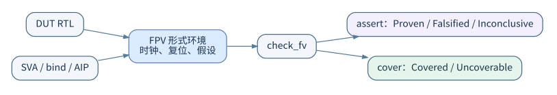
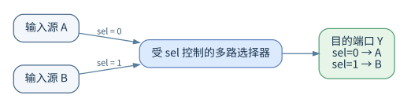
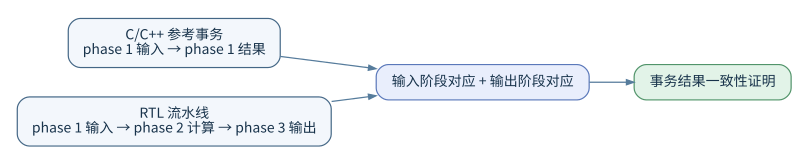
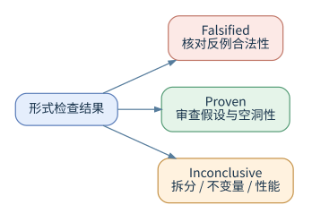

<a id="chapter-01"></a>


# 阅读指南

本手册从形式验证原理讲起，依次介绍 VC Formal 环境、SVA、通用命令和各类专用应用。软件文档基线为 **X-2025.06-SP1**。较短的条目在汇总表里比较，使用条件和原理放在表后展开；包含竖线的语法放在代码块中，完整的案例源码直接放在各篇正文里。

## 1. 内容组织

| 阅读阶段 | 内容 | 建议目标 |
| --- | --- | --- |
| 原理与模型 | 形式验证、平台、工程与结果 | 理解证明在什么前提下成立 |
| 语言与操作 | SVA、通用命令 | 独立建立一个完整验证工程 |
| 专用应用 | FPV 至 FLP / LPC | 按具体问题选择输入、目标和流程 |
| 查询与进阶 | 集合、AIP、分解、调试和验收 | 审查范围、分析困难和保存证据 |

初次使用时，先读原理、平台和 SVA，然后再对照计数器的正确版本与错误版本。有仿真经验的读者，应该重点核查 SVA 的采样、历史值和复位处理，而不是直接把仿真激励改写成形式假设。涉及 SoC 集成场景的读者，可以在掌握通用基础之后，按需阅读 CC、FRV、FXP 和低功耗等章节。

## 2. 分篇目录

| 文章 | 内容 |
| --- | --- |
| [形式验证](#chapter-02) | 状态模型、证明方法、断言责任和结论限制 |
| [VC Formal 平台与环境](#chapter-03) | 应用模式、编译、时钟复位和初始化 |
| [验证工程与结果解读](#chapter-04) | 规格分解、工程目录、反例和状态解释 |
| [SVA语法合集](#chapter-05) | 时序语法、采样函数、完整检查器与常见错误 |
| [通用命令详解](#chapter-06) | 按阶段分类的启动、环境、属性和运行命令 |
| [FPV](#chapter-07) | 手写属性、计数器与 FIFO 完整案例 |
| [AEP](#chapter-08) | 自动规则、生成条件、状态机检查及豁免 |
| [FXP](#chapter-09) | 未知值来源、观察点、传播与定位 |
| [CC](#chapter-10) | 连接规则、CSV、别名和连通性覆盖 |
| [FCA](#chapter-11) | 覆盖对象、数据库、不可达分析和排除结果 |
| [SEQ](#chapter-12) | 双设计编译、对应关系和不等价调试 |
| [FRV](#chapter-13) | 寄存器规格、自动断言、访问覆盖和桥接 |
| [FTA](#chapter-14) | 属性发现错误的能力、故障配置和数据库 |
| [FuSa](#chapter-15) | 故障激活、功能观察、安全检测和结果保存 |
| [FSV](#chapter-16) | 信息来源、目标、允许传播条件及黑盒风险 |
| [DPV](#chapter-17) | 参考计算、事务阶段、设计组合和证明运行 |
| [FLP LPC](#chapter-18) | 电源意图、低功耗连通性与隔离钳位 |
| [设计查询与集合](#chapter-19) | 对象类别、查询、集合运算和属性筛选 |
| [AIP与分解证明](#chapter-20) | 协议检查复用与子证明依赖 |
| [调试与证明性能](#chapter-21) | 约束冲突、反例、复杂度、抽象和资源 |
| [覆盖与验证验收](#chapter-22) | 规格覆盖、形式核心和交付证据 |
| [术语表与资料索引](#chapter-23) | 中英文概念和官方资料页码 |

每篇应用文章都把用途、输入、执行顺序、命令定义和案例放在一起介绍。共用的启动、编译、任务和资源控制，在通用命令一章集中详细说明，FPV 一章则另外保留核心属性命令的完整说明。如果需要按命令名检索，可以直接使用[命令逐项详解](命令逐项详解.md)，其中汇集了 200 个命令和应用的用法条目；同名命令在不同应用中可能有不同的参数，不能跨应用直接套用。

## 3. 代码与语法的读法

标有“保存为”的代码框给出完整的文件内容，连同文件列表、绑定文件和 Tcl 运行步骤，可以直接组成对应的案例。全书 16 篇文章共有 81 处完整源码框，覆盖 58 份源码和配置文件；同一个案例出现在不同文章中时，必要的代码会重复列出，方便单篇阅读。独立工程目录只是一个可编辑的副本，并不是阅读正文的必要前提。

命令的“语法”用尖括号表示需要替换的参数，用方括号表示可选项，用竖线表示可选的取值。它并不是可以直接照抄执行的脚本；后面给出的示例才是具体的调用形式。而 SVA 运算符中的竖线是语言本身的一部分，不能删除，也不能加反斜杠。所有包含这类字符的完整语法都保留在代码块中。

## 4. 资料基线和验证状态

本书对命令的解释依据所提供的 **VC Formal User Guide**（1,168 页）和 **VC Formal Quick Reference Guide**（34 页），各条目都保留来源页码。两份文件都对应 X-2025.06-SP1，但其中少数命令名称或参数拼写存在差异；相应条目会说明采用了哪一种定义，以及它的限制。当 User Guide 把部分命令的完整参数转交给 VC Static Platform 或 DPV 专用手册时，本书只解释在已提供资料中能够核实的用法，不自行臆造参数。

当前环境没有可授权执行的 VC Formal，**也没有运行工具进行编译或形式证明**。本书给出的预期结果、反例分析和代码检查，都不能替代真实工具的报告。那些需要寄存器规格、SFF/FDB、HECTOR 封装或 UPF 的专用流程，都保留了明确的配置要求；配套的 FPV 练习并不冒充相应原生应用得到的证明。

## 5. 阅读格式

[Markdown 合订本](合订本.md)便于搜索和编辑。插图提供了 SVG、PNG 和 DOT 三种工程文件，统一保存在 `插图/` 子目录下。原始参考 PDF 的权利归原作者和权利人所有；本手册不是 Synopsys 的官方译本。


<a id="chapter-02"></a>


# 形式验证：从数学原理到芯片工程

## 1. 为什么需要形式验证

仿真回答“设计在**本次输入激励**下如何运行”；形式验证尝试回答“对于**满足约束的所有合法输入行为**，设计是否始终符合指定规则”。两者不能互相替代。仿真擅长运行长时间的系统场景、软件交互和模拟接口；形式验证擅长证明局部控制逻辑、协议约束、寄存器访问，以及难以用随机激励命中的组合条件。当工具找到一段能够违反规则的输入与状态序列时，就会给出反例；如果建立了有效的数学证明，就会得出该属性在所建模型和假设条件下成立的结论。


**典型问题**包括：先进先出缓冲区是否会发生上溢和下溢；多路仲裁器能否同时授权两个请求方；复位后控制状态是否正确；握手请求能否在指定期限内得到响应；中断在清除之后是否会被错误地保持；重构后的控制逻辑是否与原设计一致；安全数据能否流向公开端口；未知值是否会泄漏到关键控制输出。

**不适合单独依赖形式验证的问题**包括：缺少可形式化规格说明的复杂系统行为、第三方模拟器件的模拟特性、未经正确建模的软件运行环境，以及因大量未经抽象处理的存储阵列或复杂数据处理而导致的计算难题。形式验证的结论取决于模型、约束、属性以及工具的求解状态。

## 2. 有限状态模型：形式验证究竟检查什么

把一个同步数字模块抽象为状态转移系统：

\[
\mathcal{M}=(S,I,T,S_0),\qquad s_{t+1}=T(s_t,i_t)
\]

其中，\(S\) 是所有寄存器状态的集合，\(I\) 是可用的输入，\(T\) 是由当前状态和输入决定下一状态的逻辑，\(S_0\) 是**允许的初始状态**。一个安全性属性可以写成：

\[
\forall t\ge0,\ \forall (s_0,i_0,\ldots,i_t)\in\text{LegalTraces},\quad P(s_t,i_t)=1.
\]

这里的 `LegalTraces` 极其重要，它由复位初始条件、输入协议假设、时钟关系和外部环境模型共同限定。属性被证明，并不代表“在任何想象中的物理条件下都正确”，而只代表它在**被建模的所有合法执行轨迹中**成立。如果约束不合理地排除了错误场景，那么证明结果就可能失去工程价值。

### 2.1 安全性与活性

| 类别 | 要表达的规则 | 示例 | 常见求解关注点 |
| --- | --- | --- | --- |
| 安全性（Safety） | 坏事情永不发生 | 缓冲区满时不得额外写入 | 是否存在有限长度反例 |
| 有界响应 | 事件必须在有限窗口响应 | 请求发生后 1～3 周期出现应答 | 计数范围、复位与连续请求 |
| 活性（Liveness） | 好事情终将发生 | 请求最终被服务 | 公平性、无限执行、死锁和活锁 |
| 可达性（Reachability） | 某状态是否能够到达 | 仲裁状态是否被访问 | 覆盖证明或可达见证 |
| 等价性（Equivalence） | 两个系统的可观测行为一致 | 改写后的设计与参考设计一致 | 输入、状态与延迟关系 |

安全性通常可以用一段有限反例来推翻，例如在某一拍出现非法写入；而活性失败则可能表现为无限等待，需要考虑环境是否最终允许继续前进。有界响应把完成期限写入规格，更容易得到有限反例，但不能为了降低求解难度，就擅自把无期限的要求改成任意的周期上限。

有界响应往往容易写成安全性检查；而无限期的“最终应答”，则涉及环境是否会持续提供条件。例如，如果从设备永远可以拒绝服务，那么主设备就无法保证最终完成。不要用本模块无法控制的假设来证明本模块“有活性”。

### 2.2 关于初始状态与复位

没有经过初始化的寄存器，在形式模型中可能代表任意的初始取值。`create_reset` 用于声明复位信号及其极性，`sim_run`、`sim_save_reset` 等命令用于建立并保存可供证明使用的初始化状态，但必须确认复位真正驱动到了目标寄存器，而不能假定声明命令后所有寄存器就自然变为零。复位后的第一拍、同步复位与异步复位、部分复位寄存器，都需要区别处理。参见《VC Formal User Guide》§4.11～4.13（约第 132～154 页）。

## 3. 工具如何找到反例或完成证明

### 3.1 可满足性求解与有界模型检查

对于最大展开深度 \(k\)，可构造：

\[
S_0(s_0) \wedge \bigwedge_{t=0}^{k-1}T(s_t,i_t,s_{t+1})
\wedge \bigvee_{t=0}^{k}\neg P(s_t,i_t).
\]

如果公式可满足，那么这组满足赋值就对应一条反例；如果不可满足，也只能表明在该展开深度内没有找到违反，**不能由此推出无限深度下已经证明**。有界模型检查（Bounded Model Checking，BMC）通常适合处理较短的缺陷路径。

### 3.2 数学归纳与增强不变量

归纳证明要求性质在初始时刻成立，并证明“如果假设性质对当前状态成立，那么它对下一状态也成立”。简单归纳可能因为包含不可达状态而失败，这时可以引入更强的不变量（例如缓冲区占用计数与读写指针之间的关系）。增加归纳深度并不必然能解决证明困难；关键在于性质和状态约束是否充分。

### 3.3 属性引导可达性与其他证明引擎

工业工具可以结合 SAT/SMT、归纳、插值、PDR/IC3、抽象和问题分解等多种方法；不同属性和设计结构的性能差异很大。VC Formal 实际的引擎组合和配置，由软件版本、应用模式、许可证和资源控制决定，不能把某个求解方法当作该工具唯一的实现。

### 3.4 抽象、分解与可能的误报

只保留某个属性所关心的逻辑集合，可以降低求解规模，这被称为影响锥（Cone of Influence，COI）约简。如果把乘法器、存储器或内部网络进一步抽象成不完全受原逻辑约束的变量，通常会形成更宽泛的行为集合，因此可能产生原始设计根本不可能出现的反例。遇到这种反例，应该检查被抽象的信号和约束，而不是直接修改 RTL。


## 4. 断言、假设与覆盖目标

| 角色 | 表达的责任 | 结果的含义 |
| --- | --- | --- |
| 断言 | 设计必须满足的规则 | 证明所有允许执行都符合规则，或提供反例 |
| 假设 | 环境保证的合法行为 | 限制引擎允许搜索的行为集合 |
| 覆盖 | 希望确认可发生的场景 | 找到至少一条见证路径，或分析其不可达性 |

这三种角色可以使用相近的 SVA 语法，但承担的逻辑责任完全不同。把断言改成假设，并不能修复设计，而只是排除所有违反该规则的执行；把断言改成覆盖，则只要求某一条执行符合规则，这时就不能再声称已经对全部行为进行了证明。

```systemverilog
// 外部协议确实要求请求期间输入数据有效，才可作为环境前提。
as_request_data: assume property (
    @(posedge clk) disable iff (!rst_n) req |-> valid_input);
// 队列占用计数是设计自身责任，不能把这条关系改成 assume。
ap_occupancy: assert property (
    @(posedge clk) disable iff (!rst_n) count <= DEPTH);
// 确认当前环境允许请求真正出现。
cp_request: cover property (
    @(posedge clk) disable iff (!rst_n) req);
```

如果假设请求永远不会出现，那么所有以请求为前件的响应规则都可能因为前提不成立而空洞地通过。触发覆盖能够揭示这类问题，但覆盖成功仍不足以证明输入假设全都合理：还需要审查请求重叠、背压、错误输入以及运行中复位等其他合法情况。有效的验证既要保留真实环境允许的行为，又要排除真实环境禁止的行为。

## 5. 结果的工程含义

| 状态 | 能得出的结论 | 不能得出的结论 | 后续动作 |
| --- | --- | --- | --- |
| Proven | 对当前模型、初始状态和假设已经证明 | 系统级规格自动正确 | 审查属性范围、前提和空洞性 |
| Falsified | 存在可触发该属性失败的候选反例 | 一定存在芯片功能缺陷 | 检查反例、假设、复位和抽象 |
| Inconclusive | 在当前资源、策略或时间内尚无明确结论 | 该属性正确或错误 | 缩小问题、调优、延长资源 |
| Covered | 找到了满足覆盖目标的路径 | 设计全部功能受到验证 | 检查路径是否真实且有意义 |
| Uncoverable | 在当前模型和约束下不可到达 | 目标在真实系统里也不可到达 | 检查约束与复位、用例定义 |
| Not run / Disabled | 属性未被验证 | 属性已通过验证 | 检查启用列表和任务配置 |

证明状态只对本次构造的数学模型有效。判断结果时，应该把设计版本、初始状态、输入前提、抽象设置和属性正文放在一起看。尤其是覆盖目标不可达的情况，它可能是设计的固有行为，也可能是环境约束限制了场景；而未完成则表示现有的时间和资源还不足以确定结果，不能归入已证明或已失败。

状态名称会因应用、版本和报告格式而略有变化。不能把“检查结束”、“没有失败条目”、“达到某个深度”直接写成“全部已证明”。工具输出还可能包括 `checking`、`unknown`、`waived` 等管理状态。参见 User Guide §7.1（第 247 页起）。

## 6. 与仿真、静态检查、ATPG、等价检查的区别

| 技术 | 主要目标 | 典型输入 | 典型输出 |
| --- | --- | --- | --- |
| RTL 仿真 | 在给定激励下观察行为 | Testbench、激励、RTL | 波形、断言失败、覆盖率 |
| 规则检查/静态检查 | 查找结构与编码问题 | RTL、规则集 | 报错或告警 |
| 属性形式验证 | 证明逻辑规则或找反例 | RTL、SVA、形式约束 | 证明、反例、未完成 |
| 等价检查 | 比较两个版本 | 参考与实现设计、对应关系 | 等价或差异证据 |
| ATPG | 为制造缺陷模型生成测试向量 | 网表、故障模型、扫描结构 | 测试图样、故障覆盖率 |
| MBIST | 在存储器上运行算法发现制造缺陷 | 存储宏、控制器、March 测试 | 测试结果、故障定位信息 |

这些方法相互补充，而不是彼此取代。仿真适合检查复杂的软件场景和真实激励，形式验证擅长系统地寻找属性反例，等价检查适合验证实现变换前后的一致性，制造测试向量则针对制造故障模型。选择方法时，先说明要排除的错误类型，再决定所需的输入和接受条件。

**特别说明：**形式验证和 ATPG 都使用逻辑求解技术，但两者的目标并不相同。RTL 断言证明不能替代制造测试；ATPG 的高故障覆盖率也不能证明功能协议正确。

## 7. 一个完整的思考例子：仲裁器

设计：两个请求 `req[1:0]`，输出授权 `gnt[1:0]`。初步规格：

1. 同一时刻最多有一个授权；
2. 未收到请求的端口不得得到授权；
3. 在持续请求且另一端口有公平竞争条件时，请求不会无限期饥饿；
4. 复位之后授权清零。

最先写的属性通常是：

```systemverilog
ap_no_double_grant: assert property (
  @(posedge clk) disable iff (!rst_n) $onehot0(gnt));
ap_grant_requires_request: assert property (
  @(posedge clk) disable iff (!rst_n) ((gnt & ~req) == 2'b00));
cp_contention: cover property (
  @(posedge clk) disable iff (!rst_n) req == 2'b11);
```

上面第二条**只适用于同周期请求—授权协议**；如果授权允许滞后一拍，就应该与 `$past(req)` 或挂起的请求记录相匹配。第三条用于防止所有验证都发生在“根本没有竞争”的场景。公平性属性必须考虑仲裁策略、请求是否持续、时钟是否运行以及端口能否响应，因此不能脱离协议，直接写出无条件的 `eventually`。

## 8. 从规格到验证的推荐过程

1. 阅读接口规格，列出模块能够保证的行为、外部必须保证的条件，以及需要排除的非法用法。
2. 把规则分成复位、功能安全性、进展性、交叉接口、异常处理和参数化条件。
3. 为每条规则编写便于阅读的自然语言说明、SVA 表达式、触发示例和应该失败的反例。
4. 建立时钟、复位、初始状态和必要的输入假设，不要提前把内部状态约束成预期的结果。
5. 检查属性是否生效，并利用覆盖目标验证关键的触发场景确实可达。
6. 证明安全性；记录未完成的原因；修改设计后回归全部属性。
7. 用版本化的 RTL、SVA、Tcl、日志、结果报告和豁免说明，组成可复现的结果包。

详见 [验证工程与结果解读](#chapter-04)。

## 9. 初学者常见误解

**“我有 100% 代码覆盖率，所以所有功能都正确。”** 代码覆盖率描述的是哪些代码结构被执行过，并不等同于正确性。**“模型只要能跑出 Proven 就代表覆盖完整。”** 属性可能遗漏了关键规格，或者触发条件不可达。**“形式验证不需要 Testbench。”** 虽然不必使用传统的仿真激励，仍然需要通过假设、状态初始化和环境模型来定义合法行为。**“加入假设后证明更快一定是好事。”** 如果假设屏蔽了关键场景，那么速度提高反而意味着可信度下降。**“每个未完成都表示工具有问题。”** 更多时候表示属性范围、运算规模、状态空间或外部环境模型仍然需要优化。

## 10. 本手册学习索引与参考依据

- SVA 系统教材：[SVA语法合集.md](#chapter-05)。
- 工具共性：[VC_Formal_平台与环境.md](#chapter-03)、[验证工程与结果解读.md](#chapter-04)。
- 首次动手：[FPV.md](#chapter-07)；示例源码和运行说明都包含在对应文档中。
- 实战进阶：[调试与证明性能.md](#chapter-21)、[覆盖与验证验收.md](#chapter-22)。
- 官方版本参考：用户提供的 *VC Formal User Guide*, X-2025.06-SP1，§1、§3、§4、§6、§7、§17、§18，以及同版本的 *VC Formal Quick Reference Guide*。版权属于 Synopsys；本文为独立撰写的中文学习教程，不是官方文件的逐页翻译。


<a id="chapter-03"></a>


# VC Formal 平台、环境与命令执行

## 1. 平台定位与基本结构

VC Formal 是 Synopsys 的形式验证平台，通过共同的编译、展开、属性管理、求解、报告和调试环境，为不同应用提供支持。它既能完成从传统 RTL 和约束出发的功能属性验证，也能完成自动提取问题、基于结构连接列表的检查、顺序等价分析、安全性分析等专用任务。


一个验证任务通常由六个部分组成：RTL 或参考模型；SVA/CSV/寄存器描述/故障模型等规格输入；时钟复位与环境假设；证明引擎与资源策略；反例及结果报告；必要时还需要 Verdi 图形调试。不同应用共用同一个 Tcl 外壳，但**应用模式、专用命令和输入数据类型并不统一**。

## 2. 应用名称与 Tcl 模式的区别

| 中文用途 | 文档中的应用名称 | Tcl 模式 | 专用资料 |
| --- | --- | --- | --- |
| 功能属性证明 | FPV | `FPV` | [FPV.md](#chapter-07) |
| 自动提取设计检查 | AEP | `AEP` | [AEP.md](#chapter-08) |
| 连通性 | CC | `CC` | [CC.md](#chapter-10) |
| 形式覆盖率分析 | FCA | `COV` | [FCA.md](#chapter-11) |
| 未知值传播 | FXP | `FXP` | [FXP.md](#chapter-09) |
| 顺序等价 | SEQ | `SEQ` | [SEQ.md](#chapter-12) |
| 寄存器验证 | FRV | `FRV` | [FRV.md](#chapter-13) |
| 测试平台分析 | FTA | `FTA`（通常由 FPV 会话切换） | [FTA.md](#chapter-14) |
| 功能安全 | FuSa | `FUSA` | [FuSa.md](#chapter-15) |
| 信息流安全 | FSV | `FSV` | [FSV.md](#chapter-16) |
| 数据路径对照 | DPV | `DPV` | [DPV.md](#chapter-17) |
| 低功耗连通性 | FLP/LPC | `CC` + 低功耗命令（该使用流程） | [FLP_LPC.md](#chapter-18) |

2025 年 9 月快速指南的 FCA 命令行示例使用 `set_fml_appmode FCA`，但同版本 1,168 页的 User Guide 在第 65、395、430 页明确展示的是 `COV`。本教程的 FCA 脚本首选 `COV`，启动后再用 `get_fml_appmode` 确认。User Guide 第 65 页明确指出，FTA 模式不应直接用 `vcf -fmode FTA` 启动，而应在 VC Formal 会话内用 `set_fml_appmode FTA`。这两处都必须与实际安装版本核对。

## 3. 环境准备

正式环境通常需要 Linux 主机、已安装的 VC Formal / VC Static 相关组件、相应的许可证，以及可用的 Verdi（只在需要图形调试时用到）。具体支持的平台、许可证名称、最低内存和批量计算系统，应以单位内部的安装说明及实际版本的安装指南为准，不能根据本文就推断许可证一定已经开通。

首先在终端确认：

```bash
which vcf
vcf -help
pwd
```

工具可以通过 `-f` 读取 Tcl 脚本。推荐在**项目根目录**下执行，这样源文件列表和日志的位置能保持一致：

```bash
vcf -f scripts/run_fpv.tcl -batch
vcf -f scripts/run_fpv.tcl -verdi
vcf -f scripts/run_fpv.tcl
```

典型的授权选项示例有 `-fml_elite`、`-fml_token`，只有在内部许可证策略支持且确有需要时才使用。实际提示和参数请用 `vcf -help` 查看，不要把 shell 指令原样写进 Tcl 脚本。

### 3.1 首次运行所需的全部文件

环境准备好后，可以先保存下面这个最小工程。本节给出 RTL、检查器、文件列表和 Tcl 的完整内容，后续章节再解释这些命令和属性的细节。

### 3.1.1 被验证的计数器 RTL

规格：复位后计数为零；使能时从 0 计到 9，然后回到 0；不使能时保持不变。RTL 文件只包含设计，不能把待验证的结论写进环境假设。

**保存为 `rtl/counter.sv`：**

<!-- source-begin: rtl/counter.sv -->

```systemverilog
module counter (
    input  logic       clk,
    input  logic       rst_n,
    input  logic       enable,
    output logic [3:0] count
);
  always_ff @(posedge clk or negedge rst_n) begin
    if (!rst_n)             count <= 4'd0;
    else if (enable) begin
      if (count == 4'd9)    count <= 4'd0;
      else                  count <= count + 4'd1;
    end
  end
endmodule
```

<!-- source-end -->

### 3.1.2 完整断言与绑定文件

`history_valid` 在复位后建立历史有效标志。`ap_range` 检查取值范围，`ap_hold` 检查保持，`ap_increment` 检查普通递增，`ap_wrap` 检查回绕；两条 `cover` 检查最高计数值和回绕场景是否会出现。末尾的 `bind` 把检查器接入同名的设计信号，不需要修改 RTL。

**保存为 `formal/counter_props.sv`：**

<!-- source-begin: formal/counter_props.sv -->

```systemverilog
module counter_props (
    input logic       clk, rst_n, enable,
    input logic [3:0] count
);
  logic history_valid;
  always_ff @(posedge clk or negedge rst_n)
    if (!rst_n) history_valid <= 1'b0;
    else        history_valid <= 1'b1;

  ap_range: assert property (@(posedge clk) disable iff (!rst_n)
      count <= 4'd9);

  ap_hold: assert property (@(posedge clk) disable iff (!rst_n)
      history_valid && $past(!enable) |-> count == $past(count));

  ap_increment: assert property (@(posedge clk) disable iff (!rst_n)
      history_valid && $past(enable && count < 4'd9)
      |-> count == $past(count) + 4'd1);

  ap_wrap: assert property (@(posedge clk) disable iff (!rst_n)
      history_valid && $past(enable && count == 4'd9)
      |-> count == 4'd0);

  cp_reaches_nine: cover property (@(posedge clk) disable iff (!rst_n)
      count == 4'd9);
  cp_wrap: cover property (@(posedge clk) disable iff (!rst_n)
      count == 4'd9 ##1 count == 4'd0);
endmodule

bind counter counter_props u_counter_props (.*);
```

<!-- source-end -->

### 3.1.3 编译文件列表

先列 RTL，再列包含 `bind` 的属性文件；路径是相对于运行 VC Formal 的工程根目录，而不是 Tcl 文件所在目录。

**保存为 `filelist_counter.f`：**

<!-- source-begin: filelist_counter.f -->

```text
./rtl/counter.sv
./formal/counter_props.sv
```

<!-- source-end -->

### 3.1.4 完整运行脚本

依次完成选择应用、读入设计与 SVA、定义时钟复位、保存初始状态、检查设置、列出属性并开始证明。初始化步骤需要在实际安装环境中核对复位状态，不能把声明复位等同于已经完成复位。

**保存为 `scripts/fpv_counter.tcl`：**

<!-- source-begin: scripts/fpv_counter.tcl -->

```tcl
# Run from the example project root with: vcf -f scripts/fpv_counter.tcl -batch
set_fml_appmode FPV
read_file -top counter -sva -format sverilog -vcs {-f filelist_counter.f}
create_clock clk -period 100
create_reset rst_n -sense low
sim_run -stable
sim_save_reset
check_fv_setup -block
report_fv_setup -list
report_fv -list
set_fml_var fml_max_time 1H
set_fml_var fml_max_memory 8GB
check_fv -block
report_fv -verbose
```

<!-- source-end -->

**运行命令（Bash）：**

```bash
# 在工程根目录执行
mkdir -p logs
set -o pipefail
vcf -f scripts/fpv_counter.tcl -batch 2>&1 | tee logs/fpv_counter.log
```

**结果解读。** 在初始状态正确的前提下，正确版预期会满足这些断言，并存在到达 9 和回绕的覆盖轨迹。这不是本次 VC Formal 的实际运行结果。这些断言分别覆盖范围、保持、普通递增和回绕；复位值以及运行中的重新复位，仍需结合初始化模型和专用复位检查，不能只凭范围属性成立就认定全部功能正确。

## 4. Tcl 外壳与帮助系统

```tcl
help
help report*
report_fv -help
man report_fv
view_help report_fv
report_fml_var fml_max_*
report_app_var *fml*
get_fml_appmode
```

`help` 和 `-help` 用来核对命令接受的选项；`man`、`view_help` 调出更长的帮助；`report_fml_var` 用来查询形式变量，`report_app_var` 用来查询应用变量。变量的归属不能随便互换：有的需要用 `set_fml_var`，有的需要用 `set_app_var`。**应优先查看安装版本的帮助，而不是直接照抄网上的脚本**。

## 5. 读入、编译与展开 RTL

下列两种做法是供学习的可选路径，通常只需选其中一种，不要在同一个工程里无条件地把 `read_file` 和 `analyze/elaborate` 都做一遍：

```tcl
# 一步读入并完成展开
read_file -top counter -sva -format sverilog -vcs {-f filelist.f}

# 或者分步编译
analyze -format sverilog -vcs {-f filelist.f}
elaborate counter -sva
```

`read_file` 负责读入源码并创建形式设计；`analyze` 负责 HDL 分析；`elaborate` 指定顶层并进行展开；`-sva` 表示需要处理断言；`-vcs` 允许传入 VCS 风格的选项；`-format` 应与 HDL 类型对应。`-f filelist.f` 指向采用相对路径的设计列表，必须处理宏、包含目录、编译顺序以及所需的库。参见 User Guide §4.2（第 118 页起）。

建议文件列表写为：

```text
+incdir+./rtl/include
./rtl/counter.sv
./formal/counter_properties.sv
```

有些示例直接把 `bind` 文件放在最后一行；当属性用到包中的定义或其他模块时，应按语言的编译要求安排顺序。遇到语法或层级错误，先确认源文件是否展开成功，再去分析证明失败的原因。

## 6. 时钟与复位定义

```tcl
create_clock clk -period 100
create_reset rst_n -sense low
set_constant test_mode -value 1'b0
set_change_at -clock clk -default
```

`create_clock` 声明逻辑时钟；这里的 `-period 100` 是形式时钟配置中的周期单位，不能不加说明就把它解释成目标芯片的物理时间；`create_reset` 描述复位信号及其有效电平；`set_constant` 对测试模式等稳定输入建模；`set_change_at` 用来约束输入可以在哪个时钟边沿或时序位置变化（多时钟设计要特别注意）。这些命令并不等同于在 STA 中完成时序约束，也不会自动描述完整的上电过程。

### 6.1 建立复位后的初始化状态

```tcl
sim_run -stable
sim_run 2 -clk clk
sim_save_reset
view_trace -reset
```

这只是操作顺序的示意，并不是对任何 DUT 都成立的复位过程。如果复位需要由外部拉高或拉低，就必须按真实的复位时序添加 `sim_force`、`sim_run` 等操作；保存前应该用 `sim_get` 或可视化追踪检查寄存器值。不要因为示例里写了两拍，就把所有芯片的复位过程都固定成两拍。参见 User Guide §4.13。

### 6.2 多时钟处理

对每一个独立时钟域，分别确定时钟定义、输入变化时机和复位释放规则。不要把异步时钟错误地设成固定整数倍的同步时钟，以换取快速的证明。对于异步握手，接口级假设应该来自 CDC 规格，而不是简单地假定采样不会遇到亚稳态。形式分析的二值逻辑模型一般不能直接证明模拟亚稳态的物理概率。

### 6.3 初始复位与运行中复位是不同任务

`create_reset` 和初始化仿真主要用于建立证明的起始状态。初始化完成后，复位信号在常见流程中会保持无效，让引擎从复位后的状态开始探索正常运行。如果规格还要求处理中途复位、某个电源域单独复位或复位交错，就必须另外建立允许这些事件的模型和属性，不能从一次初始化成功就推断全部复位行为都正确。

`disable iff` 的作用也不同：它描述在哪些时刻中止属性尝试，而不是在验证环境中生成复位波形。把所有重要属性都在复位期间禁用，只能避免用正常运行规则去检查复位过程，并没有证明复位值、释放顺序或未复位寄存器的有效性。来源：User Guide，第 138–154 页。

## 7. 检查准备状态

```tcl
report_blackbox
report_formal_setup
report_fv_complexity
check_fv_setup -block
report_fv_setup -list
```

核对无意中产生的黑盒、未定义实例、时钟/复位检测、设计复杂度以及组合反馈等结构问题。`check_fv_setup` 的结果属于**环境检查**，并不等于完成了功能证明。黑盒范围过大可能让断言看起来更容易通过，也可能产生不切实际的反例。

## 8. 属性管理、运行、输出

```tcl
# 下面是运行阶段的常用命令
report_fv -list
set_fml_var fml_max_time 2H
set_fml_var fml_max_memory 16GB
check_fv -block
report_fv
report_fv -verbose
```

`fvassert`、`fvassume`、`fvcover` 可以在 Tcl 环境中创建或改变属性的角色。复杂的时序 SVA 最好用 SV 文件管理，便于维护、测试和版本审查。属性状态需要按分组和任务核对；`check_fv` 未指定 `-block` 时可能以后台方式运行，输出报告时要确认检查已经完成。运行后的文字报告和反例都应随任务一起保存。

## 9. 计算资源与回归

```tcl
set_fml_var fml_effort default
set_fml_var fml_max_time 4H
set_fml_var fml_max_memory 32GB
report_fml_engines
report_fml_jobs
report_fml_hosts
# 如果本机与网格环境支持，可配置调度方式：
# set_grid_usage -type RSH=4
```

`fml_effort` 是预设的求解努力程度策略。更高的资源投入不能保证所有属性最终都能完成；过度并行也可能受到单机内存和许可证数量的限制。大型项目建议按模块、属性类别和运行目的来组织任务，并在同等硬件条件下比较优化效果。可选的 `fvlearn_config -local_dir rma_db` 适用于符合条件的回归加速流程，详见 User Guide §5。

## 10. 会话、图形调试与工作区

```tcl
save_session -session my_session
restore_session -session my_session
view_trace -property my_assertion
```

工具重启时可以执行 `vcf -restore -session my_session`。注意会话文件和相应的数据库是否一起备份；设计或约束改动后，不应直接把旧结果当作新版本的证明。Verdi 的属性列表、源代码定位、反例波形和结构视图可以用来追踪失败的属性；对于没有图形环境的服务器，可以先保留文字报告，再移交调试。

## 11. 命令出现错误时的检查顺序

1. 命令无法识别：先查看 `get_fml_appmode`、该应用的专属帮助以及版本差异，尤其注意 `COV`/`FCA`。
2. 找不到文件：确认执行目录，检查 `filelist.f` 中的相对路径、`+incdir+`、宏定义和权限。
3. 属性列表为空：检查 `-sva`、`bind` 编译是否生效、顶层以及属性是否被禁用。
4. 出现大量未知初始状态：重新确认复位/初始化的保存，避免直接把初始状态强制成期望结果。
5. 反例路径异常：检查外部假设、时钟关系、非法的环境输入以及黑盒。
6. 显示已证明却无法触发：补充 `cover`、空洞性分析和约束可满足性检查。
7. 证明超时：先缩小验证目标和影响锥，再调整引擎、内存和运行时限。

## 12. 官方资料索引

- User Guide §2 第 53～65 页：环境、启动与模式。
- §3 第 66～114 页：约束、属性、SVA 与属性管理。
- §4 第 115～170 页：编译、时钟、复位、初始状态和设计检查。
- §5～8 第 171～344 页：回归加速、运行控制、结果调试和工作区。
- Quick Reference Guide 第 1～34 页：各应用最常用命令的快速定位。**快速指南并不是完整的命令参考书。**


<a id="chapter-04"></a>


# 形式验证工程组织与结果解读

## 1. 从设计需求建立验证对象

建议为每条规则建立一行审查记录：`需求编号`、`自然语言规则`、`采样时钟`、`复位条件`、`触发条件`、`允许的延迟`、`输入假设`、`属性名称`、`覆盖见证`、`报告状态`、`评审人`。自然语言规则应该足够具体，让不熟悉 SVA 的设计工程师也能判断反例究竟违反了哪条规则。

例如，规则 **REQ-03：接受请求以后最迟在第 3 个时钟上升沿给出应答**，并不意味着 `req` 一变高就一定要出现 `ack`。首先要确认：请求是在 `req && ready` 时被接受的吗？请求允许撤回吗？`ack` 是脉冲还是电平？响应期间还能接受第二个请求吗？只有把这些定义明确之后，才能编写出正确的 SVA。

## 2. 推荐项目目录

```text
project/
├── rtl/                    # 待验证设计，不得含隐含形式假设
├── formal/
│   ├── properties.sv       # 断言、假设、覆盖目标
│   ├── bind.sv             # 可选的非侵入式绑定
│   └── waivers/            # 带原因、审核与到期条件的豁免
├── scripts/
│   ├── setup.tcl           # 通用编译、时钟、复位
│   ├── run_fpv.tcl         # 应用专属检查
│   └── filelist.f
├── reports/                # 文字和机器可读报告
├── sessions/               # 会话与可视化调试数据
└── README.md               # 软件版本、运行命令与结论
```

不要把运行日志和 RTL 混放在一起，也不要把可能含有许可证、客户路径或公司机密的整个工具工作目录提交到公开代码仓库。

## 3. 完整执行顺序


### 3.1 编译通过不代表环境正确

第一步执行 `read_file` 或 `analyze/elaborate`，核对顶层、模块实例、语言和参数值。第二步定义时钟和复位，并保存初始化状态。第三步运行 `report_blackbox` 和 `check_fv_setup`，确认没有意外的黑盒和关键错误。第四步查看属性的数量和类型；如果预期有 20 条断言，报告却只列出 3 条，就必须在开始求解之前排查清楚。

### 3.2 先验证假设，再验证 DUT

优先运行一些简单的覆盖目标，确认复位退出、请求出现、握手成功、缓冲区填满、缓冲区清空和错误条件都能触发。如果关键事件的覆盖目标不可达，就先检查假设是不是对输入限制过度。输入假设应该有规格作为依据；尤其不能为了得到 `Proven` 就把 DUT 的输出或内部状态直接约束为正确取值。

### 3.3 先短后长的证明计划

第一次运行用较短时间验证环境是否完整，并发现浅层的缺陷；第二次把剩余的难点属性按功能块分组，根据重要性分配时间、内存和计算节点；最后一次运行固定输入版本，并记录工具版本、命令和状态。这样既能及早发现工程错误，又能减少在错误环境里长时间求解的开销。

## 4. 读懂反例：逐周期定位

反例至少应该包含这些信息：属性触发周期、导致失败的周期、触发前的设计状态、相关的输入变化、reset 状态、接受信号以及相关时钟。检查时按顺序回答以下问题：

1. 是否处于允许的运行状态？复位是否已经结束，起始状态是否合理？
2. 是否违反接口对输入的要求？如果是，应该把它写成环境假设，还是当成 DUT 应当处理的非法输入？
3. 失败的确切周期是什么？`|->` 与 `|=>` 是否写反了？`$past` 是否在未初始化的时候被使用了？
4. 内部状态在这个周期之前是怎样变化的？是否出现 NBA 更新与 SVA 采样之间的时间差？
5. 是否因为人为加入抽象或黑盒而产生了不可行状态？
6. 到底是修改 RTL、修正规格描述，还是修改属性？必须区分清楚，并留下审查记录。

### 4.1 反例说明模板

```text
属性：AP_FIFO_NO_OVERFLOW
模块版本：rtl_commit=...
实际检查范围：posedge clk；disable iff(!rst_n)
失败位置：反例第 17 周期
输入：push=1, pop=0, full=1
状态：occupancy=8（DEPTH=8）
期望：不得接受写入，occupancy 保持 8
实际：occupancy 变为 9
处置：修复计数更新条件，并添加满状态覆盖目标
```

上面的代码块只是一个**假设性的教学反例**，并不是本手册实际运行 VC Formal 得到的结果。

## 5. 证明状态与报告编写

报告中必须给出属性的总数和分布，包括 `Proven`、`Falsified`、`Inconclusive`、`Covered`、`Uncoverable`、`Disabled`、`Waived` 及其他输出状态。针对每条断言，写清楚时钟、复位、有效前提和设计版本。`report_fv -list` 适合做整体浏览；`report_fv -verbose` 适合排查问题；对单条失败使用 `view_trace -property <name>`。`report_fv` 的字段会因应用和版本不同而有所差别，不能把多种状态硬压成“通过/失败”二选一。

### 5.1 “Proven” 与“覆盖完整”分别检查

强断言 `assert property(req |-> ack)` 被证明，但 `req` 从未出现过，结论仍然可能是空洞的。通常还需要独立的触发覆盖目标。验证完成时至少要检查：断言是否被启用，关键 antecedent 是否可达，是否存在相互矛盾的假设，证明是否覆盖了完整的设计范围，所有豁免是否都有审查依据。

### 5.2 为什么未完成不等于失败

`Inconclusive` 只说明当前的求解资源和方法不够用；原因可能是大整数运算、内部存储阵列、长时间的依赖关系，也可能是跨越多个控制状态或影响锥过大。应该尝试简化断言、拆分属性、建立合法的不变量和合理的抽象，而不是直接加一个让属性容易证明却不合理的假设。

## 6. 时钟、复位与环境建模审查

| 对象 | 必须核对的问题 | 常见错误 |
| --- | --- | --- |
| 主时钟 | 在哪一边沿更新或采样，是否有门控 | SVA 在错误的边沿采样 |
| 异步复位 | 生效极性和释放关系 | 在 `disable iff` 之外仍然使用非法的 `$past` |
| 多时钟 | 相位关系以及允许变化的时刻 | 错误地把异步时钟当成固定同步时钟 |
| 总线数据 | `valid && ready` 时数据何时稳定 | 把每一拍数据都假设为不变 |
| 存储器 | 上电初值与读写冲突的处理规则 | 强行把未初始化的读数据设为零 |
| 黑盒 | 哪些信号会变成任意值 | 意外掩盖了实现中的错误 |
| 测试端口 | 正常模式与测试模式的关系 | 为了便于证明而错误地强制测试端口 |

形式工具并不会自动知道板级时钟、电源启动顺序或软件配置过程。工程师应该把这些外部条件转换成可以审查的模型，并把“真实环境所保证的行为”和“希望设计满足的行为”分别写成假设和断言。对未初始化状态做额外固定，或者把输出当作输入来约束，都会缩小可以探索的行为范围。

## 7. 小型设计推荐的脚本骨架

```tcl
# 一条教学用途的 FPV 批量运行示例
set_fml_appmode FPV
read_file -top counter -sva -format sverilog -vcs {-f filelist.f}
create_clock clk -period 100
create_reset rst_n -sense low
sim_run -stable
sim_save_reset
check_fv_setup -block
report_fv -list
set_fml_var fml_max_time 1H
check_fv -block
report_fv -list
report_fv -verbose
```

**使用条件**：DUT 的初始状态在该复位配置下正确建立，路径从执行目录解析，属性确实已经编译；本节接下来会直接给出完整示例；实际使用时仍然需要补充适合目标设计的复位激励，并核对状态。如果缺少许可证，本示例只是对照文档整理出来的参考脚本，并不是已经执行成功的日志。

### 7.1 将骨架落实为完整计数器工程

上一段中的 `dut/filelist.f` 只是一个通用名称。下面给出实际顶层、文件列表和全部源码，作为结果解读练习的固定输入。

### 7.1.1 被验证的计数器 RTL

规格：复位后计数为零；使能时从 0 计到 9 后回到 0；没有使能时保持。RTL 文件只包含设计本身，不会把待验证的结论写成环境假设。

**保存为 `rtl/counter.sv`：**

<!-- source-begin: rtl/counter.sv -->

```systemverilog
module counter (
    input  logic       clk,
    input  logic       rst_n,
    input  logic       enable,
    output logic [3:0] count
);
  always_ff @(posedge clk or negedge rst_n) begin
    if (!rst_n)             count <= 4'd0;
    else if (enable) begin
      if (count == 4'd9)    count <= 4'd0;
      else                  count <= count + 4'd1;
    end
  end
endmodule
```

<!-- source-end -->

### 7.1.2 完整断言与绑定文件

`history_valid` 在复位后建立“历史有效”标志。`ap_range` 检查范围，`ap_hold` 检查保持，`ap_increment` 检查普通递增，`ap_wrap` 检查回绕；两条 `cover` 用来检查最高计数值和回绕场景是否能够出现。末尾的 `bind` 把检查器接入同名的设计信号，不需要修改 RTL。

**保存为 `formal/counter_props.sv`：**

<!-- source-begin: formal/counter_props.sv -->

```systemverilog
module counter_props (
    input logic       clk, rst_n, enable,
    input logic [3:0] count
);
  logic history_valid;
  always_ff @(posedge clk or negedge rst_n)
    if (!rst_n) history_valid <= 1'b0;
    else        history_valid <= 1'b1;

  ap_range: assert property (@(posedge clk) disable iff (!rst_n)
      count <= 4'd9);

  ap_hold: assert property (@(posedge clk) disable iff (!rst_n)
      history_valid && $past(!enable) |-> count == $past(count));

  ap_increment: assert property (@(posedge clk) disable iff (!rst_n)
      history_valid && $past(enable && count < 4'd9)
      |-> count == $past(count) + 4'd1);

  ap_wrap: assert property (@(posedge clk) disable iff (!rst_n)
      history_valid && $past(enable && count == 4'd9)
      |-> count == 4'd0);

  cp_reaches_nine: cover property (@(posedge clk) disable iff (!rst_n)
      count == 4'd9);
  cp_wrap: cover property (@(posedge clk) disable iff (!rst_n)
      count == 4'd9 ##1 count == 4'd0);
endmodule

bind counter counter_props u_counter_props (.*);
```

<!-- source-end -->

### 7.1.3 编译文件列表

先列出 RTL，再列出包含 `bind` 的属性文件；路径是相对于运行 VC Formal 的工程根目录，而不是 Tcl 文件所在的目录。

**保存为 `filelist_counter.f`：**

<!-- source-begin: filelist_counter.f -->

```text
./rtl/counter.sv
./formal/counter_props.sv
```

<!-- source-end -->

### 7.1.4 完整运行脚本

依次选择应用、读入设计和 SVA、定义时钟和复位、保存初始状态、检查设置、列出属性并开始证明。初始化步骤需要在实际安装环境中核对复位状态，不能把声明复位等同于已经完成复位。

**保存为 `scripts/fpv_counter.tcl`：**

<!-- source-begin: scripts/fpv_counter.tcl -->

```tcl
# Run from the example project root with: vcf -f scripts/fpv_counter.tcl -batch
set_fml_appmode FPV
read_file -top counter -sva -format sverilog -vcs {-f filelist_counter.f}
create_clock clk -period 100
create_reset rst_n -sense low
sim_run -stable
sim_save_reset
check_fv_setup -block
report_fv_setup -list
report_fv -list
set_fml_var fml_max_time 1H
set_fml_var fml_max_memory 8GB
check_fv -block
report_fv -verbose
```

<!-- source-end -->

**运行命令（Bash）：**

```bash
# 在工程根目录执行
mkdir -p logs
set -o pipefail
vcf -f scripts/fpv_counter.tcl -batch 2>&1 | tee logs/fpv_counter.log
```

**结果阅读。** 在初始状态正确的前提下，正确版本应当满足这些断言，并存在到达 9 和回绕的覆盖轨迹。这并不是本次 VC Formal 的实际运行结果。这些断言分别覆盖范围、保持、普通递增和回绕；复位值以及运行中重新复位的情况，仍然需要结合初始化模型和专门的复位检查，不能仅凭范围属性成立就认定全部功能都正确。

## 8. 状态回归和证明性能

相同的属性在不同的 RTL、SVA、时钟约束或工具版本下不应该直接比较结果。建议记录一份固定的 run manifest：源码校验值、文件列表、Tcl 参数、许可证环境、CPU 与内存资源、运行时间、属性状态汇总、工具报告路径。对于复杂设计，可以按功能分类建立任务：复位初始化、寄存器读写、主状态机、协议握手、数据通路和异常控制。

## 9. 验收条件建议

一个适合作为版本交付的形式验证结果包通常应该满足以下条件：所有必须检查的断言都明确列出；失败已经定位并评审；未完成的属性标注了后续验证措施；所有豁免都有理由和责任人；约束集合经过独立审查；关键触发条件有覆盖见证；代码、时钟、复位和工具版本都可以重现。这里的“验收”指的是项目的质量要求，并不是 VC Formal 某个按钮自动给出的最终结论。

详见 [调试与证明性能.md](#chapter-21) 及 [覆盖与验证验收.md](#chapter-22)。

## 10. 参考

*VC Formal User Guide*, X-2025.06-SP1，§3～8、§18～20；*Quick Reference Guide*，FPV 与各应用的运行及报告部分。


<a id="chapter-05"></a>


# SystemVerilog Assertions（SVA）完整中文教程

## 1. SVA 解决什么问题

SVA 是一组用 SystemVerilog 描述时间相关规则的语言结构。它不仅能检查单个信号是否为正确值，还能表达“请求以后数拍内必须应答”“在握手完成之前数据必须保持稳定”这类跨周期关系。SVA 既可以用于仿真，也可以在形式验证时由工具转化为逻辑属性。不过 SVA 本身并不会让环境自动合法，外部输入的要求仍然需要明确的假设和复位模型。


## 2. 先理解三种角色

```systemverilog
ap_safety: assert property (@(posedge clk) disable iff (!rst_n)
                            !(write && full && !read));
as_input:  assume property (@(posedge clk) disable iff (!rst_n)
                            req |-> input_valid);
cp_full:  cover  property (@(posedge clk) disable iff (!rst_n)
                            full);
```

`assert property` 定义需要被验证的设计责任；`assume property` 描述环境向设计提供的约束；`cover property` 则请求工具去寻找满足某条行为的输入轨迹。不要为了获得更多的 `Proven`，就把设计错误的结论改写成 `assume`。

## 3. 并发断言的时钟、采样与失效条件

### 3.1 标准结构

```systemverilog
property p_example;
  @(posedge clk) disable iff (!rst_n)
  trigger |-> ##[1:3] response;
endproperty

ap_example: assert property (p_example);
```

- `@(posedge clk)`：属性在时钟上升沿采样。
- `disable iff (!rst_n)`：复位低有效期间，关闭或中止该属性的活动求值。
- `trigger`：时序要求中的触发部分，称为前件（antecedent）。
- `|->`：重叠蕴含；后件从前件序列匹配结束的那个采样周期开始。
- `##[1:3] response`：允许在未来的第 1、2 或 3 个采样周期响应。

SVA 并发断言判断的是时钟事件采样到的值，通常看到的是 **NBA 非阻塞赋值更新之前**的值。因此，在 `always_ff @(posedge clk)` 中用非阻塞赋值更新的寄存器，其新值通常要到下一次采样沿才会被断言看到。检查“状态更新后”的规则时，往往需要 `|=>` 或 `$past`。

### 3.2 复位并不会自动清零采样函数的历史

`disable iff` 是属性的失效条件，不能把它理解成 `$past` 会自动替换成复位值。比如首次进入正常工作状态时，上一拍可能仍处于复位。如果规则依赖上一拍已经处于有效工作状态，就应该增加 `past_valid` 寄存器，或适当加上 `$past(rst_n)` 作为前提。

```systemverilog
logic past_valid;
always_ff @(posedge clk or negedge rst_n)
  if (!rst_n) past_valid <= 1'b0;
  else        past_valid <= 1'b1;

ap_hold: assert property (@(posedge clk) disable iff (!rst_n)
  past_valid && hold |-> data == $past(data));
```

上例中的 `past_valid` 为工具提供了可信的前一采样点。在不同时间点立即释放或断言复位时，异步 `disable iff` 与时钟采样的交互仍应按照 DUT 的实际复位语义来审查。

### 3.3 default clocking / default disable iff

```systemverilog
default clocking cb @(posedge clk); endclocking
default disable iff (!rst_n);

ap_onehot: assert property ($onehot0(grant));
```

它适用于同一时钟下的属性模块。对于多时钟或不同复位域，建议为每条关键属性显式指定时钟和失效条件，以免默认时钟覆盖到并不匹配的接口。

## 4. 重叠蕴含与非重叠蕴含

| 写法编号 | 后件起点 | 前件在第 5 拍成立时检查哪一拍 |
| --- | --- | --- |
| A：重叠蕴含 | 前件结束的同一拍 | 第 5 拍 |
| B：非重叠蕴含 | 前件结束后的下一拍 | 第 6 拍 |
| C：重叠后延迟两拍 | 从同一拍再计两拍 | 第 7 拍 |
| D：非重叠后延迟两拍 | 从下一拍再计两拍 | 第 8 拍 |

```systemverilog
// A：同拍；B：下一拍；C：两拍后；D：三拍后。
a |-> b
a |=> b
a |-> ##2 b
a |=> ##2 b
```

上表以单周期布尔前件 `a` 为例。重叠与否决定后件从哪里开始，再由后件自身的延迟决定实际的检查周期。因此非重叠蕴含后面再写两拍延迟，合计是前件结束后三拍，而不是两拍。对于长度大于一拍的前件，起点是前件**完成匹配的那一拍**，而不是前件开始的那一拍。

```systemverilog
// req 在第 5 拍、accept 在第 7 拍完成前件。
// ap_same 检查第 7 拍的 busy；ap_next 检查第 8 拍的 busy。
ap_same: assert property (@(posedge clk) disable iff (!rst_n)
    (req ##2 accept) |-> busy);
ap_next: assert property (@(posedge clk) disable iff (!rst_n)
    (req ##2 accept) |=> busy);
```

这里的简单单时钟布尔后件，可以用一拍显式延迟来改写非重叠蕴含。复杂的序列可能有多个结束匹配或空匹配，多时钟属性还有专门的时钟衔接规则，不能只凭符号外观机械替换。每条关键规则都应写清触发周期、前件结束周期和预计失败周期。

## 5. sequence 和 property 的职责

```systemverilog
sequence s_accept;
  valid && ready;
endsequence

sequence s_finish_within_3;
  ##[1:3] done;
endsequence

property p_finish;
  @(posedge clk) disable iff (!rst_n)
  s_accept |-> s_finish_within_3;
endproperty

ap_finish: assert property(p_finish);
```

`sequence` 描述如何匹配一个有限的时序片段；`property` 则组合时序规则、蕴含、停止和其他属性运算符。复杂的序列可以接受参数和局部变量，用于协议检测、延迟记录和数据关联。对于可重复使用的时序模式，建议起一个易读的名称。

## 6. 序列连接与延迟运算符

### 6.1 固定延迟 `##n`

```systemverilog
sequence s_two_cycles;
  a ##2 b;
endsequence
```

这要求 `a` 之后的第二个采样时刻 `b` 成立。`a ##0 b` 要求二者在同一采样时刻满足。当 `a` 是多周期序列时，`##n` 从 `a` 匹配结束的地方算起。

### 6.2 范围延迟 `##[m:n]`

```systemverilog
ap_ack_1_4: assert property (@(posedge clk) disable iff (!rst_n)
  $rose(req) |-> ##[1:4] ack);
```

`ack` 可以在第 1～4 拍的任一时刻满足。要注意**逐拍重新发起的并行检查**：如果 `req` 连续 4 拍为高，用 `req` 作为前件就会发起 4 条独立的响应义务。使用 `$rose(req)` 只表示检测上升沿，仍不一定等价于总线“接受请求”的定义。

### 6.3 连续重复 `[*]`

```systemverilog
// busy 必须持续 3 拍
ap_busy: assert property (@(posedge clk) disable iff (!rst_n)
  start |-> ##1 busy[*3]);

// ready 可以延迟出现，示意有界等待
ap_wait: assert property (@(posedge clk) disable iff (!rst_n)
  start |-> (!ready)[*0:3] ##1 ready);
```

`[*3]` 表示连续匹配 3 次；`[*1:4]` 表示连续匹配 1～4 次；`[*0:$]` 允许匹配零次且上限无限，与后续表达式连接时可能形成意料之外的空匹配。尤其是空匹配与蕴含组合时，必须通过覆盖和波形来验证真正在检查的规则。

### 6.4 非连续重复 `[=]` 与 goto 重复 `[->]`

```systemverilog
sequence s_three_events;
  event_a[=3];
endsequence

sequence s_second_hit;
  event_a[->2];
endsequence
```

`[=3]` 描述在一段匹配范围内出现三次非连续的 `event_a`，并可在最后一次命中后继续匹配非事件周期；`[->2]` 则直到第二次命中事件处结束。两者的区别会改变它们与后续 `##1 b` 的关系，对于复杂协议，建议先写一个小型波形测试来确认末端匹配的位置。

## 7. 序列的组合

### 7.1 `and` / `or` / `intersect`

```systemverilog
sequence s_both;
  (a ##1 b) and (c ##2 d);
endsequence

sequence s_one;
  (a ##1 b) or (a ##2 b);
endsequence

sequence s_same_window;
  (a ##1 b) intersect (c ##1 d);
endsequence
```

`and` 要求两个序列都匹配，但不要求它们的结束位置相同；`intersect` 要求匹配区间的开始和结束都一致。`or` 允许其中任意一个序列匹配。不要把序列的 `and` 与普通的同周期位运算 `&&` 混为一谈。

### 7.2 `throughout`：范围内持续成立

```systemverilog
ap_hold_during_busy: assert property (@(posedge clk) disable iff (!rst_n)
  start |-> (enable throughout (busy[*1:5] ##1 done)));
```

`expr throughout sequence` 表示布尔表达式在被匹配序列涉及的每一个采样位置都保持为真。对于简单的请求保持协议，通常用 `req && !ack |=> req` 更直接，也更容易审查。

### 7.3 `within`：一个时序片段落在另一个片段范围内

```systemverilog
sequence s_short;
  a ##1 b;
endsequence
sequence s_outer;
  start ##[1:5] stop;
endsequence
sequence s_inside;
  s_short within s_outer;
endsequence
```

`within` 可以表达一个事件序列完整地发生在一个更大序列的匹配区间之内。涉及可变时长时，要特别警惕匹配歧义。可以用工具的 `cover` 检查预期的代表性路径。

### 7.4 `first_match`

```systemverilog
sequence s_first_ack;
  first_match(##[1:8] ack);
endsequence
```

它用于从候选匹配中选取首次匹配，减少后续序列对不同匹配长度的歧义。并不是所有需要“最早应答”的规则都要用 `first_match`；如果只要求区间内任意一次应答，那么直接用范围延迟更清楚。

## 8. 属性运算符：时间上的持续和终止

### 8.1 `until` 与 `until_with`

```systemverilog
ap_keep_valid: assert property (@(posedge clk) disable iff (!rst_n)
  req |-> (valid until_with ack));
```

`until` 不要求条件在终止条件发生的那个周期仍然成立；`until_with` 则要求在终止周期也成立。弱形式可能不要求终止条件真的出现，因此如果要求“必须最终完成”，就还需要强形式，或独立的有界完成检查。

### 8.2 `strong` 与 `weak`

```systemverilog
ap_eventual: assert property (@(posedge clk) disable iff (!rst_n)
  req |-> strong(##[1:$] ack));
```

`strong` 表示时序匹配最终必须结束（具体能否证明，取决于形式应用、活性支持和公平性）；`weak` 则允许在有限轨迹或无限未完成等场景下作宽松解释。无条件的无限等待往往难以处理，实际项目中应先考虑规范能否给出合理的最大响应延迟。强活性属性通常需要假设外部持续提供时钟和资源。

### 8.3 `accept_on` / `reject_on`

属性可以在规定事件发生时被提前接受或拒绝。例如，一次事务在取消信号到来后不再要求原始应答，但是否“取消即成功”必须符合协议，而不能只是为了回避失败。`disable iff` 通常用于复位；`accept_on` 可用于协议意义上的正常取消；`reject_on` 可用于协议明确规定的提前失败条件。两者都与采样时刻有关，项目需要按工具的实际实现来验证。

## 9. 常用采样函数

| 函数 | 含义 | 典型用途 | 容易忽略的地方 |
| --- | --- | --- | --- |
| `$past(expr, n)` | 读取前 n 次采样的值 | 下一周期状态关系 | 起始历史值未定义 |
| `$rose(expr)` | 检测从非真到真的变化 | 捕获请求新事务 | 不等同于 `req && ready` |
| `$fell(expr)` | 检测从真到非真的变化 | 撤销请求 | 异步与 X 变化要谨慎 |
| `$stable(expr)` | 当前值与上一采样相同 | 等待期间数据保持 | 初始样本的比较问题 |
| `$changed(expr)` | 与上一采样不同 | 寻找状态翻转 | 重复周期持续匹配 |
| `$isunknown(expr)` | 表达式包含 X 或 Z | 仿真与 X 检查 | 二值形式模型解释可不同 |
| `$onehot(expr)` | 恰有一位为 1 | 必须存在且唯一授权 | 空闲时全零会失败 |
| `$onehot0(expr)` | 最多一位为 1 | 允许空闲的授权 | 不能保证至少有一位 |
| `$countones(expr)` | 统计为 1 的位数 | 配额/令牌检查 | 大位宽求解可能昂贵 |
| `$initstate` | 初始时间检测 | 初始化相关规则 | 工具、上下文支持需核对 |

### 9.1 `$past` 的正确使用

```systemverilog
ap_count_inc: assert property (@(posedge clk) disable iff (!rst_n)
  past_valid && $past(inc && !clear)
    |-> count == $past(count) + 1'b1);
```

这是在**当前采样周期**检查上一周期已经满足加一条件之后的寄存器值。如果计数器会饱和或回绕，还必须补上相应的前提。需要特别确认 `past_valid` 的第一个有效周期与设计运行的时序一致。

### 9.2 `$stable` 的常见错误

对 `valid && !ready |=> $stable(data)` 的解释，要看接口在下一拍是否仍然保持 `valid`。如果数据在 `valid && ready` 发生后的下一拍可以自由变化，那么这个规则就可能过于严格。更常用也更直观的条件是：

```systemverilog
ap_stable_when_stalled: assert property (@(posedge clk) disable iff (!rst_n)
  valid && !ready |=> valid && $stable(data));
```

这个写法要求：上一拍未被接受的传输，下一拍仍然保持 `valid` 和数据，这恰好符合许多 ready/valid 接口的要求。即使在下一拍被接受，也不改变“采样到的当前数据仍应保持”的要求。

## 10. 立即断言和并发断言的区别

```systemverilog
always_comb begin
  assert (!(grant[0] && grant[1]))
    else $error("two simultaneous grants");
end

ap_grant: assert property (@(posedge clk) disable iff (!rst_n)
  $onehot0(grant));
```

立即断言在过程执行时检查瞬时条件，可能受组合逻辑调度次序、暂态变化和 X 值的影响；并发断言则按事件采样，便于表达时序关系。在形式验证中，要遵循该工具对即时/延迟断言支持的说明，不能把所有仿真调试语句都当成能被形式引擎直接证明的属性。

## 11. 属性局部变量、`let` 和参数化

### 11.1 `let`：抽象复杂布尔条件

```systemverilog
let accepted(v, r) = (v && r);

ap_no_drop: assert property (@(posedge clk) disable iff (!rst_n)
  accepted(valid, ready) |-> !error);
```

`let` 表达式可以复用，能减少同一接口条件在几十条属性中被不同工程师写出细微差异的情况。是否使用 `let`，取决于编译器的支持情况。

### 11.2 sequence 局部变量：关联请求与响应数据

```systemverilog
property p_data_return;
  logic [7:0] saved_id;
  @(posedge clk) disable iff (!rst_n)
    (req, saved_id = req_id) |-> ##[1:4]
      (rsp && rsp_id == saved_id);
endproperty
ap_data_return: assert property (p_data_return);
```

这个属性为**每一次匹配的请求**保存其标识，并要求在窗口内匹配到应答。如果允许多个并发请求且同一标识会被重复使用，仍需根据协议处理事务编号、队列深度、重排规则和独立超时。局部变量并不是在 RTL 中真的增加了寄存器，工具可能会为断言引入匹配状态，过于复杂的动态序列会增加形式求解的成本。

### 11.3 参数化属性

```systemverilog
module ready_valid_checker #(
  parameter int DATA_W = 32,
  parameter int RESP_MAX = 8
) (
  input logic clk, rst_n, valid, ready,
  input logic [DATA_W-1:0] data
);
  ap_stall: assert property (@(posedge clk) disable iff(!rst_n)
    valid && !ready |=> valid && $stable(data));
  cp_transfer: cover property (@(posedge clk) disable iff(!rst_n)
    valid && ready);
endmodule
```

参数化断言适合在多个实例中复用；但如果像 `RESP_MAX` 这样的参数在属性中用作常量延迟，就必须遵守工具对常量表达式的要求。

## 12. `bind`：无需改动设计源码注入 SVA

```systemverilog
module counter_checker (
  input logic clk, rst_n, inc,
  input logic [3:0] count
);
  ap_range: assert property (@(posedge clk) disable iff(!rst_n)
    count <= 4'd9);
  cp_full: cover property (@(posedge clk) disable iff(!rst_n)
    count == 4'd9);
endmodule

bind counter counter_checker u_checker (
  .clk(clk), .rst_n(rst_n), .inc(inc), .count(count)
);
```

`bind` 在指定的设计模块或实例上附加检查器，不必改动交付的 RTL。但要确保端口名与被绑定模块一致、检查器的编译顺序正确，并且在顶层编译时开启断言支持（例如相应流程中的 `-sva`）。**不要在形式测试文件里用 `assign` 强行驱动 DUT 的内部状态，以此代替外部约束**。

## 13. 常见系统级断言模板

### 13.1 复位值

```systemverilog
ap_reset_state: assert property (@(posedge clk)
  !rst_n |-> state == IDLE);
```

这个示例适用于这样的协议模型：复位在该采样时钟上足够早地生效，且状态在这一采样点应已为 `IDLE`。如果同步复位要到 `posedge clk` 的 NBA 才生效，就应改成正确的下一拍检查；异步复位则应另外确认其有效瞬间与采样要求。

### 13.2 一热与互斥

```systemverilog
ap_mutex: assert property (@(posedge clk) disable iff(!rst_n)
  $onehot0(grant));
ap_one_grant_when_pending: assert property (@(posedge clk) disable iff(!rst_n)
  pending |-> $onehot(grant));
```

第二条只适用于协议要求“只要有请求就必须立刻授权”的情况，否则应改成有界的最终授权，并定义公平条件。

### 13.3 请求—应答

```systemverilog
ap_ack: assert property (@(posedge clk) disable iff(!rst_n)
  (req && accept) |-> ##[1:3] ack);
cp_req: cover property (@(posedge clk) disable iff(!rst_n)
  req && accept);
```

这个写法有一个明确的受理事件；如果 `ack` 可能与受理同周期，就把窗口改成 `##[0:3]`。如果协议允许接受多个请求，就需要采用事务关联检查。

### 13.4 背压期间保持

```systemverilog
ap_hold: assert property (@(posedge clk) disable iff(!rst_n)
  valid && !ready |=> valid && $stable(payload));
```

对于标准的 ready/valid 流控制，后一拍 `ready` 可以变为 1，此时仍需要在握手时提供原来的 `payload`。

### 13.5 FIFO 不上溢、不下溢与计数范围

```systemverilog
ap_depth: assert property (@(posedge clk) disable iff(!rst_n)
  occupancy <= DEPTH);
ap_no_empty_pop: assert property (@(posedge clk) disable iff(!rst_n)
  pop_accept |-> !empty);
ap_no_full_push: assert property (@(posedge clk) disable iff(!rst_n)
  push_accept |-> (!full || pop_accept));
```

这里假定 FIFO 允许在满状态下同时读写（具体要看实现），`push_accept/pop_accept` 是**已接受的操作**，而不是原始请求。如果 `push` 是请求而硬件可以拒绝，那么 `push && full` 并不一定就是错误。计数器溢出的检查应与接受操作和旁路条件保持一致。

### 13.6 超时与重试

```systemverilog
ap_timeout: assert property (@(posedge clk) disable iff(!rst_n)
  launch |-> ##[1:8] (done || timeout));
```

这个例子只保证在第 1～8 拍的某一拍能看到完成或超时，并不保证两者互斥；如果协议规定两者互斥，就再增加一条 `!(done && timeout)` 断言。

### 13.7 有限状态机状态合法性

```systemverilog
ap_state_legal: assert property (@(posedge clk) disable iff(!rst_n)
  state inside {ST_IDLE, ST_REQ, ST_WAIT, ST_DONE});
```

`inside` 中的常量值必须与 RTL 一致。枚举类型有时可以采用更清晰的编码检查；这个属性只能证明取值合法，不能证明所有状态转移都符合协议。

### 13.8 安全权限控制

```systemverilog
ap_secure_write: assert property (@(posedge clk) disable iff(!rst_n)
  write_accept && secure_reg_sel |-> privileged);
```

还需要检查非法请求是否被阻止、读路径是否泄漏，以及复位后的权限状态。单条写权限断言并不代表已经证明了不存在信息泄漏。

## 14. 空洞性、覆盖目标与不恰当假设

```systemverilog
ap_req_ack: assert property (@(posedge clk) disable iff(!rst_n)
  req |-> ##[1:3] ack);
cp_req_seen: cover property (@(posedge clk) disable iff(!rst_n)
  req);
cp_req_ack: cover property (@(posedge clk) disable iff(!rst_n)
  req ##[1:3] ack);
```

反例：如果在其他文件里写了 `assume property(!req)`，`ap_req_ack` 可能很轻松就被证明，但 `cp_req_seen` 却不可达。**验证环境既需要让合法的关键场景可达，又需要排除真实接口所禁止的输入行为。**

工程中建议同时维护三类检查：设计断言、环境前提的注释与审查、关键规格场景的覆盖。形式覆盖与仿真覆盖不是同一个概念，应分别分析。

## 15. 常见错误及修正方法

| 错误类别 | 直接后果 | 修正方向 |
| --- | --- | --- |
| 同拍与下一拍混淆 | 检查过早或过晚 | 先画采样周期，再选蕴含形式 |
| 非重叠后重复计算延迟 | 比规格多等待一拍 | 以完整前件结束时刻为零点 |
| 无效历史值 | 首拍错误失败或错误通过 | 建立历史有效标志 |
| 无界弱等待 | 未表达必须最终响应 | 使用有界响应或明确强活性 |
| 前件从未触发 | 属性空洞通过 | 添加触发和完成覆盖目标 |
| 接收方始终就绪假设 | 屏蔽背压缺陷 | 只保留真实协议前提 |
| 一热规则不允许全零 | 合法空闲状态失败 | 区分恰好一个与最多一个 |
| 把设计责任写成假设 | 直接排除了错误状态 | 对设计责任使用断言 |
| 用复位禁用代替复位验证 | 复位值从未被检查 | 分别检查初始化与复位行为 |
| 以一次完成覆盖代替进展性 | 遗漏永久等待请求 | 对每次合法请求检查完成 |

**先把时间关系写正确。** 下一拍应答与两拍后应答应使用不同的序列。下面这些属性都显式给出了时钟和复位，其中第二条在简单布尔情形下等价于第一条；第三条要求两拍后响应，而不是三拍后响应。

```systemverilog
ap_next_1: assert property (@(posedge clk) disable iff (!rst_n)
    req |=> ack);
ap_next_2: assert property (@(posedge clk) disable iff (!rst_n)
    req |-> ##1 ack);
ap_two_cycles: assert property (@(posedge clk) disable iff (!rst_n)
    req |-> ##2 ack);
```

**历史值与复位要分别处理。** `$past(data)` 读取的是过去采样点的值，`disable iff` 只会中止属性尝试，并不会自动把所有历史采样都变成期望值。需要一拍历史时，可以设置复位后才拉高的 `past_valid`；需要多拍历史时，有效标志也要覆盖足够长的历史窗口。运行中能否再次复位，应与工具对初始复位的处理区分开来。

```systemverilog
logic past_valid;
always_ff @(posedge clk or negedge rst_n)
  if (!rst_n) past_valid <= 1'b0;
  else        past_valid <= 1'b1;

ap_hold_when_stalled: assert property (
    @(posedge clk) disable iff (!rst_n)
    past_valid && $past(valid && !ready)
    |-> valid && $stable(data));
```

**通过必须建立在合适的触发场景上。** 不能把 `ready` 固定为 1 之后就声称已经验证了背压，也不能把计数范围直接写成假设后再去证明同一个范围。对于允许空闲的授权向量，应检查最多只有一位有效；覆盖目标分别确认请求会出现、以及一次完整事务可以发生，但不能代替每次请求的完成断言。

```systemverilog
ap_grant_exclusive: assert property (
    @(posedge clk) disable iff (!rst_n) $onehot0(grant));
ap_response_deadline: assert property (
    @(posedge clk) disable iff (!rst_n) req |-> ##[1:3] ack);
cp_request: cover property (
    @(posedge clk) disable iff (!rst_n) req);
cp_transaction: cover property (
    @(posedge clk) disable iff (!rst_n) req ##[1:3] ack);
```

**无限等待需要明确的活性要求。** 不应把带无界延迟的弱序列直接解释成“最终一定应答”。真实规格有超时上限时，就用有界窗口；没有上限却又要求最终完成时，就需要强活性表达以及可解释的环境公平性。下面这个写法要求存在一个有限的匹配终点，但仍要核对所用工具对相应活性形式的支持，不能为了证明方便就随意增加“外部必然响应”的假设。

```systemverilog
ap_eventual_response: assert property (
    @(posedge clk) disable iff (!rst_n)
    req |-> strong(##[0:$] ack));
```

## 16. 多时钟属性、X 值与复杂语法的限制

多时钟属性在 SystemVerilog 标准中有专门的采样与序列连接规则，不能简单地把两种时钟事件放进单时钟模板。不同的 EDA 引擎对多时钟交叉属性的支持可能有限；具体限制可参考 VC Formal User Guide §3.9。跨时钟同步器、握手和异步 FIFO 通常需要分别定义每个时钟域的责任，以及跨时钟的数据一致性。

`$isunknown` 在四值仿真中很直观，但传统形式证明的二值布尔编码可能与仿真中的 X 传播语义不同；检查 RTL 中的 X 传播风险，更适合配合 VC Formal FXP 和明确的注入/观察模型。对于写有 `casex`、`casez`、`unique case` 的 RTL，还应结合综合与仿真对 X 的不同处理方式来审查。

## 17. 完整示例：有界计数器及 VC Formal 工程

前面的短代码块用于解释单个语法；本节则给出可以保存成文件的完整设计、检查器、编译列表和 Tcl。代码与 FPV 章的计数器案例保持一致。

### 17.1 被验证的计数器 RTL

规格：复位后计数为零；使能时从 0 计到 9 后回到 0；没有使能时保持不变。RTL 文件只包含设计，不把待验证的结论写成环境假设。

**保存为 `rtl/counter.sv`：**

<!-- source-begin: rtl/counter.sv -->

```systemverilog
module counter (
    input  logic       clk,
    input  logic       rst_n,
    input  logic       enable,
    output logic [3:0] count
);
  always_ff @(posedge clk or negedge rst_n) begin
    if (!rst_n)             count <= 4'd0;
    else if (enable) begin
      if (count == 4'd9)    count <= 4'd0;
      else                  count <= count + 4'd1;
    end
  end
endmodule
```

<!-- source-end -->

### 17.2 完整断言与绑定文件

`history_valid` 在复位后建立历史有效标志。`ap_range` 检查范围，`ap_hold` 检查保持，`ap_increment` 检查普通递增，`ap_wrap` 检查回绕；两条 `cover` 检查最高计数值和回绕场景是否能够出现。末尾的 `bind` 把检查器接入同名的设计信号，不需要修改 RTL。

**保存为 `formal/counter_props.sv`：**

<!-- source-begin: formal/counter_props.sv -->

```systemverilog
module counter_props (
    input logic       clk, rst_n, enable,
    input logic [3:0] count
);
  logic history_valid;
  always_ff @(posedge clk or negedge rst_n)
    if (!rst_n) history_valid <= 1'b0;
    else        history_valid <= 1'b1;

  ap_range: assert property (@(posedge clk) disable iff (!rst_n)
      count <= 4'd9);

  ap_hold: assert property (@(posedge clk) disable iff (!rst_n)
      history_valid && $past(!enable) |-> count == $past(count));

  ap_increment: assert property (@(posedge clk) disable iff (!rst_n)
      history_valid && $past(enable && count < 4'd9)
      |-> count == $past(count) + 4'd1);

  ap_wrap: assert property (@(posedge clk) disable iff (!rst_n)
      history_valid && $past(enable && count == 4'd9)
      |-> count == 4'd0);

  cp_reaches_nine: cover property (@(posedge clk) disable iff (!rst_n)
      count == 4'd9);
  cp_wrap: cover property (@(posedge clk) disable iff (!rst_n)
      count == 4'd9 ##1 count == 4'd0);
endmodule

bind counter counter_props u_counter_props (.*);
```

<!-- source-end -->

### 17.3 编译文件列表

先列 RTL，再列包含 `bind` 的属性文件；这里的路径相对于运行 VC Formal 的工程根目录，而不是 Tcl 文件所在的目录。

**保存为 `filelist_counter.f`：**

<!-- source-begin: filelist_counter.f -->

```text
./rtl/counter.sv
./formal/counter_props.sv
```

<!-- source-end -->

### 17.4 完整运行脚本

依次选择应用、读入设计与 SVA、定义时钟和复位、保存初始状态、检查设置、列出属性并开始证明。初始化步骤需要在实际安装环境中核对复位状态，不能把声明复位等同于已经完成复位。

**保存为 `scripts/fpv_counter.tcl`：**

<!-- source-begin: scripts/fpv_counter.tcl -->

```tcl
# Run from the example project root with: vcf -f scripts/fpv_counter.tcl -batch
set_fml_appmode FPV
read_file -top counter -sva -format sverilog -vcs {-f filelist_counter.f}
create_clock clk -period 100
create_reset rst_n -sense low
sim_run -stable
sim_save_reset
check_fv_setup -block
report_fv_setup -list
report_fv -list
set_fml_var fml_max_time 1H
set_fml_var fml_max_memory 8GB
check_fv -block
report_fv -verbose
```

<!-- source-end -->

**运行命令（Bash）：**

```bash
# 在工程根目录执行
mkdir -p logs
set -o pipefail
vcf -f scripts/fpv_counter.tcl -batch 2>&1 | tee logs/fpv_counter.log
```

**结果阅读。** 在初始状态正确的前提下，正确版预期满足这些断言，并存在到达 9 和回绕的覆盖轨迹。这不是本次 VC Formal 的实际运行结果。这些断言分别覆盖范围、保持、普通递增和回绕；复位值以及运行中的重新复位仍需结合初始化模型和专用复位检查，不能仅凭范围属性成立就认定全部功能正确。

## 18. 工程练习（建议自行运行与审查）

1. 把计数器回绕阈值从 9 改为 10，观察 `ap_range` 的反例；再把阈值改回后重复证明。
2. 删除 `history_valid`，分析首个有效采样点上 `$past` 规则的差异。
3. 为一个 2 输入仲裁器编写三类属性：互斥、授权必须对应请求、竞争覆盖。
4. 为 ready/valid 通道编写背压保持、握手可达和连续握手覆盖。
5. 故意加入约束 `assume(!enable)`，观察覆盖目标为什么无法满足，然后撤销该约束。

本章第 17 节已经直接列出了练习所需的 RTL、SVA、文件列表和完整运行脚本；独立的源码文件只是为了方便编辑，并不构成本章阅读的前置要求。

## 19. 语法检索与选择

| 类别 | 语法或函数 | 适合描述的问题 |
| --- | --- | --- |
| 角色 | `assert`、`assume`、`cover` | 设计责任、环境前提和可达性 |
| 采样 | `@`、`default clocking` | 用哪个事件观察信号 |
| 失效 | `disable iff` | 哪些条件中止当前检查尝试 |
| 蕴含 | 重叠、非重叠 | 前件完成后何时开始后件 |
| 延迟 | `##n`、范围延迟 | 事件间的周期关系 |
| 重复 | 连续、非连续、goto | 事件需要重复多少次 |
| 序列组合 | `and`、`or`、`intersect` | 多段行为的组合及结束时刻 |
| 区间关系 | `throughout`、`within` | 条件持续或片段包含 |
| 匹配控制 | `first_match` | 选择首个完成匹配 |
| 时间终止 | `until`、`until_with` | 终止事件发生前后的条件保持 |
| 强弱要求 | `strong`、`weak` | 是否必须存在完成的匹配 |
| 历史采样 | `$past`、`$rose`、`$fell` | 过去值与边沿变化 |
| 稳定和互斥 | `$stable`、`$onehot0`、`$onehot` | 数据保持与授权关系 |
| 检查器复用 | `property`、`sequence`、`let`、`bind` | 参数化并接入多个实例 |

语法选择应从规格问题出发，而不是先挑一个看起来简短的运算符。例如，“忙期间数据不变”要明确忙区间是否包含最后一拍；“接到请求后响应”要明确请求是电平、脉冲还是握手接受事件；“响应对应请求”还必须说明是否允许多个未完成事务。下面集中列出容易在表格中被误拆的运算符和序列写法，全部保持原字符，可以直接复制到合适的序列或属性上下文中。

```systemverilog
a |-> b
a |=> b
a ##2 b
a ##[1:3] b
a[*3]
a[=3]
a[->3]
```

这些是语法片段，不是一个完整的模块，也不能在顶层源码中连续粘贴后直接编译。带时钟、复位、绑定和运行脚本的完整示例见本章第 17 节。

## 20. 参考与责任界定

本教程独立编写，参照了 IEEE 1800 中常见的语法概念，以及用户提供的 *VC Formal User Guide* X-2025.06-SP1 §3.7～3.9 和附录 B。工具的具体支持范围、强活性处理、采样行为和优化由正式安装版本决定。本文示例用于教学，并未声称已经在用户实际的 VC Formal 授权环境中运行过全部代码。


<a id="chapter-06"></a>


# VC Formal 命令分类与通用命令详解

## 1. 怎样阅读命令语法

命令不能只靠记名称，还要同时理解它的执行阶段、接受的对象、对验证环境的修改以及返回的结果。启动命令在操作系统终端执行；会话命令由 VC Formal 的 Tcl 解释器执行；SVA 属性由编译器处理；DPV 的参考函数则属于 C/C++ 源码。把这些层次分清，才能判断某个报错发生在启动、编译、环境设置还是证明阶段。

| 标记 | 含义 | 使用要求 |
| --- | --- | --- |
| 尖括号参数 | 需要替换的名称、路径或数值 | 不把尖括号原样输入命令 |
| 方括号参数 | 语法说明中的可选部分 | 与 Tcl 的命令替换方括号区分 |
| 备选值 | 参数可取的若干互斥值 | 实际调用选择一个合法值 |
| 花括号列表 | Tcl 中保持整体的参数或脚本 | 防止空格和特殊字符被提前解释 |
| 对象集合 | 工具管理的设计或属性对象 | 使用集合命令，不当成普通字符串列表 |

语法框用于描述命令可以接受的形式，示例框给出具体的调用。下面第一行表示选项可以省略，第二行才是可以直接解释的 Tcl。语法说明中的竖线只表示备选值，并不是要发送给命令的字符；而完整的 SVA 运算符必须原样保留。

```text
report_fv [-status <proven|falsified|inconclusive>] [<properties>]
```

```tcl
report_fv -status proven
```

正文以提供的 X-2025.06-SP1 User Guide 为基线；如果 User Guide 只给出调用示例，而把完整的参数定义交给其他参考手册，本章会明确标注其范围，不虚构额外的选项。下面这些命令示例通常都要求已经完成其上游步骤，不能脱离当前的设计和任务逐行任意运行。完整、可保存的 RTL、SVA、文件列表和 Tcl 工程放在第 5 节，各应用章节也各自保留了完整的案例。

## 2. 按工作阶段选择命令

| 阶段 | 要完成的工作 | 详细说明位置 |
| --- | --- | --- |
| 启动与帮助 | 选择工作方式、读取本机命令说明 | 本章第 3 节 |
| 编译与环境 | 读入设计、建立时钟复位和初始状态 | 本章第 3 节 |
| 属性与任务 | 管理断言、假设、覆盖和任务范围 | 本章第 4 节 |
| 运行与资源 | 设置计算资源、执行、报告和保存 | 本章第 4 节 |
| 自动规则与未知值 | 自动提取检查、设置未知值来源及观察点 | AEP、FXP |
| 连通性与低功耗 | 描述端点、电源条件和隔离要求 | CC、FLP / LPC |
| 等价与寄存器 | 建立设计对应关系、加载寄存器规格 | SEQ、DPV、FRV |
| 覆盖及属性质量 | 可达性、形式核心和故障检测能力 | FCA、FTA、覆盖与验证验收 |
| 安全分析 | 故障影响、告警及信息传播 | FuSa、FSV |
| 结构查询 | 查询实例、网络、端口和对象属性 | 设计查询与集合 |
| 调试与分解 | 反例、约束冲突、复杂度和组合证明 | 调试与证明性能、AIP 与分解证明 |

这个分类描述的是依赖顺序，而不是互不相干的菜单。例如，AEP 自动生成的目标仍要通过通用属性命令来管理；FXP 设置的来源和观察点需要在正确的复位环境下解释；FRV 生成检查器之后，还必须确认实际的总线访问能够触发检查。应把应用专用命令嵌入完整的验证流程，避免只执行“生成”和“报告”却漏掉证明。

## 3. 命令语法、参数与用例

| 命令 | 主要作用 |
| --- | --- |
| `vcf` | 启动外壳、批处理和图形会话 |
| `help` | 按命令名称查询帮助 |
| `man` | 阅读命令的详细手册页 |
| `view_help` | 打开图形帮助条目 |
| `set_fml_appmode` | 选择形式应用 |
| `get_fml_appmode` | 查询当前应用模式 |
| `set_app_var` | 设置平台应用变量 |
| `report_app_var` | 查询平台变量的值和说明 |
| `set_fml_var` | 设置形式分析变量 |
| `report_fml_var` | 查询形式变量 |
| `read_file` | 一次读入、编译并展开设计 |
| `analyze` | 分析源文件并存入设计库 |
| `elaborate` | 展开顶层并建立验证设计 |
| `set_blackbox` | 把选定模块或实例设为黑盒 |
| `report_blackbox` | 报告黑盒对象 |
| `get_blackbox` | 取得黑盒集合 |
| `create_clock` | 定义时钟及参考时钟 |
| `create_reset` | 定义复位有效值及启动复位 |
| `get_resets` | 查询复位对象 |
| `set_constant` | 同时约束初始化与正式分析中的常量 |
| `set_change_at` | 限制输入允许变化的时钟事件 |
| `report_change_at` | 检查输入变化规则 |
| `get_change_at` | 读取输入变化规则对象 |
| `sim_run` | 运行初始化仿真 |
| `sim_force` | 在初始化仿真中强制信号 |
| `sim_set_state` | 设置寄存器和存储器的初始状态 |
| `sim_save_reset` | 把当前状态保存为形式初始状态 |
| `sim_get` | 查询当前初始化仿真值 |
| `fv_setup_config` | 配置模型准备检查 |
| `check_fv_setup` | 执行模型准备检查 |
| `report_fv_setup` | 报告准备检查的状态与违规 |
| `infer_formal_setup` | 推断时钟等形式设置 |
| `formal_setup_config` | 查询或配置自动设置流程 |
| `report_formal_setup` | 报告自动或显式形式设置 |

环境设置决定形式模型中允许哪些初始状态和输入变化。要特别注意编译前生效的变量、黑盒规则、时钟复位定义和初始化仿真的先后顺序；在编译之后修改前端开关，通常无法自动重建已经生成的模型。

### 3.1 `vcf`：启动外壳、批处理和图形会话

```text
vcf [-batch] [-out_dir <dir_name>]
    [-cmd_log_file <log_name>] [-f <file_name>]
    [-fmode <FPV|COV|SEQ|CC|AEP|FRV|FXP|FSV|FUSA|DPV>]
    [-gui] [-verdi] [-verdi_base] [-verdi_apex]
    [-help] [-id] [-lic_wait <minutes>] [-no_init]
    [-no_restore] [-no_ui] [-output_log_file <log_name>]
    [-read_only] [-reset] [-restore] [-session <session_name>]
    [-use_ipv4] [-use_ipv6] [-x <config_tcl_cmd>]
    [-y <post_config_tcl_cmd>] [-doc]
    [-fml_base] [-fml_ultra] [-fml_elite] [-fml_token]
    [-fml_legacy] [-fml_no_legacy] [-fml_zoix] [-fml_z01x]
    [-fml_auto_restore_level <none|job|engine|host|all>]
    [-scl_span] [-rma_off] [-container] [-noecho]
    [-fml_nxg <0|1|2>] [-echo]
```

**参数解释。** `-f` 指定启动后执行的 Tcl 脚本，完整写法是 `-file`；`-batch` 进入非交互批处理，`-out_dir` 指定输出目录，`-session` 指定运行数据库目录。`-cmd_log_file` 保存命令记录，`-output_log_file` 保存控制台输出，两者用途不同。`-fmode` 选择启动应用，省略时为 FPV，启动列表中不包括 FTA。

`-gui` 和 `-verdi` 打开图形环境；`-verdi_base`、`-verdi_apex` 选择相应的 Verdi 授权。`-fml_base`、`-fml_ultra`、`-fml_elite`、`-fml_token` 选择形式工具授权方式；`-fml_legacy` 使用旧的授权查找方式，`-fml_no_legacy` 不回退到旧方式；两个 FuSa 选项用于选择分级 FuSa 授权。`-lic_wait` 的单位是分钟，`-scl_span` 允许跨多个服务器获取授权。

`-restore` 恢复会话，`-read_only` 表示只读恢复；`-no_restore` 删除以前的会话并重新开始，`-reset` 清理旧的工作会话，使用前应保留需要的数据库。`-no_init` 不读初始化设置文件，`-no_ui` 不启动界面进程。`-x`、`-y` 分别在配置阶段和配置之后执行 Tcl 命令。`-fml_auto_restore_level` 控制自动保存会话的恢复层级。`-rma_off` 关闭相应授权模式下自动启用的回归加速，`-container` 用于容器环境；`-use_ipv4`、`-use_ipv6` 选择进程通信协议；`-fml_nxg` 选择命令一致性模式。`-noecho` 不在输出和会话日志中回显命令；`-echo` 只回显环境，不调用可执行程序。`-help` 显示帮助，`-id` 显示构建和环境信息，`-doc` 打开文档。

**用法与结果。** 这是操作系统命令，不是在 `vcf>` 提示符内执行的 Tcl 命令。批处理脚本必须等待需要的证明完成，再导出报告并退出；只加 `-batch` 并不会替脚本中的所有异步命令建立依赖。每个回归任务使用独立的会话目录，避免多个进程同时写入同一个数据库。

```bash
vcf -f scripts/fpv_counter.tcl -batch \
    -session counter_run -output_log_file counter.log
vcf -f scripts/fpv_counter.tcl -verdi
vcf -restore -session counter_run -read_only
```

来源：User Guide，X-2025.06-SP1，第 54–62 页。

### 3.2 `help`：按命令名称查询帮助

```text
help [<command-pattern>]
```

**参数解释。** 不指定模式时显示帮助入口；模式可以包含通配符，例如用 `report*` 查找报告类命令。这里的星号用于匹配命令名称，而不是筛选设计对象。

**用法与结果。** 先确认命令是否存在，再看它的参数。未知命令与未知参数是不同的问题：前者可能来自应用模式、安装包或命令版本，后者通常需要核对具体的调用形式。

```tcl
help
help report*
```

来源：User Guide，X-2025.06-SP1，第 46–50；Quick Reference Guide 6 页。

### 3.3 `man`：阅读命令的详细手册页

```text
man <command-name>
```

**参数解释。** 命令名本身不带参数。详细页通常给出用途、语法、参数和示例，适合用来核对超出本文调用形式的选项。

**用法与结果。** User Guide 对部分平台命令明确转引 VC Static Platform Reference Guide，因此不能把 User Guide 里的一行示例当成该命令支持的全部参数。

```tcl
man report_fv
man create_clock
```

来源：User Guide，X-2025.06-SP1，第 46–50；Quick Reference Guide 6 页。

### 3.4 `view_help`：打开图形帮助条目

```text
view_help <command-name>
```

**参数解释。** 指定要查看的命令名称。图形帮助依赖于可用的文档和界面环境。

**用法与结果。** 它只用于阅读说明，不会运行该命令，也不会改变当前的验证状态。在批处理环境中，应优先保存文本帮助和命令日志。

```tcl
view_help report_fv
```

来源：User Guide，X-2025.06-SP1，第 46–50；Quick Reference Guide 6 页。

### 3.5 `set_fml_appmode`：选择形式应用

```text
set_fml_appmode <FPV|COV|SEQ|CC|AEP|FRV|FXP|FSV|FUSA|DPV|FTA>
```

**参数解释。** 位置参数是应用模式名。FCA 是覆盖分析应用的名称，本文采用该版 User Guide 明确列出的 Tcl 模式 `COV`；FTA 可以通过本命令来切换，但不能用 `vcf -fmode FTA` 启动。

**用法与结果。** 通常在编译前选定应用。FTA 的例外流程是先在 FPV 中准备并运行属性，然后再切换到 FTA。切换模式并不意味着已加载的专用配置、故障数据库或证明条件会自动生效。

```tcl
set_fml_appmode FPV
get_fml_appmode
```

来源：User Guide，X-2025.06-SP1，第 64–65 页。

### 3.6 `get_fml_appmode`：查询当前应用模式

```text
get_fml_appmode
```

**参数解释。** 无位置参数，返回当前形式应用名。

**用法与结果。** 在公共脚本入口以及专用应用切换之后各查询一次，可以及早发现使用了错误的默认模式。不要用 GUI 页签的名称来代替实际的 Tcl 模式检查。

```tcl
set current_app [get_fml_appmode]
puts "Current application: $current_app"
```

来源：User Guide，X-2025.06-SP1，第 65 页。

### 3.7 `set_app_var`：设置平台应用变量

```text
set_app_var <variable-name> <value>
```

**参数解释。** 第一个参数是平台登记过的应用变量，第二个参数是符合该变量类型和值域的值。变量是否在设计读入之前生效，应根据变量说明来确定。

**用法与结果。** 本命令不同于 Tcl 的 `set`：后者可以创建普通的脚本变量，而本命令针对的是工具已经定义的应用变量。编译开关、前端行为和形式求解变量不能混为一类。

```tcl
report_app_var apply_bind_in_all_units -verbose
set_app_var apply_bind_in_all_units false
```

来源：User Guide，X-2025.06-SP1，第 63–64、119 页。

### 3.8 `report_app_var`：查询平台变量的值和说明

```text
report_app_var [<name-pattern>] [-verbose]
```

**参数解释。** 不指定模式时列出平台变量；模式用于限制名称范围，`-verbose` 显示详细说明。输出会区分当前值、类型、默认值和限制。

**用法与结果。** 报告平台变量不会把用户通过 `set` 创建的所有普通变量都列出来。需要审计配置时，应同时保存设置脚本和相关详细报告，而不是只记录修改后的一个数值。

```tcl
report_app_var fml_*
report_app_var fml_composite_trace -verbose
```

来源：User Guide，X-2025.06-SP1，第 63–64 页。

### 3.9 `set_fml_var`：设置形式分析变量

```text
set_fml_var <variable-name> <value> [-global]
```

**参数解释。** 变量名决定控制的对象，例如运行时间、内存、空洞性分析或轨迹生成。`-global` 在文档示例中用于把设置应用到所有任务；并不是每项变量都能在求解过程中即时修改。

**用法与结果。** 变量可能改变模型，也可能只改变资源。前者需要重新构建并复核结果，后者也要在任务开始之前明确设定。不要把缩短时间限制后留下的未完成目标当成成功。

```tcl
set_fml_var fml_max_time 24H
set_fml_var fml_max_memory 32GB
set_fml_var fml_vacuity_on true
set_fml_var fml_report_profile_data true -global
```

来源：User Guide，X-2025.06-SP1，第 131–132、709–713；Quick Reference Guide 7–8 页。

### 3.10 `report_fml_var`：查询形式变量

```text
report_fml_var [<name-pattern>] [-verbose]
```

**参数解释。** 名称模式支持按前缀查找；`-verbose` 用于查看默认值、当前值和具体说明。

**用法与结果。** 文档基线相同，也可能启用了不同的安装配置。对于影响覆盖生成、初始状态或抽象的变量，先查详细说明，再在正式脚本中显式设置所需的值。

```tcl
report_fml_var fml_max_*
report_fml_var fml_vacuity_on -verbose
```

来源：User Guide，X-2025.06-SP1，第 384、1127–1140；Quick Reference Guide 6 页。

### 3.11 `read_file`：一次读入、编译并展开设计

```text
read_file -format <verilog|sverilog|vhdl> -top <top-name>
          [-sva] [-aep <aep-types>] [-cov <coverage-types>]
          -vcs {<compiler-options-and-files>}
```

**参数解释。** `-format` 选择语言，`-top` 指定顶层，`-sva` 启用源代码属性处理。`-aep` 和 `-cov` 是对应应用的目标生成选项，不能在任意应用中随意组合。`-vcs` 后面的一个 Tcl 参数会传给编译前端，可以包含文件名、文件列表和前端选项。

**用法与结果。** 这是 User Guide 展示的一步式流程，不是平台参考手册的全部选项。推荐用花括号把固定的编译参数串包起来，避免 Tcl 提前替换方括号和美元符号；需要变量展开时，则使用经过审查的双引号或 `list` 构造。设计文件、属性文件和绑定文件必须全部被编译。

```tcl
set_fml_appmode FPV
read_file -format sverilog -top counter -sva \
    -vcs {-f filelist_counter.f}
```

来源：User Guide，X-2025.06-SP1，第 118–120、371、394–395 页。

### 3.12 `analyze`：分析源文件并存入设计库

```text
analyze -format <verilog|sverilog|vhdl> [-library <library-name>]
        [-vcs {<compiler-options>}] <source-files>
```

**参数解释。** `-format` 指定前端语言，`-library` 用于区分分析库；源文件既可以直接给出，也可以采用文档中的 `-vcs` 参数串和文件列表形式。

**用法与结果。** 这一步只完成前端分析，并不等于已经建立了可证明的顶层设计。混合语言工程可以分别分析 VHDL 和 SystemVerilog，再通过 `elaborate` 统一展开；SEQ 常常为参考实现和待比较实现使用不同的库。

```tcl
analyze -format sverilog -vcs {-f filelist_counter.f}
elaborate counter -sva
```

来源：User Guide，X-2025.06-SP1，第 119–120、522–523 页。

### 3.13 `elaborate`：展开顶层并建立验证设计

```text
elaborate <top-name> [-sva] [-aep <aep-types>]
          [-cov <coverage-types>] [-vcs {<compiler-options>}]
```

**参数解释。** 顶层名来自已经分析的设计单元。`-sva` 处理属性，`-aep`、`-cov` 指定相应的自动目标。混合语言绑定有时需要额外的前端选项，User Guide 给出了 `-lca` 与绑定相关的示例。

**用法与结果。** 展开之后应检查顶层、实例层级、参数值、黑盒以及属性数量。对于参数化模块，仅仅成功分析了文件，并不能保证展开的就是要验证的那个参数配置。

```tcl
analyze -format sverilog -vcs {-f filelist_counter.f}
elaborate counter -sva
report_fv -list
```

来源：User Guide，X-2025.06-SP1，第 119–120、375–376 页。

### 3.14 `set_blackbox`：把选定模块或实例设为黑盒

```text
set_blackbox -designs <module-name-list>
set_blackbox -cells <hierarchical-instance-list>
```

**参数解释。** `-designs` 依据设计单元名称选择模块，可能影响该模块的多个实例；`-cells` 选择具体的层级实例。层级名称应与当前顶层下的展开结果一致。

**用法与结果。** 黑盒会省略内部功能，输出通常成为模型中的自由输入。这样可以缩小问题规模，也可能产生真实实现中不存在的行为。对证明通过和失败的解释必须结合抽象的方向；安全信息流应用还需要专门的安全黑盒设置，不能直接沿用普通黑盒的推断。

```tcl
set_blackbox -designs {large_memory}
set_blackbox -cells {u_soc.u_analog}
report_blackbox
```

来源：User Guide，X-2025.06-SP1，第 128–131；Quick Reference Guide 7 页。

### 3.15 `report_blackbox`：报告黑盒对象

```text
report_blackbox
```

**参数解释。** 无参数形式输出当前黑盒配置及对象。

**用法与结果。** 在运行之前比对预期的黑盒与实际黑盒。未解析模块、显式黑盒和工具优化得到的结构，应按来源分别记录；缺少源文件不应被当成合理的抽象。

```tcl
report_blackbox
```

来源：User Guide，X-2025.06-SP1，第 128–131；Quick Reference Guide 7 页。

### 3.16 `get_blackbox`：取得黑盒集合

```text
get_blackbox
```

**参数解释。** 返回当前设计中的黑盒对象，供后续的 Tcl 查询使用。

**用法与结果。** 返回值是工具对象集合，而不是普通的文本报告。检查其大小、名称和层级时要使用集合命令；不要仅根据控制台截断显示的几项，就判断黑盒已经全部列出。

```tcl
set boxes [get_blackbox]
puts [sizeof_collection $boxes]
foreach_in_collection box $boxes {
    puts [get_object_name $box]
}
```

来源：User Guide，X-2025.06-SP1，第 128–131；Quick Reference Guide 19 页。

### 3.17 `create_clock`：定义时钟及参考时钟

```text
create_clock -period <period_value> [-name <clock_name>]
             [-waveform <edge_list>] [-add] [-comment <string>]
             [-refclk] [-initial <0|1>] [source_objects]
```

**参数解释。** `-period` 是时钟周期；`source_objects` 是用于定义时钟的网络、端口或引脚。`-name` 指定时钟对象名，`-waveform` 给出边沿列表，`-add` 向原时钟补充选项，`-comment` 保存说明。`-refclk` 指定参考时钟；`-initial` 指定时间零点的时钟值，本版列出的默认值是 1。

**用法与结果。** 参考时钟用于没有显式时钟的脚本属性、复位仿真以及部分深度报告。单时钟设计会自动使用该时钟，多时钟设计默认选择最快的时钟，也可以显式覆盖。同一个 `-name` 再次用于不同信号会覆盖原来的时钟，因此不同的真实时钟应使用不同的名称。周期表达的是相对时间关系，不应把数值直接当成芯片在真实电压、温度下的工作频率证明。

```tcl
create_clock clk -name core_clk -period 100 -refclk
create_clock slow_clk -name peripheral_clk -period 200 \
    -waveform {0 100} -initial 0
```

来源：User Guide，X-2025.06-SP1，第 132–138 页。

### 3.18 `create_reset`：定义复位有效值及启动复位

```text
create_reset [-sync] [-async] [-both] [-type <reset|set|both>]
             [-name <reset_name>] [-sense <low|high|any>]
             [-value <low|high>] [-add] [-tdr]
             [-disable_assertions_db] [-untimed] [source_objects]
```

**参数解释。** `source_objects` 是实际的复位信号，不能只写对象名而不给源信号。`-sense low` 表示低有效，`-sense high` 表示高有效；共享平台的帮助推荐用 `-value` 代替 `-sense`，但本版形式流程的正文仍用 `-sense` 来解释行为。

`-sync`、`-async`、`-both` 描述复位的连接类型，缺省为异步；`-type`、`-name`、`-add` 分别描述类别、命名和选项追加。`-tdr` 标记测试或调试复位，`-disable_assertions_db` 关闭对应的 AssertionDB 生成，`-untimed` 表示它不是时序单元的时钟化输出。User Guide 特别指出，VC Formal 的关键行为由复位有效电平决定，不能把共享平台的所有标记都理解为额外的形式约束。

**用法与结果。** 低有效复位在初始化仿真时被施加为 0，在后续的形式分析中被固定为 1；高有效的情况则相反。因此标准流程验证的是复位之后的工作行为，而不是运行过程中的任意再次复位。要验证动态复位，必须另外建立一个允许复位变化的模型和相应的属性。`create_reset -name rst` 不等价于 `create_reset rst`，工具不支持用这种写法创建虚拟复位。

```tcl
create_reset rst_n -sense low
sim_run -stable
sim_save_reset
```

来源：User Guide，X-2025.06-SP1，第 138–140 页。

### 3.19 `get_resets`：查询复位对象

```text
get_resets [-filter <filterexp>] [-regexp] [-quiet] [-nocase]
           [-exact] [-of_objects <object-list>] [patterns]
```

**参数解释。** `patterns` 匹配复位名称；`-filter` 根据属性筛选，`-regexp` 采用正则表达式，`-exact` 要求精确匹配，`-nocase` 忽略大小写，`-quiet` 抑制信息。`-of_objects` 从端口、引脚、网络或复位根对象查询关联的复位。

**用法与结果。** 查询出的对象应与真实的复位域逐项对应。如果设计读入后增加了封装层，路径必须相对于新的顶层进行修正；名称看起来相近，并不保证选中的就是实际的复位源。

```tcl
get_resets
get_resets rst*
get_resets -filter {name == rst_n}
```

来源：User Guide，X-2025.06-SP1，第 140 页。

### 3.20 `set_constant`：同时约束初始化与正式分析中的常量

```text
set_constant <signal-or-object-list> -value <constant>
```

**参数解释。** 信号对象是要固定的端口或网络，`-value` 给出数值。Verilog 数字可以带位宽，例如 `1'b0`，传入脚本时应保持正确的 Tcl 字面值。

**用法与结果。** 常量传播能简化后续逻辑，但它不是一条属性，不能像 `fvassume` 创建的约束那样转换成断言。与普通假设相比，它还参与复位状态的计算。只能固定当前功能模式下确实恒定的信号；固定之后，其他模式就不在本次结论的范围内。

```tcl
set_constant scan_en -value 1'b0
set_constant test_mode -value 1'b0
```

来源：User Guide，X-2025.06-SP1，第 70 页。

### 3.21 `set_change_at`：限制输入允许变化的时钟事件

```text
set_change_at -clock <clock-name> [-posedge] [-negedge] <signals>
set_change_at -clock <clock-name> -default
set_change_at -default -remove
```

**参数解释。** `-clock` 指定控制输入变化时机的时钟，边沿选项进一步指定允许变化的事件；`-default` 设置默认的信号规则，`-remove` 移除对应的规则。这里展示的是 User Guide 和快速参考中出现的调用形式。

**用法与结果。** 在慢时钟上写一个 assume，只保证慢时钟采样点上的条件，并不会自动保证两个采样点之间保持稳定。在多时钟验证中，快时钟可能看到中间的变化。本命令用于表达真实接口的稳定区间，不能把本来异步变化的输入强行同步化，以此消除失败。

```tcl
set_change_at -clock clk -default
report_change_at
```

来源：User Guide，X-2025.06-SP1，第 74–76、118；Quick Reference Guide 7 页。

### 3.22 `report_change_at`：检查输入变化规则

```text
report_change_at
```

**参数解释。** 列出当前设置的允许变化事件及关联的信号。

**用法与结果。** 应确认每个外部接口受哪一条时钟规则影响，尤其要注意默认规则是否覆盖了本来需要异步变化的复位、握手或中断输入。

```tcl
report_change_at
```

来源：User Guide，X-2025.06-SP1，第 75–76 页。

### 3.23 `get_change_at`：读取输入变化规则对象

```text
get_change_at
```

**参数解释。** 取得已经定义的变化时机设置，供脚本进一步查询。User Guide 在多时钟建模中列出了这个查询入口，但没有在正文中展开它的完整筛选参数。

**用法与结果。** 要将它与报告命令区分开：报告面向阅读，查询结果用于脚本处理。不能根据名称去推断未列出的参数；自动化脚本只采用经过当前工具帮助确认的筛选方式。

```tcl
set changes [get_change_at]
puts $changes
```

来源：User Guide，X-2025.06-SP1，第 75–76 页。

### 3.24 `sim_run`：运行初始化仿真

```text
sim_run -stable
sim_run <cycles> [-clk <clock-name>]
```

**参数解释。** `-stable` 运行到用于初始化的稳定状态；数值形式则运行给定的周期数，`-clk` 指定计数所用的时钟。

**用法与结果。** 本命令服务于形式模型的初始化，并不等于覆盖设计全部工作行为的动态验证。运行之后用 `sim_get` 检查关键寄存器，再执行 `sim_save_reset`，把得到的状态交给证明。修改了会影响形式设置的条件之后，工具可能重新生成复位状态，此时要避免覆盖手工设置的初值。

```tcl
sim_run -stable
sim_get [get_sequentials *count*]
sim_save_reset
```

来源：User Guide，X-2025.06-SP1，第 141–157；Quick Reference Guide 7 页。

### 3.25 `sim_force`：在初始化仿真中强制信号

```text
sim_force <signal-name> -apply <value>
```

**参数解释。** 信号名是需要强制的对象，`-apply` 给出要施加的值。这里展示的是复位仿真与初始化示例中施加值的形式。

**用法与结果。** 强制初始化信号与在正式分析中固定常量不是同一个操作。标准的 `create_reset` 会把初始化强制和正式分析中的非复位常量行为结合起来；手工编写初始化序列时，需要明确每个阶段的信号值，不能假定施加动作已经建立了全部后续约束。

```tcl
sim_force rst_n -apply 1'b0
sim_run 3 -clk clk
sim_save_reset
```

来源：User Guide，X-2025.06-SP1，第 139、141–149 页。

### 3.26 `sim_set_state`：设置寄存器和存储器的初始状态

```text
sim_set_state [-fsdb {<file> <instance> <time>}]
              [-uninit_script <file_name>] [-apply <0|1|x|z>]
              [-exact] [-regexp] [-all] [-uninitialized]
              [-readmemb {<file> <memory> [start_addr [end_addr]]}]
              [-readmemh {<file> <memory> [start_addr [end_addr]]}]
              [-exclude_package] [-top <instance_name>] [-xml <file_name>]
              [<sequential-patterns-or-collection>]
```

**参数解释。** `-apply` 直接设置状态值；位置参数选择时序对象，`-all` 选择全部状态，`-uninitialized` 只选择未初始化的对象，`-exact` 和 `-regexp` 改变名称的匹配方式。`-fsdb` 从指定的实例、指定的时间取状态；`-uninit_script` 输出 FSDB 中缺少的未初始化对象脚本。`-readmemb`、`-readmemh` 分别读取二进制、十六进制的存储器文件，可以指定地址范围。`-xml` 读取保存的初始状态，`-top` 限定加载的实例，`-exclude_package` 排除工具包中的信号。

**用法与结果。** 应在初始化仿真完成之后设置，并随后保存状态；如果先设置再运行复位仿真，手工设置的值可能会被覆盖。把一个实际未复位的寄存器设为 0，是缩小初始状态集合；把一个有确定初值的寄存器设成 X，则是进行初始状态抽象。两者对证明结论的影响不同，都需要有明确的目的和证据。

```tcl
sim_run -stable
sim_set_state {u_counter.count} -apply x
sim_save_reset

sim_set_state -xml reviewed_reset.xml
sim_save_reset
```

来源：User Guide，X-2025.06-SP1，第 141–145 页。

### 3.27 `sim_save_reset`：把当前状态保存为形式初始状态

```text
sim_save_reset
```

**参数解释。** 无参数形式会把当前的初始化状态保存到任务对应的复位状态资料中。

**用法与结果。** `create_reset` 只定义复位行为，`sim_run` 计算初始化状态，本命令才把当前状态交给后续证明。在复制任务或读入复位 XML 之后，同样需要明确当前任务所采用的初始状态，避免误用其他运行遗留的值。

```tcl
sim_run -stable
sim_save_reset
view_trace -reset
```

来源：User Guide，X-2025.06-SP1，第 141–143、149–157 页。

### 3.28 `sim_get`：查询当前初始化仿真值

```text
sim_get <signals-or-collection>
sim_get -signals {<signal-patterns>}
```

**参数解释。** 位置参数或 `-signals` 用于选择信号。返回值来自当前的仿真时刻；紧接复位仿真之后查询时，就是所观察到的复位状态。

**用法与结果。** 这个值不是所有形式轨迹的共同值，也不是某条失败反例中特定周期的值。检查未知初值时应同时记录对象名称和初始化步骤，不能把一次仿真中的取值直接提升为覆盖全时域的假设。

```tcl
sim_get [get_sequentials *count*]
sim_get -signals {control_reg*}
```

来源：User Guide，X-2025.06-SP1，第 156–157；Quick Reference Guide 7 页。

### 3.29 `fv_setup_config`：配置模型准备检查

```text
fv_setup_config [-check <check-names>] [-category <category>]
                [-severity <error|info|warning>]
                [-autorun <checkpoint>] [-disable] [-enable]
                [-list] [-verbosity <none|summary|verbose>]
```

**参数解释。** `-check` 支持 `clock`、`comb_loop`、`glitch`、`multi_driver`、`osc_loop`、`osc_seq`、`reset`。`-category` 为 `all`、`general` 或 `modport`；非 all 类别要求只指定一种检查，modport 对应多驱动检查。`-severity` 默认为 warning，设为 error 可在检查出违规时终止流程。`-autorun` 的检查点是 `design_load`；本版的组合环自动检查只在设计加载点执行。`-disable`、`-enable` 改变检查的启用情况，`-list` 查看配置，`-verbosity` 默认为 summary。

**用法与结果。** `modport` 类别用于区分由接口输出 modport 造成的特殊多驱动情形与普通多驱动，例如多个接口都声明为输出，但实际只有一个非高阻赋值。不要为了让脚本继续运行，就把真实的组合环或时钟问题整体关掉。

```tcl
fv_setup_config -check comb_loop -severity error
fv_setup_config -list
check_fv_setup -block
```

来源：User Guide，X-2025.06-SP1，第 157–159 页。

### 3.30 `check_fv_setup`：执行模型准备检查

```text
check_fv_setup [-block] [-run_finish <commands>] [-stop]
               [-break <number-of-falsifications>]
               [-check <check-names>] [-category <category>] [-verbose]
```

**参数解释。** `-block` 等待检查结束；缺省为非阻塞，可以用报告命令查看进度。`-run_finish` 指定非阻塞结束后执行的命令，`-stop` 停止运行，`-break` 在达到指定的失败数后停止。`-check` 和 `-category` 的检查类型与配置命令相同，`-verbose` 逐项打印违规。

**用法与结果。** 这是对时钟、复位、组合环和多驱动等准备条件的检查，不是业务属性的证明。如果要检查经过电源开关的电源逻辑异常，必须先读入 UPF。自动生成了潜在问题目标，并不等于这些目标已经运行；`POTENTIAL_SETUP_ISSUE` 提示正是要求进一步执行并阅读准备检查。

```tcl
check_fv_setup -block
report_fv_setup -list
check_fv -block
```

来源：User Guide，X-2025.06-SP1，第 157–160 页。

### 3.31 `report_fv_setup`：报告准备检查的状态与违规

```text
report_fv_setup [-list] [-limit <integer>]
```

**参数解释。** `-list` 逐条列出违规，`-limit` 限制列出的网络数量。

**用法与结果。** 异步检查没有结束时，报告只是当前进度的快照。正式归档应在阻塞检查结束或完成回调之后生成，并保留未经截断的原始日志。

```tcl
check_fv_setup -block
report_fv_setup -list -limit 100
```

来源：User Guide，X-2025.06-SP1，第 160–161 页。

### 3.32 `infer_formal_setup`：推断时钟等形式设置

```text
infer_formal_setup -type <setup-type>
```

**参数解释。** `-type clock` 是快速参考展示的时钟推断用法。推断结果需要通过 `report_formal_setup` 查看；其他推断类型不在这个调用形式中擅自扩展。

**用法与结果。** 推断能减少重复输入，但不能替代设计意图。门控时钟、测试时钟、多源选择和封装层可能使结构推断与实际工作模式不一致，因此应在正式证明之前确认，必要时显式定义。

```tcl
infer_formal_setup -type clock
report_formal_setup
```

来源：Quick Reference Guide，X-2025.06-SP1，第 Quick Reference Guide 7 页。 这里是为快速参考提供的补充调用；User Guide 没有列出完整的参数定义。

### 3.33 `formal_setup_config`：查询或配置自动设置流程

```text
formal_setup_config
```

**参数解释。** 快速参考列出了无参数入口，用于查看形式设置相关的配置。该资料没有在这里展开全部参数。

**用法与结果。** 用这个入口检查工具当前的配置，不应凭名称补写未经证实的选项。需要改变自动推断行为时，应采用安装版本帮助中明确支持的配置项，并保存修改后的报告。

```tcl
formal_setup_config
infer_formal_setup -type clock
report_formal_setup
```

来源：Quick Reference Guide，X-2025.06-SP1，第 Quick Reference Guide 7 页。 这里是为快速参考提供的补充调用；User Guide 没有列出完整的参数定义。

### 3.34 `report_formal_setup`：报告自动或显式形式设置

```text
report_formal_setup
```

**参数解释。** 无参数入口用于查看当前的形式设置报告。

**用法与结果。** 核对时钟、复位和相关建模条件之后，再看具体属性的状态。报告设置与 `report_fv_setup` 报告检查结果是不同的，不能因为设置表中存在时钟名称，就认为时钟检查已经通过。

```tcl
report_formal_setup
check_fv_setup -block
report_fv_setup -list
```

来源：Quick Reference Guide，X-2025.06-SP1，第 Quick Reference Guide 7 页。 这里是为快速参考提供的补充调用；User Guide 没有列出完整的参数定义。

## 4. 命令语法、参数与用例

| 命令 | 主要作用 |
| --- | --- |
| `fvassert` | 创建断言或改变已有属性的使用方式 |
| `fvassume` | 创建环境前提或改变属性用途 |
| `fvcover` | 创建可达性目标并扩展到事务结束 |
| `fvdisable` | 停用选定的断言、假设或覆盖 |
| `fvenable` | 重新启用已有属性 |
| `fvdelete` | 删除脚本属性 |
| `get_props` | 按类型、用途和状态查询属性集合 |
| `check_fv` | 证明属性或寻找覆盖见证 |
| `report_fv` | 读取证明状态、深度和详细结果 |
| `fvlearn_config` | 配置回归学习的保存与复用 |
| `set_grid_usage` | 配置并行工作进程与计算集群 |
| `set_backup_grid_usage` | 配置备用计算资源 |
| `report_fml_hosts` | 查看集群主机和工作进程状态 |
| `report_fml_engines` | 按目标报告求解引擎表现 |
| `report_fml_jobs` | 按作业报告运行状态与结束原因 |
| `fvtask` | 创建、切换和删除验证任务 |
| `get_fvtask` | 取得当前或指定任务集合 |
| `report_fvtask` | 报告任务状态 |
| `save_session` | 保存设置与运行资料 |
| `restore_session` | 在工具中恢复保存的会话 |
| `quit` | 退出工具 |
| `fvcompile` | 编译延后建立的脚本属性 |

属性管理改变当前任务中哪些结论需要证明、哪些条件被假设、哪些事件只要求存在一次。运行命令还可能是非阻塞的：脚本继续执行，并不表示证明已经结束。报告、会话和波形分别保存不同的信息，应结合起来用于复现结果。

### 4.1 `fvassert`：创建断言或改变已有属性的使用方式

```text
fvassert [<name>] -expr {<property-expression>} [-clock <clock>]
fvassert [-class <classes>] [-type <types>] [-usage <usages>]
         [-filter <expression>] <property-names-or-collection>
```

**参数解释。** 带 `-expr` 时创建脚本属性；不带 `-expr`、直接传入已有属性名称时，则把它的使用方式设为 assert 并启用。`-class` 表示来源类别，`-type` 是声明或生成的类型，`-usage` 是当前用途，三者不是同义词。

**用法与结果。** 表达式含显式采样事件时，就使用该事件；此时如果额外写 `-clock`，会给出警告并优先采用表达式中的时钟。没有事件时则使用参考时钟。表达式要用花括号保护起来，避免 `$past` 和位选择被 Tcl 解释。把假设转成断言是让验证环境做出承诺的方法之一，但必须在承担该承诺的设计范围内证明。

```tcl
fvassert AP_HOLD -expr {
  @(posedge clk) disable iff (!rst_n)
  valid && !ready |=> valid && $stable(data)
}
fvassert assume_input_protocol
```

来源：User Guide，X-2025.06-SP1，第 87–89、106–113 页。

### 4.2 `fvassume`：创建环境前提或改变属性用途

```text
fvassume [<name>] -expr {<expression>} [-clock <clock>]
fvassume [<name>] -expr {<combinational-expression>} -depth <n>
fvassume [<name>] -env -expr {<environment-expression>}
fvassume <property-names-or-collection>
```

**参数解释。** 普通的 `-expr` 创建证明过程中的假设。`-depth n` 要求为正整数，只在复位后的前 n 个采样周期施加，默认按参考时钟的上升沿计数，可以用 `-clock` 改变；其表达式必须是组合逻辑，不能含 SVA 时序运算符。`-env` 创建同时参与初始化和正式分析的环境约束，表达式只允许涉及主输入、未驱动网络、截断点和黑盒输出等指定对象，而且复位仿真能接受的表达式还有额外的限制。

**用法与结果。** `-env` 必须在 `sim_run` 之前建立，否则对已经完成的初始化不会生效。假设应表达外部环境确实保证的条件；如果在同一个任务中把待证明的设计输出直接设成假设，就等于把问题本身删掉了。复用已经证明的断言时必须说明证明依赖，不能形成循环。

```tcl
fvassume AS_INPUT_STABLE -expr {
  @(posedge clk) disable iff (!rst_n)
  valid && !ready |=> valid && $stable(data)
}
fvassume AS_BOOT_MODE -expr {mode == 2'b00} -depth 3
fvassume AS_NO_TEST -env -expr {test_mode == 1'b0}
```

来源：User Guide，X-2025.06-SP1，第 66–76、87–89、106–113 页。

### 4.3 `fvcover`：创建可达性目标并扩展到事务结束

```text
fvcover [<name>] -expr {<sequence-or-expression>}
fvcover -extend_cond {<end-condition>} [-suffix <suffix>]
        <base-cover-property>
fvcover [-usage cover] [-class <class>] [-type <type>]
        -extend_cond {<end-condition>} [-suffix <suffix>]
```

**参数解释。** `-expr` 创建要寻找见证的目标。`-extend_cond` 在已有覆盖的基础上追加布尔结束条件，不能与 `-expr` 同时使用；`-suffix` 指定新名字的后缀，省略时会追加 `_extended`。也可以按 source、script、covergroup 等属性类别或类型来选择基础覆盖。

**用法与结果。** 到达一个覆盖点，并不等于事务已经正常退出。扩展覆盖要求该点之后还能到达空闲或事务清空的条件，适合检查“触发以后仍能完成”。它本质上仍然是在寻找一条轨迹，并不自动证明所有命中该点的轨迹都能完成。

```tcl
fvcover CP_REQUEST -expr {@(posedge clk) req}
fvcover CP_TRANSFER -expr {@(posedge clk) req ##[1:4] ack}
fvcover -extend_cond {idle} -suffix eot CP_TRANSFER
```

来源：User Guide，X-2025.06-SP1，第 87–89、108–110 页。

### 4.4 `fvdisable`：停用选定的断言、假设或覆盖

```text
fvdisable [-class <classes>] [-type <types>] [-usage <usages>]
          [-filter <expression>] [<properties>]
```

**参数解释。** 可以按来源、声明类型、当前用途或名称选择属性；不明确区分筛选条件，容易影响到错误的对象。`-usage assume` 选择的是当前参与约束的属性，而不是所有原始声明为 assume 的属性。

**用法与结果。** 停用断言只是不再检查该断言，停用假设则会放宽允许的行为，使已有的证明资料失效或需要重新求解。User Guide 对 enabled 与 usage 的部分旧例描述并不一致，脚本应查询这两个属性，不要依赖旧输出中的 none 文本。

```tcl
fvdisable -class aep -type bounds_check
fvdisable -usage cover
report_fv -list
```

来源：User Guide，X-2025.06-SP1，第 106–113、375 页。

### 4.5 `fvenable`：重新启用已有属性

```text
fvenable [-class <classes>] [-type <types>] [-usage <usages>]
         [-filter <expression>] [<properties>]
```

**参数解释。** 按选择条件启用已有的目标，不会重新生成 RTL 中未插入的检查。

**用法与结果。** 重新启用与重新声明不是一回事。如果使用 `aep_config -dont_generate` 在编译前阻止了生成，这里就没有可供启用的对象，需要重新配置并编译。重新启用假设之后，应重新检查是否产生了约束冲突或空洞。

```tcl
fvenable -class aep -type bounds_check
fvenable AP_HOLD
report_fv -list
```

来源：User Guide，X-2025.06-SP1，第 106–113 页。

### 4.6 `fvdelete`：删除脚本属性

```text
fvdelete <property-names-or-collection>
```

**参数解释。** 指定要删除的属性对象。快速参考把本命令列为属性管理操作，示例针对的是可以由脚本重新建立的属性。

**用法与结果。** 删除会失去对象本身，停用则保留对象以及便于审计的信息。临时试验可以删除脚本目标；正式工程更应修改受版本控制的属性源码和生成脚本，而不是只在交互会话里删除失败目标。

```tcl
fvcover CP_TEMP -expr {@(posedge clk) req}
fvdelete CP_TEMP
```

来源：Quick Reference Guide，X-2025.06-SP1，第 Quick Reference Guide 8、19 页。 这里是为快速参考提供的补充调用；User Guide 没有列出完整的参数定义。

### 4.7 `get_props`：按类型、用途和状态查询属性集合

```text
get_props [-class <classes>] [-type <types>] [-usage <usages>]
          [-status <statuses>] [-filter <expression>]
          [-regexp] [-exact] [-selected] [<names-or-patterns>]
```

**参数解释。** `-class` 包括 source、script、aep、connection、coverage、register、security、seq、xprop、fusa 等来源；`-type` 描述具体的种类；`-usage` 为 assert、assume、cover。`-status` 按报告状态筛选，`-filter` 根据属性表达式筛选，`-regexp` 和 `-exact` 调整匹配规则；`-selected` 只取界面上当前选择的属性。

**用法与结果。** 返回的是工具集合。空集合可能是因为名称错误、没有生成目标、筛选条件错误或属性被停用，不能直接解释为所有目标都已经通过。应查询集合的大小，并结合未经筛选的总报告来判断。

```tcl
set asserts [get_props -usage assert]
puts "Assertions: [sizeof_collection $asserts]"
foreach_in_collection p $asserts {
    puts "[get_object_name $p] [get_attribute $p status]"
}
```

来源：User Guide，X-2025.06-SP1，第 110–114 页。

### 4.8 `check_fv`：证明属性或寻找覆盖见证

```text
check_fv [-block] [-run_finish <commands>] [-stop]
         [-break <number-of-falsifications>]
         [-property <properties-or-collection>]
         [-subtype <property|vacuity|witness>] [-assume]
```

**参数解释。** `-block` 会阻塞直到本次检查结束；默认是非阻塞。`-run_finish` 指定非阻塞完成后执行的 Tcl 命令。`-stop` 停止当前的运行，`-break` 在达到指定的失败数时停止。`-property` 选择目标；`-subtype` 可以取一个或多个 property、vacuity、witness。`-assume` 允许把已证明的断言以及不可达的覆盖用于约束。

**用法与结果。** 证明同时服从启用的假设、常量、初始状态、黑盒和截断设置。在非阻塞运行期间可以查看报告，但不能并行修改会影响运行的设置。完成意味着这次受资源限制的运行结束了，并不等于全部目标都获得了确定的结果；因此报告中的未完成状态必须单独处理。

```tcl
check_fv_setup -block
check_fv -block
report_fv -list > results.txt

check_fv -property [get_props AP_HOLD] \
    -subtype {property vacuity} \
    -run_finish {report_fv -verbose > hold_results.txt}
```

来源：User Guide，X-2025.06-SP1，第 184–189、202–207 页。

### 4.9 `report_fv`：读取证明状态、深度和详细结果

```text
report_fv [-class <classes>] [-type <types>] [-usage <usages>]
          [-status <statuses>] [-list] [-verbose] [-no_summary]
          [<property-names-or-patterns>]
```

**参数解释。** `-list` 输出逐项列表，`-verbose` 增加引擎、用时、证明深度和属性的详细信息，`-no_summary` 省略汇总。筛选参数只限定报告对象，不会运行目标或改变其状态。

**用法与结果。** 报告是当前状态的快照。安全深度表示有界检查已经覆盖的范围，并不是无界证明；反例深度表示失败的位置，两者不能合并比较。筛选后只看到 proven 目标时，必须另外查一下总目标数以及其他状态，防止通过筛选制造出“全部通过”的假象。

```tcl
report_fv
report_fv -list -status falsified > failures.txt
report_fv -verbose -no_summary AP_HOLD
```

来源：User Guide，X-2025.06-SP1，第 247–261 页。

### 4.10 `fvlearn_config`：配置回归学习的保存与复用

```text
fvlearn_config [-local_dir <directory>] [-enable <0|1>]
               [-local_dir_learn <directory>]
               [-local_dir_apply <directory>]
               [-learn_only] [-apply_only] [-global] [-verbose] [-status]
```

**参数解释。** `-local_dir` 共用学习和应用的目录，也可以分别用 `-local_dir_learn`、`-local_dir_apply` 设置。`-learn_only` 只保存当前的学习结果，并可能覆盖已有数据；`-apply_only` 只应用旧数据，不写入本次的学习结果。`-enable` 开关 RMA，`-global` 应用于当前的各个任务，`-verbose` 输出收益信息，`-status` 返回开关与数据库路径的字典。

**用法与结果。** 应在证明命令之前配置。复用的是学习结果与求解经验，并不能免除对修改后设计的检查。准备检查和形式核心计算不会积累这类学习。目标数量极大的 COV 任务可能因为保存数据库而增加成本，必须比较真实的端到端耗时，而不是只看引擎用时。

```tcl
fvlearn_config -local_dir rma_db
check_fv -block
fvlearn_config -status

fvlearn_config -local_dir rma_db -apply_only
```

来源：User Guide，X-2025.06-SP1，第 171–182 页。

### 4.11 `set_grid_usage`：配置并行工作进程与计算集群

```text
set_grid_usage [-type <string>] [-control <string>] [-dir <string>]
  [-file <string>] [-memory <string>] [-global] [-default]
  [-job_array] [-prefetch_pct <percent>] [-level <integer>] [-navigator]
```

**参数解释。** `-type` 指定计算集群类型及工作进程数，例如 `LSF=8`、`SLURM=6`；`-control` 是该集群实际使用的提交命令及资源要求。`-dir` 指定工作进程的临时目录，`-file` 指定提交配置文件。`-memory` 表示多级资源配置对应的内存容量（GB），`-level` 指定级别，必须从 0 开始连续编号。`-global` 作用于全部当前任务，`-navigator` 作用于 navigator 任务而不是普通的当前任务；`-default` 恢复默认设置。`-job_array` 启用作业数组，`-prefetch_pct` 控制预取进程的比例，范围为 0–100。

**用法与结果。** 请求的工作进程数不等于实际获得的资源，也不是线程数或总内存。各节点必须能访问相同的设计、临时目录和授权服务；队列的内存限制与形式引擎的内存限制应保持一致。提交字符串是特定于集群的配置，不能直接照搬其他站点的名称。

```tcl
set_grid_usage -type rsh=8
check_fv -block
report_fml_jobs -list

set_grid_usage -type SLURM=6 \
    -control {/nfs/slurm/bin/sbatch -p vcfM5 --wait}
```

来源：User Guide，X-2025.06-SP1，第 190–198 页。

### 4.12 `set_backup_grid_usage`：配置备用计算资源

```text
set_backup_grid_usage -type <backend=worker-count>
                      -control {<submission-command-and-options>}
```

**参数解释。** 快速参考把此命令列为备用集群的配置入口。后端与提交选项必须来自实际部署的队列设置。

**用法与结果。** 备用资源用于运行环境中的资源切换，不会改变验证目标的逻辑含义。主资源失败时，应通过作业报告区分排队、启动失败、内存耗尽和外部终止，而不是把所有未完成都归因于证明困难。

```tcl
set_backup_grid_usage -type LSF=4 \
    -control {bsub -q backup -R rusage[mem=8000]}
```

来源：User Guide，X-2025.06-SP1，第 190–198；Quick Reference Guide 7–8 页。

### 4.13 `report_fml_hosts`：查看集群主机和工作进程状态

```text
report_fml_hosts
```

**参数解释。** 报告实际可用或已分配的主机及工作进程信息；用于和资源请求配置进行比对。

**用法与结果。** 集群请求成功，并不代表工作进程已经开始运行。长时间没有证明进展时，先确认机器是否已经分配、进程是否已经启动以及共享目录是否可访问，然后再调整形式算法。

```tcl
report_fml_hosts
report_fml_jobs -list
```

来源：User Guide，X-2025.06-SP1，第 208–217；Quick Reference Guide 8 页。

### 4.14 `report_fml_engines`：按目标报告求解引擎表现

```text
report_fml_engines [-no_summary] [-list] [-verbose]
                   [-depthCounts] [-depthVsTime]
                   [-status <statuses>] [-jobId <number>]
                   [-goalId <number>] [-engine <name>]
                   [-subtype <subtypes>] [-jobStatus <statuses>]
```

**参数解释。** 默认汇总当前任务最近的一次运行。`-list` 每个目标一行，`-verbose` 则分别列出每个目标在不同引擎中的状态。`-depthCounts` 按失败深度和有界深度计数，`-depthVsTime` 查看深度随时间的变化。`-jobId`、`-goalId`、`-engine`、`-subtype`、`-jobStatus` 分别按作业、目标、引擎、目标子类和作业状态筛选。

**用法与结果。** 一个属性可能产生自身、空洞性和见证等多个目标。报告中的累计引擎时间不是墙上时钟经过的时间；SEQ 子证明的时间也可能是多个引擎时间的总和。判断性能改动时，应同时记录端到端时间、完成的目标数和安全深度。

```tcl
report_fml_engines -list
report_fml_engines -verbose -status bounded
report_fml_engines -depthCounts
```

来源：User Guide，X-2025.06-SP1，第 209–212 页。

### 4.15 `report_fml_jobs`：按作业报告运行状态与结束原因

```text
report_fml_jobs [-status <status>] [-reason <reason>] [-list]
                [-totaltime] [-no_summary] [-engine <name>]
                [-host <name>] [-jobId <integer>] [-profile]
                [-memBucket <GB>] [-grid_level <integer>]
```

**参数解释。** `-status` 筛选 scheduled、running 或 completed；`-reason` 筛选 normal、timeout、memout、orc_killed、sig_killed、crash、start_fail、misc_error 等原因。`-list` 列出每个作业的状态、时间、CPU 利用率、内存、目标数量和机器信息；`-totaltime` 汇总作业时间，`-no_summary` 省略汇总。`-engine`、`-host`、`-jobId` 按对象过滤；`-profile` 按引擎统计时间、内存与完成的目标数，`-memBucket` 控制内存分组的宽度，默认为 8 GB；`-grid_level` 筛选资源级别。

**用法与结果。** timeout 可能只是工具分阶段尝试短时引擎的正常结果；orc_killed 常常表示其他引擎已经解决了目标；sig_killed 可能来自集群外部的限制。它们都不能直接等同于 RTL 错误。CPU 利用率明显低于预期时，应先检查机器的争用与资源分配情况。

```tcl
report_fml_jobs -list
report_fml_jobs -reason memout -list
report_fml_jobs -profile -memBucket 4
```

来源：User Guide，X-2025.06-SP1，第 212–217 页。

### 4.16 `fvtask`：创建、切换和删除验证任务

```text
fvtask [-create] [-delete] [-limit_copy] [-copy <copy_task>]
  [-appcopy <app_name>] [-attributes <name/value-pairs>]
  [-asserts <properties>] [-assumes <properties>] [-covers <properties>]
  [-constants <signals>] [-snips <signals>] [-changeats <signals>]
  [-keep_status] [-keep_task] [<task_name>]
```

**参数解释。** `-create` 创建任务，并通常会切换为当前任务；`-delete` 删除非默认任务；只给任务名则表示切换任务。`-copy` 从指定的任务复制，`-appcopy` 从指定的应用复制。`-asserts`、`-assumes`、`-covers` 选择属性；`-constants`、`-snips`、`-changeats` 选择现有的常量、截断信号和变化时刻约束。`-limit_copy` 限制复制的范围，要求至少指定一类属性；`-attributes` 显式指定任务的属性名和值。`-keep_status` 保留父任务的目标状态；`-keep_task` 创建或修改目标任务，但不切换当前任务。

**用法与结果。** 任务隔离允许按功能和难度来组织证明，但不会自动让任务之间的假设变得正确。限制复制时要特别检查约束、初始状态以及任务专属属性，User Guide 明确提示专属属性不会总是默认复制。新任务如果缺少关键的环境约束，可能出现伪反例；多复制了错误的假设，则可能导致不真实的通过。 时钟与复位定义是全局设置，不会因为拆成任务就形成独立的时钟环境。同一会话在同一时刻只有一个任务执行 `check_fv`。语法定义中没有单列 `-abstractions`，即使说明文字提到复制抽象，也不应据此构造出并不存在于语法框中的开关。

```tcl
fvtask -create hold_checks -copy FPV \
    -asserts *hold* -assumes *
check_fv -block
report_fv -list
fvtask FPV
```

来源：User Guide，X-2025.06-SP1，第 313–323 页。

### 4.17 `get_fvtask`：取得当前或指定任务集合

```text
get_fvtask [-filter <attribute-expression>] [tasks]
```

**参数解释。** 不带参数时取得当前任务，用星号取得所有任务；`-filter` 按任务属性筛选。

**用法与结果。** 返回的是工具集合，适合读取任务属性或构造批量报告。不要把不带参数的 `get_fvtask` 误认为会列出所有任务。

```tcl
set current [get_fvtask]
set all_tasks [get_fvtask *]
puts [sizeof_collection $all_tasks]
```

来源：User Guide，X-2025.06-SP1，第 317 页。

### 4.18 `report_fvtask`：报告任务状态

```text
report_fvtask [-filter <expression>] [-xml] [tasks]
```

**参数解释。** 任务名称或模式用于限制范围，`-filter` 按属性过滤，`-xml` 采用 XML 输出。

**用法与结果。** 该报告说明任务是否活动以及汇总状态；具体的失败属性仍需进入对应的任务查看。批量回归应把任务名与设计配置一起记录，不能把不同前提下的通过计数合并在一起。

```tcl
report_fvtask *
report_fvtask -xml * > task_report.xml
```

来源：User Guide，X-2025.06-SP1，第 317 页。

### 4.19 `save_session`：保存设置与运行资料

```text
save_session [-session <session-name>]
```

**参数解释。** 省略名称时保存当前会话；`-session` 指定会话保存的位置或名称。

**用法与结果。** 退出并不保证所需的设置和结果已经保存。只有把源代码版本、Tcl 脚本和日志一起归档，才能在后续调试中知道数据库是由哪一组输入生成的。保存会话也不是可移植的正式证明证书。

```tcl
check_fv -block
report_fv -list > results.txt
save_session -session reviewed_run
```

来源：User Guide，X-2025.06-SP1，第 324–329 页。

### 4.20 `restore_session`：在工具中恢复保存的会话

```text
restore_session -session <session-name>
```

**参数解释。** 参数指定已经保存的会话。也可以从操作系统通过 `vcf -restore -session ...` 启动恢复。

**用法与结果。** 恢复之后先查询应用模式、任务和报告，再决定是否继续求解。恢复旧的数据库不会自动读入后来修改过的源码，也不能把旧结果标记为对新设计有效。

```tcl
restore_session -session reviewed_run
get_fml_appmode
report_fvtask *
report_fv
```

来源：User Guide，X-2025.06-SP1，第 324–329 页。

### 4.21 `quit`：退出工具

```text
quit [-force]
```

**参数解释。** 无参数时退出当前外壳；`-force` 用于跳过保存相关步骤快速退出。

**用法与结果。** 正式批处理应在证明结束或指定的完成回调结束后生成报告，并按需要显式保存会话，然后再退出。不能在非阻塞 `check_fv` 之后立即执行 `quit`，否则结果可能还没有产生。

```tcl
check_fv -block
report_fv -list > final_results.txt
save_session
quit
```

来源：User Guide，X-2025.06-SP1，第 185、324–325 页。

### 4.22 `fvcompile`：编译延后建立的脚本属性

```text
fvcompile
```

**参数解释。** 无参数调用，用于在延后属性编译的流程中一次性编译已经生成的脚本属性。

**用法与结果。** 自动生成大量属性时，可以先设置延后编译、建立各个属性，再统一编译，从而避免逐条重复处理。这里的编译针对的是属性，并不取代设计前端的 analyze 和 elaborate。

```tcl
set_fml_var fml_defer_property_compile true
fvassert AP_ONEHOT -expr {@(posedge clk) $onehot0(grant)}
fvcover CP_REQUEST -expr {@(posedge clk) req}
fvcompile
```

来源：User Guide，X-2025.06-SP1，第 379–380 页。

## 5. 完整计数器工程

上面的命令列表用于按用途检索，其中 `top/filelist.f` 等名称只是参数示意。下面则列出全部实际文件，帮助读者从命令清单进入一个可保存的教学工程。

### 5.1 被验证的计数器 RTL

规格：复位后计数为零；使能时从 0 计到 9 后回到 0；没有使能时保持不变。RTL 文件只包含设计，不把待验证的结论写成环境假设。

**保存为 `rtl/counter.sv`：**

<!-- source-begin: rtl/counter.sv -->

```systemverilog
module counter (
    input  logic       clk,
    input  logic       rst_n,
    input  logic       enable,
    output logic [3:0] count
);
  always_ff @(posedge clk or negedge rst_n) begin
    if (!rst_n)             count <= 4'd0;
    else if (enable) begin
      if (count == 4'd9)    count <= 4'd0;
      else                  count <= count + 4'd1;
    end
  end
endmodule
```

<!-- source-end -->

### 5.2 完整断言与绑定文件

`history_valid` 在复位后建立历史有效标志。`ap_range` 检查范围，`ap_hold` 检查保持，`ap_increment` 检查普通递增，`ap_wrap` 检查回绕；两条 `cover` 检查最高计数值和回绕场景是否能够出现。末尾的 `bind` 把检查器接入同名的设计信号，不需要修改 RTL。

**保存为 `formal/counter_props.sv`：**

<!-- source-begin: formal/counter_props.sv -->

```systemverilog
module counter_props (
    input logic       clk, rst_n, enable,
    input logic [3:0] count
);
  logic history_valid;
  always_ff @(posedge clk or negedge rst_n)
    if (!rst_n) history_valid <= 1'b0;
    else        history_valid <= 1'b1;

  ap_range: assert property (@(posedge clk) disable iff (!rst_n)
      count <= 4'd9);

  ap_hold: assert property (@(posedge clk) disable iff (!rst_n)
      history_valid && $past(!enable) |-> count == $past(count));

  ap_increment: assert property (@(posedge clk) disable iff (!rst_n)
      history_valid && $past(enable && count < 4'd9)
      |-> count == $past(count) + 4'd1);

  ap_wrap: assert property (@(posedge clk) disable iff (!rst_n)
      history_valid && $past(enable && count == 4'd9)
      |-> count == 4'd0);

  cp_reaches_nine: cover property (@(posedge clk) disable iff (!rst_n)
      count == 4'd9);
  cp_wrap: cover property (@(posedge clk) disable iff (!rst_n)
      count == 4'd9 ##1 count == 4'd0);
endmodule

bind counter counter_props u_counter_props (.*);
```

<!-- source-end -->

### 5.3 编译文件列表

先列 RTL，再列包含 `bind` 的属性文件；这里的路径相对于运行 VC Formal 的工程根目录，而不是 Tcl 文件所在的目录。

**保存为 `filelist_counter.f`：**

<!-- source-begin: filelist_counter.f -->

```text
./rtl/counter.sv
./formal/counter_props.sv
```

<!-- source-end -->

### 5.4 完整运行脚本

依次选择应用、读入设计与 SVA、定义时钟和复位、保存初始状态、检查设置、列出属性并开始证明。初始化步骤需要在实际安装环境中核对复位状态，不能把声明复位等同于已经完成复位。

**保存为 `scripts/fpv_counter.tcl`：**

<!-- source-begin: scripts/fpv_counter.tcl -->

```tcl
# Run from the example project root with: vcf -f scripts/fpv_counter.tcl -batch
set_fml_appmode FPV
read_file -top counter -sva -format sverilog -vcs {-f filelist_counter.f}
create_clock clk -period 100
create_reset rst_n -sense low
sim_run -stable
sim_save_reset
check_fv_setup -block
report_fv_setup -list
report_fv -list
set_fml_var fml_max_time 1H
set_fml_var fml_max_memory 8GB
check_fv -block
report_fv -verbose
```

<!-- source-end -->

**运行命令（Bash）：**

```bash
# 在工程根目录执行
mkdir -p logs
set -o pipefail
vcf -f scripts/fpv_counter.tcl -batch 2>&1 | tee logs/fpv_counter.log
```

**结果阅读。** 在初始状态正确的前提下，正确版预期满足这些断言，并存在到达 9 和回绕的覆盖轨迹。这不是本次 VC Formal 的实际运行结果。这些断言分别覆盖范围、保持、普通递增和回绕；复位值以及运行中的重新复位仍需结合初始化模型和专用复位检查，不能仅凭范围属性成立就认定全部功能正确。


<a id="chapter-07"></a>


# FPV：功能属性验证应用使用指南

## 1. 定位、能力与不适用范围

FPV 通过数学证明来验证 RTL 和 SVA 所描述的设计规则。它的输入包括待验证 RTL、用户断言、Assertion IP（AIP）断言、环境假设、时钟复位和初始化状态，输出则是证明状态、反例、覆盖轨迹和分析报告。FPV 适合验证局部协议、状态机、控制面、缓冲区、寄存器副作用和异常控制等内容，可以在传统 testbench 完成之前就投入使用。

FPV 不会自动理解芯片规格，也不会自动生成所有应当证明的规则。只有对**已经编写并启用**的属性完成证明，才能得出相应结论，而且环境约束必须可信。如果设计缺少软件配置顺序或外部协议模型，就可能给出不符合实际的假反例；如果约束过度，则可能出现空洞证明。

## 2. 标准流程与输入输出



| 阶段 | 任务 | 命令或文件 | 核查点 |
| --- | --- | --- | --- |
| 选择应用 | 设置 FPV | `set_fml_appmode FPV` | 模式是否正确 |
| 编译 | 读入 RTL、属性和 bind 文件 | `read_file` 或 `analyze/elaborate` | 顶层、参数、属性数量 |
| 初始化 | 时钟、复位、常量、初始状态 | `create_clock`、`create_reset`、`sim_save_reset` | 与真实启动一致 |
| 环境审查 | 检查黑盒和模型问题 | `report_blackbox`、`check_fv_setup` | 不存在关键环境缺陷 |
| 运行 | 执行验证 | `check_fv -block` | 任务真正结束 |
| 分析 | 输出证明状态和反例 | `report_fv`、`view_trace` | 性质与前提一致 |
| 回归 | 保存可复现结果 | `save_session`、日志/manifest | 版本与运行资源可追踪 |

流程中的每一步都会改变后续的证明问题。编译决定结构和属性是否存在，时钟与复位决定状态更新和初始状态，约束决定允许的输入行为，而证明命令负责求解。报告必须和产生它的设置一起保存；如果只保留最后统计的通过数量，就无法重现验证结论。

## 3. 单时钟计数器：完整 RTL、SVA 与运行流程

本节直接给出全部依赖文件。按照“保存为”给出的路径创建目录并保存代码，就能搭建出对应的教学工程，不必再到附件里寻找 RTL、断言或脚本。

### 3.1 被验证的计数器 RTL

规格如下：复位后计数为零；使能时从 0 计到 9，然后回到 0；没有使能时保持不变。RTL 文件只包含设计本身，不把待验证的结论写成环境假设。

**保存为 `rtl/counter.sv`：**

<!-- source-begin: rtl/counter.sv -->

```systemverilog
module counter (
    input  logic       clk,
    input  logic       rst_n,
    input  logic       enable,
    output logic [3:0] count
);
  always_ff @(posedge clk or negedge rst_n) begin
    if (!rst_n)             count <= 4'd0;
    else if (enable) begin
      if (count == 4'd9)    count <= 4'd0;
      else                  count <= count + 4'd1;
    end
  end
endmodule
```

<!-- source-end -->

### 3.2 完整断言与绑定文件

`history_valid` 在复位后建立历史有效标志。`ap_range` 检查范围，`ap_hold` 检查保持，`ap_increment` 检查普通递增，`ap_wrap` 检查回绕；两条 `cover` 则检查最高计数值和回绕场景是否能够出现。末尾的 `bind` 把检查器接入同名设计信号，不需要修改 RTL。

**保存为 `formal/counter_props.sv`：**

<!-- source-begin: formal/counter_props.sv -->

```systemverilog
module counter_props (
    input logic       clk, rst_n, enable,
    input logic [3:0] count
);
  logic history_valid;
  always_ff @(posedge clk or negedge rst_n)
    if (!rst_n) history_valid <= 1'b0;
    else        history_valid <= 1'b1;

  ap_range: assert property (@(posedge clk) disable iff (!rst_n)
      count <= 4'd9);

  ap_hold: assert property (@(posedge clk) disable iff (!rst_n)
      history_valid && $past(!enable) |-> count == $past(count));

  ap_increment: assert property (@(posedge clk) disable iff (!rst_n)
      history_valid && $past(enable && count < 4'd9)
      |-> count == $past(count) + 4'd1);

  ap_wrap: assert property (@(posedge clk) disable iff (!rst_n)
      history_valid && $past(enable && count == 4'd9)
      |-> count == 4'd0);

  cp_reaches_nine: cover property (@(posedge clk) disable iff (!rst_n)
      count == 4'd9);
  cp_wrap: cover property (@(posedge clk) disable iff (!rst_n)
      count == 4'd9 ##1 count == 4'd0);
endmodule

bind counter counter_props u_counter_props (.*);
```

<!-- source-end -->

### 3.3 编译文件列表

先列 RTL，再列包含 `bind` 的属性文件；路径相对于运行 VC Formal 的工程根目录，而不是 Tcl 文件所在的目录。

**保存为 `filelist_counter.f`：**

<!-- source-begin: filelist_counter.f -->

```text
./rtl/counter.sv
./formal/counter_props.sv
```

<!-- source-end -->

### 3.4 完整运行脚本

脚本依次选择应用、读入设计与 SVA、定义时钟复位、保存初始状态、检查设置、列出属性并开始证明。初始化步骤需要在实际安装环境中核对复位状态，不能把声明复位当成已经完成复位。

**保存为 `scripts/fpv_counter.tcl`：**

<!-- source-begin: scripts/fpv_counter.tcl -->

```tcl
# Run from the example project root with: vcf -f scripts/fpv_counter.tcl -batch
set_fml_appmode FPV
read_file -top counter -sva -format sverilog -vcs {-f filelist_counter.f}
create_clock clk -period 100
create_reset rst_n -sense low
sim_run -stable
sim_save_reset
check_fv_setup -block
report_fv_setup -list
report_fv -list
set_fml_var fml_max_time 1H
set_fml_var fml_max_memory 8GB
check_fv -block
report_fv -verbose
```

<!-- source-end -->

**运行命令（Bash）：**

```bash
# 在工程根目录执行
mkdir -p logs
set -o pipefail
vcf -f scripts/fpv_counter.tcl -batch 2>&1 | tee logs/fpv_counter.log
```

**结果解读。** 在初始状态正确的前提下，正确版预期会满足这些断言，并且存在到达 9 和回绕的覆盖轨迹。这不是本次 VC Formal 的实际运行结果。这些断言分别覆盖范围、保持、普通递增和回绕；复位值以及运行中的重新复位，仍然需要结合初始化模型和专用复位检查，不能仅凭范围属性成立就认定全部功能正确。

### 3.5 故意错误的 RTL

错误只在回绕阈值：把 9 改成 10。模块名仍然为 `counter`，所以这个文件与正确版必须分别编译。属性文件沿用本节已经完整列出的 `counter_props.sv`。

**保存为 `rtl/counter_bad.sv`：**

<!-- source-begin: rtl/counter_bad.sv -->

```systemverilog
// Intentionally buggy teaching variant: roll-over condition is 10 instead of 9.
// Do NOT include with rtl/counter.sv in the same compilation.
module counter (
    input  logic       clk,
    input  logic       rst_n,
    input  logic       enable,
    output logic [3:0] count
);
  always_ff @(posedge clk or negedge rst_n) begin
    if (!rst_n)             count <= 4'd0;
    else if (enable) begin
      if (count == 4'd10)   count <= 4'd0;
      else                  count <= count + 4'd1;
    end
  end
endmodule
```

<!-- source-end -->

### 3.6 错误版编译文件列表

只读入错误设计以及同一份检查器，不同时包含两个同名设计。

**保存为 `filelist_counter_bad.f`：**

<!-- source-begin: filelist_counter_bad.f -->

```text
./rtl/counter_bad.sv
./formal/counter_props.sv
```

<!-- source-end -->

### 3.7 错误版完整运行脚本

与正确版采用相同的接口和初始化方法，不为了让错误版通过而增加输入限制。

**保存为 `scripts/fpv_counter_bad.tcl`：**

<!-- source-begin: scripts/fpv_counter_bad.tcl -->

```tcl
# Intentionally failing counter example. Do not include the good counter at once.
set_fml_appmode FPV
read_file -top counter -sva -format sverilog -vcs {-f filelist_counter_bad.f}
create_clock clk -period 100
create_reset rst_n -sense low
sim_run -stable
sim_save_reset
check_fv_setup -block
check_fv -block
report_fv -verbose
```

<!-- source-end -->

**运行命令（Bash）：**

```bash
# 在工程根目录执行
mkdir -p logs
set -o pipefail
vcf -f scripts/fpv_counter_bad.tcl -batch 2>&1 | tee logs/fpv_counter_bad.log
```

错误版的预期反例是：在允许连续使能的输入下，计数从 9 进入 10，违反范围与回绕规则。查看反例时，应当区分时钟沿的采样值与非阻塞赋值之后的寄存器值；不能把这里描述的预期现象伪装成工具日志。

## 4. 如何组织断言

建议把每条属性归入四个类别：初始化（复位值和复位后输出）；协议（有效应答、授权、稳定性）；内部安全性（计数范围、状态合法、资源互斥）；进展性（最大等待时间、错误响应）。每个类别不仅要包含断言，还要有能够触发关键规则的覆盖目标。可以把大型属性拆成“输入合法 → 请求被接受 → 内部状态变化 → 输出响应”这样的小性质，降低定位和求解的难度。

### 4.1 它真正验证了什么

```systemverilog
ap_range: assert property (@(posedge clk) disable iff(!rst_n)
  count <= 4'd9);

cp_wrap: cover property (@(posedge clk) disable iff(!rst_n)
  count == 4'd9 ##1 count == 4'd0);
```

`ap_range` 证明占用值不超过上界；`cp_wrap` 搜索一次从 9 到 0 的回绕。两者不能互相替代。如果设计从来没有到达 9，`ap_range` 仍然可能通过，但回绕规则并没有真正得到验证。对错误 RTL，前者应当给出反例，后者能否覆盖则取决于更新条件。

### 4.2 使用 `bind` 与外部属性模块

推荐把待验证 RTL 与检查器分离，方便调试和提交代码：

```systemverilog
module interface_checker (
  input logic clk, rst_n,
  input logic valid, ready,
  input logic [7:0] data
);
  ap_stable: assert property (@(posedge clk) disable iff(!rst_n)
     valid && !ready |=> valid && $stable(data));
  cp_transfer: cover property (@(posedge clk) disable iff(!rst_n)
     valid && ready);
endmodule
```

在 `formal/bind.sv` 里写 `bind <DUT_type> interface_checker ...`，然后让绑定文件随 `-sva` 一起编译到设计里。必须确认属性端口与 DUT 的实际时序一致，不能仅凭属性能被编译就认为建模正确。

## 5. 属性与运行命令详解

| 操作 | 命令 | 核心区别 |
| --- | --- | --- |
| 建立责任和前提 | `fvassert`、`fvassume`、`fvcover` | 证明、限制与搜索见证是不同逻辑问题 |
| 查询目标 | `get_props` | 返回可继续筛选和处理的属性集合 |
| 执行和报告 | `check_fv`、`report_fv` | 启动证明与读取状态是两个步骤 |
| 调整参与范围 | `fvdisable`、`fvenable` | 禁用目标不是证明通过 |

下列命令是 FPV 属性工作的核心。编译、时钟复位、任务复制和集群参数的完整说明放在通用命令章节；本章保留最直接影响断言责任和结果解释的命令全文，便于结合完整案例理解每个操作。

### 5.1 `fvassert`：创建断言或改变已有属性的使用方式

```text
fvassert [<name>] -expr {<property-expression>} [-clock <clock>]
fvassert [-class <classes>] [-type <types>] [-usage <usages>]
         [-filter <expression>] <property-names-or-collection>
```

**参数解释。** 带 `-expr` 时创建脚本属性；不带 `-expr`、直接传入已有属性名称时，把它的使用方式设为 assert 并启用。`-class` 表示来源类别，`-type` 表示声明或生成的类型，`-usage` 表示当前用途，三者不是同义词。

**用法与结果。** 表达式含显式采样事件时，就使用该事件；此时再额外写 `-clock` 会给出警告，并优先采用表达式里的时钟。没有事件时使用参考时钟。表达式用花括号保护，避免 `$past` 和位选择被 Tcl 解释。把假设转成断言是验证环境承诺的方法之一，但必须在承担该承诺的设计范围内证明。

```tcl
fvassert AP_HOLD -expr {
  @(posedge clk) disable iff (!rst_n)
  valid && !ready |=> valid && $stable(data)
}
fvassert assume_input_protocol
```

来源：User Guide，X-2025.06-SP1，第 87–89、106–113 页。

### 5.2 `fvassume`：创建环境前提或改变属性用途

```text
fvassume [<name>] -expr {<expression>} [-clock <clock>]
fvassume [<name>] -expr {<combinational-expression>} -depth <n>
fvassume [<name>] -env -expr {<environment-expression>}
fvassume <property-names-or-collection>
```

**参数解释。** 普通的 `-expr` 创建证明过程中的假设。`-depth n` 要求为正整数，只在复位后的前 n 个采样周期施加，默认按参考时钟上升沿计数，可以用 `-clock` 改变；它的表达式必须是组合逻辑，不能含 SVA 时序运算符。`-env` 创建同时参与初始化和正式分析的环境约束，表达式只允许涉及主输入、未驱动网络、截断点和黑盒输出等指定对象，而且复位仿真能接受的表达式还有额外限制。

**用法与结果。** `-env` 必须在 `sim_run` 之前建立，否则对已经完成的初始化不会生效。假设应当表达外部环境确实保证的条件；如果在同一个任务中把待证明的设计输出直接设成假设，就等于把问题本身删掉。复用已证明的断言时，必须说明证明依赖关系，不能形成循环。

```tcl
fvassume AS_INPUT_STABLE -expr {
  @(posedge clk) disable iff (!rst_n)
  valid && !ready |=> valid && $stable(data)
}
fvassume AS_BOOT_MODE -expr {mode == 2'b00} -depth 3
fvassume AS_NO_TEST -env -expr {test_mode == 1'b0}
```

来源：User Guide，X-2025.06-SP1，第 66–76、87–89、106–113 页。

### 5.3 `fvcover`：创建可达性目标并扩展到事务结束

```text
fvcover [<name>] -expr {<sequence-or-expression>}
fvcover -extend_cond {<end-condition>} [-suffix <suffix>]
        <base-cover-property>
fvcover [-usage cover] [-class <class>] [-type <type>]
        -extend_cond {<end-condition>} [-suffix <suffix>]
```

**参数解释。** `-expr` 创建需要寻找见证的目标。`-extend_cond` 在已有覆盖的基础上追加布尔结束条件，不能与 `-expr` 同时使用；`-suffix` 指定新名字的后缀，省略时会追加 `_extended`。也可以按 source、script、covergroup 等属性类别或类型来选择基础覆盖。

**用法与结果。** 到达一个覆盖点，不等于事务已经正常退出。扩展覆盖要求该点之后还能到达空闲或事务清空条件，适合检查“触发以后是否仍能完成”。它本质上仍然是在寻找一条轨迹，并不自动证明所有命中该点的轨迹都能完成。

```tcl
fvcover CP_REQUEST -expr {@(posedge clk) req}
fvcover CP_TRANSFER -expr {@(posedge clk) req ##[1:4] ack}
fvcover -extend_cond {idle} -suffix eot CP_TRANSFER
```

来源：User Guide，X-2025.06-SP1，第 87–89、108–110 页。

### 5.4 `get_props`：按类型、用途和状态查询属性集合

```text
get_props [-class <classes>] [-type <types>] [-usage <usages>]
          [-status <statuses>] [-filter <expression>]
          [-regexp] [-exact] [-selected] [<names-or-patterns>]
```

**参数解释。** `-class` 包括 source、script、aep、connection、coverage、register、security、seq、xprop、fusa 等来源；`-type` 描述具体的种类；`-usage` 可以是 assert、assume、cover。`-status` 按报告状态筛选，`-filter` 根据属性表达式筛选，`-regexp` 和 `-exact` 调整匹配规则；`-selected` 只取界面上当前选择的属性。

**用法与结果。** 返回的是工具集合。空集合可能是名称写错、没有生成目标、筛选条件错误或属性被停用，不能直接理解为所有目标都已经通过。应当查询集合大小，并结合未筛选的总报告来判断。

```tcl
set asserts [get_props -usage assert]
puts "Assertions: [sizeof_collection $asserts]"
foreach_in_collection p $asserts {
    puts "[get_object_name $p] [get_attribute $p status]"
}
```

来源：User Guide，X-2025.06-SP1，第 110–114 页。

### 5.5 `check_fv`：证明属性或寻找覆盖见证

```text
check_fv [-block] [-run_finish <commands>] [-stop]
         [-break <number-of-falsifications>]
         [-property <properties-or-collection>]
         [-subtype <property|vacuity|witness>] [-assume]
```

**参数解释。** `-block` 会阻塞到本次检查结束；默认是非阻塞。`-run_finish` 指定非阻塞完成后执行的 Tcl 命令。`-stop` 停止当前运行，`-break` 在达到指定失败数时停止。`-property` 选择目标；`-subtype` 可以取一个或多个 property、vacuity、witness。`-assume` 允许把已证明的断言以及不可达的覆盖用于约束。

**用法与结果。** 证明会同时受到启用的假设、常量、初始状态、黑盒和截断设置的约束。非阻塞运行期间可以查看报告，但不能同时改变会影响运行的设置。完成意味着这次在资源限制下的运行已经结束，并不等于所有目标都得到了确定结果；因此报告中的未完成状态必须单独处理。

```tcl
check_fv_setup -block
check_fv -block
report_fv -list > results.txt

check_fv -property [get_props AP_HOLD] \
    -subtype {property vacuity} \
    -run_finish {report_fv -verbose > hold_results.txt}
```

来源：User Guide，X-2025.06-SP1，第 184–189、202–207 页。

### 5.6 `report_fv`：读取证明状态、深度和详细结果

```text
report_fv [-class <classes>] [-type <types>] [-usage <usages>]
          [-status <statuses>] [-list] [-verbose] [-no_summary]
          [<property-names-or-patterns>]
```

**参数解释。** `-list` 输出逐项列表，`-verbose` 增加引擎、用时、证明深度和属性详细信息，`-no_summary` 省略汇总。筛选参数只限定报告对象，不会运行目标，也不会改变其状态。

**用法与结果。** 报告是当前状态的快照。安全深度表示有界检查已经覆盖的范围，并不是无界证明；反例深度表示失败位置，两者不能合并比较。如果筛选后只看到 proven 目标，必须另外查看总目标数以及其他状态，防止通过筛选制造出“全部通过”的假象。

```tcl
report_fv
report_fv -list -status falsified > failures.txt
report_fv -verbose -no_summary AP_HOLD
```

来源：User Guide，X-2025.06-SP1，第 247–261 页。

### 5.7 `fvdisable`：停用选定的断言、假设或覆盖

```text
fvdisable [-class <classes>] [-type <types>] [-usage <usages>]
          [-filter <expression>] [<properties>]
```

**参数解释。** 可以按来源、声明类型、当前用途或名称选择属性；如果不明确区分筛选条件，就容易作用到错误的对象上。`-usage assume` 选择的是当前参与约束的属性，而不是所有原始声明为 assume 的属性。

**用法与结果。** 停用断言只是不再检查这条断言，停用假设则会放宽允许的行为，使已有的证明资料失效或需要重新求解。User Guide 对 enabled 和 usage 的部分旧例描述并不一致，脚本应当查询这两个属性，不要依赖旧输出里的 none 文本。

```tcl
fvdisable -class aep -type bounds_check
fvdisable -usage cover
report_fv -list
```

来源：User Guide，X-2025.06-SP1，第 106–113、375 页。

### 5.8 `fvenable`：重新启用已有属性

```text
fvenable [-class <classes>] [-type <types>] [-usage <usages>]
         [-filter <expression>] [<properties>]
```

**参数解释。** 按选择条件启用已有目标，不会重新生成 RTL 中未插入的检查。

**用法与结果。** 重新启用和重新声明不是一回事。如果使用 `aep_config -dont_generate` 在编译前阻止了生成，这里就没有可供启用的对象，需要重新配置并编译。重新启用假设之后，应当重新检查是否产生约束冲突或空洞。

```tcl
fvenable -class aep -type bounds_check
fvenable AP_HOLD
report_fv -list
```

来源：User Guide，X-2025.06-SP1，第 106–113 页。

## 6. 四个逐步进阶的用例

### 用例 A：复位后状态正确

规格如下：复位退出后，状态机应当进入空闲状态。首先要明确是同步还是异步复位，以及断言的采样时刻：

```systemverilog
ap_reset_release: assert property (
  @(posedge clk) $rose(rst_n) |-> state == IDLE);
```

这段规则只适用于这样的实现：在第一次采样到复位高电平的时刻，状态就已经是 `IDLE`。如果模块采用同步释放，要到下一个周期才进入有效状态，就必须调整响应周期。应当为复位前提单独建立初始化流程，不能只靠 `disable iff` 回避复位检查。

### 用例 B：握手停止期间数据不变

```systemverilog
ap_stall_hold: assert property (@(posedge clk) disable iff(!rst_n)
  valid && !ready |=> valid && $stable(data));
cp_backpressure: cover property (@(posedge clk) disable iff(!rst_n)
  valid && !ready ##1 ready);
```

如果 `ready` 由外部驱动，就不能假设 `ready` 始终为 1；否则背压规则可能很容易就被证明，却没有真正被触发的测试场景。

### 用例 C：深层计数器溢出

使用参数化深度为 10 的计数器，故意把最大值条件写错。预期安全性 `count <= 9` 会失败；反例中每拍都给出 `enable`，可以从逐周期的变化里找到第一次出现的非法值。修复后重新运行，与更早的报告比较时，应当以 RTL 的校验值为前提。

### 用例 D：多端口仲裁

```systemverilog
ap_mutex: assert property (@(posedge clk) disable iff(!rst_n)
  $onehot0(grant));
cp_contend: cover property (@(posedge clk) disable iff(!rst_n)
  req == 2'b11);
```

这是最基础的安全性和触发覆盖。如果想证明“等待不超过 8 拍”，必须明确持续请求以及仲裁器能否接收新请求，并对每一个端口分别写属性。状态空间复杂时，可以先证明互斥与请求合法，再证明有界公平性。

### 6.5 FIFO 控制器：完整代码

这个例子只验证 FIFO 的占用计数、空满标志和请求接受规则，不包含存储阵列，因此不能据此宣称已经证明数据顺序正确。满状态允许同时读写；空状态不能读出，而且本例没有空 FIFO 直通功能。

#### 6.5.1 控制器 RTL

`pop_accept` 首先排除空读；`push_accept` 在未满或本拍成功读出的条件下接受写入。实际更新依据的是接受信号，而不是原始的 `push/pop` 请求。

**保存为 `rtl/fifo_ctrl.sv`：**

<!-- source-begin: rtl/fifo_ctrl.sv -->

```systemverilog
module fifo_ctrl #(
    parameter int DEPTH = 4,
    parameter int CW = $clog2(DEPTH + 1)
) (
    input logic clk, rst_n,
    input logic push, pop,
    output logic full, empty,
    output logic push_accept, pop_accept,
    output logic [CW-1:0] occupancy
);
  assign full       = (occupancy == DEPTH);
  assign empty      = (occupancy == 0);
  assign pop_accept  = pop && !empty;
  assign push_accept = push && (!full || pop_accept);

  always_ff @(posedge clk or negedge rst_n) begin
    if (!rst_n) occupancy <= '0;
    else case ({push_accept, pop_accept})
      2'b10: occupancy <= occupancy + 1'b1;
      2'b01: occupancy <= occupancy - 1'b1;
      default: occupancy <= occupancy;
    endcase
  end
endmodule
```

<!-- source-end -->

#### 6.5.2 完整 SVA 与参数绑定

属性参数与 RTL 的 `DEPTH/CW` 相对应；检查内容包括范围、标志一致性，以及禁止空读、禁止无空间写入。覆盖目标用来辅助确认满状态和用完后回到空状态是否可达。

**保存为 `formal/fifo_ctrl_props.sv`：**

<!-- source-begin: formal/fifo_ctrl_props.sv -->

```systemverilog
module fifo_ctrl_props #(
  parameter int DEPTH = 4,
  parameter int CW = $clog2(DEPTH + 1)
) (
  input logic clk, rst_n, push, pop,
  input logic full, empty, push_accept, pop_accept,
  input logic [CW-1:0] occupancy
);
  ap_safe_count: assert property (@(posedge clk) disable iff (!rst_n)
    occupancy <= DEPTH);
  ap_flag_full: assert property (@(posedge clk) disable iff (!rst_n)
    full == (occupancy == DEPTH));
  ap_flag_empty: assert property (@(posedge clk) disable iff (!rst_n)
    empty == (occupancy == 0));
  ap_no_empty_pop: assert property (@(posedge clk) disable iff (!rst_n)
    pop_accept |-> !empty);
  ap_no_overflow_push: assert property (@(posedge clk) disable iff (!rst_n)
    push_accept |-> (!full || pop_accept));
  cp_full: cover property (@(posedge clk) disable iff (!rst_n)
    full);
  cp_empty_after_use: cover property (@(posedge clk) disable iff (!rst_n)
    !empty ##[1:5] empty);
endmodule

bind fifo_ctrl fifo_ctrl_props #(.DEPTH(DEPTH), .CW(CW)) u_fifo_ctrl_props (.*);
```

<!-- source-end -->

#### 6.5.3 文件列表

**保存为 `filelist_fifo.f`：**

<!-- source-begin: filelist_fifo.f -->

```text
./rtl/fifo_ctrl.sv
./formal/fifo_ctrl_props.sv
```

<!-- source-end -->

#### 6.5.4 完整脚本

**保存为 `scripts/fpv_fifo.tcl`：**

<!-- source-begin: scripts/fpv_fifo.tcl -->

```tcl
set_fml_appmode FPV
read_file -top fifo_ctrl -sva -format sverilog -vcs {-f filelist_fifo.f}
create_clock clk -period 100
create_reset rst_n -sense low
sim_run -stable
sim_save_reset
check_fv_setup -block
check_fv -block
report_fv -verbose
```

<!-- source-end -->

**运行命令（Bash）：**

```bash
# 在工程根目录执行
mkdir -p logs
set -o pipefail
vcf -f scripts/fpv_fifo.tcl -batch 2>&1 | tee logs/fpv_fifo.log
```

## 7. 如何分析结果

`Proven`：属性在该模型和假设下成立。需要检查触发是否可达、约束是否合理。`Falsified`：工具给出违反路径，首先要检查输入是否符合环境规格，以及时钟复位是否正确。`Inconclusive`：目前尚未完成，不能当作通过。`Covered`：存在一条满足覆盖目标的路径。`Uncoverable`：该目标在当前模型下不可达，需要区分真正的死逻辑与过度约束。详见 [验证工程与结果解读](#chapter-04)。

## 8. 提高证明效率，同时不降低结论的可靠性

1. 缩小模块的验证范围，必要时划分不同的 `fvtask`；不要一开始就大面积假设内部值。
2. 把一条复杂的断言拆成若干可解释的不变量和阶段性结果。
3. 分析影响锥，确认算术、RAM、时钟域和不必要的外围逻辑是否被带入证明。
4. 然后才考虑 `set_fml_var fml_effort high`、资源限制、`set_abstractions`、`snip_driver` 等进阶优化；新的抽象可能引入虚假反例。
5. 对长期回归使用符合条件的 `fvlearn_config -local_dir ...`，并区分继承来的缓存与新运行得到的真实结果。
6. 使用 `report_fml_engines`、`report_fml_jobs`、`report_fml_hosts` 来定位瓶颈。

## 9. 常见故障与排查

| 现象 | 优先检查 | 不应做的事 |
| --- | --- | --- |
| 所有断言都轻松通过 | 触发覆盖、空洞性和假设 | 直接宣布完整验证通过 |
| 许多断言在第 0 拍失败 | 初始化状态与 `$past` | 假设所有寄存器为预期值 |
| 证明几乎没有进展 | 影响锥、参数和 RAM | 无审查地增加内部假设 |
| 只有有界深度结论 | 是否真正 `Proven` | 把展开深度当作无限证明 |
| Verdi 中找不到信号 | 优化、层级、会话版本 | 在不知影响的情况下关掉全部优化 |
| 频繁得到非法请求反例 | 环境模型与协议规范 | 把所有 DUT 失败行为都排除 |

优先检查那些会改变验证问题本身的设置，然后再考虑求解器。没有生成目标、输入被固定、复位释放错误或属性触发条件不可达，都可能造成“运行很快而且全部通过”的假象。对任何性能优化，都应当比较修改前后的属性数量、环境前提和关键覆盖场景。

## 10. 进阶主题

FPV 可以与 AIP、覆盖质量评估（FCA）、FTA 的形式测试平台突变分析、Proof Architect 的组合式证明方法等配合使用。对于无法快速证明的属性，可以阅读 [调试与证明性能](#chapter-21)；对于交付报告，可以阅读 [覆盖与验证验收](#chapter-22)。FPV 的物理规模限制会随属性影响锥、状态空间和引擎而变化，并不存在一个对所有设计都有效的固定门数门槛。

## 11. 参考定位

User Guide §17（FPV，686 页起），§3（SVA/属性，66 页起），§4（初始化，115 页起），§6～7（运行与调试，183～312 页），§18～20（性能、组合式证明与验收）。Quick Reference Guide 的 FPV 页面提供命令速览，但不是全部参数的说明。


<a id="chapter-08"></a>


# AEP：自动提取属性应用使用指南

## 1. AEP 的角色与应用价值

AEP 不需要用户先手工写出每一条 SVA，就能从 RTL 结构和编码方式中自动推导出一批容易引发功能问题的条件，并把它们交给形式引擎检查。它适用于新接入的 IP、第三方 RTL、复杂状态机、溢出与数组访问风险排查，以及验证项目启动阶段的快速质量筛查。

AEP **不等于自动证明全部功能规格**。它擅长发现通用的实现错误（越界、算术溢出、状态机问题、三态冲突、某些不完整分支等），但不会知道客户要求某个控制寄存器在第几个周期复位，也不会自动理解外部协议的最终响应期限。经过 AEP 筛查之后，仍然需要补充 FPV 业务属性。

## 2. 检查对象与生成条件

| 检查类型 | 选择值 | 主要检查对象 |
| --- | --- | --- |
| 数组访问 | `bounds_check` | 数组索引是否超出声明范围 |
| 算术结果 | `arith_oflow` | 支持的运算是否发生算术溢出 |
| 移位结果 | `shift_oflow` | 左操作数的全部位是否被移出 |
| 类型转换 | `cast_oflow` | 赋值右侧最外层转换的有效位是否丢失 |
| 三态悬空 | `floating_bus` | 是否没有有效三态驱动 |
| 三态多驱动 | `multi_driver` | 是否同时启用多个三态驱动 |
| 三态驱动冲突 | `conflict_driver` | 多个三态驱动是否输出相反值 |
| 分支完整性 | `full_case` | 声明为完整的选择条件是否确实完整 |
| 分支互斥性 | `parallel_case` | 声明为并行的选择条件是否确实互斥 |
| 异步置位与复位 | `set_reset` | 异步置位和复位是否同时有效 |
| 显式未知值 | `x_assign` | 显式 X 赋值是否可被执行 |
| 单状态无限等待 | `fsm_deadlock` | 是否无限停留于一个状态 |
| 多状态循环等待 | `fsm_livelock` | 是否困在多个状态组成的循环 |
| 状态机综合锁定 | `fsm_unionlock` | 用一条状态机属性检查两种锁定 |

**算术、移位与转换不是同一种检查。** `shift_oflow` 关注的是全部位都被移出，并不是只要丢失任意一位就算失败。8 位左操作数使用最大为 7 的移位量时，不能仅仅因为高位被丢弃就推断该检查一定失败。`cast_oflow` 的自动提取条件是赋值右侧最外层为 `$signed` 或 `$unsigned`，然后检查参数中最左侧的置位能否存入左侧信号。两者在本版本都是 beta 功能，不能当作通用的数值精度检查器，也不能覆盖所有截位问题。

**三态多驱动与数值冲突必须区分。** 两个三态驱动同时开启属于多驱动；如果两者都输出相同的值，未必会触发 `conflict_driver`。冲突检查针对的是相反值同时驱动的情况，并不会为普通的非三态多赋值结构生成同一种目标。悬空检查关注的则是所有驱动都关闭，三者分别覆盖不同的场景。

**分支检查依赖设计声明。** `full_case` 和 `parallel_case` 检查的是相应综合指示或 SystemVerilog 的 `unique`、`priority` 等结构所做出的承诺，并不等于对每个没有 `default` 的分支都生成相同的检查。某个非法编码应该被拒绝、忽略还是返回错误，应当由功能规格决定，不能依靠增加综合注释来消除设计问题。

**状态机检查需要单独启用。** `fsm_deadlock` 和 `fsm_livelock` 按状态生成相应目标，`fsm_unionlock` 则为每个状态机生成一条同时考虑死锁和活锁的目标。它们的计算代价较高，**不会因为使用 `-aep all` 就自动生成**。等待外部响应是否算错误，还取决于真实系统是否保证最终响应；公平性条件必须来自环境保证，而不是为了让目标通过而临时添加。

本版本的 VHDL 不支持 `parallel_case`、`full_case`、`shift_oflow` 和 `cast_oflow`；三态总线检查还需要额外启用变量。来源：User Guide，第 363–371 页。

## 3. 入门 AEP 案例：数组越界

### 3.1 完整设计源码

数组只有两个元素，但两位 `index` 能表示 0、1、2、3。这里故意保留未检查的索引访问；数组内容是否已经初始化，与本例的索引越界问题应当分开分析。

**保存为 `rtl/array_demo.sv`：**

<!-- source-begin: rtl/array_demo.sv -->

```systemverilog
// Deliberately has an index range wider than the 2-element memory.
module array_demo (
  input  logic       clk,
  input  logic [1:0] index,
  output logic [7:0] data_out
);
  logic [7:0] mem [0:1];
  always_ff @(posedge clk)
    data_out <= mem[index];
endmodule
```

<!-- source-end -->

如果接口规格确实允许任意两位索引，就应当由 RTL 来拒绝非法访问。只有在接口规范明确禁止索引 2、3 时，才可以建立相应的环境假设，不能为了消除反例而任意限制输入。

### 3.2 完整文件列表

**保存为 `filelist_aep.f`：**

<!-- source-begin: filelist_aep.f -->

```text
./rtl/array_demo.sv
```

<!-- source-end -->

## 4. 标准运行步骤

### 4.1 最小数组检查脚本

先选择 `bounds_check`，再检查属性是否真的生成。没有生成属性，并不等同于数组安全。

**保存为 `scripts/aep_bounds.tcl`：**

<!-- source-begin: scripts/aep_bounds.tcl -->

```tcl
set_fml_appmode AEP
read_file -top array_demo -aep bounds_check -format sverilog -vcs {-f filelist_aep.f}
create_clock clk -period 100
check_fv_setup -block
report_fv -list
check_fv -block
report_fv -verbose
```

<!-- source-end -->

**运行命令（Bash）：**

```bash
# 在工程根目录执行
mkdir -p logs
set -o pipefail
vcf -f scripts/aep_bounds.tcl -batch 2>&1 | tee logs/aep_bounds.log
```

真实工程如果带有复位，应当加上 `create_reset` 和必要的初始化序列；上面的 `array_demo` 刻意只有时钟，用来突出数组检查的概念。如果工具对该语言、数组形式或优化方式没有生成相应属性，先检查 `-aep` 语法与对象是否符合它的抽取前提。

### 4.2 多种 AEP 组合

```tcl
read_file -top my_top -aep fsm_deadlock+fsm_livelock \
  -format sverilog -vcs {-f filelist.f}
```

这里的 `+` 表示组合多个检查选择值，是指南中提供的一种常见写法；`-aep all` 不包含状态机锁定检查，也不意味着对每个设计都应该一开始就开启全部普通检查。建议先对高优先级逻辑运行一个小集合，再逐步扩展，以便降低误报排查的成本。

### 4.3 VHDL 的相关配置

```tcl
set_app_var fml_enable_vhdl_aep true
set_fml_var fml_enable_vhdl_bus_checks true
set_app_var fml_enable_vhdl_cov true
```

前一个是应用变量，后一个是形式变量，分别用 `set_app_var` 和 `set_fml_var` 设置，不能互换。它们用来启用 VHDL 自动检查及三态总线检查。VHDL 的语言结构与 SystemVerilog 不同，不能假定每一种 AEP 的覆盖条件都完全相同。

## 5. 状态机检查：死锁、活锁与公平性

FSM 死锁一般指在给定约束下进入无法合理继续的状态；活锁指能够不停转移、却始终不进入完成或期望状态。是否一定算设计缺陷，取决于环境前提：一个等待读取外设的状态，如果允许外设永远不响应，可能属于系统规格缺失，而不是状态机 RTL 必然有错。

```tcl
read_file -top controller -aep fsm_deadlock+fsm_livelock \
  -format sverilog -vcs {-f controller.f}
aep_generate -type fsm_fairness
# 可把候选公平性配置保存为脚本后审查
aep_generate -type fsm_fairness -tcl fairness.tcl
```

生成公平性相关条件时，应当由系统工程师审查其物理可实现性。例如“不停请求外部总线”并不能保证对方必然授权，除非系统规格已经明确了调度公平性。

### 5.1 控制某种状态的自动生成

```tcl
aep_config -dont_generate -type fsm_livelock {state_reg:state_name}
```

这个指令适用于已经确认某个状态的自动生成规则不适当的情况；必须给出关闭的原因和关联的设计评审。示例 `state_reg:state_name` 只是占位对象，实际名称应当从生成属性和设计状态列表中获取。不要用大量关闭属性的方式来解决真正的问题。

## 6. 命令语法、参数与用例

| 命令 | 主要作用 |
| --- | --- |
| `aep_config` | 在读入设计前控制自动检查生成 |
| `aep_generate` | 生成状态机公平性及输入变化约束 |
| `enable_aep_goals_in_coi` | 只启用指定 FPV 目标相关的 AEP |
| `fvwaive` | 对可豁免目标记录豁免 |
| `fvunwaive` | 撤销目标豁免 |
| `save_waiver_file` | 保存当前目标豁免 |
| `read_waiver_file` | 读入已审核豁免 |

这一组命令按照准备、生成、执行和结果处理的关系组织。语法框保留参数名称和可选关系；示例中的实例、属性和文件名称需要与当前工程一致。生成目标与证明目标是不同的阶段，调用生成命令之后应当检查实际的目标数量，再启动证明。

### 6.1 `aep_config`：在读入设计前控制自动检查生成

```text
aep_config [-dont_generate] [-type <type-list>]
           [-enable_counter_arith_oflow <true|false>]
           [-generate_only_with_fanout <true|false>]
           [<signal-name:state>]
```

**参数解释。** `-dont_generate` 阻止所选类别生成；`-type` 可以选择数组越界、算术溢出、驱动冲突、悬空、多驱动、分支完整性或互斥、置位复位、X 赋值、三种状态机锁定检查以及 all。位置参数可以精确到状态寄存器及某一个状态，使用单个冒号连接。`-enable_counter_arith_oflow` 控制自增、自减计数器的算术溢出检查，默认为 true；`-generate_only_with_fanout` 只保留目标信号有扇出使用的检查，默认为 false。

**用法与结果。** 这个命令必须在 `read_file` 之前执行。它会改变插入到模型中的目标，而 `fvdisable` 只是停用已经生成的目标。对于设计本来允许等待的 RESET 状态，应当按规格局部排除，不应把全部死锁检查都关闭。User Guide 语法注释中提到的 `-exclude` 与展示的选项不一致，示例采用正文明确给出的 `-dont_generate`。

```tcl
set_fml_appmode AEP
aep_config -dont_generate -type fsm_deadlock \
    {u_ctrl.state:RESET}
aep_config -enable_counter_arith_oflow false
read_file -top ctrl -format sverilog \
    -aep bounds_check+fsm_deadlock -vcs {ctrl.sv}
```

来源：User Guide，X-2025.06-SP1，第 375–377 页。

### 6.2 `aep_generate`：生成状态机公平性及输入变化约束

```text
aep_generate -type <fsm_fairness|change_at>
             [-input_type <in|snip|abstract|bbout>]
             [-inputs <inputs-or-collection>] [-tcl <file_name>]
             [-max_width <integer>] [-bit] [-property <properties>]
```

**参数解释。** `-type fsm_fairness` 为有关的输入建立公平性前提；`change_at` 建立允许变化的边沿规则。`-input_type` 指定主输入、截断点、抽象点或黑盒输出；`-inputs` 指定对象，不给时使用属性影响范围内的输入。`-tcl` 把生成结果写到文件，以供审核。`-max_width` 限制总线位宽：未指定 inputs 时默认阈值为 2，指定 inputs 时默认为 10；超限会给出警告，没有生成任何公平性约束则会报错。`-bit` 按位生成，`-property` 限定相关属性。

**用法与结果。** 先建立时钟、复位和常量，然后再生成。总线公平性可能要求遍历其全部可能值，按位公平性与总线组合公平性也不相同；这些都是额外的环境承诺。建议先输出 Tcl，逐条确认外部环境真的保证这种变化，然后再 `source`。不能用公平性去强迫设计内部卡住的状态“总会变化”。

```tcl
create_clock clk -period 100
create_reset rst_n -sense low
aep_generate -type fsm_fairness \
    -inputs {ready response_valid} -max_width 2 \
    -tcl fairness_review.tcl
```

来源：User Guide，X-2025.06-SP1，第 377–380 页。

### 6.3 `enable_aep_goals_in_coi`：只启用指定 FPV 目标相关的 AEP

```text
enable_aep_goals_in_coi [-type <types>] [-status <statuses>]
                        [-filter <expression>] [-regexp] [-exact]
                        [<names-ids-or-property-collections>]
```

**参数解释。** 位置参数指定 FPV 目标；`-type` 限制 AEP 类别，`-status` 限定状态，`-filter` 施加属性过滤，`-regexp` 或 `-exact` 改变名称的匹配方式。

**用法与结果。** 这个命令在 FPV 应用中工作，会启用所选目标影响范围内的 AEP，并停用其他 AEP。它用来聚焦相关的结构，并不等于其他结构已经验证过。使用之后应当记录 AEP 总数和启用数量，避免在汇总报告中忽略未检查的部分。

```tcl
fvassert AP_OUTPUT_NONZERO -expr {out > 0}
enable_aep_goals_in_coi AP_OUTPUT_NONZERO
report_fv -class aep -list
```

来源：User Guide，X-2025.06-SP1，第 373–375 页。

### 6.4 `fvwaive`：对可豁免目标记录豁免

```text
fvwaive <property-name>
```

**参数解释。** 指定已经审核、需要保留为例外的目标。AEP 豁免流程要求在读入设计之前设置 `fml_aep_enable_waiver_flow`。

**用法与结果。** 豁免并不会把目标变成已证明。User Guide 明确说明该机制不支持 assert 类型的 AEP，因此不能把这个命令当成通用的断言免检方式。FCA 还有覆盖目标豁免，应当区分不同的应用和目标类型。

```tcl
set_fml_var fml_aep_enable_waiver_flow true
# 在设计读入和目标审核完成后执行：
fvwaive reviewed_waivable_goal
```

来源：User Guide，X-2025.06-SP1，第 383–384、424–428 页。

### 6.5 `fvunwaive`：撤销目标豁免

```text
fvunwaive <property-name>
```

**参数解释。** 指定已有豁免的目标名称。

**用法与结果。** 规格、RTL 或输入约束发生变化后，应当撤销不再有依据的旧豁免并重新分析；如果只是重新导入旧的排除文件，就会继承过时的结论。

```tcl
fvunwaive reviewed_waivable_goal
report_fv -list
```

来源：User Guide，X-2025.06-SP1，第 383–384、424–428 页。

### 6.6 `save_waiver_file`：保存当前目标豁免

```text
save_waiver_file -file <filename>
```

**参数解释。** `-file` 指定输出文件；在 AEP 用法中保存可复用的 XML 豁免内容。

**用法与结果。** 文件扩展名并不能决定文件的真实格式。保存时应当同时保存豁免理由、适用的设计版本和审核人；工具生成的文件通常不足以表达全部的工程依据。

```tcl
save_waiver_file -file aep_waivers.xml
```

来源：User Guide，X-2025.06-SP1，第 384 页。

### 6.7 `read_waiver_file`：读入已审核豁免

```text
read_waiver_file -elfiles <filename>
```

**参数解释。** `-elfiles` 在本版 AEP 用法中指定之前保存的豁免文件。

**用法与结果。** 应当在目标已经建立、正式检查之前导入，并确认匹配的目标数量。名称变化导致豁免未匹配，与目标无需再检查，是两种不同的情况。

```tcl
read_waiver_file -elfiles aep_waivers.xml
report_fv -list
check_fv -block
```

来源：User Guide，X-2025.06-SP1，第 384 页。

## 7. 常见问题与处理方案

**问题 A：数组越界属性失败。** 检查索引值、数组的实际维度、索引来源，以及它是否属于非法但允许的输入；如果设计应当防御非法访问，就修复输入检查和返回行为。**问题 B：`full_case` 告警。** 检查组合分支是否覆盖了所有合法编码；如果某些编码应视为非法，先明确它们的可达性，不能仅靠注释 `full_case` 来掩盖。**问题 C：状态机活锁告警。** 查看反例循环，确认是否需要外设公平假设。**问题 D：属性数为零。** 检查 AEP 开关、RTL 类型和提取范围，不要因此推断“RTL 不存在问题”。

### 用例：审查豁免

```tcl
fvwaive <property_name>
save_waiver_file -file reviewed_aep.el
```

建议在豁免记录中独立写明编号、原始现象、为什么不是设计缺陷、所依据的系统规格、最后审查日期与责任人。`fvwaive` 只是结果管理，并不会让设计行为变正确。

## 8. 推荐的 AEP + FPV 双阶段工作方法

先在整段 RTL 范围内运行 AEP，发现基础实现风险；然后再针对关键模块编写 FPV 属性，以覆盖具体的时序与功能规格。AEP 发现的真缺陷，应当补充成可以长期回归的手工断言（如果合适）。AEP 发现的假阳性，应当检查真实前提并保留说明；不能简单地添加 `assume` 让它消失。

对于大型 SoC，可以先用 AEP 检查地址解码、寄存器文件索引、FIFO 状态机、宽窄运算及三态总线。对于自动生成属性无法证明的情况，可以单独分组并提升资源，而不是影响所有检查的分析时间。

## 9. 官方参考

User Guide §10：第 362～385 页；§3.5 属性 class 与 type；§7 反例与状态；Quick Reference Guide 的 AEP 章节。本文对检查类型的简述属于独立归纳，并不是逐页复制官方表格。


<a id="chapter-09"></a>


# FXP：形式未知值传播验证使用指南

## 1. 为什么未知值传播值得单独验证

RTL 仿真中的 `X` 可能表示：寄存器尚未复位、未驱动、被赋值 X、模块未定义、数组越界、选择条件不确定等。真实电路并不存在一种独立的“X 电压值”；它表示形式或仿真层面上的确定性缺失。在安全控制、启动流程、电源域切换、复位释放和错误路径中，一个无法确定的控制值可能会在时序上被传播或放大。

FXP 的核心目标是查明：**指定的未知值来源是否可能影响那些本不应出现未知值的观察信号**。它通过生成 X 注入点与观察点、建立检查，并使用形式引擎寻找违反条件的轨迹。普通的 FPV 二值断言不能自动等同于这种 X 传播分析。


## 2. 注入点与观察点的概念

**注入点**是允许引入未知值的位置，例如未初始化寄存器、显式 `X` 赋值、未驱动信号、黑盒输出或人为指定的关键节点。**观察点**则是要求未知值不应到达的位置，例如顶层功能输出、关键状态机控制端、黑盒输入，以及被指定为需要保持稳定、可判定值的寄存器。

形式检查要回答的是：在当前复位和输入条件下，能不能找到一条路径，让注入的不确定性传播到观察点？它并不是统计 X 出现的概率，也不等于电路可靠性故障率分析。

## 3. 自动提取对象：来源与观察点

| 选择值 | 注入来源 | 观察位置 |
| --- | --- | --- |
| `uninit` | 未初始化寄存器 | 否 |
| `xassign`、`undriven`、`undef` | 显式未知值、未驱动、未定义运算 | 否 |
| `in`、`bbout`、`unresout` | 顶层输入、黑盒输出、未解析模块输出 | 否 |
| `out`、`bbin`、`unresin` | 否 | 顶层输出、黑盒输入、未解析模块输入 |
| `oba` | 越界引入未知值的位置 | 越界相关观察位置 |
| `snip`、`abs` | 截断与抽象引入的来源 | 相应截断与抽象观察位置 |
| 截断驱动端类别 | 否 | 截断网络的驱动端 |

来源描述不确定性如何进入模型，观察位置描述哪里必须保持确定。它们是两个独立的选择维度：只指定未初始化寄存器，并不自动等于已经为所有关键输出建立了检查；只建立输出观察目标，也不能保证所有需要分析的未知值来源都已经注入。应当在生成之后同时检查来源数量和目标数量。

例如分析“未初始化缓存是否影响输出”时，可以自动选择 `uninit` 和 `out`，也可以选择 `uninit` 之后再用 `fxp_assert` 明确指定输出。本章的完整案例采用后一种方式，避免把自动输出目标与手工输出目标重复生成。未初始化缓存存在，并不必然构成缺陷；当 `valid` 可靠地屏蔽缓存，且下游在无效期间只看到确定值时，不确定性可能不会到达那些要求确定的观察位置。

User Guide 的类型表把截断驱动端写作 `snip_drv`，语法列表里又有 `snipdrv` 的写法；本章不会把这一差异猜测成两种都有效。实际需要选择该类别时，应当核对安装版本的帮助。其余类别及双重角色来自 User Guide 第 447–448 页的类型定义。

## 4. 标准脚本与运行顺序

```tcl
set_fml_appmode FXP
read_file -top soc_top -format sverilog -vcs {-f filelist.f}
create_clock clk -period 100
create_reset rst_n -sense low
set_constant test_mode -value 1'b0
sim_run -stable
sim_save_reset
check_fv_setup -block
fxp_generate
report_fv -list
check_fv -block
report_fv -verbose
```

`fxp_generate` 使用默认类型自动提取检查。如果原型模块没有复位，应当删除不适用的 `create_reset`，不能输入一个不存在的复位信号。任何被 `set_constant` 固定的控制输入都应当有真实的工程依据，否则可能人为切断未知值的传播路径。

### 4.1 显式选择未初始化寄存器类型

```tcl
fxp_generate -name uninitialized_checks -type {uninit}
```

只关注某一类来源，有利于快速得到第一批可解释的结果。User Guide 中还给出了把某个范围及若干类型一起配置的方式；例如只针对某个子模块，可以传入对应的 scope 列表（需要真实的实例路径）。

## 5. 命令语法、参数与用例

| 命令 | 主要作用 |
| --- | --- |
| `fxp_generate` | 按实例范围和类别生成 X 检查 |
| `fxp_assume` | 控制 X 来源或排除已知确定的位置 |
| `fxp_assert` | 定义条件化的 X 观察点 |
| `fxp_compute_rootcause` | 计算失败 X 检查的上游来源 |
| `fxp_report_rootcause` | 报告 X 来源计算结果 |

这一组命令按照准备、生成、执行和结果处理的关系组织。语法框保留参数名称和可选关系；示例中的实例、属性和文件名称需要与当前工程一致。生成目标与证明目标是不同的阶段，调用生成命令之后应当检查实际的目标数量，再启动证明。

### 5.1 `fxp_generate`：按实例范围和类别生成 X 检查

```text
fxp_generate [<instance-scopes>] [-name <prefix>]
             [-type <type-list>]
```

**参数解释。** 范围使用实例名，而不是模块定义名；嵌套实例使用相对顶层的层级路径，多个实例写入 Tcl 列表。`-name` 作为生成属性的共同前缀。`-type` 选择来源与观察类别，省略时使用默认组合；auto 对应文档列出的默认组合。常见类别包括 uninit、oba、xassign、undef、undriven、in、out、bbin、bbout、unresin、unresout、abs 和 snip。

**用法与结果。** 默认类别并不是“给所有输入都注入 X”：主输入 in、黑盒输出 bbout 和未解析模块输出 unresout 在属性类型表中都不是默认项。语法列表中的 snipdrv 与表中的 snip_drv 拼写存在差异，教程不会把其中任意一个扩展成通用的可运行选项。最小案例显式给出 uninit 和 out，确保既有来源又有观察点。

```tcl
fxp_generate -name reset_x -type {uninit out}
fxp_generate {u_cpu u_uart.regs} \
    -name io_x -type {uninit xassign out}
report_fv -class xprop -list
```

来源：User Guide，X-2025.06-SP1，第 447–451 页。

### 5.2 `fxp_assume`：控制 X 来源或排除已知确定的位置

```text
fxp_assume -injectx [-name <name>] [-reset] [-oba] [-xassign]
           [-undef] [-condition <expression>] [-scope <scope>] <signal>
fxp_assume -nox [-name <name>] [-reset] [-condition <expression>] <signal>
```

**参数解释。** `-injectx` 建立 X 来源，`-nox` 从指定点排除 X。`-name` 命名生成的目标；`-reset` 用于时序单元的出复位状态。`-oba`、`-xassign`、`-undef` 分别对应越界、显式 X 和未定义行为，作用于整个范围时必须配合 `-scope`；`-condition` 是控制该操作的组合条件。

**用法与结果。** 已经用 `create_clock` 或 `create_reset` 定义的时钟、复位信号不能作为 X 注入源。`-nox` 是一种模型前提，不会给 RTL 添加复位或屏蔽逻辑；只有在规格或外部电路保证确定时才可以使用。User Guide 的 nox 语法行漏写了 condition 前的连字符，参数解释和快速参考都采用 `-condition`，这里采用后者并保留该差异说明。

```tcl
fxp_assume -injectx -name cold_data -reset {u_buf.data_q}
fxp_assume -nox -name known_mode -condition {cfg_valid} {mode}
fxp_assert -name output_defined -condition {out_valid} {out_data}
```

来源：User Guide，X-2025.06-SP1，第 451–453 页。

### 5.3 `fxp_assert`：定义条件化的 X 观察点

```text
fxp_assert [-name <name>] [-condition <expression>] <signal>
```

**参数解释。** `-name` 指定检查名称，`-condition` 决定在哪些组合条件成立时要求目标信号确定；位置参数是观察信号。

**用法与结果。** 无有效数据的周期允许数据寄存器未初始化时，应当只在 out_valid 为真时才要求数据确定。同时还必须用 FPV 检查 out_valid 不会提前置位，否则错误的屏蔽条件可能让 FXP 看不到真实的问题。

```tcl
fxp_assert -name data_when_valid \
    -condition {out_valid} {out_data}
check_fv -block
report_fv -class xprop -list
```

来源：User Guide，X-2025.06-SP1，第 453 页。

### 5.4 `fxp_compute_rootcause`：计算失败 X 检查的上游来源

```text
fxp_compute_rootcause [-property <property-names>] [-stop] [-block]
```

**参数解释。** `-property` 指定失败目标，`-block` 等待定位结束，`-stop` 停止相关计算并清理待计算的属性列表。

**用法与结果。** 先要有失败属性和轨迹，再执行来源分析。它会区分未初始化、显式 X、越界等来源，减少从下游逐级人工回溯的工作量，但仍然需要核对该路径的有效性控制。自动模式由 `fxp_compute_rootcause_auto` 控制，默认为 false。

```tcl
fxp_compute_rootcause -property {output_defined} -block
fxp_report_rootcause -property {output_defined} -list
```

来源：User Guide，X-2025.06-SP1，第 456–457 页。

### 5.5 `fxp_report_rootcause`：报告 X 来源计算结果

```text
fxp_report_rootcause [-property <property-names>] [-list] [-no_summary]
```

**参数解释。** `-property` 选择目标，`-list` 按属性逐行输出，`-no_summary` 不显示来源类型的汇总。

**用法与结果。** 只执行报告命令，不会自动补齐缺失的来源计算。看到某个寄存器未初始化之后，应当进一步判断它是否应该有复位、复位是否被门控、工具是否识别了复位，以及下游是否错误地使用了无效数据。

```tcl
fxp_compute_rootcause -block
fxp_report_rootcause -list
```

来源：User Guide，X-2025.06-SP1，第 456–457 页。

### 5.6 什么时候允许 `-nox`

只有当硬件结构、外部协议或正式初始化流程**保证该信号在指定阶段已知**时，才允许消除它的 X 来源。例如某个寄存器由上电复位明确赋值，并且复位时序确实执行；或者某个输入在完成训练之后才被采样，并且存在可证明的有效标志。如果把所有未知数据都用 `-nox` 约束掉，FXP 就失去了实际作用。

## 6. 教学用例 A：未复位的数据寄存器

```systemverilog
module uninit_demo (
  input  logic clk, rst_n, write,
  input  logic [7:0] in_data,
  output logic [7:0] out_data
);
  logic [7:0] cache;
  always_ff @(posedge clk) begin
    if (write)
      cache <= in_data;
  end
  always_comb out_data = cache;
endmodule
```

`cache` 不受 `rst_n` 复位，而且复位后在第一次写入之前，可以作为任意初值输出。如果 `out_data` 必须始终有效，FXP 应当提示这一风险。修复方式有两类：一是复位 `cache`；二是在 `cache` 内容有效之前，通过 `valid` 等硬件逻辑阻止下游采样，或者输出一个确定值。**仅添加形式假设让 `write` 在第一拍发生，不一定等同于真实硬件有这样的保证。**

### 6.1 更合理的有效性控制

```systemverilog
logic initialized;
always_ff @(posedge clk or negedge rst_n) begin
  if (!rst_n) initialized <= 1'b0;
  else if (write) initialized <= 1'b1;
end
assign out_data = initialized ? cache : 8'h00;
```

当 `cache` 尚未被写入时，输出为确定值；写入之后则使用缓存数据。FXP 仍然要检查选择条件以及其他传播分支是否可能携带未知值。

### 6.2 本节完整工程文件

上面的片段展示的是问题原理。下面是同一类未初始化缓存案例的完整文件，故意保留复位端口却不复位缓存，用来说明“端口存在”并不意味着缓存就有已知初值。

#### 6.2.1 被验证的完整 RTL

**保存为 `rtl/uninit_demo.sv`：**

<!-- source-begin: rtl/uninit_demo.sv -->

```systemverilog
// Purposefully uninitialized cache to illustrate FXP, not recommended RTL.
module uninit_demo (
  input logic clk, rst_n, write,
  input logic [7:0] in_data,
  output logic [7:0] out_data
);
  logic [7:0] cache;
  always_ff @(posedge clk)
    if (write) cache <= in_data;
  assign out_data = cache;
endmodule
```

<!-- source-end -->

#### 6.2.2 完整文件列表

**保存为 `filelist_fxp.f`：**

<!-- source-begin: filelist_fxp.f -->

```text
./rtl/uninit_demo.sv
```

<!-- source-end -->

#### 6.2.3 完整 FXP 脚本

`fxp_generate` 选择未初始化对象，`fxp_assert` 把输出作为必须已知的观察位置。输入 `write` 没有被假设为始终有效，因此必须考虑尚未写入的路径。

**保存为 `scripts/fxp_uninit.tcl`：**

<!-- source-begin: scripts/fxp_uninit.tcl -->

```tcl
set_fml_appmode FXP
read_file -top uninit_demo -format sverilog -vcs {-f filelist_fxp.f}
create_clock clk -period 100
create_reset rst_n -sense low
sim_run -stable
sim_save_reset
fxp_generate -name uninitialized_checks -type {uninit}
fxp_assert -name output_must_be_known out_data
check_fv -block
report_fv -verbose
```

<!-- source-end -->

**运行命令（Bash）：**

```bash
# 在工程根目录执行
mkdir -p logs
set -o pipefail
vcf -f scripts/fxp_uninit.tcl -batch 2>&1 | tee logs/fxp_uninit.log
```

预期的观察结果是：未发生有效写入时，缓存的不确定性可能到达输出。分析失败时，应当查看工具实际选择的注入点和反例，不应通过把 `write` 固定为 1 来掩盖初始化缺陷。这里没有真实的 FXP 运行报告。

## 7. 教学用例 B：显式 X 赋值与越界

```systemverilog
always_comb begin
  unique case (opcode)
    2'b00: result = a + b;
    2'b01: result = a ^ b;
    default: result = 'x;
  endcase
end
```

对未定义的操作码，显式 X 可能被后级直接使用；`-type {xassign}` 可以帮助定位。如果协议规定未支持的操作码必须返回错误码或忽略写入，那么直接赋 X 就不是完整的实现，应当修改 RTL 和相应 SVA。如果设计规则明确规定非法操作码永远不会输入，就需要有可审查的上游保证，不能只针对当前检查添加无限制的输入假设。

对数组 `mem[index]` 的非法访问则属于 `oba` 等相关检查。在一些 RTL 里，越界索引导致的 X 传播既可以由 AEP 发现，也可以通过 FXP 分析它实际影响的观察点，两者的结论不同、相互补充。

## 8. 教学用例 C：有意屏蔽不确定数据

```systemverilog
assign packet_out = valid ? raw_packet : '0;
```

如果 `valid` 的生成完全可靠，而且只有 `valid=1` 时 `raw_packet` 才被使用，那么未初始化的 `raw_packet` 未必造成危险的输出。FXP 应当在考虑 `valid` 的实际来源和复位行为之后，判断它是否能够影响 `packet_out`；不要只凭 `raw_packet` 未复位就断定必须增加复位网络。对于大面积的数据寄存器，**有效位优先**的方案往往比强行复位所有触发器更合理，但前提是证明有效位本身可靠，并且它的控制能够完全屏蔽未知数据。

## 9. 调试：由下游症状回溯到上游来源

```tcl
check_fv -block
report_fv -list
view_trace -property <failed_property>
fxp_compute_rootcause <failed_property>
fxp_report_rootcause
```

定位时先找出观察点在何时受到影响，然后从该周期往前追踪经过的条件选择、多路复用器、寄存器和复位逻辑。重点确认是否存在以下情况：复位未覆盖、输出在有效位之前被采样、黑盒建模不当、未知模式输入未处理、未驱动网络，或隐含的时钟门控。必须把“真正产生不确定性”和“最终使不确定性可见”这两件事分开分析。


## 10. 设计规模很大时怎么做

先针对关键输出与重要控制节点建立一批观察点；然后根据报告，只针对相关模块开启额外的注入类型；最后再扩大到全模块或全芯片。全信号扫描往往会生成大量属性，其中可能包含没有工程意义的中间节点和普通数据寄存器，因此不推荐把 `get_signals` 的全部对象直接、无差别地传给 `fxp_assert`，尤其不推荐在没有容量预算和报告分类的情况下执行。如果需要批量生成对象列表，应当过滤掉时钟、复位、扫描测试、非功能占位和已知允许变化的信号，并在最终报告中清楚地列出排除规则。

### 10.1 与复位覆盖工作的关系

FXP 可以帮助识别“实际运行时需要已知，但没有完整初始化”的重要状态，但**不能单独替代复位规格验证**。建议同时使用 FPV 证明复位之后关键控制寄存器为规定的常量。这样发现的 X 传播问题可以分成几类：状态未初始化、控制路径泄漏、协议保护失效，或仿真 X 语义不同。

## 11. 常见问题

| 现象 | 可能原因 | 改进方向 |
| --- | --- | --- |
| 复位后一拍输出为 X | 数据寄存器未复位或有效位错误 | 修改 RTL 或协议保护 |
| 某黑盒输出引起所有下游失败 | 模型过于自由 | 提供正确的黑盒约束或可综合模型 |
| 所有属性都通过但已知存在 X 问题 | 未将关键输出列为观察点或注入范围不足 | 核对 `fxp_generate` 类型及属性数量 |
| 生成属性太多，内存不足 | 扫描范围过宽 | 按重要模块、输出和原因分批 |
| `-injectx` 报错 | 选中时钟/复位或不支持对象 | 查该命令对象与 scope 限制 |
| 人工 `-nox` 后全部通过 | 可能屏蔽真实传播 | 审查硬件依据，保留原始对照结果 |

FXP 反例是观察点在特定条件下可能不确定的证据，不应直接把所有未复位寄存器都加上复位。先确认下游是否在数据有效之前采样，再核对屏蔽条件和复位时序；只有规格要求上电即确定时，才需要相应的初始化实现。

## 12. FXP 与 AEP、FPV 的分工

AEP 检查数组越界或危险表达式之类的自动规则；FXP 检查不确定性是否影响重要观察点；FPV 则证明指定输入规范下的功能值和时序关系。同一处越界访问可以同时涉及这三种问题，但三者的目标和通过条件不同。

例如越界读可能导致数据不确定，这三个应用依次能够定位越界原因、传播风险以及实际功能规则的失败。联合使用会更全面，但三者仍然依赖正确的模型和约束。

## 13. 官方依据与版本提醒

User Guide 第 12 章（444～457 页），Quick Reference Guide FXP 部分。`set_blackbox` 的开关应当以安装版本的帮助为准，部分旧笔记中存在 `-design` 与 `-designs` 混用；不要把未经核对的选项直接写入生产脚本。源码形式验证与真实芯片的亚稳态、模拟电压和物理故障不是同一个模型。


<a id="chapter-10"></a>


# CC：形式连通性检查使用指南

## 1. 这项应用解决的问题

大规模 SoC 包含大量中断线、复位线、测试模式信号、控制总线、调试线以及模块间的数据连接。人工核对顶层 RTL 不仅费时，也很难覆盖条件选择、多级复用和逻辑变换。CC 通过预先声明源、目的、使能及延迟条件，验证设计在结构上或功能上是否存在符合要求的传播关系。

**结构连通性**关注从源到目的是否存在候选有向路径；**功能连通性**则进一步检查在规定使能、初始状态和时序条件下，目的值是否满足规格。结构上有路径，并不能证明功能上始终正确；功能检查还需要具体考虑控制条件。



## 2. 连通性规格包含哪些信息

User Guide §13.2 把一个基本连通性要求分解为：名称、源 `src`、目的 `dest`、使能表达式、路径延迟 `path_delay`、使能保持时间 `enable_hold`、使能延迟 `enable_delay`、起始偏移 `offset_delay` 和时钟。常见连接的延迟为 0，但这并不表示全部 SoC 连接的延迟都是 0。

| 字段 | 要解决的具体问题 | 示例说明 |
| --- | --- | --- |
| name | 这一连接叫什么 | `cc_irq0` |
| src | 信号从哪里来 | `irq_in[0]` |
| dest | 到哪里去 | `irq_out[0]` |
| enable | 何时应该生效 | `sel == 0` |
| path_delay | 源到目的要经过几个时钟 | 0 或固定延迟 |
| enable_hold | 使能需要保持的周期范围 | 与数据到达时机有关 |
| enable_delay | 使能相对源信号何时有效 | 可为 0 或负偏移 |
| offset_delay | 距离初始化的检查起点 | 排除合法启动窗口 |
| clock | 延迟检查采用哪个时钟 | `clk` |

一条连接规格至少应明确源、目的和成立条件。存在模式选择时，必须同时描述选择条件和传播关系；存在寄存器或流水级时，还必须明确允许的延迟。别名只用来统一路径的书写方式，不改变电路行为。导入后先检查识别出的连接数量和方向，再运行证明，避免因拼写错误导致规格没有真正成为待验证目标。

不能把含使能的连通性简单概括为“检查线路是否连接”：例如一个由 `sel` 控制的多路选择器，在 `sel=0` 时源 `a` 应通到 `y`，在 `sel=1` 时源 `b` 应通到 `y`，这属于两条使能各不相同的规格。

## 3. 最小实例：多路选择器

### 3.1 完整多路选择器源码

这里没有寄存器，输出完全由当前的 `sel`、`a`、`b` 决定。

**保存为 `rtl/mux2.sv`：**

<!-- source-begin: rtl/mux2.sv -->

```systemverilog
module mux2 (
  input logic a, b, sel,
  output logic y
);
  assign y = sel ? b : a;
endmodule
```

<!-- source-end -->

对应的两条连接规格是：当 `sel=0` 时 `a` 与 `y` 相同；当 `sel=1` 时 `b` 与 `y` 相同。可以在 Tcl 中这样创建：

```tcl
set_fml_appmode CC
read_file -top mux2 -format sverilog -vcs {./rtl/mux2.sv}
add_cc -src a -dest y -enable {!sel}
add_cc -src b -dest y -enable {sel}
check_fv -block
report_fv -list
```

`add_cc` 的 `-enable` 语法应以当前安装的帮助为准；如果本版本对复杂表达式格式有限制，可以改用 CSV 规格导入。**该脚本是用于展示连接语义的教学骨架，运行前需要按安装版本补充完整的编译和检查配置。**

## 4. CSV 导入：大规模 SoC 的推荐方法

CSV 可以由规格表维护，也可以从模块接口说明或端口表生成。根据 User Guide 第 461～464 页，默认字段顺序从属性名、源、目的、使能、路径延迟开始。一个简单的 CSV 如下：

### 4.1 完整 CSV 连接规格

本例使用名称、源、目的、使能、路径延迟五列。第一行是说明性注释；是否接受这种注释形式仍需按安装版本核对。两条连接各覆盖一个选择条件。

**保存为 `cc_connections.csv`：**

<!-- source-begin: cc_connections.csv -->

```csv
// format: name,src,dest,enable,path_delay
cc_mux_a,a,y,!sel,0
cc_mux_b,b,y,sel,0
```

<!-- source-end -->

### 4.2 CSV 方式的完整运行脚本

直接读入上一节的 RTL 和本节的 CSV；不需要额外的 `filelist.f`。先查看 `report_load_cc`，确认两条连接都成功加载，再分析形式结果。

**保存为 `scripts/cc_mux.tcl`：**

<!-- source-begin: scripts/cc_mux.tcl -->

```tcl
set_fml_appmode CC
read_file -top mux2 -format sverilog -vcs {./rtl/mux2.sv}
load_cc -format csv cc_connections.csv
report_load_cc
check_fv -block
report_fv -verbose
```

<!-- source-end -->

**运行命令（Bash）：**

```bash
# 在工程根目录执行
mkdir -p logs
set -o pipefail
vcf -f scripts/cc_mux.tcl -batch 2>&1 | tee logs/cc_mux.log
```

对于跨组织的大规模规格，建议保留完整的九个核心字段，并明确表头和默认值。`load_cc -default_param_order` 对应默认列顺序，`load_cc_set_param` 可以定义自定义的列对应关系，如 `load_cc_set_param csv_src "%2%"`；如果使用自定义格式，必须随规格表一起提交，防止 CSV 列发生移动造成检查错位。

### 4.3 延迟连接的限制

CC 支持与时钟关联的连接延迟；路径中可能有寄存器，也可能由使能控制时序组合。验证之前需要指定准确的时钟，并检查 `path_delay` 的解释方式。不要把源和目的之间的**物理布线延迟**误当成 `path_delay=1`；这里描述的是形式模型中按采样时钟计算的功能延迟。多时钟跨域连接不能简单地用一条普通的单时钟延迟规格来代替 CDC 分析。

## 5. 源目的别名与设计层级

实际 SoC 规格名称通常与 RTL 层级名不同，可以使用别名处理：

```tcl
set_cc_alias CPU_IRQ u_top.u_cpu.irq_in
report_cc_alias
# 必要时删除已失效的别名
delete_cc_alias CPU_IRQ
```

别名使规格表与层级变动解耦，但必须建立审查规则：别名应对应单一、明确的对象或合法的总线片段；层级优化后应重新检查别名的解析结果。

## 6. 命令语法、参数与用例

| 命令 | 主要作用 |
| --- | --- |
| `add_cc` | 建立一条条件连通性检查 |
| `load_cc` | 从 CSV 或表格式导入连接规格 |
| `load_cc_set_param` | 定义 CSV 字段的位置和组合方式 |
| `report_load_cc` | 报告连接规格导入和结构检查 |
| `set_cc_alias` | 定义连接规格中的层级别名 |
| `report_cc_alias` | 查看连接别名 |
| `delete_cc_alias` | 删除旧连接别名 |
| `generate_cc` | 从设计提取可能的连接及使能条件 |
| `compute_cc_cov` | 分析已证明连接的翻转覆盖 |
| `save_cc_cov_results` | 保存连接覆盖和排除资料 |

这一组命令按照准备、生成、执行和结果处理的顺序组织。语法框保留参数名称和可选关系；示例中的实例、属性和文件名称需要与当前工程一致。生成目标和证明目标是不同阶段，调用生成命令后应检查实际目标数量，再启动证明。

### 6.1 `add_cc`：建立一条条件连通性检查

```text
add_cc -src <source-signals> -dest <destination-signals>
       [-enable <expression>] [-path_delay <min:max|latency>]
       [-enable_hold <cycles>] [-enable_delay <cycles>]
       [-offset_delay <cycles>] [-clock <clock-expression>]
       [-name <name>]
```

**参数解释。** `-src`、`-dest` 是有顺序的信号列表，支持名称模式，顺序决定对应关系。`-enable` 是连接成立的条件，默认为 true；`-path_delay` 是源到目的的延迟，默认为 0。`-enable_hold` 指定使能需要保持多久，`-enable_delay` 指定使能相对源值需要提前多久成立，两者默认都是 0。`-offset_delay` 指定复位后经过多少周期才开始检查。`-clock` 给出采样表达式，默认使用已定义时钟的上升沿；`-name` 为检查命名。

**用法与结果。** 普通的同拍连接可以不包含时序延迟；有延迟时必须有有效的时钟。源和目的的名字正确但顺序错误、位序颠倒或使能提前量不对，都可能造成失败。对于经过寄存器的路径，不能只靠增加 path_delay 随意消除反例，必须以接口时序规格为依据。

```tcl
add_cc -name data0_to_y -src {a} -dest {y} -enable {!sel}
add_cc -name data1_to_y -src {b} -dest {y} -enable {sel}
check_fv -block
report_fv -class connection -list
```

来源：User Guide，X-2025.06-SP1，第 469–479 页。

### 6.2 `load_cc`：从 CSV 或表格式导入连接规格

```text
load_cc [-format <csv|table>] [-quiet] <filename>
        [-default_param_order]
```

**参数解释。** 默认格式是 csv；table 是工具定义的增强表格式，可以把使能条件分散到多列。`-quiet` 抑制进度和结构检查的汇总，但仍会报告错误和警告。`-default_param_order` 让本次读取按默认字段顺序解释，不覆盖已保存的自定义字段配置。

**用法与结果。** CSV 的列顺序是规格的一部分，不能只凭第一行的标题猜测工具的解释方式。table 格式需要两行表头，条件通常是多个位或字相等判断的合取，不能把任意 SVA 写进表格。导入后先看 `report_load_cc` 的成功条数和错误，再进行功能连通性证明。

```tcl
load_cc -format csv cc_connections.csv
report_load_cc -verbose
check_fv -block
```

来源：User Guide，X-2025.06-SP1，第 461–469 页。

### 6.3 `load_cc_set_param`：定义 CSV 字段的位置和组合方式

```text
load_cc_set_param <parameter-name> <value>
```

**参数解释。** 字段位置写成 `%1%`、`%2%` 这样的占位符，如 csv_src、csv_dest、csv_prop_name、csv_enable。层级字段可以拼接，例如 `%3%.%4%`。csv_start_line、csv_end_line 用于指定行范围，csv_comment_pattern 指定行首注释标志。其余延迟、时钟和使能字段应与连接定义保持一致。

**用法与结果。** 列编号从 1 开始。拼接时会省略空字段，相应的多余层级分隔符也会删除。它改变的是后续文件的解释规则，并不修改 CSV 本身；在同一会话中导入多个不同格式的文件时，要显式切换配置，或使用默认字段顺序选项。

```tcl
load_cc_set_param csv_prop_name "%1%"
load_cc_set_param csv_src "%2%"
load_cc_set_param csv_dest "%3%"
load_cc_set_param csv_enable "%4%"
load_cc_set_param csv_start_line "2"
load_cc cc_connections.csv
```

来源：User Guide，X-2025.06-SP1，第 464–468 页。

### 6.4 `report_load_cc`：报告连接规格导入和结构检查

```text
report_load_cc [-list] [-verbose] [-no_summary] [-error]
               [-warning] [-connected] [-disconnected]
               [-not_applicable] [filename]
```

**参数解释。** `-list` 按文件列出每个目标的状态、行号和连接名；`-verbose` 还会显示详细消息；`-no_summary` 去掉汇总。其余状态选项分别筛选错误、警告、结构已连接、结构不连接和不适用的目标；位置参数文件名用于限制来源。

**用法与结果。** 在本报告中，connected 是导入阶段的结构信息，并不是使能和延迟条件下的完整功能证明。not_applicable 可能来自禁用或常量源等情况，不能当成已经通过。正式报告应同时包含导入条数和 `check_fv` 的结果。

```tcl
report_load_cc -error -verbose
report_load_cc -disconnected -list
report_load_cc -verbose cc_connections.csv
```

来源：User Guide，X-2025.06-SP1，第 468–469 页。

### 6.5 `set_cc_alias`：定义连接规格中的层级别名

```text
set_cc_alias [-nest] <alias> <replacement>
```

**参数解释。** 别名只能使用字母、数字和下划线，点号保留给层级分隔。`-nest` 允许递归解析别名；replacement 可以是层级路径，也可以是用已有别名组成的表达式。

**用法与结果。** 别名只是为了书写路径方便，不改变电路。带位选择的替换值应用花括号包住，防止 Tcl 把方括号当成命令替换。递归别名应避免形成循环，并在导入目标后核对实际的源和目的。

```tcl
set_cc_alias core chip_top.u_core
set_cc_alias irq {chip_top.irq_bus[0]}
set_cc_alias -nest core_irq core.irq_o
report_cc_alias
```

来源：User Guide，X-2025.06-SP1，第 479 页。

### 6.6 `report_cc_alias`：查看连接别名

```text
report_cc_alias [<alias-pattern>]
```

**参数解释。** 不带模式时查看全部定义列表，模式用于查找单个或一组别名。

**用法与结果。** 在 IP 复用和顶层层级调整之后，先确认别名仍指向当前对象。旧别名并不会自动随 RTL 的层级重命名而更新。

```tcl
report_cc_alias
report_cc_alias core*
```

来源：User Guide，X-2025.06-SP1，第 479 页。

### 6.7 `delete_cc_alias`：删除旧连接别名

```text
delete_cc_alias <alias-name>
```

**参数解释。** 指定要删除的别名。

**用法与结果。** 删除会影响后续的名字解析；不能假定已经生成的属性会随别名删除而重建。改变别名后需要重新确认规格的导入结果。

```tcl
delete_cc_alias core_irq
report_cc_alias
```

来源：User Guide，X-2025.06-SP1，第 479 页。

### 6.8 `generate_cc`：从设计提取可能的连接及使能条件

```text
generate_cc [-src <objects>] [-dest <objects>] [-control <objects>]
            [-run] [-preserve] [-clearall] [-file <path>]
            [-limit <integer>] [-verbose]
```

**参数解释。** 源、目的和控制对象可以是网络、端口或实例。先用 `-src`、`-dest` 积累对象对，执行 `-run` 时才真正提取。`-control` 指定使能表达式追溯到哪些控制对象；`-preserve` 保留源和目的供后续运行，`-clearall` 清除已设置的源、目的和控制列表。`-file` 输出 Tcl，否则写入属性数据库；`-limit` 限制每对对象提取的路径数量，默认为 1；`-verbose` 输出细节。

**用法与结果。** 提取的是当前 RTL 中已经存在的连接，并不是独立的规格。它适合辅助生成待审核的连接清单，但不能把由错误 RTL 自己提取的连接再证明一遍，就称为满足原设计需求。多对对象一次运行通常比逐对运行更高效。

```tcl
generate_cc -src {a} -dest {y}
generate_cc -src {b} -dest {y}
generate_cc -run -file extracted_connections.tcl
```

来源：User Guide，X-2025.06-SP1，第 502–506 页。

### 6.9 `compute_cc_cov`：分析已证明连接的翻转覆盖

```text
compute_cc_cov [-par_task <task>] [-endpoint] [-net]
               [-structural] [-property <properties>] [-block]
               [-run_finish <commands>] [-enable]
```

**参数解释。** `-par_task` 指定父 CC 任务，默认为当前任务；`-endpoint` 计算源和目的的翻转，`-net` 计算路径上的网络，`-enable` 包含使能表达式及其到选择位置的路径。`-property` 指定启用且已证明的连接。`-structural` 直接把证明连接对应的覆盖目标标为已覆盖，不执行覆盖分析。`-block` 等待完成；本节说明 `-run_finish` 只在阻塞模式下有效，不能照搬 check_fv 的非阻塞回调规则。

**用法与结果。** 必须在读入设计时生成翻转目标，并启用连通性覆盖流程。`-structural` 的直接标记与实际翻转可达性证明不是同一种证据，在报告中必须区分。库文件缺省时可能不生成覆盖，需要根据工程使用 `-cm_libs vy`。

```tcl
compute_cc_cov -endpoint -net -block
save_cc_cov_results -covdb_name cc_toggle.vdb
```

来源：User Guide，X-2025.06-SP1，第 510–515 页。

### 6.10 `save_cc_cov_results`：保存连接覆盖和排除资料

```text
save_cc_cov_results [-covdb_name <database>]
                    [-exclude_disabled] [-elfile]
```

**参数解释。** `-covdb_name` 指定输出数据库，缺省为 `cc_tgl_cov.vdb`；`-exclude_disabled` 把禁用或无关的目标写入排除文件；`-elfile` 保存不可达翻转目标的排除文件，并沿用数据库的基本名称。

**用法与结果。** 保存结果不会重新执行覆盖计算。启用严格排除模式后，已覆盖的目标在后续运行中会保留已覆盖标记，因此更需要控制好适用的设计版本和约束条件，不能跨不相容的配置沿用。

```tcl
compute_cc_cov -endpoint -block
save_cc_cov_results -covdb_name cc_toggle.vdb -elfile
```

来源：User Guide，X-2025.06-SP1，第 511–515 页。

## 7. 三种常见用例

**用例一：复位信号分发。** 检查顶层复位能否经过相关的复位控制逻辑到达每个子模块的对应复位端；如果经过同步复位器，不要错误地要求零拍直接等值。**用例二：中断选择器。** 按每个路由配置值检查中断来源与目的的条件连接，另外还要独立检查未使能的中断不应错误地出现在输出端。**用例三：测试模式控制。** 检查正常模式 `test_mode=0` 时功能信号没有被测试逻辑截断，同时要避免把受硬件控制的测试状态误假设成永久关闭。

## 8. 失败分类与排查

**结构不连通**：检查层级、拼写、位选择、网表优化、黑盒，以及源到目的是否确实存在组合/时序路径。**结构有路径但功能失败**：检查控制使能、复位时序、源和目的的位宽、数据翻转关系、被插入的反相器或优先级。**不可适用或无意义的连接**：确认目的端是否可观察、是否被固定常量、规则是否超出所支持的延迟/时钟形式。

报告中某条连接显示 `Connected`，并不能证明整个 SoC 的功能行为。CC 只覆盖已经列出的连接规则，规格是否完整需要接口所有者审核。

## 9. 对大型项目的建议

按接口类别拆分 CSV 文件（时钟、复位、中断、扫描、调试、寄存器地址控制等），为每一行保留规格编号和责任模块。批处理时针对真实的错误分类输出 `report_load_cc` 和 `report_fv`。把结构不连通与功能不符合分开处理；以保留全部输入列表的方式生成导出报告，便于发现某个连接根本没有被加载的情况。

## 10. 参考

User Guide §13（458～516 页），尤其是 §13.2（460 页起）、CSV 格式说明（461～465 页）、连接延迟与覆盖章节；Quick Reference Guide CC 章节。低功耗场景另见 [FLP_LPC.md](#chapter-18)。


<a id="chapter-11"></a>


# FCA：形式覆盖率分析使用指南

## 1. FCA 与 FPV 的区别

FPV 证明某一条属性是否成立；FCA 侧重理解覆盖目标的可达性，帮助分析仿真中未覆盖的代码和功能点，在现有约束下是否真的不可能触发。典型情况是：随机回归发现某个分支从未执行，原因究竟是测试不够、环境限制过严，还是这个分支从设计的初始状态就根本不可到达？FCA 可以在适当的逻辑模型中研究可达性，并为覆盖率排除提供依据。

FCA 的结果通常与 VCS 的覆盖数据配合使用，常涉及 `simv.vdb`、排除文件 `.el` 和 `save_covdb` 产生的覆盖数据库。**并不是所有未覆盖都应该被豁免**；覆盖目标在形式模型下不可到达，也不代表它一定不对应产品的真实行为，因为模型和假设可能过度限制。

## 2. 覆盖对象与每种结果的含义

| 对象 | 要求出现的行为 | 不能据此推断的结论 |
| --- | --- | --- |
| 代码行 | 相应可执行语句能够被执行 | 该语句计算结果正确 |
| 分支 | 某个判断分支或选择分支被采用 | 所有子条件组合均已出现 |
| 布尔条件 | 覆盖模型指定的条件取值或组合出现 | 所有接口时序均已检查 |
| 信号翻转 | 指定位出现规定方向的取值变化 | 数据内容和先后关系正确 |
| 状态与转移 | 状态机进入指定状态或完成指定转移 | 状态机不会死锁或饥饿 |
| 功能覆盖目标 | 覆盖组或用户目标描述的场景出现 | 该场景下所有功能正确 |

**行、分支与条件覆盖的观察层次不同。** 下面这条赋值语句可以执行，只说明控制流进入了对应的分支。两个分支都执行过，也不表示 `req`、`ready` 和 `cancel` 的各种有效组合都被检查过。具体的条件覆盖项取决于所导入的数据库以及编译时启用的覆盖配置，不应把“条件覆盖”笼统地说成是对任意布尔表达式的全部组合穷举。

```systemverilog
always_comb begin
  accepted = 1'b0;
  if (req && ready && !cancel)
    accepted = 1'b1;
end
```

**翻转覆盖与数据正确性不同。** 数据总线的每一位都出现过 0 和 1，并不能说明一次写入后读出的字节顺序正确，也不能说明校验位与数据一致。翻转覆盖适合发现被固定的控制位、没有活动的接口以及配置遗漏；数据关系仍然要通过断言或参考模型比较来验证。

**状态覆盖与进展性不同。** 一个状态能够到达，不等于能从中离开；所有状态都到达过，也不等于不存在无限循环。FCA 的状态与转移目标需要结合 AEP 的状态机检查或手工编写的活性属性，才能回答“请求是否最终完成”这类问题。

**覆盖类型必须在编译或数据库导入阶段就明确。** 原生覆盖可以通过 `read_file -cov ...` 提取，仿真覆盖可以由 `read_covdb` 导入。分支等类别可能需要在编译前启用对应的配置变量。报告必须说明类型、设计范围、初始状态和环境假设，再给出可达、不可达和未完成的数量。来源：User Guide，第 386–443 页。

## 3. 第一个 FCA 用例：输入条件与代码分支可达性

### 3.1 完整设计源码

本例没有对 `mode` 施加限制，因此四种输入组合都允许出现。分析可达性并不是预先宣布某个分支不可到达。

**保存为 `rtl/coverage_demo.sv`：**

<!-- source-begin: rtl/coverage_demo.sv -->

```systemverilog
// FCA exercise: branch conditions and reachability.
// mode is intentionally unconstrained, unless the verification environment
// supplies an explicitly reviewed operating-mode assumption.
module coverage_demo (
  input  logic       clk,
  input  logic       rst_n,
  input  logic [1:0] mode,
  output logic [1:0] result
);
  always_comb begin
    result = 2'd0;
    case (mode)
      2'd0: result = 2'd1;
      2'd1: result = 2'd2;
      2'd2: result = 2'd3;
      default: result = 2'd0;
    endcase
  end
endmodule
```

<!-- source-end -->

如果真实系统规范要求 `mode[1]` 恒为零，那么另外两个模式在该约束下才不可达；必须记录约束的出处，并区分真实限制与为了抬高覆盖数字而新增的假设。组合分支能否保留并产生检查，还受编译优化和覆盖类型配置的影响。

### 3.2 完整文件列表

**保存为 `filelist_fca.f`：**

<!-- source-begin: filelist_fca.f -->

```text
./rtl/coverage_demo.sv
```

<!-- source-end -->

## 4. 主要流程：完整 Tcl

### 4.1 完整运行脚本

本版本使用 `COV` 模式。脚本保留检查设置和结果报告，但不会在尚未审查结果时就自动把所有未完成目标导出为排除项。

**保存为 `scripts/fca_coverage.tcl`：**

<!-- source-begin: scripts/fca_coverage.tcl -->

```tcl
# Formal Coverage Analyzer uses COV appmode in X-2025.06-SP1 User Guide.
# Run from example project root; treat result as tool-dependent.
set_fml_appmode COV
read_file -top coverage_demo -format sverilog -cov all -vcs {-f filelist_fca.f}
create_clock clk -period 100
create_reset rst_n -sense low
sim_run -stable
sim_save_reset
check_fv_setup -block
check_fv -block
report_fv -verbose
```

<!-- source-end -->

**运行命令（Bash）：**

```bash
# 在工程根目录执行
mkdir -p logs
set -o pipefail
vcf -f scripts/fca_coverage.tcl -batch 2>&1 | tee logs/fca_coverage.log
```

需要导出经过审查的不可达候选时，再按实际会话执行：

```tcl
save_cov_exclusion -file formal_unreachable.el
```

`-cov all` 的覆盖类型仍需按版本核对，某些类型有单独的启用变量。应先确认生成了哪些目标、目标数量以及实际的完成状态，再去解释覆盖率或排除文件。

## 5. 从仿真数据库开始

```tcl
set_fml_appmode COV
read_covdb -cov_input simv.vdb -cov_dut tb.dut
read_file -top dut -format sverilog -cov all -vcs {-f filelist.f}
create_clock clk -period 100
create_reset rst_n -sense low
sim_run -stable
sim_save_reset
check_fv -block
save_covdb -status covered -name formal_result.vdb
save_cov_exclusion -file candidate_exclusion.el
```

`-cov_dut` 必须是仿真数据库中的真实 DUT 实例路径。如果层级不匹配，生成的排除记录可能关联到错误的对象。User Guide 第 395 页说明，没有仿真数据库时排除对象的层级来源，与有仿真数据库时并不相同；最终在覆盖可视化工具中导入 `.el` 之前需要确认层级。

## 6. 命令语法、参数与用例

| 命令 | 主要作用 |
| --- | --- |
| `read_covdb` | 导入仿真覆盖数据库 |
| `save_cov_exclusion` | 导出覆盖排除文件 |
| `save_covdb` | 保存形式覆盖分析结果 |
| `view_coverage` | 查看数据库与排除项 |
| `cov_config` | 配置自动分解覆盖分析 |
| `compute_cov` | 执行自动分解后的覆盖任务 |

这一组命令按照准备、生成、执行和结果处理的顺序组织。语法框保留参数名称和可选关系；示例中的实例、属性和文件名称需要与当前工程一致。生成目标和证明目标是不同阶段，调用生成命令后应检查实际目标数量，再启动证明。

### 6.1 `read_covdb`：导入仿真覆盖数据库

```text
read_covdb -cov_input <database_path> -cov_dut <simulation_instance>
           [-fv_dut <formal_instance>]
```

**参数解释。** `-cov_input` 指向仿真生成的覆盖数据库；`-cov_dut` 是数据库内的 DUT 实例路径，而不是 RTL 模块名。形式环境另外加了封装模块时，用 `-fv_dut` 指定形式设计内的 DUT 路径，使两个层次中的覆盖对象正确对应。

**用法与结果。** 通常先设定 COV 应用模式、导入数据库，再读取设计并生成覆盖目标。没有仿真数据库时，可以直接从 RTL 开始做不可达分析。导入后主要分析仿真尚未覆盖的目标；不能把仿真的实例路径直接当成形式封装中的路径。以下列出的是 User Guide 使用流程中展示的选项，未扩展到该流程中没有解释的平台参数。

```tcl
set_fml_appmode COV
read_covdb -cov_input simv.vdb -cov_dut simTB.i1.DUT \
           -fv_dut formal_top.u_dut
read_file -top formal_top -format sverilog -vcs "-f formal.f"
```

来源：User Guide，X-2025.06-SP1，第 395–399 页。

### 6.2 `save_cov_exclusion`：导出覆盖排除文件

```text
save_cov_exclusion -file <filename> [-append] [-missing_else]
  [-cov <metric_list>] [-line_intent] [-no_line_intent]
  [-filter <expression>] [-targets <goals>]
  [-enable_top_mod_excl] [-mod_excl] [-mod_excl_scope <modules>]
  [-strict] [-scope <module_or_instance>]
```

**参数解释。** `-file` 指定文件，`-append` 表示追加。`-missing_else` 纳入隐含的缺失 else 分支。`-cov` 用加号连接各项指标，支持 line、cond、toggle、fsm_state、fsm_trans、branch、cg、assert、cover、all；all 指结构覆盖类型，assert 和 cover 应显式指定。语法把 `-cov` 标为可选，原文同一段又出现“mandatory”，与省略它的示例相互矛盾；正文采用其明确给出的省略示例，不把该句解释为必填。

`-line_intent` 只保留与代码意图相关的目标，`-no_line_intent` 排除这些目标；`-filter` 按属性筛选，`-targets` 显式指定目标集合。`-enable_top_mod_excl` 对顶层使用模块排除，对子层使用实例排除；`-mod_excl` 求同一模块各实例共有的不可达项，`-mod_excl_scope` 限定模块。`-scope` 限定导出层次。`-strict` 写出供 URG/Verdi 严格检查使用的排除文件，以便发现“数据库中已覆盖、排除文件却排除”的冲突。

**用法与结果。** 默认导出已判为不可达的目标，成功返回 1，失败返回 0。显式使用 `-targets` 可以改变导出对象，因此仅有排除文件并不等于每一项都有不可达证明；审查时要同时保留约束、状态和日志。

```tcl
check_fv -block
save_cov_exclusion -file unr.el -strict
save_cov_exclusion -file selected_unr.el \
  -targets [get_props -status uncoverable]
```

来源：User Guide，X-2025.06-SP1，第 401–403 页。

### 6.3 `save_covdb`：保存形式覆盖分析结果

```text
save_covdb -name <covdb_name> [-update] [-overwrite]
  [-cov <metric_list>] [-line_intent] [-no_line_intent]
  [-status <status_list>]
```

**参数解释。** `-name` 给出目标数据库；`-update` 把新测试结果更新到已有数据库，`-overwrite` 删除旧内容并重建，两种策略不要混用。`-cov` 筛选指标，`-line_intent` 和 `-no_line_intent` 筛选与代码意图相关的目标。`-status` 支持 covered、uncoverable。assert 和 cover 不会因为省略 `-cov` 就自动全部保存，需要明确选择。

**用法与结果。** 应先保存数据库，再调用 `view_coverage`。原文特别提醒：未使用 `-status covered` 时，不可达目标可能直接从数据库中移除，Verdi Exclusion Manager 不一定把它们显示为“被排除的目标”。需要可审计的排除记录时，要另存 `.el` 文件，不能只保留最终的百分比。

```tcl
save_covdb -name formal_result.vdb -overwrite -status covered
save_cov_exclusion -file formal_unr.el -strict
view_coverage -cov_input formal_result.vdb -elfile formal_unr.el
```

来源：User Guide，X-2025.06-SP1，第 404–405 页。

### 6.4 `view_coverage`：查看数据库与排除项

```text
view_coverage -cov_input <saved_database> -elfile <exclusion_file>
```

**参数解释。** `-cov_input` 选择已保存的覆盖数据库，`-elfile` 叠加不可达排除文件。这是 User Guide 展示的查看流程，并不表示这两个选项就构成了该命令的全部平台语法。

**用法与结果。** 打开 Verdi Coverage 后，在 Exclusion Manager 中审查排除项及其来源。检查每个不可达结论是否依赖设计模式、绑定的常量或环境限制，再决定能否用于仿真覆盖验收。查看窗口本身不执行证明，也不改变已有约束。

```tcl
save_covdb -name fca_result.vdb -overwrite -status covered
view_coverage -cov_input fca_result.vdb -elfile unr.el
```

来源：User Guide，X-2025.06-SP1，第 405 页。

### 6.5 `cov_config`：配置自动分解覆盖分析

```text
cov_config [-auto_scale]
  [-line_task <n>] [-cond_task <n>] [-branch_task <n>]
  [-tgl_task <n>] [-fsm_task <n>] [-cg_task <n>]
  [-limit <percentage>] [-line_limit <n>] [-branch_limit <n>]
  [-tgl_limit <n>] [-fsm_limit <n>] [-cond_limit <n>]
  [-module <module>] [-inst_list <instances>]
  [-start_task_cmd <commands>] [-end_task_cmd <commands>]
  [-start_line_task_cmd <commands>] [-start_cond_task_cmd <commands>]
  [-start_branch_task_cmd <commands>] [-start_tgl_task_cmd <commands>]
  [-start_fsm_task_cmd <commands>] [-start_cg_task_cmd <commands>]
  [-exclude_assumes_covdb] [-exclude_bb_signals]
cov_config -debug
```

**参数解释。** `-auto_scale` 开启自动分解；各 `*_task` 指定对应指标的并行任务数。`-limit` 是模块已有总覆盖率的阈值，默认为 70；高于阈值的模块会被跳过。各 `*_limit` 则是未覆盖目标数量的阈值，低于该数量的模块会被跳过，不能把这两类阈值都理解成百分比。`-module` 指定形式设计的起点，`-inst_list` 指定输入覆盖数据库中的实例起点。

`-start_task_cmd` 在每个任务创建之后、证明之前执行，`-end_task_cmd` 在该任务证明结束后执行；各 `-start_*_task_cmd` 只作用于对应的指标。`-exclude_assumes_covdb` 保存约束对应的排除信息，`-exclude_bb_signals` 排除数据库中的黑盒信号。`-debug` 输出时间和内存消耗信息，是后文使用示例中补充的开关。

**用法与结果。** 必须先开启 `-auto_scale`，再配置其他自动分解选项，或者在同一条命令里设置。阈值和层次选择项必须在 `read_file` 或 `elaborate` 之前使用；读取设计之后再修改，不会按预期重新决定覆盖插装的范围。此流程要用 `compute_cov` 启动，而不是简单地替换几个 `check_fv` 参数。

```tcl
set_fml_appmode COV
read_covdb -cov_input simv.vdb -cov_dut tb.u_dut
cov_config -auto_scale -limit 80 -tgl_task 4
cov_config -start_task_cmd {set_fml_var fml_max_time 10M}
read_file -top dut -format sverilog -vcs "-f rtl.f"
compute_cov
```

来源：User Guide，X-2025.06-SP1，第 435–438 页。

### 6.6 `compute_cov`：执行自动分解后的覆盖任务

```text
compute_cov
```

**参数解释。** 该用法不需要位置参数；它的输入是 `cov_config` 建立的自动分解配置，以及已经读取的 RTL、覆盖数据库和环境。

**用法与结果。** 这个命令按指标和层次生成并执行任务，报告各任务和总体的结果。每个任务可以产生自己的排除文件，整个流程还会合并产生 `unreachables.el`。任务被筛选跳过并不等于目标已经证明不可达，应把自动筛选范围和最终结论一起记录。

```tcl
cov_config -auto_scale
cov_config -tgl_task 4
# 完成数据库、RTL、时钟和复位设置后执行。
compute_cov
```

来源：User Guide，X-2025.06-SP1，第 438–440 页。

## 7. Auto Scale 及资源策略

当覆盖目标数量巨大时，FCA 可以自动划分出多个覆盖类型和模块任务。先运行一个小范围测试，估计内存以及每类目标的数量，再考虑 `cov_config -auto_scale`、`-line_task`、`-fsm_task`、`-tgl_task` 等参数。在不了解网格队列和许可证预算的情况下，不要照搬快速指南中几十或上百个 worker 的示例。汇总结果时，应说明每一类型完成、不可达和未完成的数量。

## 8. 排除文件需要审查

“不可达”至少可能来自三种情形：设计逻辑确实使它不可达；复位/环境约束使它不可达；模型存在缺失使它无法触发。第一种可能是冗余 RTL，也可能是特定配置下的合法不可达；后两种则不能简单纳入永久覆盖排除。建议每条排除记录都带上规格版本、环境限制和审批人。

一份完整的报告应区分仿真原始覆盖率、形式分析发现的不可达目标、审查后允许排除的目标，以及仍需增加激励的可达目标。不能把形式分析结果当成单纯提高覆盖率百分比的手段。

## 9. 常见排查

| 现象 | 检查事项 |
| --- | --- |
| 无覆盖属性 | `-cov` 类型、模式、文件展开、分支额外开关 |
| 导出的排除文件和仿真层级不一致 | `-cov_dut`、顶层名、编译优化 |
| 许多目标显示不可达 | 复位、环境常量、黑盒与约束 |
| 计算耗时非常长 | 按模块、覆盖类型拆分任务；使用 Auto Scale |
| `.el` 无法被查看器识别 | 数据库版本和导入路径 |

覆盖目标缺失首先属于模型构建的问题，而不是目标已经不可达。数据库应与当前的层级、参数和编译设置一致；排除文件应保留来源。得到不可达结果以后，还应撤去非必要的约束，或检查对应的输入场景，以区分设计中永远不会执行的代码与验证环境的过度限制。

## 10. 命名差异和官方参考

X-2025.06-SP1 版本的 Quick Reference Guide 使用 `set_fml_appmode FCA`，但 User Guide §2（65 页）和 §11.2.2（395 页）使用的是 `set_fml_appmode COV`。本手册采用 User Guide 的 `COV` 作为示例；如果安装环境中存在别名或不同版本的行为，以 `set_fml_appmode -help` 和 `get_fml_appmode` 的确认结果为准。资料：User Guide 第 11 章及 Quick Reference Guide FCA 页。


<a id="chapter-12"></a>


# SEQ：顺序等价检查使用指南

## 1. 为什么不能只比较组合逻辑

RTL 优化常常会改变状态寄存器数量、编码、流水线或时钟门控。如果参考版本和实现版本内部结构不同，但对外部可观察的输入输出仍符合约定，那么二者可能功能等价。SEQ 比较两个顺序系统——参考模型（Specification）和实现模型（Implementation）——通过寻找状态对应关系、输入关系和输出关系来检查它们的等价性。

SEQ 可用于 RTL 重构、状态机重编码、寄存器重定时、时钟门控优化以及某些微架构变化。需要明确的是：**等价的定义离不开观测点、初始状态、输入条件和时间对应关系**。如果实现比参考多一拍输出延迟，未经处理的逐周期相等检查可能会失败，而根据允许的事务延迟改写比较规则后则可能成立。


## 2. 初学者例子：两种计数器写法

两边都是四位模 16 计数器，不是 FPV 一章的模 10 计数器。接口相同，代码组织不同。

### 2.1 参考实现完整源码

使能时加一，不使能时依靠未赋值来保持状态。

**保存为 `rtl/counter_spec.sv`：**

<!-- source-begin: rtl/counter_spec.sv -->

```systemverilog
module counter_spec(input logic clk, rst_n, en, output logic [3:0] q);
  always_ff @(posedge clk or negedge rst_n)
    if (!rst_n) q <= 4'd0;
    else if (en) q <= q + 4'd1;
endmodule
```

<!-- source-end -->

### 2.2 待比较实现完整源码

把使能扩展为四位加数；为零时相当于保持，为一时相当于递增。

**保存为 `rtl/counter_impl.sv`：**

<!-- source-begin: rtl/counter_impl.sv -->

```systemverilog
module counter_impl(input logic clk, rst_n, en, output logic [3:0] q);
  always_ff @(posedge clk or negedge rst_n)
    if (!rst_n) q <= 4'd0;
    else        q <= q + {3'b000,en};
endmodule
```

<!-- source-end -->

### 2.3 故意不等价版本

同样使用 `counter_impl` 作为模块名，但使能时加二。正确版和错误版只能选一个加入本次比较。

**保存为 `rtl/counter_impl_bad.sv`：**

<!-- source-begin: rtl/counter_impl_bad.sv -->

```systemverilog
// 故意错误版本：模块名仍为 counter_impl；不要与正确版本同时编译。
module counter_impl(input logic clk, rst_n, en, output logic [3:0] q);
  always_ff @(posedge clk or negedge rst_n)
    if (!rst_n) q <= 4'd0;
    else        q <= q + (en ? 4'd2 : 4'd0);
endmodule
```

<!-- source-end -->

在合法初始化和对应关系下，前两种写法预期等价，第三种则可能在使能后产生差异。预期结果不能代替实际的工具证明。

## 3. 编译两个独立设计库并运行

### 3.1 正确实现的完整 SEQ 脚本

参考设计放入 `spec` 库，待比较设计放入 `impl` 库。此脚本直接列出 RTL 路径，没有额外未展示的文件列表。执行 `map_by_name` 后必须查看对应结果，不能认为名字相同就完成了初始化审查。

**保存为 `scripts/seq_counter.tcl`：**

<!-- source-begin: scripts/seq_counter.tcl -->

```tcl
set_fml_appmode SEQ
analyze -format sverilog -library spec -vcs {./rtl/counter_spec.sv}
analyze -format sverilog -library impl -vcs {./rtl/counter_impl.sv}
elaborate_seq -spectop counter_spec -impltop counter_impl
create_clock clk -period 100
create_reset rst_n -sense low
map_by_name
report_seq_mappings
check_fv_setup -block
check_fv -block
report_fv -list
```

<!-- source-end -->

### 3.2 错误实现的完整 SEQ 脚本

只替换待比较一侧的源文件，参考侧和环境条件保持不变。

**保存为 `scripts/seq_counter_bad.tcl`：**

<!-- source-begin: scripts/seq_counter_bad.tcl -->

```tcl
set_fml_appmode SEQ
analyze -format sverilog -library spec -vcs {./rtl/counter_spec.sv}
analyze -format sverilog -library impl -vcs {./rtl/counter_impl_bad.sv}
elaborate_seq -spectop counter_spec -impltop counter_impl
create_clock clk -period 100
create_reset rst_n -sense low
map_by_name
report_seq_mappings
check_fv_setup -block
check_fv -block
report_fv -list
```

<!-- source-end -->

**运行命令（Bash）：**

```bash
# 在工程根目录执行
mkdir -p logs
set -o pipefail
vcf -f scripts/seq_counter.tcl -batch 2>&1 | tee logs/seq_counter.log
vcf -f scripts/seq_counter_bad.tcl -batch 2>&1 | tee logs/seq_counter_bad.log
```

这里保留原有教学脚本的初始化框架；实际项目应检查两个设计的复位状态和初始状态关系，不能把 `create_reset` 或名称对应当成“任意初态自动一致”。如果需要额外复位激励，应按 SEQ 的本地运行流程补充并记录。

## 4. 对应关系是什么

匹配可以基于相同名称的输入、输出和部分状态，常用 `map_by_name`，其结果可通过 `report_seq_mappings` 审查；更复杂时可以用 `seqmap`、`sequnmap`，或读入人工编写的匹配文件。不能仅因为“映射出来很多对象”就认为匹配一定正确；应特别检查复位极性、寄存器位宽、符号扩展、被优化掉的状态以及不同流水线阶段之间的关系。

### 4.1 未初始化位的影响

如果参考版和实现版的寄存器初态都是任意的，两者并不要求从任意**独立**初态开始都立刻一致：合理的等价证明需要定义可接受的初始状态关系。用 `seq_config -map_uninit -map_x zero` 把所有未初始化位清零，是该版本示例中的一种选择，但只在硬件上电模型允许时才使用，否则可能忽略真实的启动差异。

## 5. 顺序优化类型与对应关系

| 改动 | 主要挑战 | 需要关注的比较条件 |
| --- | --- | --- |
| 组合表达式重写 | 表达式结构变化 | 相同输入下输出是否同拍一致 |
| 状态机重新编码 | 状态变量命名与编码变化 | 状态关系、输出一致性 |
| 加入时钟门控 | 等效使能与采样行为 | 门控使能关闭时是否保持 |
| 寄存器重定时 | 状态位置与延迟变化 | 正确建立跨状态对应 |
| 流水线深度改变 | 输入到输出周期可能变化 | 确认规格是否允许变化 |
| 微架构重构 | 内部状态数量可能不同 | 匹配可观察事务行为 |

等价检查必须比较相同的外部行为，而不能只依赖内部寄存器名字相似。表达式重写通常可以按同拍值比较；状态重编码可能需要状态关系；流水级调整则必须明确输入接受与输出有效之间的周期关系。建立对应关系是为了构造正确的比较问题，并不表示可以把任意不一致的信号强制认为相等。

## 6. 命令语法、参数与用例

| 命令 | 主要作用 |
| --- | --- |
| `elaborate_seq` | 建立参考与实现两个设计 |
| `map_by_name` | 按名称建立两侧对应关系 |
| `seqmap` | 增加人工指定的对应关系 |
| `sequnmap` | 移除或禁止自动对应 |
| `seq_config` | 配置比较策略、未知值与调试 |
| `get_seq_mappings` | 返回可编程查询的对应集合 |
| `report_seq_mappings` | 报告对应对象与未对应原因 |
| `get_seq_equivalences` | 查询内部等价检查状态 |
| `seq_debug` | 计算失败比较的诊断信息 |
| `seq_debug_report` | 输出比较失败分析 |

这一组命令按照准备、生成、执行和结果处理的顺序组织。语法框保留参数名称和可选关系；示例中的实例、属性和文件名称需要与当前工程一致。生成目标和证明目标是不同阶段，调用生成命令后应检查实际目标数量，再启动证明。

### 6.1 `elaborate_seq`：建立参考与实现两个设计

```text
elaborate_seq -spectop <reference_top> -impltop <implementation_top>
              [-speclib <reference_library>] [-impllib <implementation_library>]
elaborate_seq -spectop <top> -same_design
```

**参数解释。** `-spectop`、`-impltop` 分别指定参考和实现的顶层。分析时如果使用了非默认的 spec、impl 库名，就需要相应设置 `-speclib`、`-impllib`。`-same_design` 从同一个已分析设计建立两份实例，不必重复 `analyze`，也不再要求 `-impltop`。

**用法与结果。** 两个版本的模块重名时，用库来隔离，不能把两个定义放进同一个普通工作库，然后指望工具自动区分。`-same_design` 适合同一份 RTL 在不同配置下的比较，但不会自动建立配置差异；差异仍由两侧的常量、模式和环境设置来表达。

```tcl
set_fml_appmode SEQ
analyze -format sverilog -library spec ref.sv
analyze -format sverilog -library impl impl.sv
elaborate_seq -spectop ref_top -impltop impl_top
```

来源：User Guide，X-2025.06-SP1，第 520–521 页。

### 6.2 `map_by_name`：按名称建立两侧对应关系

```text
map_by_name [-exclude <signals>] [-blackbox] [-undriven] [-abstraction]
  [-infer_unresolved_ports] [-map_type <types>]
  [-align_mismatch_bitwidth <alignment>] [-clock <clock>]
  [-edge <posedge|negedge|edge>]
  [-spec_latency <cycles>] [-impl_latency <cycles>]
  [-condition <expression>]
```

**参数解释。** `-exclude` 排除不应自动对应的信号；`-blackbox` 包括同名黑盒和编译存储器抽象，默认还要求它们的底层模块名相同。`-undriven` 对应未驱动信号，`-abstraction` 对应抽象对象。`-map_type` 限制对象类别，例如只比较 output。`-align_mismatch_bitwidth` 指定不同位宽按 lsb 还是 msb 对齐，使用前要确认哪一部分具有规格意义。

`-clock` 和 `-edge` 决定比较的采样事件，默认边沿为 posedge。`-spec_latency`、`-impl_latency` 设置两侧的比较延迟；`-condition` 限定相等检查成立的条件。未解析模块的端口方向可以由 `-infer_unresolved_ports` 辅助推断。这里展开的是 User Guide 在使用章节中逐项说明的选项，不要把它误当成独立平台命令参考的全部选项。

**用法与结果。** 应在 `sim_run` 之前建立对应。初始化之后才执行可能会报错；即使降低错误等级，生成的约束种类也可能从环境约束变成普通属性约束，初始状态因此不再等价。输入和黑盒输出之间的相等通常形成假设，输出和黑盒输入之间的相等则形成待证明目标，二者不能混淆。

```tcl
seqmap -port spec.request impl.req
map_by_name -exclude {debug_out}
report_seq_mappings -list
# 输出存在明确的采样时钟时，可单独建立带延迟的检查。
map_by_name -map_type {output} -clock spec.clk \
  -spec_latency 3 -impl_latency 3
```

来源：User Guide，X-2025.06-SP1，第 522–528 页。

### 6.3 `seqmap`：增加人工指定的对应关系

```text
seqmap [-name <name>] [-port] [-exact] <spec_expression> <impl_expression>
```

**参数解释。** 两个位置参数可以是信号、实例或匹配表达式。实例形式会在两侧实例下按寄存器名称寻找对应；通配形式只接受符合类别和位宽规则的对象。`-name` 给这条规则命名，多对匹配会产生带序号的派生名称；名称不能重复。`-port` 用于端口对象，`-exact` 表示精确的信号对，而不是前缀搜索。

**用法与结果。** 寄存器匹配主要是为求解器提供提示，并不意味着未经证明就把内部寄存器强制设成相等。端口对应则可以生成输入假设和输出断言，必须按接口规格审查。在默认的表达式匹配中，寄存器和未驱动信号不能跨类别对应。

```tcl
seqmap -name state_pair -exact spec.state impl.state_reg
seqmap -port spec.req impl.request
map_by_name
report_seq_mappings -list
```

来源：User Guide，X-2025.06-SP1，第 558–560 页。

### 6.4 `sequnmap`：移除或禁止自动对应

```text
sequnmap [-port] [-exact] <spec_expression> <impl_expression>
sequnmap -name <mapping_name>
```

**参数解释。** 可以按信号或实例表达式移除一组关系，也可以只用 `-name` 指定已命名关系。`-name` 不能与两个位置表达式一起使用。`-port` 作用于端口对应，`-exact` 避免前缀匹配扩大范围。

**用法与结果。** 移除端口对应可能会删除已经生成的属性；移除输入约束会使依赖旧约束的 proven、vacuous、uncoverable 结果失效。被显式取消的对应，在后续的 `map_by_name` 或 `check_fv` 中可能继续被跳过，因此不能把这个命令理解成只清除报告中的一行。

```tcl
sequnmap -name state_pair
sequnmap -port spec.debug_in impl.debug_in
report_seq_mappings -type not_mapped -list
```

来源：User Guide，X-2025.06-SP1，第 559–561 页。

### 6.5 `seq_config`：配置比较策略、未知值与调试

```text
seq_config [-specprefix <prefix>] [-implprefix <prefix>]
  [-recipe <recipe>] [-map_uninit] [-map_x <zero|one|safe|bestmatch|none>]
  [-map_counters] [-extended_mapping] [-latch_scope <spec|impl|none>]
  [-auto_failure_debug <ON|OFF>] [-enable_rca_path <ON|OFF>]
  [-map_diff_bb_designs <ON|OFF>] [-enable_clock_coi_analysis <true|false>]
  [-infer_unresolved_ports <ON|OFF>]
  [-enable_infer_blackbox_port_direction <true|false>]
```

**参数解释。** `-specprefix`、`-implprefix` 默认是 spec、impl。`-recipe` 可选 orch_generic_easy、orch_generic_low、orch_generic_medium、orch_generic_hard，默认为 medium。`-map_uninit` 在复位时按名称对应未初始化寄存器；`-map_counters` 对应抽象计数器；`-extended_mapping` 扩大人工对应的对象搜索范围。`-latch_scope` 选择对哪一侧进行锁存器处理。

`-map_x` 默认为 none：zero/one 把工具产生的未定义值固定为 0/1，safe 对应同名但位宽不同的信号，bestmatch 优先按名称对应，无法对应时置零，none 则保留未知行为。它不处理 snip；被切断的两侧信号需要另行建立关系。`-auto_failure_debug` 控制失败分析；`-enable_rca_path` 默认为 ON。`-map_diff_bb_designs` 默认为 OFF，开启后允许同名但底层模块不同的黑盒对应。未解析端口推断默认为 ON，所有黑盒端口方向推断默认为 false；`-enable_clock_coi_analysis` 默认为 false。

**用法与结果。** 这些选项并不只是运行速度的设置。尤其是把 X 固定为常量、对应未初始化状态、允许不同黑盒对应，都改变了比较问题或其抽象方式。应在报告中保留设置及理由，并先确认正常初始化下的行为，不能为了消除失败就直接使用 bestmatch。

```tcl
seq_config -recipe orch_generic_medium
seq_config -map_x none
seq_config -auto_failure_debug ON
seq_config -map_diff_bb_designs OFF
```

来源：User Guide，X-2025.06-SP1，第 562–564 页。

### 6.6 `get_seq_mappings`：返回可编程查询的对应集合

```text
get_seq_mappings [-type <mapped|not_mapped>]
  [-map_type <types>] [-skip_map_type <types>] [-clear_mem]
```

**参数解释。** `-map_type` 支持 input、output、bbin、bbout、absin、absout、sequential、undriven、unloaded、explicit_x、undefined_x、net，以及 auto、all；`-skip_map_type` 排除具体类别。`-type` 区分已对应和未对应，`-clear_mem` 清除之前该命令建立的集合，避免长期运行的脚本累积查询对象。

**用法与结果。** 在 `map_by_name` 之后调用。返回值是工具的集合，不是普通的 Tcl 字符串列表，应使用 `foreach_in_collection` 和 `get_attribute` 读取属性。`not_mapped_reason` 比只看未对应数量更有意义，能够区分名称不存在、位宽不同、方向不同等问题。

```tcl
set missing [get_seq_mappings -type not_mapped -map_type input]
foreach_in_collection obj $missing {
  puts "[get_attribute $obj full_name]: [get_attribute $obj not_mapped_reason]"
}
```

来源：User Guide，X-2025.06-SP1，第 545–549 页。

### 6.7 `report_seq_mappings`：报告对应对象与未对应原因

```text
report_seq_mappings [-type <mapped|not_mapped>]
  [-map_type <types>] [-skip_map_type <types>]
  [-backend] [-list] [-verbose] [-no_summary]
  [-sort <ascending|descending>]
```

**参数解释。** 对象类别与 `get_seq_mappings` 相同。`-list` 每对一行，`-verbose` 展开细节，`-no_summary` 去掉汇总；`-sort` 按位宽升序或降序排列。`-backend` 用于查看求解后端实际采用的对应，不能同时使用 `-map_type`、`-list`、`-verbose`、`-no_summary`。

**用法与结果。** 这个命令说明的是“哪些对象建立了关系”，而不是“哪些比较已经证明成功”。默认的新流程先给出类别汇总，需要显式加上 `-list` 才会逐项显示。最终的等价结论仍由输出比较和必要的约束审查决定。

```tcl
report_seq_mappings -map_type all -list
report_seq_mappings -type not_mapped -verbose
report_seq_mappings -backend
```

来源：User Guide，X-2025.06-SP1，第 550–558 页。

### 6.8 `get_seq_equivalences`：查询内部等价检查状态

```text
get_seq_equivalences [-status <success|failed|bounded|no_status>]
                     [-id <integer>]
```

**参数解释。** `-status` 筛选内部等价点的状态；`-id` 选择报告中指定的内部等价编号。success 表示内部检查成功，failed 表示内部不等价，bounded 表示有界结果，no_status 可能表示该提示未被使用。

**用法与结果。** 内部寄存器不等价不一定会导致输出不等价，例如重编码或不同的流水组织可能改变内部状态而保持接口功能不变。这个查询用于调试和分析，不能用“所有提示都必须 success”来代替最终的输出检查标准。

```tcl
set failed [get_seq_equivalences -status failed]
foreach_in_collection eq $failed {
  puts [get_attribute $eq full_name]
}
```

来源：User Guide，X-2025.06-SP1，第 564–566 页。

### 6.9 `seq_debug`：计算失败比较的诊断信息

```text
seq_debug [-stop] [-block] [<property_list>]
```

**参数解释。** 省略目标列表时，对当前适用的失败属性进行计算；提供属性名则限制范围。`-block` 等待分析完成，`-stop` 停止正在进行的分析。

**用法与结果。** 先运行比较并获得反例，再计算诊断。信息会区分第一处不一致、驱动关系不一致、未对应、未驱动、切断、抽象或黑盒影响等类型。这些类型说明了反例如何形成，但不会自动判定究竟属于 RTL 错误还是环境设置错误。

```tcl
check_fv -block
seq_debug -block
seq_debug_report -detail verbose
```

来源：User Guide，X-2025.06-SP1，第 584–588 页。

### 6.10 `seq_debug_report`：输出比较失败分析

```text
seq_debug_report [-detail <list|summary|verbose>]
  [-format <text|xml>] [-group_failure <criteria>] [<property_list>]
```

**参数解释。** `-detail` 默认为 summary；`-format` 默认为 text；`-group_failure` 可以按 mismatch、depth、rootcause_type、rootcause_signal 分组。属性列表用于限制报告范围。

**用法与结果。** 必须先有诊断计算的结果。按最早失败深度和共同原因信号分组，可以避免逐条重复检查同一个接口配置错误；XML 格式适合后续用脚本汇总，但应保留原属性名称和反例索引。

```tcl
seq_debug -block
seq_debug_report -detail verbose -format text
seq_debug_report -group_failure {depth rootcause_type}
```

来源：User Guide，X-2025.06-SP1，第 587–589 页。

## 7. 如何解释不等价结果

首先判断是不是真实的对外行为差异，然后再检查内部状态。推荐按如下顺序：确定失败的输出或检查点；核对两个设计的输入在同一采样时刻是否一致；检查复位的起始状态；检查 X 与未初始化值的策略；检查流水线延迟或时钟门控；最后再追踪内部状态分歧最早发生的位置。

**三种不同结论不能混同：**一是明确找到了两者输出行为不一致的反例；二是在当前资源下无法证明；三是当前的对应关系或抽象造成了局部失败。如果初始状态和外部协议前提建错了，需要修复比较环境，而不是简单地修改 RTL。

## 8. 高级优化策略

对于寄存器重定时、多时钟门控和大型算术逻辑，可以考虑 `seq_config -recipe orch_generic_medium`、`set_fml_var fml_effort high`、`set_seq_abstractions ...` 和分组证明。抽象可能缩小计算量，也可能引入新的反例，需要再验证其可实现性。

对于复杂的关系，建议分步骤进行：先证明复位和普通模式下的基础等价，确认输入输出映射，再处理新增的内部状态以及特殊操作模式。不要把所有复杂证明一次性交给自动命名对应，而忽略了潜在的误配。

## 9. 教学练习

1. 证明 `en ? q+1 : q` 与 `q+en` 在指定位宽下是否一致；注意表达式位宽。
2. 修改实现版，使输出晚 1 拍，观察直接逐拍比较为什么失败。
3. 在实现版增加一个无功能影响的寄存器，分析映射报告和求解结果。
4. 把初始状态改为未定义，比较是否仍然成立，并说明真正的硬件上电规格。

## 10. 参考

User Guide §14（517～611 页），尤其是设计编译、映射与调试部分；§18 的复杂性分析；Quick Reference Guide SEQ 章节。对于需要比较多周期事务而非逐拍行为的情形，也可对照 [DPV.md](#chapter-17)。


<a id="chapter-13"></a>


# FRV：形式寄存器验证使用指南

## 1. 典型目标和输入资料

SoC 中的寄存器字段数量很多，容易出现复位值错误、读写权限错误、写一清零行为错误、保留位处理错误，以及地址别名或总线封装接口方面的问题。FRV 会根据寄存器说明文件（IP-XACT XML、RALF 等）提取字段规则，生成并运行形式检查；它的价值在于减少为每个寄存器位重复手工编写测试和断言的工作。

输入至少包括真实 RTL、寄存器规格文件、总线协议适配和形式环境。需要特别注意：寄存器文件所描述的**理想行为**必须与设计真实的事务接口含义一致；只有一份 XML，并不会让工具自动推断出哪一次总线读写对应哪个寄存器。

## 2. 核心概念

| 寄存器属性 | 预期行为 | 应验证的例子 |
| --- | --- | --- |
| Reset value | 复位后默认值 | 配置字段复位为零 |
| RW | 可读可写 | 写入已接受后读回一致 |
| RO | 只读 | 总线写入不能改变状态 |
| WO | 只写 | 读取行为应符合规格定义 |
| W1C | 写 1 清零 | 写 1 清对应位，写 0 不清 |
| W1S | 写 1 置位 | 写 1 置位，其他位不变 |
| Reserved | 保留位 | 写入是否被忽略、读取返回什么 |
| Volatile | 硬件可以自主更新 | 不要求所有周期保持软件写入值 |
| Side effect | 读取或写入有副作用 | 读清除、中断状态操作 |

访问类型决定一次总线事务应该如何改变寄存器，复位值则规定启动状态，两者需要分开验证。以写一清零字段为例，写入 1 的位应该被清除，写入 0 的位应该保持；字节使能关闭的位同样应该保持。如果硬件事件与软件写入在同一拍发生，那么还必须在规格中给出优先级，否则工具无法根据地址和访问类型推导出唯一的预期结果。

字段的行为策略由寄存器规范决定。不要把没有发生读写握手的周期当作已经接受的事务，也不能把硬件会自动变化的计数器字段当成永远保持的软件配置值。

### 2.1 自动断言检查哪条路径

| 断言类别 | 对照对象 | 含义 |
| --- | --- | --- |
| 首次读回与写后读回 | 总线读取值与复位值或最近写入值 | 检查外部可见寄存器行为 |
| 后门初值 | 内部字段与规定初始值 | 检查复位后首个周期的内部状态 |
| 后门读取 | 总线读回与指定周期的内部字段 | 检查读路径及延迟对应 |
| 后门写入 | 总线写入与随后内部字段 | 检查写路径及更新延迟 |
| 地址块以外读取 | 块外访问的返回值 | 检查规格定义的越界访问处理 |

总线检查回答软件看到的数据是否正确，后门检查则直接观察内部字段，两者可以配合起来区分“寄存器没有更新”和“寄存器更新了但读路径出错”这两种情况。是否生成某条检查，还取决于访问类型、是否提供初始值、是否提供后门信号，以及 `COMPOSITE` 等参数。如果设计对地址块外访问返回错误响应，数据检查可能因前提不成立而空洞地通过；这种接口行为应该按规格配置，而不是为了增加目标数量而强行要求返回普通数据。

自动生成名称中的 `<attr>` 是与字段访问属性相关的占位内容。User Guide 列出的命名形式如下，生成后真实的属性名应该从报告中获取：

```text
ast_<attr>_read_data_check
ast_<attr>_initial_read_check
ast_<attr>_write_read_check
ast_<attr>_bdr_initial_check
ast_<attr>_bdr_read_check
ast_<attr>_bdr_write_check
ast_out_adblk_read_check
```

### 2.2 覆盖目标按访问顺序编排

| 分组 | 覆盖对象 | 要确认的场景 |
| --- | --- | --- |
| 本寄存器读写历史 | 首次读、写后读、再次读 | 初始化和写入后的访问均可发生 |
| 交错访问 | 写入后插入其他地址访问再读回 | 周边访问不阻止目标序列出现 |
| 首次访问前的其他访问 | 其他地址访问后首次读或写 | 非空历史下仍能访问目标字段 |
| 访问权限 | 向只读字段写、从只写字段读 | 禁止方向的请求没有被环境直接排除 |
| 用户指定地址 | 指定地址与目标字段的交错顺序 | 特殊副作用和地址关系能够触发 |
| 有效字节通道 | 字节使能覆盖目标 | 字段的有效字节通道确实更新 |

**本寄存器的四种基本历史**区分了第一次读是否发生在写之前，以及再次读之前是否已经发生过写入。覆盖这些场景有助于发现环境把首次访问固定成写入、从而掩盖复位值检查的问题。

```text
cov_first_read_before_write
cov_first_read_after_write
cov_read_after_read_before_write
cov_read_after_read_and_write
```

**交错访问的目标**要求先写目标寄存器，中途访问其他地址，然后再读回目标寄存器。其中 `diff_addr` 表示其他寄存器地址，`out_addr` 表示地址块以外，`user_addr` 表示用户指定的地址。它们只证明这种访问顺序能够出现，数据是否保持仍由相应的断言来证明。

```text
cov_diff_addr_write_between_write_read
cov_diff_addr_read_between_write_read
cov_out_addr_write_between_write_read
cov_out_addr_read_between_write_read
cov_user_addr_write_between_write_read
cov_user_addr_read_between_write_read
```

**首次目标访问之前的历史**共有四种组合：先读其他地址再首次写目标，先写其他地址再首次读目标，先写其他地址再首次写目标，以及先读其他地址再首次读目标。每种组合又分别对应普通其他地址、地址块外地址和用户指定地址。

```text
cov_diff_addr_read_before_first_write
cov_out_addr_read_before_first_write
cov_user_addr_read_before_first_write
cov_diff_addr_write_before_first_read
cov_out_addr_write_before_first_read
cov_user_addr_write_before_first_read
cov_diff_addr_write_before_first_write
cov_out_addr_write_before_first_write
cov_user_addr_write_before_first_write
cov_diff_addr_read_before_first_read
cov_out_addr_read_before_first_read
cov_user_addr_read_before_first_read
```

**权限与字节使能场景**不应被理解为要求非法操作成功。只读字段允许收到写请求，但规格可能要求忽略写入或者报错；这个请求应该能够到达，随后由断言检查它是否被正确处理。字节通道目标则检查目标字段的有效字节通道是否发生更新，它不能代替逐字节的保持与更新规则。

```text
cov_read_only_write
cov_write_only_read
cov_valid_byte_lane_updated
```

上面按行为分组列出了 User Guide 的 25 个覆盖名称，而不是把每个名称拆成孤立的小段。User Guide 明确把其中一组用户地址目标列为默认不生成，后续版本增加的目标也仍然受参数和适用条件控制；不能假定每个字段默认都会产生全部 25 项。来源：User Guide，第 622–625 页。

## 3. 寄存器规格与 RTL 的对照

例如有 `CTRL`（地址 0x00，位 0 为使能，RW）和 `STATUS`（地址 0x04，位 0 为完成，W1C）。典型的教学实现是：接受对 `CTRL` 地址的写入后更新使能位；`STATUS.done` 由硬件事件置位，软件向对应位写 1 将其清除；异步复位把两者全部清零。相应的检查至少要覆盖默认值、RW 正常写入、W1C 保持和清零，以及无效地址的处理。

FRV 的自动检查可以减少手工工作量，但对于多写入源冲突、硬件置位与软件清零同周期时的优先级等复杂语义，通常仍然需要补充明确的 SVA。假定硬件事件的优先级高于 W1C，就需要实现与规格一致的条件判断。

### 3.1 完整教学实现与手写属性

下面把上述规格写成可以独立保存的 RTL 和 SVA。这里接口不是 APB/AXI：`wr_en=1` 的上升沿立即接受写入，读取是由 `rd_en` 控制的组合输出；没有字节使能，也没有等待周期。这样可以先理解 RW、W1C 与硬件置位优先级，然后再接入真实总线。

#### 3.1.1 寄存器 RTL

**保存为 `rtl/reg_block_demo.sv`：**

<!-- source-begin: rtl/reg_block_demo.sv -->

```systemverilog
// 单周期教学寄存器接口，不是 APB/AXI 适配器。
// 上升沿 wr_en=1 即接受写入；rd_en=1 时组合读出。
module reg_block_demo (
  input  logic        clk, rst_n,
  input  logic        wr_en, rd_en,
  input  logic [7:0]  addr,
  input  logic [31:0] wdata,
  input  logic        hw_done,
  output logic [31:0] rdata,
  output logic        ctrl_enable, status_done
);
  localparam logic [7:0] CTRL_ADDR   = 8'h00;
  localparam logic [7:0] STATUS_ADDR = 8'h04;

  always_ff @(posedge clk or negedge rst_n) begin
    if (!rst_n) begin
      ctrl_enable <= 1'b0;
      status_done <= 1'b0;
    end else begin
      // CTRL[0] 为 RW，其他位忽略写入。
      if (wr_en && addr == CTRL_ADDR)
        ctrl_enable <= wdata[0];

      // 硬件置位优先于软件写一清零；写零保持原状态。
      if (hw_done)
        status_done <= 1'b1;
      else if (wr_en && addr == STATUS_ADDR && wdata[0])
        status_done <= 1'b0;
    end
  end

  always_comb begin
    rdata = 32'd0;
    if (rd_en) begin
      case (addr)
        CTRL_ADDR:   rdata = {31'd0, ctrl_enable};
        STATUS_ADDR: rdata = {31'd0, status_done};
        default:     rdata = 32'd0;
      endcase
    end
  end
endmodule
```

<!-- source-end -->

#### 3.1.2 完整检查器

W1C 检查只在上一拍没有硬件事件时才要求清零；如果硬件事件和软件写清除同时发生，本例明确要求硬件置位优先。

**保存为 `formal/reg_block_demo_props.sv`：**

<!-- source-begin: formal/reg_block_demo_props.sv -->

```systemverilog
module reg_block_demo_props (
  input logic clk, rst_n, wr_en, rd_en, hw_done,
  input logic [7:0] addr,
  input logic [31:0] wdata, rdata,
  input logic ctrl_enable, status_done
);
  logic history_valid;
  always_ff @(posedge clk or negedge rst_n)
    if (!rst_n) history_valid <= 1'b0;
    else        history_valid <= 1'b1;

  // 当前采样值应等于上一拍已接受写事务的结果。
  ap_rw_write: assert property (@(posedge clk) disable iff (!rst_n)
    history_valid && $past(wr_en && addr == 8'h00)
      |-> ctrl_enable == $past(wdata[0]));
  ap_rw_hold: assert property (@(posedge clk) disable iff (!rst_n)
    history_valid && !$past(wr_en && addr == 8'h00)
      |-> ctrl_enable == $past(ctrl_enable));
  ap_hw_set_priority: assert property (@(posedge clk) disable iff (!rst_n)
    history_valid && $past(hw_done) |-> status_done);
  ap_w1c: assert property (@(posedge clk) disable iff (!rst_n)
    history_valid && $past(!hw_done && wr_en && addr == 8'h04 && wdata[0])
      |-> !status_done);
  ap_status_hold: assert property (@(posedge clk) disable iff (!rst_n)
    history_valid && $past(!hw_done && !(wr_en && addr == 8'h04 && wdata[0]))
      |-> status_done == $past(status_done));

  ap_read_ctrl: assert property (@(posedge clk) disable iff (!rst_n)
    rd_en && addr == 8'h00 |-> rdata == {31'd0, ctrl_enable});
  ap_read_status: assert property (@(posedge clk) disable iff (!rst_n)
    rd_en && addr == 8'h04 |-> rdata == {31'd0, status_done});
  ap_read_default: assert property (@(posedge clk) disable iff (!rst_n)
    (!rd_en || (addr != 8'h00 && addr != 8'h04)) |-> rdata == 32'd0);

  // 不使用 disable iff，单独说明采样到复位时的后继状态。
  ap_reset: assert property (@(posedge clk)
    !rst_n |=> !ctrl_enable && !status_done);
  cp_hw_sw_conflict: cover property (@(posedge clk) disable iff (!rst_n)
    hw_done && wr_en && addr == 8'h04 && wdata[0]);
endmodule

bind reg_block_demo reg_block_demo_props u_reg_props (.*);
```

<!-- source-end -->

#### 3.1.3 文件列表

**保存为 `filelist_fpv_register_demo.f`：**

<!-- source-begin: filelist_fpv_register_demo.f -->

```text
./rtl/reg_block_demo.sv
./formal/reg_block_demo_props.sv
```

<!-- source-end -->

#### 3.1.4 手写属性的 FPV 运行脚本

这是 FRV 专章中的配套 FPV 练习，不调用 `frv_load`，不会生成 FRV 自动检查器。

**保存为 `scripts/fpv_register_demo.tcl`：**

<!-- source-begin: scripts/fpv_register_demo.tcl -->

```tcl
# 在工程根目录执行；结果必须以本机 VC Formal 日志为准。
set_fml_appmode FPV
read_file -top reg_block_demo -sva -format sverilog -vcs {-f filelist_fpv_register_demo.f}
create_clock clk -period 100
create_reset rst_n -sense low
# 先核验实际复位状态，再保存初始状态。
sim_run -stable
sim_save_reset
check_fv_setup -block
report_fv -list
check_fv -block
report_fv -verbose
```

<!-- source-end -->

**运行命令（Bash）：**

```bash
# 在工程根目录执行
mkdir -p logs
set -o pipefail
vcf -f scripts/fpv_register_demo.tcl -batch 2>&1 | tee logs/fpv_register_demo.log
```

**检查范围。** 本节的源码足以说明并验证这个简化接口下的寄存器规则，但不能替代 FRV 对 IP-XACT/RALF 的加载、总线适配和自动生成属性。原生 FRV 工程仍然必须由本节之后的规格输入和接口桥接组成。

## 4. 一个最小脚本模板

```tcl
set_fml_appmode FRV
# 二选一：实际工程提供寄存器描述文件
frv_load -ral registers.ralf -top block:REG_BLOCK -auto_load
# frv_load -ipxact registers.xml -auto_load
read_file -top reg_block -sva -format sverilog \
  -vcs {-f filelist_reg.f} bind_frv.sv
create_clock clk -period 100
create_reset rst_n -sense low
sim_run -stable
sim_save_reset
check_fv_setup -block
report_fv -class register -list
check_fv -block
frv_report
report_fv -class register -verbose
```

`bind_frv.sv` 必须实现与实际总线的接口对应关系，不能把这个占位文件当成工具自动生成的全部环境组件。在上面 `-top block:REG_BLOCK` 中，`REG_BLOCK` 是 RALF 定义的地址块名称，**不是随意从 RTL 顶层抄来的实例名**；如果使用其他层级，可以指定 `comp:`、`mmap:` 或 `block:`，详见 User Guide 第 626～630 页。IP-XACT 和 RALF 支持的字段、命名空间及访问类型，以该版本 User Guide 16.4～16.11 为准。

### 4.1 原生 FRV 模板完整源码

它保留了防止误执行的 `error`；RALF/IP-XACT、生成的检查器接口以及真实总线绑定，并没有被伪造成已经存在的文件。补齐输入并审查之后，才能启用相应的命令。

**保存为 `templates/frv_ralf.tcl`：**

<!-- source-begin: templates/frv_ralf.tcl -->

```tcl
# FRV：RALF/IP-XACT 寄存器检查模板。绝不能原样执行。
# 替换 RTL 顶层、RALF、总线桥接与复位时序，并审核寄存器访问与检查器绑定。
error "此文件是 FRV 教学模板：请先替换设计、寄存器定义、接口桥接和复位序列"
set_fml_appmode FRV
# frv_load -ral /project/csr/regs.ralf -top block:REG_BLOCK -auto_load
# read_file -top reg_top -sva -format sverilog -vcs {-f filelist_reg.f} bind_frv.sv
# create_clock clk -period 100
# create_reset rst_n -sense low
# sim_run -stable
# sim_save_reset
# check_fv -block
# frv_report
```

<!-- source-end -->

## 5. 命令语法、参数与用例

| 命令 | 主要作用 |
| --- | --- |
| `frv_load` | 从寄存器规格生成并装入检查器 |
| `frv_config` | 控制寄存器属性生成范围 |
| `frv_report` | 检查规格解析与属性生成情况 |

这一组命令按照准备、生成、执行和结果处理的顺序组织。语法框保留了参数名称和可选关系；示例中的实例、属性和文件名称需要与当前工程一致。生成目标和证明目标是不同的阶段，调用生成命令后应先检查实际目标数量，再启动证明。

### 5.1 `frv_load`：从寄存器规格生成并装入检查器

```text
frv_load [-ipxact <file>] [-ral <file>] [-csv <file>]
  [-bind <bind_file>] [-top <[comp|mmap|block]:name>]
  [-checker_file <file>] [-include <type_list>]
  [-auto_load] [-parameters <parameter_list>] [-verbose]
```

**参数解释。** `-ipxact`、`-ral`、`-csv` 用来选择相应格式的寄存器规格，工程应该明确选定自己的输入格式，不要把三种规格混在同一次调用中。`-bind` 给出总线连接文件；`-checker_file` 指定生成的检查器文件名，默认是 frv.sv。`-top` 限定 component、memoryMap 或 addressBlock；不写类型时，依次按 comp、mmap、block 查找，同名的对象可以使用完整层次路径。

`-include` 可以选 unmapped、unmapped_reg、unmapped_field、reserved、reserved_reg、reserved_field。包含保留或未分配空间后，还需要设置 RSVD_MODE：0 表示不检查，1 表示期望全零，2 表示期望全一，3 表示使用 snps:outAddrValue 自定义值。`-auto_load` 装入生成的检查器、绑定文件和依赖库。`-parameters` 是 Tcl 参数列表，例如 `{RSVD_MODE=1 COVER_READ=1}`；支持的检查器参数还包括 ADDR_WIDTH、DATA_WIDTH、COMPOSITE、BUS_LATENCY、WR_LATENCY、RD_LATENCY、COVER_TYPE、COVER_WRITE、COVER_BYTE_UPDATE、OUTADDR_EN、LATENCY_MD、OUTABLK_MD、SNPS_AD_ABS、COVER_ALLOW_ERROR。`-verbose` 会显示不支持的结构，而不是默认忽略掉。

**用法与结果。** 这个命令只生成检查器，并不代表已经完成证明。总线封装必须把协议事件转换成检查器所需的读写事件；APB/AHB/AXI 的封装位于安装目录的 Frv 包中，其他协议则需要检查并适配通用封装。原文示例中有一处使用 `-parameter`，正式语法用 `-parameters`，正文统一使用后者，不依赖工具是否接受这种缩写。

```tcl
frv_config -generate_covers true
frv_load -ipxact regs.xml -bind regs_bind.sv \
  -top block:soc.main.regs -include {reserved_field} \
  -parameters {RSVD_MODE=1 COVER_READ=1 COVER_WRITE=1} \
  -auto_load -verbose
frv_report
```

来源：User Guide，X-2025.06-SP1，第 626–630 页。

### 5.2 `frv_config`：控制寄存器属性生成范围

```text
frv_config [-generate_backdoor_checks <boolean>]
  [-generate_covers <boolean>]
  [-generate_out_of_block_range_checks <true|false>:<0|1>]
  [-ignore <type_list>] [-disable_backdoor_checks <reg_array|all>]
  [-generate_wo_read_check <boolean>]
  [-generate_wo_read_check_value <value>]
  [-generate_bdrsig_from_name] [-enable_fiv <true|false>]
  [-enable_volatile_check <none|with_hw_update|all>]
```

**参数解释。** 反向观察检查和 cover 生成默认开启；地址块之外的检查默认关闭。`-generate_out_of_block_range_checks` 同时给出开关和期望读值，期望值只能是 0 或 1，省略时默认是 0。`-ignore` 目前列出 unknown_access；`-disable_backdoor_checks` 可以禁用寄存器数组或全部反向观察检查。

`-generate_wo_read_check` 默认关闭，开启之后再通过 `-generate_wo_read_check_value` 指定只写字段被读时的期望值，顺序不能颠倒。`-generate_bdrsig_from_name` 根据规格的 name 属性生成 RTL 信号路径，只有名称确实对应 RTL 时才能使用。`-enable_fiv` 默认是 false；`-enable_volatile_check` 默认是 none，with_hw_update 只对带有硬件更新描述的易变字段生成读数据检查，all 则对所有此类字段生成。

**用法与结果。** 必须在 `frv_load` 之前配置，因为这些选项决定生成哪些属性，而不只是在结果报告时过滤。不带参数调用会打印当前的默认配置，适合保存到运行日志里。boolean 选项按原文支持 true/false 或 1/0；对于明确只列出 true/false 的选项，保持该拼写。

```tcl
frv_config -generate_covers true
frv_config -generate_wo_read_check true
frv_config -generate_wo_read_check_value 0
frv_config -enable_volatile_check with_hw_update
frv_config
frv_load -ipxact regs.xml -auto_load
```

来源：User Guide，X-2025.06-SP1，第 630–632 页。

### 5.3 `frv_report`：检查规格解析与属性生成情况

```text
frv_report [-hide_fields] [-no_summary]
  [-top <[comp|mmap|block]:name>]
  [-vendor_extensions <[comp|mmap|block]:hierarchical_name>]
  [-filter <expression>]
```

**参数解释。** `-hide_fields` 隐藏字段细节，`-no_summary` 隐藏汇总。`-top` 限定规格对象，类型省略时按 comp、mmap、block 查找。`-vendor_extensions` 展开指定寄存器或字段的厂商扩展信息。`-filter` 支持 regAccess、fieldAccess，用 `==` 或 `!=` 比较访问类型。

**用法与结果。** 应该在证明之前检查寄存器的数量、地址和属性数量是否与预期一致。缺少寄存器或字段检查，往往源于规格格式、访问类型、包含范围或参数设置，不能用“所有已生成的断言都通过”来掩盖漏生成的问题。

```tcl
frv_report
frv_report -filter {regAccess == rw}
frv_report -top block:soc.main.regs -hide_fields
frv_report -vendor_extensions block:soc.main.regs.CTRL.EN
```

来源：User Guide，X-2025.06-SP1，第 632–633 页。

### 5.4 FRV 检查器和总线桥接的实际组成

User Guide 第 627 页说明，`frv_load` 可以生成专用的 SVA 检查器文件（默认 `frv.sv`），并可以用 `-auto_load` 自动装入生成的检查器、绑定文件和库文件。对于常见的 AMBA 总线，安装目录 `$VC_STATIC_HOME/packages/Frv/` 中还包含 APB、AHB、AXI 的预制适配模块，以及用于简单非 AMBA 接口的通用适配模块。

| 典型路径 | 用途 |
| --- | --- |
| `snps_frv_apb_wrapper.sv` | APB 总线寄存器访问抽象 |
| `snps_frv_ahb_wrapper.sv` | AHB 总线寄存器访问抽象 |
| `snps_frv_axi_wrapper.sv` | AXI 总线寄存器访问抽象 |
| `snps_frv_gen_wrapper.sv` | 一般寄存器读写接口示例 |

桥接模块主要负责把总线请求、响应、地址和有效数据准确地提供给属性检查器。**提供预制适配模块并不意味着可以免除总线配置检查**：例如 AXI 的 `ready/valid` 接受时刻、超时和响应对应关系仍然需要核实。如果 IP 自定义了特殊握手，就需要编写自己的适配器，并检查覆盖目标是否生成。

### 5.5 关于 `-parameter` / `-parameters` 的说明

同一版 User Guide 第 626 页的语法框把选项写成 `-parameters`，而第 630 页的示例写成 `frv_load -parameter {...}`。正文语法统一采用语法框中的 `-parameters`；这里不推断两种拼写都会被 Tcl 接受。移植已有脚本时，用安装版本的命令帮助确认是否支持示例中的简写。

## 6. 结果分析的方法

如果复位值属性失败：检查该寄存器是否在真实复位域内、复位序列是否正确、字段是否含有上电未知值。如果读回失败：先确定读请求是否被接受、返回数据何时有效，再检查寄存器地址、字节使能和读数据的对齐。如果 W1C 失败：检查写入掩码、硬件事件与软件写清除的优先级。如果很多属性都没有被生成：核对寄存器描述路径和映射，不要直接把“没有失败”理解成“寄存器全部正确”。

## 7. 与 UVM RAL、仿真和 FPGA/SoC 寄存器校验的配合

软件寄存器模型适合生成仿真激励和软件驱动的期望值；FRV 则可以对寄存器行为做更系统的逻辑证明。两者应该复用同一份权威的寄存器描述，避免手工维护两份不一致的默认值。对于异步硬件更新、跨时钟寄存器，以及只在某个模式下可写的寄存器，还应该有专门的接口前提和 SVA 约束。

## 8. 工程清单

- 确认 IP-XACT/RALF 的字段地址、宽度、复位值和访问类型都与规格一致。
- 确认总线的读写接受点、字节使能、错误响应、超时和复位行为。
- 确认已经报告并审查了 FRV 自动生成属性的数量和类别。
- 对 W1C/W1S/volatile/自清除等字段，增加必要的手工检查。
- 对无法证明、已豁免和未支持的字段单独汇总，而不是把它们遗漏掉。

## 9. 参考资料

User Guide §16（619～685 页）以及附录中的相关设计查询命令；在工具安装目录 `<VC_STATIC_INSTALL>/doc/vcst/examples/FRV` 下可以找到官方示例（如果随本机安装）。


<a id="chapter-14"></a>


# FTA：形式测试平台分析使用指南

## 1. FTA 解决的不是 RTL 正确性，而是属性环境的质量

形式验证通常会给出很多 `Proven`，但这些证明是否足以覆盖真实的设计风险？某个功能错误是否会被当前的断言检测到？FTA 使用**故障/RTL 修改（mutation）注入**的方法，分析形式测试平台发现错误的能力。如果注入一个功能变化后，仍然没有任何断言检测到异常，就说明当前的检查集合可能存在薄弱之处。它是一种验证质量评估方法，而不是再运行一次普通的 FPV。

例如，RTL 中 `grant[0]` 的组合条件被修改。如果已有的互斥属性仍然全部通过，却缺少“请求必须得到相应授权”的规则，那么 FTA 可能会发现这一类变更不容易被现有属性检测出来。


## 2. 工作过程

1. 在 FPV 模式下编译 DUT 和属性，建立正确的时钟、复位与环境前提。
2. 审查现有属性的状态，确认值得评估的断言范围，并区分断言与覆盖目标。
3. 根据当前软件版本配置可用的故障类型和注入策略。
4. 切换到 FTA，运行激活、传播与检测分析。
5. 汇总可以被检出的故障、无法检出的故障以及尚无结论的故障。
6. 对未检测到的区域补充有意义的设计属性，然后再运行 FTA 和 FPV 回归。

## 3. 不能直接从 `-fmode FTA` 启动

User Guide 第 65 页明确提醒：该版本通常先从 FPV 模式建立工作区，再用 `set_fml_appmode FTA` 切换，`vcf -fmode FTA` 并不是受支持的直接启动方式。快速指南里虽然有独立的 `FTA` 命令行，但这并不意味着可以跳过准备就绪的 FPV 环境。

## 4. 示范 Tcl：多阶段流程的轮廓

```tcl
# 第一阶段：FPV 环境和属性分析
set_fml_appmode FPV
read_file -top core -sva -format sverilog -vcs {-f filelist.f}
create_clock clk -period 100
create_reset rst_n -sense low
sim_run -stable
sim_save_reset
check_fv_setup -block
check_fv -block
report_fv -list

# 第二阶段：FTA（故障设置根据具体版本和设计调整）
set_fml_appmode FTA
fta_init
configure_fta_props -par_task FPV -status {proven}
compute_fta -par_task FPV
fta_report
```

这个脚本描述的是学习顺序，**并不是一个对任何 FTA 许可证和故障模型都能立即运行的完整正式工程**。尤其是 `fta_init`、`configure_fta_props` 和 `compute_fta` 的参数，需要与当前会话的 FPV task、故障数据库及流程类型相对应。先阅读 User Guide 第 923～941 页的完整流程，再部署生产项目。

### 4.1 FTA 工程配置模板

`error` 会明确阻止把缺少已验证属性集合或故障配置的脚本当成真实的 FTA 分析。

**保存为 `templates/fta_mutation.tcl`：**

<!-- source-begin: templates/fta_mutation.tcl -->

```tcl
# FTA：Formal Testbench Analyzer。须基于真实的 FPV 工程与属性集合。
# 不能仅用 vcf -fmode FTA 直接启动，详见 User Guide §21 和手册 FTA.md。
error "此文件是 FTA 教学模板：请先完成真实 FPV 环境、属性集合和故障策略"
# set_fml_appmode FPV
# read_file -top dut -sva -format sverilog -vcs {-f filelist.f}
# create_clock clk -period 100
# create_reset rst_n -sense low
# sim_run -stable
# sim_save_reset
# check_fv -block
# set_fml_appmode FTA
# fta_init
# configure_fta_props -par_task FPV -status {proven}
# compute_fta -par_task FPV
# fta_report
```

<!-- source-end -->

## 5. 故障分类与结果含义

| 场景 | 工程解释 | 后续建议 |
| --- | --- | --- |
| 故障被属性检出 | 当前断言对该类改变敏感 | 检查检出的属性是否符合预期 |
| 故障未检出 | 可能是死代码、影响不可达、属性缺失或环境屏蔽 | 先审查可达性和影响路径 |
| 注入无法激活 | 故障点在现有环境下不被触发 | 检查约束及故障定义 |
| 结果未完成 | 当前证明资源不足 | 提升策略或缩小任务 |
| 被审查豁免 | 有外部充分证据认定不需要该项 | 记录依据并保留原结果 |

故障结果必须结合分析前的属性状态和所选的故障模型来解读。当基准设计本身已经失败时，不能把同一个失败算作新增故障被检出；当故障无法激活或传播时，也不能据此宣称断言已经检查了对应功能。应该把未检出的有效故障带回到规格和属性正文中分析。

检出率与业务规格覆盖的完整程度有关，但不能直接等同于“芯片功能正确的百分比”。

## 6. 命令语法、参数与用例

| 命令 | 主要作用 |
| --- | --- |
| `fta_init` | 限定故障注入设计范围 |
| `configure_fta_props` | 选择检测故障所使用的属性 |
| `compute_fta` | 执行形式测试环境质量分析 |
| `get_fta_faults` | 按实例与状态选取故障 |
| `fta_report` | 输出实例级故障统计 |
| `read_fta_waiver` | 重新应用已审查的故障豁免 |
| `read_faultdb` | 导入仿真测试环境故障数据库 |
| `save_faultdb` | 保存形式故障分析结果 |
| `cluster_fta_faults` | 把相似未检测故障分组 |
| `report_fta_fault_clusters` | 查看未检测故障分组 |
| `debug_fta` | 判断未检测故障能否传播到输出 |

这一组命令按照准备、生成、执行和结果处理的顺序组织。语法框保留了参数名称和可选关系；示例中的实例、属性和文件名称需要与当前工程一致。生成目标和证明目标是不同的阶段，调用生成命令后应先检查实际目标数量，再启动证明。

### 6.1 `fta_init`：限定故障注入设计范围

```text
fta_init -top <top_module>
fta_init -scope <module_list>
```

**参数解释。** `-top` 指定故障注入的顶层，在分步的 `analyze/elaborate` 流程中尤其要先设置；`-scope` 限定参与故障注入的模块列表。两种写法分别出现在 User Guide 的流程说明中，但这并不等于所有模式都必须同时提供这两个选项。

**用法与结果。** FTA 应该从已有的干净 FPV 环境开始，随后在读入或展开设计时使用 `-inject_fault`。如果没有提供专用的 Certitude 文件，工具可以为所有模块自动生成注入配置；这会显著扩大故障集合。显式配置文件中的 FaultSet 与注入开关之间存在优先级，不能只凭一条 Tcl 判断实际的故障范围。

```tcl
set_fml_appmode FPV
fta_init -top controller
fta_init -scope {controller}
read_file -top controller -sva -inject_fault RTL \
  -format sverilog -vcs "-f formal.f"
```

来源：User Guide，X-2025.06-SP1，第 923–925 页。

### 6.2 `configure_fta_props`：选择检测故障所使用的属性

```text
configure_fta_props -par_task <fpv_task>
  [-fault_class <classes>] [-type <types>]
  [-usage <usages>] [-status <statuses>]
  [-min_proof_depth <depth>]
```

**参数解释。** `-par_task` 指定父 FPV 任务。`-fault_class` 在已经插入的故障内进一步选择类别，例如 SynchronousControlFlow、ComboLogicControlFlow；它不能补插编译时没有生成的故障。`-type`、`-usage`、`-status` 选择参与检测的属性，默认只使用 proven 属性。`-min_proof_depth` 为纳入的未完成属性设定最小有界证明深度；如果没有显式给出，工具就取所选未完成属性中最小的证明深度。

**用法与结果。** 选择 inconclusive 属性时，要同时报告它的有界深度，不能让最终的故障检测率看起来与全部使用完整证明的配置相同。原文有一处示例误拼成 `-par_tack`，其他定义和示例都使用 `-par_task`；本教程采用后一种拼写。

```tcl
configure_fta_props -par_task FPV \
  -fault_class {SynchronousControlFlow ComboLogicControlFlow}
configure_fta_props -par_task FPV -status {proven}
```

来源：User Guide，X-2025.06-SP1，第 925–926 页。

### 6.3 `compute_fta`：执行形式测试环境质量分析

```text
compute_fta -par_task <fpv_task> [-property <property_collection>]
```

**参数解释。** `-par_task` 指明提供规格断言和约束的父任务。`-property` 可以显式选取用于检测故障的属性；省略时使用配置和默认的选择规则，通常为 proven 属性。

**用法与结果。** 先在全部故障被内部关闭的情况下重跑 FPV，确认注入后的设计模型仍然满足原基线，然后再运行 FTA。故障未被检测并不自动证明故障没有影响：可能是断言漏写、约束屏蔽了激活条件、故障无法传播，或者求解尚无结论。需要结合分类和反例继续分析。

```tcl
check_fv -block
configure_fta_props -par_task FPV -status {proven}
compute_fta -par_task FPV
# 在 FTA 分析完成后查看结果。
fta_report -instance {controller}
```

来源：User Guide，X-2025.06-SP1，第 925–927，941 页。

### 6.4 `get_fta_faults`：按实例与状态选取故障

```text
get_fta_faults <instance_list> [-status <status_list>]
```

**参数解释。** 位置参数限定设计实例；`-status non_detected` 可以筛选出未检测的故障。返回的是工具集合，可以交给 `report_fv`、`fvdisable`、`fvenable`、`fvwaive`。

**用法与结果。** 是否区分同一模块不同实例中的故障，受编译前的 `fml_fta_inst_qual` 设置影响。在大量共用模块的场景下，应该先确认实例级故障是否彼此独立，再比较每个实例的检测率。禁用或豁免集合只是在本次分析中排除掉目标，并不等于已经检测。

```tcl
set nd [get_fta_faults controller.u_fifo -status non_detected]
report_fv $nd -list
report_fv $nd -verbose
```

来源：User Guide，X-2025.06-SP1，第 927–930 页。

### 6.5 `fta_report`：输出实例级故障统计

```text
fta_report -instance <instance_list>
fta_report <instance_name> -list
fta_report <instance_name> -verbose
```

**参数解释。** `-instance` 指定一个或多个实例，`-list` 和 `-verbose` 分别用于逐项报告和详细报告。这里保留了 User Guide 中分别出现的调用形式；不把示意性的 `-list/-verbose` 连写成一个可执行的开关。

**用法与结果。** 先看总量和状态分布，再看未检测故障对应的 RTL 和规格断言。报告应该注明故障类别、实例范围、被排除的故障和参与检测的属性集合，否则不同运行得到的百分比不能直接比较。

```tcl
fta_report -instance {controller.u_fifo controller.u_arbiter}
fta_report controller.u_fifo -verbose
```

来源：User Guide，X-2025.06-SP1，第 928–930 页。

### 6.6 `read_fta_waiver`：重新应用已审查的故障豁免

```text
read_fta_waiver [-elfiles <exclusion_file_list>]
```

**参数解释。** `-elfiles` 指定一个或多个由 `save_waiver_file -fta` 生成的文件。故障键包含类别、原 RTL 构造及其他唯一属性，而不只是依赖容易变化的显示序号。

**用法与结果。** 当设计修改导致原故障键不再匹配时，不应该强行沿用旧的豁免；应该审查失配项。工作目录中的 COI.el、FC.el 可能会被相关的 FTA/高强度汇总流程自动使用，运行归档时要一并收集这些文件，避免出现隐藏的排除来源。

```tcl
fvwaive [get_fta_faults controller.u_debug]
save_waiver_file -fta -file reviewed_faults.el
read_fta_waiver -elfiles {reviewed_faults.el}
```

来源：User Guide，X-2025.06-SP1，第 926–927 页。

### 6.7 `read_faultdb`：导入仿真测试环境故障数据库

```text
read_faultdb -name <database_path>
```

**参数解释。** `-name` 指向的是 Testbench Quality Assurance/Certitude 数据库，而不是普通的 VCS 代码覆盖 `.vdb`。

**用法与结果。** 必须在 `read_file` 或 `elaborate` 之前使用。在仿真数据库中已经判为检测到的故障，可以从形式分析目标中排除，让形式工具集中处理其余的故障。合并统计之前，仍然需要确认两个流程的设计版本、故障定义和配置一致。

```tcl
set_fml_appmode FPV
read_faultdb -name simulation_faults
read_file -top controller -inject_fault RTL -sva \
  -format sverilog -vcs "-f formal.f"
```

来源：User Guide，X-2025.06-SP1，第 938–939 页。

### 6.8 `save_faultdb`：保存形式故障分析结果

```text
save_faultdb [-name <database_path>]
```

**参数解释。** `-name` 指定保存目录或数据库路径。结果会保存到 Testbench Quality Assurance 数据库，供独立工具合并和查看。

**用法与结果。** 这是 FTA 的数据库接口，既不是 FuSa 的 `fusa_save`，也不是覆盖率的 `save_covdb`。三者的数据对象和后续使用它们的工具各不相同，文件名相似并不意味着命令可以互换。

```tcl
save_faultdb -name formal_fault_results
```

来源：User Guide，X-2025.06-SP1，第 939 页。

### 6.9 `cluster_fta_faults`：把相似未检测故障分组

```text
cluster_fta_faults
```

**参数解释。** User Guide 在本节给出的调用不带参数；它对未检测的故障进行相似性分组。

**用法与结果。** 分组用于减少重复调试。修复组内一个代表故障所暴露的检查缺失之后，应该重跑整组，而不是直接把其他成员改成“已检测”。相似只是一种分析提示，并不是逻辑等价的证明。

```tcl
cluster_fta_faults
report_fta_fault_clusters
```

来源：User Guide，X-2025.06-SP1，第 955 页。

### 6.10 `report_fta_fault_clusters`：查看未检测故障分组

```text
report_fta_fault_clusters
```

**参数解释。** 输入是先前由 `cluster_fta_faults` 计算出的分组结果；本节没有列出额外参数。

**用法与结果。** 优先选择那些影响可观察输出、关联关键功能且覆盖属性较少的分组，做代表性调试。保留组成员清单，便于在补充断言之后核实整组状态的变化。

```tcl
cluster_fta_faults
report_fta_fault_clusters
```

来源：User Guide，X-2025.06-SP1，第 955 页。

### 6.11 `debug_fta`：判断未检测故障能否传播到输出

```text
debug_fta [-property <fault_property>]
debug_fta -dump_setup
debug_fta -run_user_setup
```

**参数解释。** `-property` 限定目标故障；不提供时使用流程的默认目标。`-dump_setup` 导出 fta_ndf.tcl；修改这个模板之后再用 `-run_user_setup` 运行用户设置。这三种形式属于不同阶段，不应该把导出和运行开关无条件堆在同一个调用中。

**用法与结果。** 这个命令借助 SEQ 比较正常设计与带目标故障的设计，并自动打开带 Verdi 的独立会话，因此批处理 FTA 也可能需要图形显示和 SEQ 许可。它会调整工作目录中的 Certitude 配置文件；回到原来的 FPV-FTA 流程之前，应该按原文要求恢复。初始化时不启用目标故障，故障在复位阶段的影响不属于这个默认的调试问题。

```tcl
debug_fta -dump_setup
# 审阅并修改生成的 fta_ndf.tcl 后，另行执行：
debug_fta -run_user_setup
```

来源：User Guide，X-2025.06-SP1，第 955–958 页。

## 7. 两个评估示例

**例一：FIFO 缺少溢出断言。** 只写了 FIFO 空闲和复位属性，注入“满时仍然接受写入”的 RTL 改变，可能不会被检出。补充 `occupancy <= DEPTH`、接受写入时机等断言，再重新比较检测结果。**例二：状态机出现错误的状态转换。** 只检查状态编码的合法性，状态从 `WAIT` 错误跳到 `IDLE` 时，编码仍然可能保持合法，却违反了协议。FTA 可以促使增加状态转移规则与完成覆盖。

### 7.1 用完整源码观察断言是否能发现设计变化

下面用计数器的正确版与错误版做手工对照，帮助理解“改变设计之后，原有属性是否敏感”。这一练习使用 FPV；它不能替代 FTA 自动生成故障或计算检出率。为便于单独阅读本章，相关文件再次全文列出。

### 7.1.1 被验证的计数器 RTL

规格：复位后计数为零；使能时从 0 计到 9，然后回到 0；没有使能时保持不变。RTL 文件只包含设计本身，不把待验证的结论写成环境假设。

**保存为 `rtl/counter.sv`：**

<!-- source-begin: rtl/counter.sv -->

```systemverilog
module counter (
    input  logic       clk,
    input  logic       rst_n,
    input  logic       enable,
    output logic [3:0] count
);
  always_ff @(posedge clk or negedge rst_n) begin
    if (!rst_n)             count <= 4'd0;
    else if (enable) begin
      if (count == 4'd9)    count <= 4'd0;
      else                  count <= count + 4'd1;
    end
  end
endmodule
```

<!-- source-end -->

### 7.1.2 完整断言与绑定文件

`history_valid` 在复位后建立历史有效标志。`ap_range` 检查范围，`ap_hold` 检查保持，`ap_increment` 检查普通递增，`ap_wrap` 检查回绕；两条 `cover` 检查最高计数值及回绕场景是否能够出现。末尾的 `bind` 把检查器接入同名的设计信号，不需要修改 RTL。

**保存为 `formal/counter_props.sv`：**

<!-- source-begin: formal/counter_props.sv -->

```systemverilog
module counter_props (
    input logic       clk, rst_n, enable,
    input logic [3:0] count
);
  logic history_valid;
  always_ff @(posedge clk or negedge rst_n)
    if (!rst_n) history_valid <= 1'b0;
    else        history_valid <= 1'b1;

  ap_range: assert property (@(posedge clk) disable iff (!rst_n)
      count <= 4'd9);

  ap_hold: assert property (@(posedge clk) disable iff (!rst_n)
      history_valid && $past(!enable) |-> count == $past(count));

  ap_increment: assert property (@(posedge clk) disable iff (!rst_n)
      history_valid && $past(enable && count < 4'd9)
      |-> count == $past(count) + 4'd1);

  ap_wrap: assert property (@(posedge clk) disable iff (!rst_n)
      history_valid && $past(enable && count == 4'd9)
      |-> count == 4'd0);

  cp_reaches_nine: cover property (@(posedge clk) disable iff (!rst_n)
      count == 4'd9);
  cp_wrap: cover property (@(posedge clk) disable iff (!rst_n)
      count == 4'd9 ##1 count == 4'd0);
endmodule

bind counter counter_props u_counter_props (.*);
```

<!-- source-end -->

### 7.1.3 编译文件列表

先列出 RTL，再列出包含 `bind` 的属性文件；路径是相对于运行 VC Formal 的工程根目录，而不是 Tcl 文件所在的目录。

**保存为 `filelist_counter.f`：**

<!-- source-begin: filelist_counter.f -->

```text
./rtl/counter.sv
./formal/counter_props.sv
```

<!-- source-end -->

### 7.1.4 完整运行脚本

依次选择应用、读入设计与 SVA、定义时钟复位、保存初始状态、检查设置、列出属性并开始证明。初始化步骤需要在实际安装环境中核对复位状态，不能把声明复位等同于已经完成复位。

**保存为 `scripts/fpv_counter.tcl`：**

<!-- source-begin: scripts/fpv_counter.tcl -->

```tcl
# Run from the example project root with: vcf -f scripts/fpv_counter.tcl -batch
set_fml_appmode FPV
read_file -top counter -sva -format sverilog -vcs {-f filelist_counter.f}
create_clock clk -period 100
create_reset rst_n -sense low
sim_run -stable
sim_save_reset
check_fv_setup -block
report_fv_setup -list
report_fv -list
set_fml_var fml_max_time 1H
set_fml_var fml_max_memory 8GB
check_fv -block
report_fv -verbose
```

<!-- source-end -->

**运行命令（Bash）：**

```bash
# 在工程根目录执行
mkdir -p logs
set -o pipefail
vcf -f scripts/fpv_counter.tcl -batch 2>&1 | tee logs/fpv_counter.log
```

**结果阅读。** 在初始状态正确的前提下，正确版预期会满足这些断言，并存在到达 9 和回绕的覆盖轨迹。这并不是本次 VC Formal 的实际运行结果。这些断言分别覆盖范围、保持、普通递增和回绕；复位值以及运行中的重新复位仍然需要结合初始化模型和专门的复位检查，不能仅凭范围属性成立就认定全部功能正确。

### 7.1.5 故意错误的 RTL

错误只在回绕阈值上：把 9 改成 10。模块名仍然是 `counter`，所以这个文件与正确版必须分别编译。属性文件沿用本节已经完整列出的 `counter_props.sv`。

**保存为 `rtl/counter_bad.sv`：**

<!-- source-begin: rtl/counter_bad.sv -->

```systemverilog
// Intentionally buggy teaching variant: roll-over condition is 10 instead of 9.
// Do NOT include with rtl/counter.sv in the same compilation.
module counter (
    input  logic       clk,
    input  logic       rst_n,
    input  logic       enable,
    output logic [3:0] count
);
  always_ff @(posedge clk or negedge rst_n) begin
    if (!rst_n)             count <= 4'd0;
    else if (enable) begin
      if (count == 4'd10)   count <= 4'd0;
      else                  count <= count + 4'd1;
    end
  end
endmodule
```

<!-- source-end -->

### 7.1.6 错误版编译文件列表

只读入错误设计和同一份检查器，不要同时包含两个同名的设计。

**保存为 `filelist_counter_bad.f`：**

<!-- source-begin: filelist_counter_bad.f -->

```text
./rtl/counter_bad.sv
./formal/counter_props.sv
```

<!-- source-end -->

### 7.1.7 错误版完整运行脚本

与正确版采用相同的接口和初始化方法，不要为了让错误版通过而增加输入限制。

**保存为 `scripts/fpv_counter_bad.tcl`：**

<!-- source-begin: scripts/fpv_counter_bad.tcl -->

```tcl
# Intentionally failing counter example. Do not include the good counter at once.
set_fml_appmode FPV
read_file -top counter -sva -format sverilog -vcs {-f filelist_counter_bad.f}
create_clock clk -period 100
create_reset rst_n -sense low
sim_run -stable
sim_save_reset
check_fv_setup -block
check_fv -block
report_fv -verbose
```

<!-- source-end -->

**运行命令（Bash）：**

```bash
# 在工程根目录执行
mkdir -p logs
set -o pipefail
vcf -f scripts/fpv_counter_bad.tcl -batch 2>&1 | tee logs/fpv_counter_bad.log
```

错误版的预期反例是：在允许连续使能的输入下，计数从 9 进入 10，违反了范围和回绕规则。查看反例时，应该区分时钟沿的采样值与非阻塞赋值之后的寄存器值；不能把这里描述的预期现象伪装成工具日志。

## 8. FTA 与故障仿真的区别

FTA 使用形式分析，寻找能够触发和传播注入差异的逻辑证据；故障仿真通常依赖已经准备好的激励序列。两者都可以用来研究测试平台的质量，但对状态空间、收敛条件、故障模型和资源需求的依赖各不相同。FTA 的故障并不等同于制造测试中的 stuck-at / transition ATPG 故障模型。

## 9. 参考

User Guide 第 21 章，尤其是多阶段运行、故障注入、结果调试与性能部分；以及 User Guide 第 20 章的最终验证质量评估方法。


<a id="chapter-15"></a>


# FuSa：功能安全形式分析使用指南

## 1. 场景与关键概念

对于汽车、工业控制或其他要求功能安全的芯片而言，故障不仅要判断“是否存在”，还需要分析它在规定的运行状态下可能带来什么影响，以及能否通过硬件检测机制观察到。FuSa 可以与故障数据库和 Z01X 等工具协同工作，按故障的可控性、可观察性和检测能力进行分类，为 FMEDA（失效模式、影响及诊断分析）提供支持。

**可控性**：是否可能在允许的输入/状态下触发相关故障影响；**可观察性**：故障差异是否可能传播到指定的观察点；**可检测性**：预定的诊断机制是否能够检测到故障。三者相互关联但各不相同。不能把“故障可观察”直接写成“已经被安全机制检测到”。

## 2. 前置要求和故障输入

根据 User Guide 第 1015～1016 页，准备 FuSa 之前应该先有一个没有关键设置问题的 FPV 环境；故障定义可以来自 Standard Fault Format（SFF）或统一故障数据库（FDB），此外还需要提供观察点、检测点以及相关的常量前提。工具版本和故障数据库版本应该保持兼容。

典型的输入资料包括：RTL、参数配置、故障清单、正确的时钟复位与初始化、合法运行模式的定义，以及观察/检测节点列表。如果观察点设置错误，那么即使某个故障在真实系统中很危险，也可能被错误分类。

## 3. 四类分析

| 分析类别 | 目标 | 可能的误解 |
| --- | --- | --- |
| 结构分析（Structural） | 初步查看故障与观察/检测点的结构关系 | 有结构路径不代表一定可传播 |
| 可控性分析（Control） | 检查是否能激活相应故障效应 | 不可控可能受环境约束影响 |
| 可观察性分析（Observe） | 研究故障效应是否到达观察端 | 到达观察端不代表诊断会报警 |
| 可检测性分析（Detection） | 判断指定检测机制是否响应 | 取决于指定检测点和时序规则 |

这四类分析形成逐级细化的证据：结构关系只说明存在可能的传播路径；可控性研究故障能否被激活；可观测性研究故障能否影响指定的功能输出；检测分析研究安全机制能否在要求的条件和时间内报警。“一个故障不能被观察到”和“一个故障已经被安全机制检测到”，是完全不同的两个结论。

User Guide 23.1.1 给出了结构、可控性、可观察性及检测分析。不同模式的输出状态不应该混合汇总，尤其不能把“结构排除”当成已经对完整的工作状态完成了所有逻辑分析。

## 4. 标准脚本结构

```tcl
set_fml_appmode FUSA
# 先配置故障清单，后读入设计
fusa_config -sff faults.sff
# 或者结合 FDB 设置，具体数据库名与路径按项目确定
# fusa_config -fdb campaign -fdb_path /project/faultdb
read_file -top safety_top -format sverilog -vcs {-f filelist.f}
create_clock clk -period 100
create_reset rst_n -sense low
sim_run -stable
sim_save_reset
fusa_observation -add safety_output
fusa_detection -add alarm
fusa_generate
set_fml_var fusa_run_mode structural
check_fv -block
fusa_report
```

在这个教学骨架中，`faults.sff`、`safety_output`、`alarm` 这些对象必须用实际的故障清单和 RTL 来替换。正式项目应该先在 FPV 环境完成 `check_fv_setup -block` 等准备检查，并了解 User Guide 中关于正式 FuSa 重复执行这些检查的性能提示。

### 4.1 原生 FuSa 模板完整源码

真实的 SFF/FDB 文件和系统安全故障定义属于必要输入，不能用下面的教学用异或掩码代替这些输入，来声称已经完成 FuSa。模板默认停止执行。

**保存为 `templates/fusa_safety.tcl`：**

<!-- source-begin: templates/fusa_safety.tcl -->

```tcl
# FuSa：功能安全分析，需要 SFF/FDB、真实的安全检测点和失效定义。
error "此文件是 FuSa 教学模板：请先提供 SFF/FDB、观察点、检测点、RTL 和安全场景"
# set_fml_appmode FUSA
# fusa_config -sff /project/faults/campaign.sff
# read_file -top safety_top -format sverilog -vcs {-f filelist.f}
# create_clock clk -period 100
# create_reset rst_n -sense low
# sim_run -stable
# sim_save_reset
# fusa_observation -add {safety_top.data_out safety_top.done}
# fusa_detection -add {safety_top.error_alarm}
# fusa_generate
# set_fml_var fusa_run_mode structural
# check_fv -block
# fusa_report
```

<!-- source-end -->

## 5. 逐步提高分析精度

```tcl
set_fml_var fusa_run_mode structural
check_fv -block
set_fml_var fusa_run_mode control
check_fv -block
set_fml_var fusa_run_mode observe
check_fv -block
```

执行不同的分析阶段时，需要使用每个阶段生成的故障类别并保存结果。某些版本或项目中还需要专用的检测配置，不能仅凭这三条命令就推断出完整的 FMEDA 已经生成。请阅读该安装版本的 `fusa_config -help`、`fusa_generate -help`、`fusa_report -help`。

## 6. 命令语法、参数与用例

| 命令 | 主要作用 |
| --- | --- |
| `fusa_config` | 读取安全故障清单与数据库 |
| `fusa_clear` | 清理本轮故障与生成属性 |
| `fusa_map_status` | 指定内部结果的外部状态编码 |
| `fusa_blackbox` | 为安全分析建立可传播的抽象模块 |
| `fusa_observation` | 设置功能观察点 |
| `fusa_detection` | 设置安全检测点 |
| `fusa_generate` | 生成安全故障及分析属性 |
| `fusa_get_ignored_signals` | 查看未参与故障生成的信号 |
| `fusa_report` | 检查安全故障、分析模式与传播抽象 |
| `fusa_save` | 导出安全故障分析结果 |

这一组命令按照准备、生成、执行和结果处理的顺序组织。语法框保留了参数名称和可选关系；示例中的实例、属性和文件名称需要与当前工程一致。生成目标和证明目标是不同的阶段，调用生成命令后应先检查实际目标数量，再启动证明。

### 6.1 `fusa_config`：读取安全故障清单与数据库

```text
fusa_config [-sff <files>] [-fdb <database_name>]
  [-fdb_path <local_project_path>] [-fdb_server <server:port>]
  [-fdb_campaign <campaign>] [-status <statuses>]
  [-dut_path <dut_path>] [-save_fdb_incr <interval>]
```

**参数解释。** 至少要提供 `-sff` 或 `-fdb` 所代表的故障输入。`-sff` 接受 SFF 文件列表；`-fdb` 指定统一故障数据库。`-fdb_path` 是本地数据库路径，不能同时与 `-sff`、`-fdb_server` 一起使用；`-fdb_server` 选择服务端，`-fdb_campaign` 选择故障分析活动。`-status` 选择待分析的状态或状态组，状态组在 `fusa_generate` 时展开。`-dut_path` 用于对齐故障文件与当前设计的顶层路径。

`-save_fdb_incr` 控制运行期间的增量保存，单位是 M 或 H，默认 1H，非零时最小为 10M，设为 0 表示关闭。SFF 流程在重新配置之前需要 `fusa_clear`，并且 SFF 输入应该在读设计之前完成。

**用法与结果。** 统一安全流程涉及的工具版本需要相互匹配。User Guide 的“本地 FDB”示意代码存在重复远程选项的排版问题，因此本教程以 `-fdb_path` 的明确定义来区分本地和服务端用法。数据库能够连接，并不代表其中的故障对象都能在当前设计中找到，随后必须检查生成报告和忽略报告。

```tcl
set_fml_appmode FUSA
fusa_config -sff {faults.sff}
# FDB 工程可改用下面这一形式，而不是与上面的 SFF 调用连续混用。
# fusa_config -fdb safety_db -fdb_path /project/fdb \
#   -fdb_campaign main_campaign -dut_path controller
```

来源：User Guide，X-2025.06-SP1，第 1016–1019 页。

### 6.2 `fusa_clear`：清理本轮故障与生成属性

```text
fusa_clear
```

**参数解释。** 不带参数；它清除已经读入的故障和相关属性，使后续可以重新配置。

**用法与结果。** FDB 流程可以在保留设计的情况下切换故障配置，但必须先 clear。更换 SFF 文件受到读设计时机的限制：读设计之后再提供新的 SFF 会报错，而在旧式 SFF 流程中，读设计之后连 clear 也不允许。它并不是普遍适用的“随时重启本应用”命令。

```tcl
fusa_config -sff first.sff
fusa_clear
fusa_config -sff second.sff
# 然后才读取并展开设计。
```

来源：User Guide，X-2025.06-SP1，第 1024 页。

### 6.3 `fusa_map_status`：指定内部结果的外部状态编码

```text
fusa_map_status [-sff_status <status_code>] [<internal_status>]
```

**参数解释。** 位置参数是内部状态，例如 FNR、SIN、SSF、SNO、SND、CNC、CCC、CIN、ONO、OOB、OIN、DND、DDT、DIN、NOD、NON、ODT、OND；`-sff_status` 指定输出的编码。

**用法与结果。** 状态编码存在版本差异，不能仅凭两三个字母就判断分析证据。内部的“不可观察”“可检测”“无结论”属于不同维度；自定义外部编码之后，仍然要保留原来的内部状态和分析模式。下面的示例显式重申了原文列出的 FNR→NA 关系，不擅自改写安全分类。

```tcl
fusa_map_status -sff_status NA FNR
```

来源：User Guide，X-2025.06-SP1，第 1019–1021 页。

### 6.4 `fusa_blackbox`：为安全分析建立可传播的抽象模块

```text
fusa_blackbox [-module <modules>] [-all]
  [-all_auto_path] [-no_auto_path] [-seq_path] [-comb_path]
  [-ignore_unresolved] [-data_path_only] [-remove]
  [-task <failure_mode_task>] [<instances>]
```

**参数解释。** `-module` 或实例列表用来限定对象；`-all` 作用于全部结构黑盒。`-all_auto_path` 默认自动创建从输入到输出的路径，`-no_auto_path` 不自动创建；`-seq_path` 和 `-comb_path` 分别采用时序传播和组合传播。`-ignore_unresolved` 跳过未解析的模块；`-data_path_only` 不沿多路选择器的选择控制传播，但允许数据分支传播。`-remove` 撤销安全抽象。`-task` 仅在存在多个 failure mode 时指定所属任务。

**用法与结果。** 在设计展开之后、`fusa_generate` 之前使用。普通的结构黑盒会断开传播路径，可能错误地证明故障不可观察；安全抽象则保持保守传播，但也可能添加实际上并不成立的路径，形成需要进一步精化的失败。生成前的报告不一定列出最终的安全黑盒。

```tcl
fusa_blackbox -all -seq_path
fusa_generate
fusa_report -blackbox -path
```

来源：User Guide，X-2025.06-SP1，第 1021–1022 页。

### 6.5 `fusa_observation`：设置功能观察点

```text
fusa_observation [-add] [-delete] [-file <filename>] [<signals>]
```

**参数解释。** `-add` 增加，`-delete` 删除；信号可以直接以 Tcl 列表给出，也可以通过 `-file` 读取。对象应该是输出数据、事务响应或其他用于判断功能影响的信号。

**用法与结果。** 观察点和检测点应该分别根据系统规格确定，不应该为了提高检测率就把所有功能输出都当作告警。FDB/SFF 中已有的点可能会自动导入，也可以再用 Tcl 补充或修改；生成之后用报告核实最终的集合。

```tcl
fusa_observation -add {controller.data_out controller.done}
fusa_report -observation
```

来源：User Guide，X-2025.06-SP1，第 1022–1023 页。

### 6.6 `fusa_detection`：设置安全检测点

```text
fusa_detection [-add] [-delete] [-file <filename>] [<signals>]
```

**参数解释。** `-add` 增加，`-delete` 删除；信号可以直接以 Tcl 列表给出，也可以通过 `-file` 读取。对象应该是错误标志、告警或其他安全机制用于报告故障的信号。

**用法与结果。** 观察点和检测点应该分别根据系统规格确定，不应该为了提高检测率就把所有功能输出都当作告警。FDB/SFF 中已有的点可能会自动导入，也可以再用 Tcl 补充或修改；生成之后用报告核实最终的集合。

```tcl
fusa_detection -add {controller.error_alarm}
fusa_report -detection
```

来源：User Guide，X-2025.06-SP1，第 1022–1023 页。

### 6.7 `fusa_generate`：生成安全故障及分析属性

```text
fusa_generate [-scopes <scopes>] [-excludes <scopes>] [-exact]
  [-fault_type <st0|st1|both|transient|transient_0|transient_1|all>]
  [-analysis <analysis_list>] [-verbose] [-types <node_types>]
```

**参数解释。** 按已经导入的 SFF/FDB 清单运行时，使用无参数形式。主动生成或筛选对象时，`-scopes` 指定范围，`-excludes` 排除子范围，`-exact` 避免部分名称匹配。`-fault_type` 选择固定故障或瞬态故障；`-analysis` 选择 structural、control、observe、detect；`-types` 选择 WIRE、PORT、VARI、ARRY；`-verbose` 展开生成的信息。

**用法与结果。** 生成属性之后，仍然需要设置运行模式并执行 `check_fv`。该版本对瞬态故障的支持范围不能从允许的枚举值推断出来：User Guide 的支持矩阵只列出了它对结构分析的支持。时钟和复位故障也有专门的结构分析限制，不能把全部注入对象都纳入同一个动态检测率的分母。

```tcl
fusa_generate
set_fml_var fusa_run_mode structural
check_fv -block
fusa_report -fault_category
fusa_get_ignored_signals
```

来源：User Guide，X-2025.06-SP1，第 1017–1018，1023–1027 页。

### 6.8 `fusa_get_ignored_signals`：查看未参与故障生成的信号

```text
fusa_get_ignored_signals [-clock] [-reset] [-skipped]
```

**参数解释。** `-clock` 只显示被忽略的时钟，`-reset` 只显示复位，`-skipped` 显示其他被跳过的信号；不加筛选时查看整体情况。

**用法与结果。** 这个报告是故障范围审查的一部分。信号出现在 RTL 中，并不表示它的故障参与了全部分析模式，尤其不要把时钟、复位对结构分析的支持误说成可控、可观察和检测分析也都支持。

```tcl
fusa_get_ignored_signals -clock
fusa_get_ignored_signals -reset
fusa_get_ignored_signals -skipped
```

来源：User Guide，X-2025.06-SP1，第 1025 页。

### 6.9 `fusa_report`：检查安全故障、分析模式与传播抽象

```text
fusa_report [-list] [-verbose] [-no_summary]
  [-observation] [-detection] [-fault_id <id>]
  [-blackbox] [-fdb_report] [-file <filename>]
  [-path] [-path_config] [-col] [-with_top]
  [-instance <instances>] [-fault_category] [-fdb_version]
```

**参数解释。** `-list` 让每个故障占一行，`-verbose` 输出详细记录，`-no_summary` 去掉汇总；`-fault_id` 定位故障，`-instance` 按实例筛选，`-with_top` 保留顶层前缀。`-observation`、`-detection` 输出这两类点。`-blackbox` 查看安全黑盒，`-path` 查看传播路径，`-path_config` 查看用户路径配置，`-col` 返回对应的实例集合。`-fdb_report` 输出数据库报告，`-file` 指定该报告的 SFF 文件；`-fault_category` 展示分类，`-fdb_version` 查看数据库版本。

**用法与结果。** 报告中的故障状态和分析模式都应该保留。例如，结构上无通路、动态不可激活和尚未求得结论，不能合并成一个“通过”。需要复核检测能力时，要同时查看检测点是否正确导入，而不只是读取 observed 的数量。

```tcl
fusa_report -list
fusa_report -observation
fusa_report -detection
fusa_report -blackbox -path
fusa_report -fault_category
```

来源：User Guide，X-2025.06-SP1，第 1027–1028 页。

### 6.10 `fusa_save`：导出安全故障分析结果

```text
fusa_save [-sff <filename>] [-fault_db <database_path>]
  [-test <test_name>] [-status <statuses>] [-all_failure_modes]
```

**参数解释。** `-sff` 保存 SFF；`-fault_db` 指定数据库；`-test` 指定结果所属的测试名；`-status` 只保存所选的状态；`-all_failure_modes` 保存全部 failure mode 的当前结果。已经配置了本地 FDB 时，可以不带参数保存到当前数据库。

**用法与结果。** 输出格式应该与输入流程一致：SFF 输入就导出 SFF，FDB 输入就保存 FDB，不要把这个命令当作通用的格式转换器。它保存的是当前的证据，不会补做尚未完成的分析；汇总报告应该明确指出还有哪些状态未知。

```tcl
fusa_save -sff formal_safety_result.sff
# FDB 工程使用 fusa_save 或明确的 -fault_db/-test 配置。
```

来源：User Guide，X-2025.06-SP1，第 1029 页。

## 7. 案例：带奇偶校验的安全寄存器

一个重要配置寄存器使用奇偶校验位，写入时更新校验值；读取或使用时，如果校验与数据不一致，就把 `alarm` 拉高。可以把寄存器数据以及校验位中的故障指定为分析对象，把 `alarm` 作为检测点，把关键输出作为观察点。分析时要区分：故障是否真正改变了数据；改变是否到达输出；奇偶校验是否在规定时延内报警。即使某个故障没有影响输出，也不能把其他故障的检测结果套用到它身上。

### 7.1 完整代码：观察值、报警与漏检场景

为了把“输出受影响”和“报警检测到”区分开，下面只在读取路径上增加教学用的异或掩码。数据寄存器和校验寄存器正常更新；`fault_mask` 改变读出的数据位，`fault_parity` 改变读出的校验位。这个模型既不是晶体管故障模型，也不是故障数据库文件。

#### 7.1.1 完整 RTL

**保存为 `rtl/safety_reg_demo.sv`：**

<!-- source-begin: rtl/safety_reg_demo.sv -->

```systemverilog
// 教学故障模型：用异或掩码改变读取路径的数据/校验位。
// 不是 SFF/FDB 注入器，也不代表真实硬件故障的全部类型。
module safety_reg_demo (
  input  logic       clk, rst_n, write_en,
  input  logic [7:0] write_data,
  input  logic [7:0] fault_mask,
  input  logic       fault_parity,
  output logic [7:0] safety_output,
  output logic       alarm
);
  logic [7:0] stored_data;
  logic       stored_parity;

  always_ff @(posedge clk or negedge rst_n) begin
    if (!rst_n) begin
      stored_data   <= 8'd0;
      stored_parity <= 1'b0;
    end else if (write_en) begin
      stored_data   <= write_data;
      stored_parity <= ^write_data;
    end
  end

  assign safety_output = stored_data ^ fault_mask;
  assign alarm = (^safety_output) ^ stored_parity ^ fault_parity;
endmodule
```

<!-- source-end -->

#### 7.1.2 完整 SVA

除了单比特错误会报警之外，还覆盖两位数据同时翻转却不报警的情况。这有助于识别奇偶校验的能力限制，不能把单个场景的结果推广成全部故障的检出率。

**保存为 `formal/safety_reg_demo_props.sv`：**

<!-- source-begin: formal/safety_reg_demo_props.sv -->

```systemverilog
module safety_reg_demo_props (
  input logic clk, rst_n,
  input logic [7:0] fault_mask,
  input logic fault_parity, alarm
);
  ap_no_fault_no_alarm: assert property (@(posedge clk) disable iff (!rst_n)
    fault_mask == 8'd0 && !fault_parity |-> !alarm);
  ap_single_bit_detected: assert property (@(posedge clk) disable iff (!rst_n)
    $onehot(fault_mask) && !fault_parity |-> alarm);
  ap_parity_bit_detected: assert property (@(posedge clk) disable iff (!rst_n)
    fault_mask == 8'd0 && fault_parity |-> alarm);
  // 两位数据同时翻转不改变奇偶性，用覆盖目标寻找漏检场景。
  cp_two_bit_undetected: cover property (@(posedge clk) disable iff (!rst_n)
    fault_mask == 8'h03 && !fault_parity && !alarm);
endmodule

bind safety_reg_demo safety_reg_demo_props u_safety_props (
  .clk(clk), .rst_n(rst_n), .fault_mask(fault_mask),
  .fault_parity(fault_parity), .alarm(alarm)
);
```

<!-- source-end -->

#### 7.1.3 文件列表

**保存为 `filelist_fpv_safety_demo.f`：**

<!-- source-begin: filelist_fpv_safety_demo.f -->

```text
./rtl/safety_reg_demo.sv
./formal/safety_reg_demo_props.sv
```

<!-- source-end -->

#### 7.1.4 配套 FPV 脚本

**保存为 `scripts/fpv_safety_demo.tcl`：**

<!-- source-begin: scripts/fpv_safety_demo.tcl -->

```tcl
# 在工程根目录执行；结果必须以本机 VC Formal 日志为准。
set_fml_appmode FPV
read_file -top safety_reg_demo -sva -format sverilog -vcs {-f filelist_fpv_safety_demo.f}
create_clock clk -period 100
create_reset rst_n -sense low
# 先核验实际复位状态，再保存初始状态。
sim_run -stable
sim_save_reset
check_fv_setup -block
report_fv -list
check_fv -block
report_fv -verbose
```

<!-- source-end -->

**运行命令（Bash）：**

```bash
# 在工程根目录执行
mkdir -p logs
set -o pipefail
vcf -f scripts/fpv_safety_demo.tcl -batch 2>&1 | tee logs/fpv_safety_demo.log
```

在这个教学模型中，单个数据位或单独的校验位发生改变，预期会报警；两位数据同时翻转的覆盖目标预期可以达到。只有把真实的故障清单、观察点、检测点和系统失效定义接入原生 FuSa 流程之后，才能解释该流程实际的故障分类。

## 8. 与 ISO 26262 / FMEDA 的关系

FuSa 的分析结果可以作为硬件随机故障指标评估的一部分，但不能仅凭工具中的一个百分比就认定达到了某个 ASIL 等级。功能安全还涉及故障模型、故障率来源、诊断间隔、残余风险、独立性、系统级失效影响和安全机制完整性。所有故障分类以及能够被排除的对象，都应该由功能安全负责人审查。

## 9. 常见错误

- 故障数据与 RTL 的层级不一致，导致部分故障没有真正进入分析。
- 没有先校验时钟、复位及模式常量，造成大量虚假的不可控。
- 观察点或检测点太少，使报告过于乐观或不完整。
- 把可观察与已检测、未完成与不可达混为一谈。
- 把结构分析结果当成所有故障的最终证明。

## 10. 官方资料

User Guide §23（1009～1039 页）、§4（初始化）、§6（结果控制）；如果涉及数据库交互，还应该同时参照 Z01X / FDB 相同软件版本的文档。


<a id="chapter-16"></a>


# FSV：形式安全信息流验证使用指南

## 1. 目标：检查本不应出现的信息传播

数字系统可能包含安全域与普通域。安全域中的密钥、认证状态、受保护计数器等信息，不能在未授权的条件下影响普通域的输出；普通域的输入也不能未经允许就改变关键安全状态。FSV 用形式化的来源、目的及传播条件来描述这些安全信息流要求。

与一般的 CC 不同，FSV 不只是检查“需要的连接是否存在”，还要检查**禁止的信息传播是否可能发生**。例如：安全密钥不允许直接或间接影响公开的调试端口；普通外设不能未经权限检查就更新可信启动状态。可见的信息流分析并不自动涵盖时间侧信道、功耗侧信道以及模拟泄漏。


## 2. 什么是信息流与非干扰

假设存在高安全级输入 `secret` 和低安全级输出 `public_out`。一种非干扰（noninterference）性质要求：当普通级输入和合法初态相同时，改变 `secret` 不能改变 `public_out`，除非系统允许某种已定义的解密或公开处理。它是一种关于两种输入情况的关系，而不只是单条波形上某个值等于零。

FSV 通过源和目的的定义生成信息流属性，并在形式环境中检查合法的传播范围。对于含授权条件、故障检测条件，或在某些模式下允许公开的数据，必须对相应条件建模，不能只是无条件地禁止全部传播。

## 3. 典型命令结构

```tcl
set_fml_appmode FSV
read_file -top security_top -format sverilog -vcs {-f filelist.f}
create_clock clk -period 100
create_reset rst_n -sense low
sim_run -stable
sim_save_reset
check_fv_setup -block
fsv_generate -src secret_key -dest debug_out
check_fv -block
fsv_report
report_fv -list
```

脚本中的信号名和复位过程都是教学用的占位内容，真正的形式模型必须包含完整的普通输入、授权模式及初态。`fsv_generate` 的实际语法支持一个或多个源、一个或多个目的，以及 `-src_condition`、`-dest_condition`、`-exclude`、`-name`、`-zone` 等选项（见 User Guide 第 966 页）。

### 3.1 面向真实系统的完整模板

这个模板用来替换成真实的安全域层级；第 5 节另有完整的小型设计与运行脚本。这里保留保护性的 `error`，不会把尚未审查的系统安全策略自动启用。

**保存为 `templates/fsv_secure_flow.tcl`：**

<!-- source-begin: templates/fsv_secure_flow.tcl -->

```tcl
# FSV：信息流安全。请先完成 source、destination 与授权策略审查。
error "此文件是 FSV 教学模板：必须指定真正的安全源与公开输出"
# set_fml_appmode FSV
# read_file -top secure_top -format sverilog -vcs {-f filelist.f}
# create_clock clk -period 100
# create_reset rst_n -sense low
# sim_run -stable
# sim_save_reset
# fsv_generate -src u_core.secret -dest u_dbg.out
# check_fv -block
# fsv_report
```

<!-- source-end -->

## 4. 可控的允许传播

有些设计需要在合法授权之后输出秘密信息的某种变换结果，例如密钥派生操作的授权输出。此时不能简单禁止所有相关的数据依赖，而应当制定允许传播的安全策略。FSV 的 `-src_condition`、`-dest_condition` 等选项可以帮助表达仅针对特定工作条件分析的信息传播。任何白名单范围都需要安全审查，避免授权信号能被不可信输入随意置位。

## 5. 案例：保护调试输出的完整工程

策略是：无论调试是否开启，公开输出都不能依赖 `secret_key`。允许调试输出普通状态，但不允许输出秘密数据。本节不使用“调试永久关闭”这样的假设来掩盖泄漏。

### 5.1 正确版本 RTL

**保存为 `rtl/debug_guard.sv`：**

<!-- source-begin: rtl/debug_guard.sv -->

```systemverilog
// 安全策略：公开调试输出永远不得依赖 secret_key。
module debug_guard (
  input  logic       clk, rst_n, debug_enable,
  input  logic [7:0] secret_key, normal_status,
  output logic [7:0] debug_out
);
  always_comb begin
    if (debug_enable) debug_out = normal_status;
    else              debug_out = 8'h00;
  end
endmodule
```

<!-- source-end -->

### 5.2 故意泄漏的完整 RTL

两份文件的模块名相同，必须分别读入。坏版只是把普通状态替换成了秘密数据，让读者能看清被检查的差异。

**保存为 `rtl/debug_guard_bad.sv`：**

<!-- source-begin: rtl/debug_guard_bad.sv -->

```systemverilog
// 故意泄漏版本；模块名与正确版相同，必须分开编译。
module debug_guard (
  input  logic       clk, rst_n, debug_enable,
  input  logic [7:0] secret_key, normal_status,
  output logic [7:0] debug_out
);
  always_comb begin
    if (debug_enable) debug_out = secret_key;
    else              debug_out = 8'h00;
  end
endmodule
```

<!-- source-end -->

### 5.3 正确版文件列表

**保存为 `filelist_fsv_good.f`：**

<!-- source-begin: filelist_fsv_good.f -->

```text
./rtl/debug_guard.sv
```

<!-- source-end -->

### 5.4 正确版完整 FSV 脚本

本例有明确的源、目的和实际 RTL，不再只使用 `security_top/filelist.f` 这样的占位名称。仍然需要核对本机 `fsv_generate` 的接口及对象解析结果。

**保存为 `scripts/fsv_debug_good.tcl`：**

<!-- source-begin: scripts/fsv_debug_good.tcl -->

```tcl
# 读取一个版本；先检查源/目的是否成功解析，不能把零属性当作通过。
set_fml_appmode FSV
read_file -top debug_guard -format sverilog -vcs {-f filelist_fsv_good.f}
create_clock clk -period 100
create_reset rst_n -sense low
sim_run -stable
sim_save_reset
check_fv_setup -block
fsv_generate -src secret_key -dest debug_out
report_fv -list
check_fv -block
fsv_report
report_fv -verbose
```

<!-- source-end -->

### 5.5 错误版文件列表

**保存为 `filelist_fsv_bad.f`：**

<!-- source-begin: filelist_fsv_bad.f -->

```text
./rtl/debug_guard_bad.sv
```

<!-- source-end -->

### 5.6 错误版完整 FSV 脚本

**保存为 `scripts/fsv_debug_bad.tcl`：**

<!-- source-begin: scripts/fsv_debug_bad.tcl -->

```tcl
# 读取一个版本；先检查源/目的是否成功解析，不能把零属性当作通过。
set_fml_appmode FSV
read_file -top debug_guard -format sverilog -vcs {-f filelist_fsv_bad.f}
create_clock clk -period 100
create_reset rst_n -sense low
sim_run -stable
sim_save_reset
check_fv_setup -block
fsv_generate -src secret_key -dest debug_out
report_fv -list
check_fv -block
fsv_report
report_fv -verbose
```

<!-- source-end -->

**运行命令（Bash）：**

```bash
# 在工程根目录执行
mkdir -p logs
set -o pipefail
vcf -f scripts/fsv_debug_good.tcl -batch 2>&1 | tee logs/fsv_debug_good.log
vcf -f scripts/fsv_debug_bad.tcl -batch 2>&1 | tee logs/fsv_debug_bad.log
```

**结果核查。** 正确版的源端不参与输出计算，错误版在调试开启时有明确的依赖。工具可能会对未使用的源做优化，因此必须先确认属性生成、源目的解析及报告分类；零属性或对象找不到都不能当作通过。示例结果仍有待在本机 VC Formal 上执行确认。

## 6. 信息流安全与普通功能断言相互补充

FPV 可以证明当 `debug_enable==0` 时 `debug_out==0`，但这不一定足以证明“只要安全源发生变化，任何普通输出都不会发生可识别的变化”。尤其是当信息通过状态机控制、地址、错误响应或其他共享资源间接传播时，普通的值检查可能会漏掉这些依赖关系。FSV 可以帮助发现这些关联，但它同样需要明确的观察范围和安全模型。

## 7. 黑盒与抽象的风险

`fsv_blackbox <instance>` 用于在安全验证中指定特殊的黑盒对象；它的抽象行为会影响信息流路径和可证明性。把加密模块全部黑盒化之后，如果没有正确描述安全输出与普通输出之间的可见关系，结果可能既不保守也不完整。建议先建立最小的原型，比较带黑盒和不带黑盒时的属性数量与失效情况，再决定大型 SoC 的建模策略。

## 8. 命令语法、参数与用例

| 命令 | 主要作用 |
| --- | --- |
| `fsv_generate` | 定义禁止的信息传播 |
| `fsv_blackbox` | 建立保持传播的安全抽象 |
| `fsv_report` | 审查安全抽象及传播路径 |

这一组命令按照准备、生成、执行和结果处理的关系组织。语法框保留参数名称和可选关系；示例中的实例、属性和文件名称需要与当前工程一致。生成目标与证明目标是不同的阶段，调用生成命令之后应当检查实际的目标数量，再启动证明。

### 8.1 `fsv_generate`：定义禁止的信息传播

```text
fsv_generate -src <signals> [-src_condition <expression>]
  -dest <signals> [-dest_condition <expression>]
  [-exclude <signals_or_instances>] [-name <prefix>]
  [-zone <zone_name>] [-condition_cover]
```

**参数解释。** `-src`、`-dest` 必填，可以是输入输出、寄存器、网络或实例；每个目的对象生成一个目标。`-src_condition` 只要求信息开始传播的那一拍成立；`-dest_condition` 只要求观察传播的那一拍成立，它们不要求同时成立或一直成立。`-exclude` 排除本条检查中的合法传播路径；`-name` 给属性和约束加前缀。`-zone` 把检查分组，同组的源标记共同作用于该组断言，但单条源/目的条件不会自动共享。`-condition_cover` 增加条件覆盖检查，便于识别不可达的条件。

**用法与结果。** 这个命令证明的是给定模型中不存在指定的传播，而不是加密强度、所有侧信道或完整的系统安全。把源条件换成始终成立的普通假设会改变问题，可能造成错误的证明。时钟和复位不能作为普通的标记源；被 create_clock/create_reset 声明的对象会被自动忽略并给出警告。

```tcl
fsv_generate -src {key_reg} -dest {debug_data} \
  -name key_to_debug -condition_cover
fsv_generate -src {secret_data} -src_condition {secure_mode} \
  -dest {public_data} -dest_condition {public_valid} \
  -exclude {u_encrypt} -name bypass_encrypt
```

来源：User Guide，X-2025.06-SP1，第 966–973 页。

### 8.2 `fsv_blackbox`：建立保持传播的安全抽象

```text
fsv_blackbox [-all] [-all_auto_path] [-no_auto_path]
  [-add_path] [-remove_path] [-src <input_ports>] [-dest <output_ports>]
  [-add_input_assertion] [-seq_path] [-comb_path]
  [-ignore_unresolved] [-data_path_only] [-remove] [<instance>]
```

**参数解释。** `-all` 处理全部结构黑盒；默认的 `-all_auto_path` 自动建立路径；`-no_auto_path` 创建无自动路径的模型。`-add_path` 和 `-remove_path` 结合 `-src`、`-dest` 增减指定端口之间的传播；`-add_input_assertion` 检查安全信息能否到达黑盒输入。`-seq_path` 引入一拍传播，有助于避免组合环；`-comb_path` 使用组合传播。`-ignore_unresolved` 跳过未解析模块，`-data_path_only` 限制控制选择信号的传播，`-remove` 撤销安全抽象。

**用法与结果。** 直接对有 RTL 的模块做安全抽象时，自动路径可以来自 RTL 的结构关系；如果先用结构黑盒删除内部逻辑、再加安全抽象，就只能保守地连接所有输入与输出，可能制造更多失败。反过来，普通的结构黑盒如果切断了传播，也可能制造错误的通过。人工删除路径必须有设计或规格依据。

```tcl
fsv_blackbox -seq_path -all_auto_path u_cipher_ctrl
fsv_report -blackbox -path
# 只有确认 ack_i 到 req_o 不存在功能传播时才移除该路径。
fsv_blackbox -remove_path -src ack_i -dest req_o u_cipher_ctrl
```

来源：User Guide，X-2025.06-SP1，第 978–982 页。

### 8.3 `fsv_report`：审查安全抽象及传播路径

```text
fsv_report -blackbox [-list] [-path_config] [-path] [-col]
```

**参数解释。** `-blackbox` 选择安全抽象报告，`-list` 列出对象，`-path_config` 显示用户配置，`-path` 展开从当前输入到输出的路径，`-col` 返回实例集合。这里只列出 User Guide 对安全黑盒报告明确说明的形式。

**用法与结果。** 用户配置并不等于最终的路径集合；在自动建立路径和人工增删之后，应当查看 `-path`。路径缺失会导致假通过，过多保守的路径会导致假失败，两者的处理方向相反。

```tcl
fsv_report -blackbox -list
fsv_report -blackbox -path_config
fsv_report -blackbox -path
```

来源：User Guide，X-2025.06-SP1，第 981–982 页。

## 9. 常见错误及处理

- 忽略普通域中的间接数据依赖，只检查显式赋值。
- 没有考虑复位或切换安全模式期间的合法输入，导致假阳性。
- 把未知的授权条件设置为恒真，从而屏蔽真实的泄漏。
- 把“没有找到信息传播反例”当成“已经没有侧信道风险”。
- 把安全策略与实现混在同一套强制约束中，导致无法审查真正的安全责任。

## 10. 官方参考

User Guide §22（961～1008 页），尤其是 §22.2 的源目的定义和 `fsv_generate`；Quick Reference Guide FSV 部分。


<a id="chapter-17"></a>


# DPV：数据路径验证与 C/C++—RTL 事务等价使用指南

## 1. 解决的问题与 SEQ 的区别

高性能加法器、乘法器、DSP、编码器和浮点运算单元通常先建立一个不含硬件周期细节的 C/C++ 算法参考模型，然后再把它实现为多级流水 RTL。DPV 使用 HECTOR 技术对照高层事务模型和硬件实现的结果，目标是证明相同的输入事务能产生正确的输出结果，即使两边的执行阶段并不相同。

**SEQ** 一般比较两个顺序设计及其相关状态；**DPV** 强调的则是对照事务级的数据变换，例如参考模型在一个函数里就完成计算，而 RTL 要经过 4 个周期才输出。它不会天真地把两个模型逐拍对齐，而是需要声明输入与输出之间的**事务阶段关系**。



## 2. 典型应用示例：8 位加法器

参考 C++ 函数计算 `uint8_t y = (uint8_t)(a+b)`；RTL 可能有一条两拍流水线：第 1 拍接收 `a,b`，第 2 拍计算，第 3 拍提交到输出寄存器。如果直接比较参考函数的返回值与 RTL 每拍的 `out`，即使算法本身正确也可能失败，因为没有处理有效标志和延迟。

需要定义这些内容：哪个事件接受一个输入事务；何时读取参考模型参数；RTL 在哪个 phase 输出结果；是否允许流水线中同时存在多个事务；运算是模 256 加法还是需要保留进位位。输入位宽、C++ 整数提升规则和有符号规则都必须一致。

## 3. C++ 事务接口的结构

User Guide 第 1067 页的示例提到 `Hector::registerInput`、`Hector::registerOutput`，以及 `Hector::beginCapture`、`Hector::endCapture`，它们用来定义事务的输入输出和捕获范围。实际完整的 C++ 封装代码需要适配安装环境提供的 HECTOR 头文件与编译前端；**本教程不会凭空编写一个未经检验的完整 HECTOR API 程序，并声称它可以执行**。下面这个普通 C++ 函数表达数学规格，可以作为普通 C++ 代码编译，但它不是 HECTOR wrapper：

```cpp
#include <cstdint>
uint8_t add_mod256(uint8_t a, uint8_t b) {
    return static_cast<uint8_t>(a + b);
}
```

编写正式的 DPV C++ spec 时，还要处理整型符号、移位、未定义行为、数组访问和宿主编译器的优化规则，否则就会出现“高层规范自身不够精确”的问题。

### 3.1 完整 C++ 源文件与穷举自测

下面两个文件可以用普通 C++ 编译器构建，用来先确认参考函数的模 256 运算。它们不包含 HECTOR 的接口封装，也不假装成这类封装；运行成功并不等于 DPV 已经证明 C++ 与 RTL 等价。

#### 3.1.1 参考函数完整源码

**保存为 `cpp/add_mod256.cc`：**

<!-- source-begin: cpp/add_mod256.cc -->

```cpp
#include <cstdint>

// 普通 C++ 参考函数；此文件没有调用 HECTOR 接口。
std::uint8_t add_mod256(std::uint8_t a, std::uint8_t b) {
    const unsigned sum = static_cast<unsigned>(a)
                       + static_cast<unsigned>(b);
    return static_cast<std::uint8_t>(sum & 0xffu);
}
```

<!-- source-end -->

#### 3.1.2 完整自测程序

枚举 256×256 组输入，一旦遇到不一致就返回非零退出状态；这里检查的是参考函数，不是 RTL。

**保存为 `cpp/add_mod256_selftest.cc`：**

<!-- source-begin: cpp/add_mod256_selftest.cc -->

```cpp
#include <cstdint>
#include <iostream>

std::uint8_t add_mod256(std::uint8_t a, std::uint8_t b);

int main() {
    unsigned tested = 0;
    for (unsigned a = 0; a < 256; ++a) {
        for (unsigned b = 0; b < 256; ++b) {
            const auto actual = add_mod256(
                static_cast<std::uint8_t>(a),
                static_cast<std::uint8_t>(b));
            const unsigned expected = (a + b) % 256u;
            if (static_cast<unsigned>(actual) != expected) {
                std::cerr << "Mismatch: a=" << a << " b=" << b << '\n';
                return 1;
            }
            ++tested;
        }
    }
    std::cout << "PASS: " << tested << " C++ input pairs\n";
    return 0;
}
```

<!-- source-end -->

**普通 C++ 自测命令（在工程根目录执行）：**

```bash
mkdir -p build
g++ -std=c++11 -Wall -Wextra -Werror \
  cpp/add_mod256.cc cpp/add_mod256_selftest.cc \
  -o build/add_mod256_selftest
./build/add_mod256_selftest
```

## 4. 创建双设计环境

User Guide §25.3 给出了基本过程：创建设计、分析源代码、可选地展开、编译数据流图。下面分别展示这两个阶段的命令（具体接口及参数仍需按现有工程调整）：

```tcl
set_fml_appmode DPV

proc compile_spec {} {
  create_design -name spec -top hector_wrapper
  cppan model.cc
  compile_design spec
}

proc compile_impl {} {
  create_design -name impl -top alu_pipe -clock clk -reset rst_n -negReset
  vcs -sverilog alu_pipe.sv
  compile_design impl
}

compile_spec
compile_impl
```

`create_design` 把 C++ 封装函数与 RTL 顶层分别定义成可以相互比较的设计。`cppan` 分析 C++，`vcs`/`vlogan`/`vhdlan` 处理 RTL，`compile_design` 构造工具所需的内部结构。不能把 `compile_design` 和普通 FPV 的 `read_file` 混为一谈。

### 4.1 软件版本差异：C++11 前端开关

上传的快速参考稿写的是 `set_hector_comp_use_new_flow true`，但 User Guide 第 1069 页给出的 Tcl 示例是：

```tcl
set _hector_comp_use_new_flow true
```

两者并不是同一条 Tcl 命令，而且 User Guide 指出 C++11 前端可能需要额外许可证。因此本教程按 User Guide 的写法提示这一版本差异，正式脚本应在实际安装环境中核实所支持的变量及其配置方式，避免照抄未经核实的快速笔记。

### 4.2 原生 DPV 流程模板完整源码

这个模板仍然需要正式的 HECTOR 封装函数，以及由实际捕获过程确定的阶段关系。不能把普通的 `add_mod256` 函数直接改名为 `hector_wrapper`，就宣称已经完成对接。

**保存为 `templates/dpv_hector.tcl`：**

<!-- source-begin: templates/dpv_hector.tcl -->

```tcl
# DPV：C/C++ 与 RTL 计算结果对照。需要 HECTOR 事务封装与阶段定义。
error "此文件是 DPV 教学模板：补齐真实 HECTOR C++ wrapper 和 spec/impl 阶段定义"
# set_fml_appmode DPV
# set _hector_comp_use_new_flow true
# create_design -name spec -top hector_wrapper
# cppan /project/ref/model.cc
# compile_design spec
# create_design -name impl -top alu_pipe -clock clk -reset rst_n -negReset
# vcs -sverilog -f filelist_impl.f
# compile_design impl
# proc ual {} {
#   map_by_name -inputs -specphase 1 -implphase 1
#   map_by_name -outputs -specphase 1 -implphase 3
# }
# set_user_assumes_lemmas_procedure ual
# compose
# solveNB p
# puts [get_task_runtime p]
```

<!-- source-end -->

## 5. 通过阶段对应建立事务关系

```tcl
proc ual {} {
  map_by_name -inputs  -specphase 1 -implphase 1
  map_by_name -outputs -specphase 1 -implphase 3
}
set_user_assumes_lemmas_procedure "ual"
```

这个示例把参考模型输入的第 1 阶段与 RTL 的第 1 阶段相匹配，同时把参考模型输出的第 1 阶段与 RTL 的第 3 阶段相匹配。两边使用的相位编号由实际的 C++ wrapper/RTL 捕获和阶段定义决定；“第 3 阶段”只是这个例子中的一种合法约定，不能机械地套用到所有流水线。

`map_by_name` 根据名称批量建立输入假设和输出对照关系；名称不同的信号就需要显式指定。处理加法器输出时，还要确保 C++ 与 SystemVerilog 的截断规则、运算宽度和溢出处理相同。

### 5.1 完整 RTL 与独立的时序检查

下面的 RTL 有输入采集、求和、结果提交三个寄存器阶段。由于并发 SVA 在上升沿使用的是更新前的采样值，本例用接受输入之后第 3 个后继采样沿来检查输出。这个 SVA 采样间隔并不等于 HECTOR 的阶段编号，不能由 `##3` 直接推导出 DPV 的 `-implphase`。

#### 5.1.1 完整流水线 RTL

**保存为 `rtl/alu_pipe_demo.sv`：**

<!-- source-begin: rtl/alu_pipe_demo.sv -->

```systemverilog
// 三个寄存器阶段：输入采集、求和、结果提交。
// 不含 ready/stall；in_valid=1 的每个上升沿都接受一项输入。
module alu_pipe_demo (
  input  logic       clk, rst_n, in_valid,
  input  logic [7:0] a, b,
  output logic       out_valid,
  output logic [7:0] out
);
  logic [7:0] a_q, b_q, sum_q;
  logic       valid_q, sum_valid;

  always_ff @(posedge clk or negedge rst_n) begin
    if (!rst_n) begin
      a_q       <= 8'd0;
      b_q       <= 8'd0;
      sum_q     <= 8'd0;
      out       <= 8'd0;
      valid_q   <= 1'b0;
      sum_valid <= 1'b0;
      out_valid <= 1'b0;
    end else begin
      valid_q   <= in_valid;
      sum_valid <= valid_q;
      out_valid <= sum_valid;
      if (in_valid) begin
        a_q <= a;
        b_q <= b;
      end
      if (valid_q)   sum_q <= a_q + b_q;
      if (sum_valid) out   <= sum_q;
    end
  end
endmodule
```

<!-- source-end -->

#### 5.1.2 完整 SVA

属性局部变量会为每个并发事务保存自己的八位预期值；另一条属性检查有效标志的延迟关系。本例不包含停止、反压或冲刷。

**保存为 `formal/alu_pipe_demo_props.sv`：**

<!-- source-begin: formal/alu_pipe_demo_props.sv -->

```systemverilog
module alu_pipe_demo_props (
  input logic clk, rst_n, in_valid, out_valid,
  input logic [7:0] a, b, out
);
  // expected 只属于当前这一次属性匹配，连续事务不会共用一个值。
  property p_add_result;
    logic [7:0] expected;
    @(posedge clk) disable iff (!rst_n)
      (in_valid, expected = a + b)
      |-> ##3 (out_valid && out == expected);
  endproperty
  ap_add_result: assert property (p_add_result);

  logic [2:0] history_valid;
  always_ff @(posedge clk or negedge rst_n)
    if (!rst_n) history_valid <= 3'b000;
    else history_valid <= {history_valid[1:0], 1'b1};

  ap_valid_delay: assert property (@(posedge clk) disable iff (!rst_n)
    history_valid[2] |-> out_valid == $past(in_valid, 3));
  cp_consecutive_results: cover property (@(posedge clk) disable iff (!rst_n)
    out_valid ##1 out_valid ##1 out_valid);
endmodule

bind alu_pipe_demo alu_pipe_demo_props u_alu_props (.*);
```

<!-- source-end -->

#### 5.1.3 文件列表

**保存为 `filelist_fpv_alu_demo.f`：**

<!-- source-begin: filelist_fpv_alu_demo.f -->

```text
./rtl/alu_pipe_demo.sv
./formal/alu_pipe_demo_props.sv
```

<!-- source-end -->

#### 5.1.4 配套 FPV 脚本

这是一项检查 RTL 事务行为的独立练习，不会自动构成 C++—RTL 的 DPV 证明。

**保存为 `scripts/fpv_alu_demo.tcl`：**

<!-- source-begin: scripts/fpv_alu_demo.tcl -->

```tcl
# 在工程根目录执行；结果必须以本机 VC Formal 日志为准。
set_fml_appmode FPV
read_file -top alu_pipe_demo -sva -format sverilog -vcs {-f filelist_fpv_alu_demo.f}
create_clock clk -period 100
create_reset rst_n -sense low
# 先核验实际复位状态，再保存初始状态。
sim_run -stable
sim_save_reset
check_fv_setup -block
report_fv -list
check_fv -block
report_fv -verbose
```

<!-- source-end -->

**运行命令（Bash）：**

```bash
# 在工程根目录执行
mkdir -p logs
set -o pipefail
vcf -f scripts/fpv_alu_demo.tcl -batch 2>&1 | tee logs/fpv_alu_demo.log
```

## 6. 证明与报告

```tcl
# 在属性已经创建、设计已经编译的前提下运行
check_fv
proofwait
listproofs
listassumes
listlemmas
listcovers
```

对于特定的证明对象，DPV 也支持 `solveNB proofName`、`solveNB_init proofName` 等命令；在工程中需要先明确 proof 的名称。调试时可以查看对应的反例和 `simcex`，但只有 C++ 参考模型与 RTL 的相位关系正确，才能解释其中的差异。

## 7. 完整可验证事务的六个核对项

1. 输入采集的条件是什么，例如 `in_valid && in_ready`。
2. 每个输入事务是否有唯一的 ID 或输出顺序保证。
3. 参考模型与 RTL 对同一个事务使用完全一致的参数。
4. 输出可比较时的有效标志和阶段编号是否正确。
5. 输出整数截断、饱和、舍入和异常处理是否一致。
6. 复位、气泡、停顿、反压、流水线冲刷等情况是否定义在两边的行为中。

如果第 1 阶段输入有效，但后续遇到 `stall`，事务的完成时间就可能不是固定的三拍，这时应进一步建模阶段条件，或者改用其他机制，不能一直沿用并不成立的固定延迟前提。

## 8. 命令语法、参数与用例

| 命令 | 主要作用 |
| --- | --- |
| `create_design` | 创建数据路径参考或实现设计 |
| `cppan` | 分析 C 或 C++ 参考模型 |
| `vcs` | 分析或展开 DPV 的 RTL 实现 |
| `vlogan` | 分析混合语言中的 Verilog 文件 |
| `vhdlan` | 分析混合语言中的 VHDL 文件 |
| `compile_design` | 将已分析设计编译为数据流图 |
| `set_user_assumes_lemmas_procedure` | 注册事务对应与限制的 Tcl 过程 |
| `map_by_name〔DPV〕` | 为 DPV 建立事务阶段对应 |
| `assume` | 在 DPV 中声明输入关系或合法值 |
| `lemma` | 在 DPV 中声明输出等价目标 |
| `compose` | 组合参考和实现及其事务关系 |
| `solveNB` | 启动 DPV 证明 |
| `get_task_runtime` | 查询 DPV 任务运行时间 |
| `proofwait` | 等待已启动的证明计算 |
| `listproofs` | 列出证明结果 |
| `listassumes` | 列出当前假设 |
| `listlemmas` | 列出待证明引理 |
| `listcovers` | 列出覆盖目标 |

这一组内容说明的是 User Guide 给出的入门工作流程。DPV 完整的前端参数、HECTOR 事务封装和高级证明命令，在专用的 Data Path Validation User Guide 中另行定义；本次提供的参考文件不包含那份手册，因此不把命令示例补写成没有来源支持的完整参数全集。这里的 C/C++ 编译、设计组合和证明启动属于不同阶段，不能把过程定义成功当成等价证明成功。

### 8.1 `create_design`：创建数据路径参考或实现设计

```text
create_design -name <design_name> -top <top_function_or_module>
              [-clock <clock_port>] [-reset <reset_port>] [-negReset]
```

**参数解释。** `-name` 建立后续编译时引用的设计名，通常是 spec、impl；`-top` 对 C++ 而言是捕获用的封装函数，对 RTL 而言是模块。`-clock`、`-reset` 描述 RTL 端口；`-negReset` 表示低有效复位，省略时为高有效。

**用法与结果。** 这是 DPV/HECTOR 的设计创建接口，不能用普通 `create_clock`、`create_reset` 的语法来替代这些选项。C++ 封装必须通过 `Hector::registerInput`、`Hector::registerOutput` 和 capture 区间来定义事务；如果只有普通 C++ 函数而没有声明输入输出，就不能自动得到正确的比较问题。

```tcl
proc compile_spec {} {
  create_design -name spec -top hector_wrapper
  cppan spec.cc
  compile_design spec
}
proc compile_impl {} {
  create_design -name impl -top adder -clock clk -reset rst_n -negReset
  vcs impl.v
  compile_design impl
}
```

来源：User Guide，X-2025.06-SP1，第 1067–1069 页。

### 8.2 `cppan`：分析 C 或 C++ 参考模型

```text
cppan <options> <source_files>
```

**参数解释。** 位置参数是源码文件列表，选项由 DPV 的 C/C++ 前端解释。User Guide 本章没有逐一列出所有编译开关，因此这里保留实际展示的最小形式，不把未经核对的编译器参数假定为兼容。

**用法与结果。** 先执行 `create_design`，再做分析，之后用 `compile_design` 转换为数据流图。这一基线同时说明了旧的 C++99 前端和新的 C++11 前端；切换新前端涉及配置和额外许可。不能因为本机 g++ 编译成功，就推断 DPV 前端也接受全部现代 C++ 特性。

```tcl
create_design -name spec -top hector_wrapper
cppan spec.cc
compile_design spec
```

来源：User Guide，X-2025.06-SP1，第 1068–1069 页。

### 8.3 `vcs`：分析或展开 DPV 的 RTL 实现

```text
vcs <options> [<source_files>]
```

**参数解释。** 纯 Verilog 流程可以直接提供源码，完成分析与展开；混合语言先用 `vlogan` 和 `vhdlan` 分析，再用 `vcs` 展开。这里的调用处在 DPV Tcl 之中，而不是在示例脚本内启动普通仿真测试。

**用法与结果。** 语法中的 `<options>` 是前端选项的占位符，不能原样复制运行。选项和语言支持应以配套的 DPV 与前端参考为准；本教程给出的最小调用与 User Guide 中可见的示例一致。

```tcl
create_design -name impl -top adder -clock clk -reset rst_n -negReset
vcs impl.v
compile_design impl
```

来源：User Guide，X-2025.06-SP1，第 1068–1069 页。

### 8.4 `vlogan`：分析混合语言中的 Verilog 文件

```text
vlogan <options> <source_files>
```

**参数解释。** 输入是 Verilog/SystemVerilog 源码列表，分析选项由相应的前端解释。User Guide 本章只给出这种一般调用形式，没有列出完整的开关清单。

**用法与结果。** 混合语言分析完成后，仍然要展开并生成数据流图。库、编译顺序和顶层绑定必须相容；分析阶段通过，不能替代模型建立成功。

```tcl
vlogan impl.v
```

来源：User Guide，X-2025.06-SP1，第 1068 页。

### 8.5 `vhdlan`：分析混合语言中的 VHDL 文件

```text
vhdlan <options> <source_files>
```

**参数解释。** 输入是 VHDL 源码列表，分析选项由相应的前端解释。User Guide 本章只给出这种一般调用形式，没有列出完整的开关清单。

**用法与结果。** 混合语言分析完成后，仍然要展开并生成数据流图。库、编译顺序和顶层绑定必须相容；分析阶段通过，不能替代模型建立成功。

```tcl
vhdlan arith_pkg.vhd arith.vhd
```

来源：User Guide，X-2025.06-SP1，第 1068 页。

### 8.6 `compile_design`：将已分析设计编译为数据流图

```text
compile_design <design_name>
```

**参数解释。** 位置参数必须对应之前 `create_design -name` 建立的名称，例如 spec 或 impl。

**用法与结果。** 这一步把参考或实现设计编译成后续比较所使用的数据流图。它还没有建立两侧的输入、输出和事务阶段关系；这些关系由 compose 阶段的用户过程提供。

```tcl
create_design -name spec -top hector_wrapper
cppan spec.cc
compile_design spec
```

来源：User Guide，X-2025.06-SP1，第 1068–1069 页。

### 8.7 `set_user_assumes_lemmas_procedure`：注册事务对应与限制的 Tcl 过程

```text
set_user_assumes_lemmas_procedure <procedure_name>
```

**参数解释。** 参数是用户自行定义的 Tcl 过程名，而不是一条直接做证明的断言。compose 阶段会调用这个过程来创建输入假设和输出比较目标。

**用法与结果。** 不要把示例中的 ual、compile_spec、compile_impl 当成工具的内置命令；它们是教程或工程中定义的过程。普通 Tcl `proc` 的过程体仍然需要完整写在脚本里。

```tcl
proc ual {} {
  map_by_name -inputs -specphase 1 -implphase 1
  map_by_name -outputs -specphase 1 -implphase 3
  assume legal_opcode = impl.in_opcode(1) == 1'b0
}
set_user_assumes_lemmas_procedure ual
```

来源：User Guide，X-2025.06-SP1，第 1069–1070 页。

### 8.8 `map_by_name〔DPV〕`：为 DPV 建立事务阶段对应

```text
map_by_name -inputs -specphase <phase> -implphase <phase>
map_by_name -outputs -specphase <phase> -implphase <phase>
```

**参数解释。** `-inputs` 为同名的输入生成相等假设，`-outputs` 为同名的输出生成待证明的 lemma。`-specphase`、`-implphase` 分别指定参考和实现的事务阶段，它们不是 SEQ 的 `-spec_latency`、`-impl_latency`。

**用法与结果。** 一个 C++ 事务结果可能对应流水 RTL 第三阶段的输出，因此不能只按名称直接做同拍比较。阶段对应还必须与 valid、使能、复位后的起始事务保持一致；阶段选错常常会让算术本身正确的设计出现反例。

```tcl
proc ual {} {
  map_by_name -inputs -specphase 1 -implphase 1
  map_by_name -outputs -specphase 1 -implphase 3
}
set_user_assumes_lemmas_procedure ual
```

来源：User Guide，X-2025.06-SP1，第 1070 页。

### 8.9 `assume`：在 DPV 中声明输入关系或合法值

```text
assume <name> = <expression>
```

**参数解释。** 名称标识假设，等号后面是 HECTOR 表达式；`impl.in_a(1)` 表示实现设计中指定事务阶段的信号，不是普通的 SystemVerilog 函数调用。

**用法与结果。** 用来建立两侧输入一致，并限制真实的合法输入。它与 `fvassume -expr` 属于不同的命令接口，不应跨应用混抄。所有假设仍然需要规格依据，否则可能把实际并不等价的输入排除掉。

```tcl
proc ual {} {
  assume same_a = spec.in_a(1)[7:0] == impl.in_a(1)[7:0]
  assume legal_op = impl.in_opcode(1) == 1'b0
}
set_user_assumes_lemmas_procedure ual
```

来源：User Guide，X-2025.06-SP1，第 1070 页。

### 8.10 `lemma`：在 DPV 中声明输出等价目标

```text
lemma <name> = <expression>
```

**参数解释。** 名称标识待证明目标；表达式通常比较两侧指定阶段的输出。它不是无条件成立的输入假设。

**用法与结果。** 在输入对应和事务条件建立之后，再证明 lemma。需要多个输出或多个操作模式时，分别给它们命名，有助于区分位宽、符号扩展、溢出和流水时刻的问题。

```tcl
proc ual {} {
  assume same_a = spec.in_a(1)[7:0] == impl.in_a(1)[7:0]
  assume same_b = spec.in_b(1)[7:0] == impl.in_b(1)[7:0]
  lemma same_sum = spec.out_sum(1) == impl.out_sum(3)
}
set_user_assumes_lemmas_procedure ual
```

来源：User Guide，X-2025.06-SP1，第 1070 页。

### 8.11 `compose`：组合参考和实现及其事务关系

```text
compose
```

**参数解释。** 使用已编译的 spec、impl 设计，以及已注册的假设/lemma 过程，构造双设计比较环境；本章介绍的是无参数流程的入口。

**用法与结果。** 必须在两侧都编译成功之后执行。看到双设计层次，并不等于输入已经正确对应，仍需检查生成的假设、lemma 和阶段关系。User Guide 把更详细的 compose 配置交给独立的 DPV 手册，本教程不补造未提供的完整语法。

```tcl
compile_spec
compile_impl
compose
```

来源：User Guide，X-2025.06-SP1，第 1071 页。

### 8.12 `solveNB`：启动 DPV 证明

```text
solveNB <proof_name>
```

**参数解释。** 参数是证明任务名称；User Guide 的文字说明用这个命令启动 lemma 证明，并可由图形界面查看相应的 proof/subproof。

**用法与结果。** 这是非阻塞的求解入口。运行后应等待任务真正结束，再解读状态或保存最终报告，不能把 Tcl 的返回结果理解为已经证明。它完整的等待、脚本选择和资源接口应与配套的 DPV 参考一起核对，不能套用 `check_fv -block` 的选项。

```tcl
compose
solveNB adder_equivalence
```

来源：User Guide，X-2025.06-SP1，第 1070–1071 页。

### 8.13 `get_task_runtime`：查询 DPV 任务运行时间

```text
get_task_runtime <task_name>
```

**参数解释。** 参数是 GUI Task List 或脚本中建立的任务名，返回总运行时间，格式为 HOURS:MM:SS。

**用法与结果。** 这个时间可以用来记录资源实验，但不能单凭时间就判定证明状态。比较性能时，要同时记录硬件、脚本、阶段关系、前端设置以及最终的任务结果。

```tcl
get_task_runtime adder_equivalence
```

来源：User Guide，X-2025.06-SP1，第 1071 页。

### 8.14 `proofwait`：等待已启动的证明计算

```text
proofwait
```

**参数解释。** 快速参考给出的是无参数的等待调用。它用来等待在此之前已经启动的证明，不负责创建设计、建立对应关系或生成引理。

**用法与结果。** 等待返回之后仍然需要读取证明状态，不能用“等到结束”代替“已经证明”。User Guide 第 1071 页另外强调，在 DPV 中不能依赖 `proofwait -nokill` 来禁止自动终止无进展任务；应该使用该流程规定的 `set_vcf_auto_job_kill` 变量来配置。这里不补写未在提供资料中展开的其他等待选项。

```tcl
check_fv
proofwait
listproofs
```

来源：Quick Reference Guide，X-2025.06-SP1，第 30 页。

### 8.15 `listproofs`：列出证明结果

```text
listproofs
```

**参数解释。** 快速参考在这里给出的是无参数调用形式。该命令用于相应的 DPV 证明环境；所提供的手册 User Guide 没有逐项列出它完整的可选参数，因此本条不构造额外的过滤开关。

**用法与结果。** 检查证明对象是否真正创建、是否有未完成或失败的结果。证明列表不是用户引理文本本身，也不保证所有预期事务都已被纳入范围。与其他报告一起保留当前的设计版本和阶段对应设置，避免把不同事务模型下的报告混在一起。

```tcl
listproofs
```

来源：Quick Reference Guide，X-2025.06-SP1，第 30 页。

### 8.16 `listassumes`：列出当前假设

```text
listassumes
```

**参数解释。** 快速参考在这里给出的是无参数调用形式。该命令用于相应的 DPV 证明环境；所提供的手册 User Guide 没有逐项列出它完整的可选参数，因此本条不构造额外的过滤开关。

**用法与结果。** 确认参考设计与实现之间的输入关系，以及用户附加的运行前提。要特别检查有没有把要比较的输出直接写成相等假设。与其他报告一起保留当前的设计版本和阶段对应设置，避免把不同事务模型下的报告混在一起。

```tcl
listassumes
```

来源：Quick Reference Guide，X-2025.06-SP1，第 30 页。

### 8.17 `listlemmas`：列出待证明引理

```text
listlemmas
```

**参数解释。** 快速参考在这里给出的是无参数调用形式。该命令用于相应的 DPV 证明环境；所提供的手册 User Guide 没有逐项列出它完整的可选参数，因此本条不构造额外的过滤开关。

**用法与结果。** 核对每条输出关系的参考阶段、实现阶段和有效条件。列出引理只表示目标存在，不能视为该目标已经得到证明。与其他报告一起保留当前的设计版本和阶段对应设置，避免把不同事务模型下的报告混在一起。

```tcl
listlemmas
```

来源：Quick Reference Guide，X-2025.06-SP1，第 30 页。

### 8.18 `listcovers`：列出覆盖目标

```text
listcovers
```

**参数解释。** 快速参考在这里给出的是无参数调用形式。该命令用于相应的 DPV 证明环境；所提供的手册 User Guide 没有逐项列出它完整的可选参数，因此本条不构造额外的过滤开关。

**用法与结果。** 覆盖目标用来查看某个操作码、有效事务或完成条件能否发生。覆盖成功只提供存在性证据，不能代替所有输入下的事务等价。与其他报告一起保留当前的设计版本和阶段对应设置，避免把不同事务模型下的报告混在一起。

```tcl
listcovers
```

来源：Quick Reference Guide，X-2025.06-SP1，第 30 页。

## 9. 数据路径证明困难时的策略

先分清问题属于哪一类：是**规格定义错误**（C++ 的有符号性/未定义行为）、**阶段设置错误**（输入输出相位不对）、**RTL 功能错误**，还是**求解规模困难**（乘法/除法/浮点运算）。先用较小的位宽和少量操作码验证模型，再推广到完整位宽。必要时按指令类别切分证明目标，或者利用 DPV 特有的重写与求解脚本；引擎调优应该放在正确的事务接口设置之后。

## 10. 官方参考

User Guide §25（1066～1080 页）、Quick Reference Guide 的 DPV 部分。更深入的 HECTOR 封装函数、内部 phase、定制求解策略应以单独的 *VC Formal Data Path Validation User Guide* 为准，不能用通用 User Guide 的十余页简介代替。


<a id="chapter-18"></a>


# FLP / LPC：低功耗连通性形式验证使用指南

## 1. 核心问题

低功耗 SoC 通过不同的电源域、电源关断、隔离单元、保持寄存器和电源控制器来降低功耗。在普通的 RTL 连通性检查中，信号看起来可能已经正确相连，但电源域关断后仍可能把未知或无效的数据送到始终通电的逻辑；而隔离控制如果接反，就可能导致不同电源状态下的功能不符合规格。

FLP CC 把 RTL 与 UPF（Unified Power Format，IEEE 1801）电源意图结合起来，验证在相应的电源状态及使能条件下，指定源与目的之间的连通性规则是否成立。它不只是检查 UPF 文件能否成功解析，还要分析电源意图对 RTL 的功能影响。


## 2. 重要对象

| 对象 | 解释 | 例子 |
| --- | --- | --- |
| Power domain | 电源控制范围 | 可关断图像处理域 |
| Supply net / set | 电源网络与电压状态 | `VDD_CORE` |
| Isolation | 电源关断时对跨域输出进行限制 | 下游锁定为 0 |
| Retention | 保存关断前需要恢复的状态 | 睡眠前的配置位 |
| Power state table | 组合描述电源合法状态 | 工作、待机、关断 |
| Power controller | 控制电源和隔离时序 | 关断前先使能隔离 |

电源意图描述设计在哪些供电条件下工作，隔离策略和保持策略则分别保护跨域输出和需要保存的状态。常供电控制器必须在被控制的电源域关闭之后，仍然能够驱动正确的控制信号。验证时应该分别覆盖正常供电、掉电、恢复三个阶段，并核对隔离控制相对于供电变化的先后关系。

需要明确的要求包括：何时隔离、生效电平是什么、钳位值是多少、是否需要恢复保存状态。普通 CC 的组合连接模型不足以单独表达所有电源关闭的效果。

## 3. 该版本的工作模式

Quick Reference Guide 的低功耗流程不是直接输入 `set_fml_appmode FLP`，而是：

```tcl
set_fml_appmode CC
fvlp_instrument -type "iso pnm"
set_fml_var fvlp_enable_pst_constraint true
read_file -top lp_top -format sverilog -vcs {-f filelist.f}
read_upf power_intent.upf
create_clock clk -period 100
create_reset rst_n -sense low
```

`fvlp_instrument` 启用低功耗语义插桩，`-type` 可以根据设计需要选择 `iso`、`pnm`、`ret` 等，具体支持的类型参照 User Guide 第 1043 页。插入低功耗支持以及读入 RTL/UPF 的顺序，需要与安装版本示例保持一致。`read_upf` 中的路径必须指向该工程真实的 UPF 文件。

### 3.1 原生低功耗检查模板完整源码

UPF、电源状态及隔离策略必须来自实际项目。本模板中省略的对象属于明确的待配置输入，并不是已经提供的完整低功耗工程。

**保存为 `templates/flp_low_power.tcl`：**

<!-- source-begin: templates/flp_low_power.tcl -->

```tcl
# 低功耗 CC：必须有 RTL、UPF、电源状态表、真正的电源域信号。
# 不支持普通 CC 的 delayed connectivity check（User Guide 第 1041 页）。
error "此文件是 FLP 教学模板：须先提供 UPF、电源控制与隔离策略"
# set_fml_appmode CC
# fvlp_instrument -type "iso pnm"
# set_fml_var fvlp_enable_pst_constraint true
# read_file -top lp_top -format sverilog -vcs {-f filelist.f}
# read_upf /project/upf/power_intent.upf
# create_clock clk -period 100
# create_reset rst_n -sense low
# add_cc -src ... -dest ... -lpa_type ... ;# 填写真实端点与类型
# check_fv -block
# report_fv -verbose
```

<!-- source-end -->

## 4. 最小系统案例

上游处理单元运行于可关断的电源域 `PD_A`，下游控制单元位于始终通电的 `PD_AON`。上游的输出 `data_o` 经过隔离单元到达下游的 `data_i`。规格要求：当 `PD_A` 供电正常且隔离关闭时，`data_i` 应该等于 `data_o`；当 `PD_A` 关断时，`data_i` 应该被钳位为零。

功能连接和隔离钳位应该分别检查。普通的端点关系通过低功耗条件下的连通性检查来定义；钳位检查则直接指定端口或引脚、隔离单元所在的位置以及应该保持的钳位值。`fvlp_check_clamp_value` 不接受旧示例稿中混入的 `-lpa_type` 或 `-enable`，这些参数不能从其他命令移植过来。

```tcl
fvlp_check_clamp_value u_aon/data_i -location parent -clamp_value 0
```

这个调用要求已经读入实际的 RTL 与 UPF，并完成低功耗模型配置；`u_aon/data_i` 必须替换成展开设计中真实的端口或引脚。电源域、隔离使能和供电关系应该由 UPF 与设计共同确定，不能靠这条命令凭空创建。

### 4.1 完整源码：先理解逻辑隔离关系

为了不把 UPF 环境和普通逻辑混在一起，下面单独给出理想隔离控制的 RTL 与 SVA。这里的 `source_power_good` 只是一个布尔输入，不会让仿真器或形式工具真的把某个电源域关断，也没有建立掉电后未知值的模型。

#### 4.1.1 完整逻辑模型

源电源不正常时，理想的控制模型会立即使能隔离；真实系统的电源控制时序、跨时钟处理和故障行为必须另行验证。

**保存为 `rtl/lp_isolation_demo.sv`：**

<!-- source-begin: rtl/lp_isolation_demo.sv -->

```systemverilog
// 仅表示理想的逻辑隔离关系，不模拟电源关断产生的未知值。
module lp_isolation_demo (
  input  logic       clk, rst_n,
  input  logic       source_power_good, isolation_request,
  input  logic [7:0] source_data,
  output logic       isolation_enable,
  output logic [7:0] destination_data
);
  // 理想控制模型：源电源不正常时强制隔离；真实 PMC 必须另行验证。
  assign isolation_enable = !source_power_good || isolation_request;
  assign destination_data = isolation_enable ? 8'h00 : source_data;
endmodule
```

<!-- source-end -->

#### 4.1.2 完整 SVA

**保存为 `formal/lp_isolation_demo_props.sv`：**

<!-- source-begin: formal/lp_isolation_demo_props.sv -->

```systemverilog
module lp_isolation_demo_props (
  input logic clk, rst_n,
  input logic source_power_good, isolation_request, isolation_enable,
  input logic [7:0] source_data, destination_data
);
  ap_isolation_clamp: assert property (@(posedge clk) disable iff (!rst_n)
    isolation_enable |-> destination_data == 8'h00);
  ap_power_off_clamp: assert property (@(posedge clk) disable iff (!rst_n)
    !source_power_good |-> destination_data == 8'h00);
  ap_normal_connection: assert property (@(posedge clk) disable iff (!rst_n)
    source_power_good && !isolation_request
      |-> destination_data == source_data);
  cp_off_on_sequence: cover property (@(posedge clk) disable iff (!rst_n)
    !source_power_good ##1 source_power_good && !isolation_request);
endmodule

bind lp_isolation_demo lp_isolation_demo_props u_lp_props (.*);
```

<!-- source-end -->

#### 4.1.3 文件列表

**保存为 `filelist_fpv_lp_logic_demo.f`：**

<!-- source-begin: filelist_fpv_lp_logic_demo.f -->

```text
./rtl/lp_isolation_demo.sv
./formal/lp_isolation_demo_props.sv
```

<!-- source-end -->

#### 4.1.4 普通 FPV 练习脚本

**保存为 `scripts/fpv_lp_logic_demo.tcl`：**

<!-- source-begin: scripts/fpv_lp_logic_demo.tcl -->

```tcl
# 在工程根目录执行；结果必须以本机 VC Formal 日志为准。
set_fml_appmode FPV
read_file -top lp_isolation_demo -sva -format sverilog -vcs {-f filelist_fpv_lp_logic_demo.f}
create_clock clk -period 100
create_reset rst_n -sense low
# 先核验实际复位状态，再保存初始状态。
sim_run -stable
sim_save_reset
check_fv_setup -block
report_fv -list
check_fv -block
report_fv -verbose
```

<!-- source-end -->

**运行命令（Bash）：**

```bash
# 在工程根目录执行
mkdir -p logs
set -o pipefail
vcf -f scripts/fpv_lp_logic_demo.tcl -batch 2>&1 | tee logs/fpv_lp_logic_demo.log
```

**与原生 FLP 的区别。** 上面的练习只说明隔离钳位和正常连接的布尔关系，并不验证 UPF 插入位置、电源网络、保持单元或电源关断行为。真正的 FLP 检查还需要第 3 节列出的 UPF 和工具的低功耗配置，不能用本节的 FPV 结果来替代。

## 5. UPF 可信性与 PMC

UPF 应该由电源架构负责人确认电源域划分、电源状态、隔离和保持策略；必要时还需要为真实的电源管理控制器（PMC）建立环境模型。User Guide §24.2 提到，可以为不存在于形式 RTL 中的 PMC 建立其外部行为模型，但不能把这种模型误当成 RTL 自身需要被证明的功能。错误地假设所有电源域永久打开，会直接屏蔽掉很多低功耗缺陷。

## 6. FLP CC 和普通 CC 的重要区别

**User Guide 第 1041 页明确说明：FLP CC 不支持连通性延迟检查。** 因此不能直接把普通 CC 中的 `path_delay` 用例复制到低功耗检查环境中。对于寄存器延迟、时序握手或跨时钟的低功耗交互，需要用另一套合适的功能属性或等价流程来验证，而不是宣称 FLP CC 已经证明了它们。

## 7. 命令语法、参数与用例

| 命令 | 主要作用 |
| --- | --- |
| `fvlp_instrument` | 选择低功耗模型插装内容 |
| `read_upf` | 将电源意图装入当前设计 |
| `get_fvlp_free_supply_nets` | 查询未驱动的自由电源 |
| `fvlp_set_supply_aon` | 将指定电源设置为常开 |
| `fvlp_set_supply_onoff_net` | 用 RTL 控制信号驱动电源开关状态 |
| `fvlp_check_clamp_value` | 检查端口或引脚的隔离方式 |
| `flp_cc_vacuity_gen_split` | 拆分低功耗空洞通过原因 |
| `flp_cc_vacuity_report` | 解释低功耗属性的空洞状态 |
| `fvlp_cc_print_path` | 显示连通性属性经过的电源相关对象 |
| `fvlp_cc_trace_fanin` | 追踪供电引脚的驱动来源 |

这一组命令按照准备、生成、执行和结果处理的顺序组织。语法框保留了参数名称和可选关系；示例中的实例、属性和文件名称需要与当前工程一致。生成目标和证明目标是不同的阶段，调用生成命令后应先检查实际目标数量，再启动证明。

### 7.1 `fvlp_instrument`：选择低功耗模型插装内容

```text
fvlp_instrument [-type <type_list>]
```

**参数解释。** `-type` 接受 iso、ret、pnm、bind_generics、ret1。iso 表示隔离策略，ret 表示保持策略，pnm 表示供电网络模型；后面的两类名称在本节只是作为可选的插装类型列出，但解释不够充分，不能把它们当成通用的推荐配置。典型低功耗连通性设置使用 `{iso pnm ret}`。

**用法与结果。** 建立 FLP CC 流程时，先选择 CC 应用模式并声明插装类型，然后再读取 RTL 与 UPF。缺少隔离模型或供电模型会改变被分析的对象，不能把有 UPF 文件名却没有相应模型的运行当成完成了低功耗检查。

```tcl
set_fml_appmode CC
fvlp_instrument -type {iso pnm ret}
read_file -top top -format sverilog -vcs "-f rtl.f"
read_upf top.upf
```

来源：User Guide，X-2025.06-SP1，第 1043–1044 页。

### 7.2 `read_upf`：将电源意图装入当前设计

```text
read_upf <upf_file>
```

**参数解释。** 位置参数是 UPF 文件路径；文件中的对象名称和作用域必须与已经读入的设计相对应。User Guide 在本节使用了这种简单形式，并没有在本章展开该平台所有的 UPF 读入选项。

**用法与结果。** 读取 UPF 之后，工具会建立电源网络、隔离、保持及掉电相关的模型。额外的形式封装层可能需要自己的电源域并设置 DUT 作用域，不能直接把原 SoC UPF 的顶层路径照搬到另一层封装中。这个命令只装入电源意图，不能替代时钟、复位和缺省 PMC 行为的建模。

```tcl
fvlp_instrument -type {iso pnm ret}
read_file -top formal_top -format sverilog -vcs "-f rtl.f"
read_upf formal_top.upf
```

来源：User Guide，X-2025.06-SP1，第 1043–1046 页。

### 7.3 `get_fvlp_free_supply_nets`：查询未驱动的自由电源

```text
get_fvlp_free_supply_nets
```

**参数解释。** 本节展示的是无参数查询，它的输出是供电模型中没有被驱动的自由 supply 列表。原文把命令和示例返回的列表排在同一行，这个列表并不是必须追加的输入参数。

**用法与结果。** 自由电源并不会自动“始终上电”。未建模的供电状态可能任意变化，从而形成不符合系统设计的掉电路径；也可能暴露出实际缺少电源约束的问题。先查询，再根据真实的电源控制设计决定哪些常开、哪些受 RTL 控制。

```tcl
get_fvlp_free_supply_nets
```

来源：User Guide，X-2025.06-SP1，第 1058 页。

### 7.4 `fvlp_set_supply_aon`：将指定电源设置为常开

```text
fvlp_set_supply_aon <supply_list>
```

**参数解释。** 位置参数是一个 Tcl 列表，例如 `{VDD_AON VDD_RET}`；不要把原文展示列表中出现的逗号复制进正常的、用空白分隔的 Tcl 列表。

**用法与结果。** 只把架构上确实常开的电源设为 AON。为了减少失败就把所有可掉电域都设为常开，会删掉隔离和保持最需要检查的情形。User Guide 的示例日志给出了工具采用的供电值，但这并不代表可以用这个命令描述任意的模拟电压或地网。

```tcl
get_fvlp_free_supply_nets
fvlp_set_supply_aon {VDD_AON VDD_RET}
```

来源：User Guide，X-2025.06-SP1，第 1058–1059 页。

### 7.5 `fvlp_set_supply_onoff_net`：用 RTL 控制信号驱动电源开关状态

```text
fvlp_set_supply_onoff_net -netname <rtl_signal> <supply_list>
```

**参数解释。** `-netname` 指定 RTL 中的开关控制信号，末尾的列表指定要受它控制的 supply。

**用法与结果。** 这个关联让供电状态随控制信号变化，但它不会自动实现完整的电源管理时序协议。隔离的先后顺序、保持控制和复位恢复仍然需要由 PMC 或形式环境来描述，并用相应的覆盖目标确认能够到达关电、上电场景。

```tcl
fvlp_set_supply_onoff_net -netname pmc.core_power_on {VDD_CORE}
```

来源：User Guide，X-2025.06-SP1，第 1059 页。

### 7.6 `fvlp_check_clamp_value`：检查端口或引脚的隔离方式

```text
fvlp_check_clamp_value <port_or_pin>
  [-location <parent|self|default>]
  [-clamp_value <0|1|LATCH|BASIC>]
```

**参数解释。** 位置参数选择端口或引脚；`-location` 限定隔离位置；`-clamp_value` 指定期望的隔离行为。0/1 检查固定的钳位值，LATCH 对应保持原值，BASIC 创建 LPA_BASIC 检查，用来验证没有定义隔离的情况。

**用法与结果。** 原 User Guide 的命令名是 `fvlp_check_clamp_value`，不能因为快速参考或旧笔记里的缩写就删去前缀中的 v。它用于针对隔离模型生成检查，而不只是打印 RTL 引脚当前的电平。

```tcl
fvlp_check_clamp_value u_core/data_out \
  -location parent -clamp_value 0
```

来源：User Guide，X-2025.06-SP1，第 1046 页。

### 7.7 `flp_cc_vacuity_gen_split`：拆分低功耗空洞通过原因

```text
flp_cc_vacuity_gen_split [<property_name>]
```

**参数解释。** 省略属性时处理默认的空洞属性集合；提供名称则只拆分该属性。它生成 src、dest、iso、src_dest、src_iso、dest_iso 六类辅助 cover，分别检查供电和隔离条件单独以及联合的可达性。

**用法与结果。** 辅助 cover 在本流程中不一定显示在普通属性表里，需要在执行证明之后通过专门的报告查看。某个条件单独可达，并不意味着它和另一个条件能够同时成立，联合 cover 正是用来找出这种环境互斥的。

```tcl
flp_cc_vacuity_gen_split cc_core_to_bus
check_fv -block
flp_cc_vacuity_report cc_core_to_bus
```

来源：User Guide，X-2025.06-SP1，第 1047–1048 页。

### 7.8 `flp_cc_vacuity_report`：解释低功耗属性的空洞状态

```text
flp_cc_vacuity_report [<property_name>]
```

**参数解释。** 它读取拆分生成并运行后的辅助 cover 状态；提供属性名可以限制范围。

**用法与结果。** 当源电源可以打开、目的电源可以打开但隔离条件不可达时，报告会把这些情况区分开。修复应该针对 UPF、PMC 或使能规格，而不是直接关闭 vacuity 检查，或者把全部电源强制设为常开。

```tcl
flp_cc_vacuity_report cc_core_to_bus
```

来源：User Guide，X-2025.06-SP1，第 1048 页。

### 7.9 `fvlp_cc_print_path`：显示连通性属性经过的电源相关对象

```text
fvlp_cc_print_path <property_name>
```

**参数解释。** 位置参数是已经生成的低功耗连通性属性名称；报告会列出它源与目的之间的对象。

**用法与结果。** 适合检查中间的电源域、隔离单元、开关和连接。路径存在只是结构信息，仍然需要结合反例中的电源状态和隔离使能，判断检查为什么失败。

```tcl
fvlp_cc_print_path cc_core_to_bus
```

来源：User Guide，X-2025.06-SP1，第 1064 页。

### 7.10 `fvlp_cc_trace_fanin`：追踪供电引脚的驱动来源

```text
fvlp_cc_trace_fanin -prop <property_name> -dest <destination> [-incr]
```

**参数解释。** `-prop` 指定分析属性，`-dest` 指定待追踪的节点。发现并行驱动时，把其中一条驱动作为下一次的 `-dest`，加上 `-incr` 继续追踪。

**用法与结果。** 它主要帮助分析 PG 引脚和 supply 的连接，不能和普通 RTL 数据扇入报告混为一谈。每次迭代都保留前一次列出的节点，直到找到真实的供电端口、开关或未连接的位置。

```tcl
fvlp_cc_trace_fanin -prop cc_core_to_bus -dest PD_CORE/PSW/VDD
fvlp_cc_trace_fanin -prop cc_core_to_bus -dest PD_CORE/VDDA -incr
```

来源：User Guide，X-2025.06-SP1，第 1064 页。

## 8. 三个需要分别检查的场景

**正常通电：**隔离关闭时，功能数据能够到达下游；**关断阶段：**隔离在失去电源之前启动，钳位值正确并持续保持；**恢复阶段：**电源回到合法状态后，对隔离解除、复位和保持恢复的顺序进行验证。第三个阶段常常涉及跨周期时序，可能需要 FPV 与电源控制器的状态属性配合。

## 9. 调试方法

从失败的低功耗连接属性开始，检查 UPF 的源目的供电网络、`iso_en` 及电源状态，然后再查看波形或 Power Browser。要特别注意电源状态表是否包含不切实际的组合、隔离使能是否被形式环境错误地固定住，以及低功耗插桩是否真正参与了编译。不能仅因为正常供电情况下路径连接正确，就结束验证。

## 10. 参考

User Guide §24（1040～1065 页），以及 Quick Reference Guide 的 Low Power Connectivity Checking 部分；涉及 UPF 语法时，还应该参考项目采用的 IEEE 1801 版本与电源意图开发规范。


<a id="chapter-19"></a>


# 设计查询、对象集合与属性筛选

## 1. 查询对象不是修改 RTL

VC Formal 展开设计后，脚本用带类型的对象来表示设计、实例、端口、引脚和网络。查询命令会返回对象集合；集合中的成员指向展开后的模型，而不是从源代码中截取出的文字。筛选和排序只改变后续脚本使用的对象范围，不会修改寄存器、电路连接或模块参数。

| 对象类别 | 表示什么 | 常见查询 |
| --- | --- | --- |
| design | 模块或库设计定义 | `get_designs` |
| cell | 展开后的实例 | `get_cells` |
| port | 当前顶层的输入输出端口 | `get_ports` |
| pin | 实例上的接口引脚 | `get_pins` |
| net | 连接驱动端与接收端的网络 | `get_nets` |
| lib_cell、lib_pin | 库单元及其引脚定义 | `get_lib_cells`、`get_lib_pins` |

例如，两个计数器实例可以引用同一个模块定义，但各自具有不同的层次路径、复位连接和内部状态。查询 `design` 只能确定模块定义；要给某个实例施加黑盒，或追踪某条信号的影响范围，通常需要实例对象或网络对象。把对象类别选错，常见的结果是查询为空，或者后续命令拒绝该集合，而不是设计中真的没有这段逻辑。

## 2. 名称、集合与 Tcl 列表

普通 Tcl 列表保存的是字符串等值，对象集合保存的是由工具管理的设计对象。`get_object_name` 用来输出可读名称，`sizeof_collection` 用来计数，`foreach_in_collection` 用来逐个遍历对象。不要用 `llength` 判断对象数量，也不要把 `query_objects` 的打印结果当成集合的返回值。

模式查询通常使用星号和问号；在准确匹配含特殊字符的名称时，既要处理查询规则，也要处理 Tcl 的求值规则。花括号可以避免 Tcl 提前解释美元符号、方括号和反斜杠。正则表达式模式与普通通配符不是同一种语法，是否启用正则模式应该始终保持显式一致。

```tcl
set cells [get_cells -hierarchical *]
puts "对象数：[sizeof_collection $cells]"
foreach_in_collection cell $cells {
    puts [get_object_name $cell]
}
```

层次查询还要区分“逐层匹配叶名”和“指定完整路径”。脚本应该在应用约束或生成检查之前，打印命中数量以及少量对象名称；如果本来应该命中几千个对象却只命中零个，就必须把它当成设置问题停下来处理，不能继续生成一份看似通过的空报告。

## 3. 命令语法、参数与用例

| 命令 | 主要作用 |
| --- | --- |
| `get_command_option_values` | 读取命令的默认参数和最近参数 |
| `get_cells` | 按名称、层次和属性查询实例 |
| `get_designs` | 查询设计定义 |
| `get_ports` | 查询顶层端口 |
| `get_pins` | 查询实例引脚 |
| `get_nets` | 查询网络 |
| `get_lib_cells` | 查询库单元 |
| `get_lib_pins` | 查询库引脚 |
| `get_object_name` | 把对象转换成可读名称 |
| `query_objects` | 显示集合中的对象 |
| `filter_collection` | 按属性筛选已有集合 |
| `foreach_in_collection` | 逐对象遍历集合 |
| `add_to_collection` | 创建加入对象后的集合 |
| `remove_from_collection` | 创建删除指定对象后的集合 |
| `sort_collection` | 按一个或多个属性排序 |
| `sizeof_collection` | 计算集合对象数 |
| `compare_collections` | 比较两个集合是否相等 |
| `copy_collection` | 复制集合容器 |
| `index_collection` | 按下标取得集合成员 |
| `get_attribute` | 读取对象属性 |
| `list_attributes` | 列出某类对象可查询的属性 |

以下命令覆盖了 User Guide 附录 A 中的基本查询、集合操作和属性访问。User Guide 对部分查询只介绍了作用，没有给出完整的平台选项；这些条目只列出能够核实的基本形式。所有详细示例都以设计已经完成展开为前提。

### 3.1 `get_command_option_values`：读取命令的默认参数和最近参数

```text
get_command_option_values [-default] [-current] -command <command>
```

**参数解释。** `-command` 指定命令名称；`-default` 读取已登记的默认值，`-current` 读取最近使用的值。两个选项都没有写出时，优先返回当前值；没有当前值时，使用默认值。返回值是按“参数名、参数值”交替排列的 Tcl 列表，可以交给 `array set` 处理。

**用法与结果。** 这个查询适合把交互操作中的选项保存到脚本里，但并不是所有命令都会登记全部选项。返回空列表只表示没有可查询的记录，不能据此判断命令不支持参数。读取参数不会重新执行原命令。

```tcl
set opts [get_command_option_values -current -command report_fv]
array set report_options $opts
parray report_options
```

来源：User Guide，X-2025.06-SP1，第 1085–1086 页。

### 3.2 `get_cells`：按名称、层次和属性查询实例

```text
get_cells [-hierarchical] [-quiet] [-regexp] [-nocase] [-exact]
          [-filter <expression>] <patterns>
get_cells [-quiet] [-filter <expression>] -of_objects <objects>
```

**参数解释。** `<patterns>` 是实例名称或模式组成的 Tcl 列表；`-hierarchical` 搜索层次中的实例；`-quiet` 抑制未匹配对象的提示。`-regexp` 使用正则表达式，`-exact` 把模式当作准确名称，两者互斥；`-nocase` 忽略大小写。`-filter` 对匹配到的实例继续进行属性筛选。`-of_objects` 从给定对象取得所属实例，不与名称模式同时使用。

**用法与结果。** 返回的是实例对象的集合，而不是模块定义名组成的字符串列表。用 `get_object_name` 取得可打印的名称，用 `foreach_in_collection` 遍历对象。名称模式决定先搜索哪些实例，属性表达式决定最终保留哪些实例，因此名称查询为空和属性筛选为空应该分开排查。

```tcl
set regs [get_cells -hierarchical * -filter {is_sequential == true}]
puts "实例数：[sizeof_collection $regs]"
foreach_in_collection cell $regs {
    puts [get_object_name $cell]
}
```

来源：User Guide，X-2025.06-SP1，第 1085–1088、1091–1094 页。

### 3.3 `get_designs`：查询设计定义

```text
get_designs <patterns>
```

**参数解释。** `<patterns>` 指定对象名称或匹配模式。这里列出的是 User Guide 介绍的基本查询形式；各对象类型的其他选项由 VC Static Platform 命令参考定义，不把 `get_cells` 的全部选项机械套用到这些命令。

**用法与结果。** 查询已经读入并展开的设计定义，而不是某个层次下的实例。多个实例可以引用同一个设计定义。返回值是对象集合，可以用于后续筛选、读取属性或计数。要先检查集合是否为空，再对具体对象执行需要非空输入的操作。

```tcl
set designs [get_designs *]
query_objects $designs
```

来源：User Guide，X-2025.06-SP1，第 1083–1088 页。

### 3.4 `get_ports`：查询顶层端口

```text
get_ports <patterns>
```

**参数解释。** `<patterns>` 指定对象名称或匹配模式。这里列出的是 User Guide 介绍的基本查询形式；各对象类型的其他选项由 VC Static Platform 命令参考定义，不把 `get_cells` 的全部选项机械套用到这些命令。

**用法与结果。** 查询当前顶层设计的端口。端口与实例引脚不是同一类对象；查询模块内部接口时，应该先判断需要的是层次引脚还是顶层端口。返回值是对象集合，可以用于后续筛选、读取属性或计数。要先检查集合是否为空，再对具体对象执行需要非空输入的操作。

```tcl
set ports [get_ports *]
foreach_in_collection p $ports {
    puts "[get_object_name $p] [get_attribute $p direction]"
}
```

来源：User Guide，X-2025.06-SP1，第 1083–1088 页。

### 3.5 `get_pins`：查询实例引脚

```text
get_pins <patterns>
```

**参数解释。** `<patterns>` 指定对象名称或匹配模式。这里列出的是 User Guide 介绍的基本查询形式；各对象类型的其他选项由 VC Static Platform 命令参考定义，不把 `get_cells` 的全部选项机械套用到这些命令。

**用法与结果。** 查询展开设计中的实例引脚。实例路径和引脚名共同标识一个引脚，不应把同名的顶层端口当成同一个对象。返回值是对象集合，可以用于后续筛选、读取属性或计数。要先检查集合是否为空，再对具体对象执行需要非空输入的操作。

```tcl
set pins [get_pins {u_counter/*}]
query_objects $pins
```

来源：User Guide，X-2025.06-SP1，第 1083–1088 页。

### 3.6 `get_nets`：查询网络

```text
get_nets <patterns>
```

**参数解释。** `<patterns>` 指定对象名称或匹配模式。这里列出的是 User Guide 介绍的基本查询形式；各对象类型的其他选项由 VC Static Platform 命令参考定义，不把 `get_cells` 的全部选项机械套用到这些命令。

**用法与结果。** 取得设计中连接驱动端和接收端的网络对象。网络对象、驱动它的引脚和接收它的引脚各自具有不同的属性。返回值是对象集合，可以用于后续筛选、读取属性或计数。要先检查集合是否为空，再对具体对象执行需要非空输入的操作。

```tcl
set nets [get_nets {data*}]
query_objects $nets
```

来源：User Guide，X-2025.06-SP1，第 1083–1088 页。

### 3.7 `get_lib_cells`：查询库单元

```text
get_lib_cells <patterns>
```

**参数解释。** `<patterns>` 指定对象名称或匹配模式。这里列出的是 User Guide 介绍的基本查询形式；各对象类型的其他选项由 VC Static Platform 命令参考定义，不把 `get_cells` 的全部选项机械套用到这些命令。

**用法与结果。** 取得库中的单元定义，它与 `get_cells` 返回的设计实例不同。其可见范围取决于当前已经加载的库。返回值是对象集合，可以用于后续筛选、读取属性或计数。要先检查集合是否为空，再对具体对象执行需要非空输入的操作。

```tcl
set library_cells [get_lib_cells *]
query_objects $library_cells
```

来源：User Guide，X-2025.06-SP1，第 1083–1088 页。

### 3.8 `get_lib_pins`：查询库引脚

```text
get_lib_pins <patterns>
```

**参数解释。** `<patterns>` 指定对象名称或匹配模式。这里列出的是 User Guide 介绍的基本查询形式；各对象类型的其他选项由 VC Static Platform 命令参考定义，不把 `get_cells` 的全部选项机械套用到这些命令。

**用法与结果。** 取得库单元的引脚定义。设计实例引脚可能关联到某个库引脚，但两者不能在脚本中任意互换。返回值是对象集合，可以用于后续筛选、读取属性或计数。要先检查集合是否为空，再对具体对象执行需要非空输入的操作。

```tcl
set library_pins [get_lib_pins *]
query_objects $library_pins
```

来源：User Guide，X-2025.06-SP1，第 1083–1088 页。

### 3.9 `get_object_name`：把对象转换成可读名称

```text
get_object_name <objects>
```

**参数解释。** `<objects>` 是对象或对象集合，返回相应的对象名称。名称适合打印、保存到文本或用来构造报告，但不能代替对象集合完成所有集合运算。

**用法与结果。** 集合在 Tcl 中以句柄表示。直接 `puts $objects` 可能打印出句柄，而不是用户想要的实例路径。为了保持对象类型和属性，内部计算要保留集合，只在输出时才转换成名称。

```tcl
set cells [get_cells *]
puts [get_object_name $cells]
```

来源：User Guide，X-2025.06-SP1，第 1083、1089–1090 页。

### 3.10 `query_objects`：显示集合中的对象

```text
query_objects <collection>
query_objects [-verbose] -class <class> <pattern>
```

**参数解释。** `<collection>` 是待显示的集合；`-class` 选择对象类别，`<pattern>` 指定名称模式；`-verbose` 可以显示类别信息，便于辨别混合了端口、引脚等对象的集合。

**用法与结果。** 这个命令会把对象打印到控制台，但返回空字符串。因此不要用 `set x [query_objects $cells]` 保存查询结果；这样得到的 `x` 并不是原集合。需要保存集合时，直接保存 `get_cells` 等查询的返回值。

```tcl
set p [get_ports *]
query_objects $p
query_objects -class port *
```

来源：User Guide，X-2025.06-SP1，第 1089–1090、1097 页。

### 3.11 `filter_collection`：按属性筛选已有集合

```text
filter_collection <collection> <expression> [-regexp] [-nocase]
```

**参数解释。** `<expression>` 是对象属性表达式。`-regexp` 让名称匹配使用正则表达式；`-nocase` 忽略大小写。筛选会产生新集合，不修改输入集合。

**用法与结果。** 表达式中的属性必须适用于该对象类别。平台的复合表达式不能简单照搬其他语言的优先级假设，多个逻辑条件应该显式加括号。如果查询命令本身支持 `-filter`，直接查询并筛选通常比先构造一个大集合再筛选更合适。

```tcl
set all_cells [get_cells -hierarchical *]
set regs [filter_collection $all_cells {is_sequential == true}]
puts "全部：[sizeof_collection $all_cells]；时序实例：[sizeof_collection $regs]"
```

来源：User Guide，X-2025.06-SP1，第 1092–1095 页。

### 3.12 `foreach_in_collection`：逐对象遍历集合

```text
foreach_in_collection <iter_var> <collections> <body>
```

**参数解释。** `<iter_var>` 是循环变量名称，`<collections>` 是待遍历的集合，`<body>` 是每次执行的 Tcl 脚本。每次迭代时，变量表示一个只含当前对象的集合。

**用法与结果。** 不能把对象集合当成普通 Tcl 列表交给 `foreach`。普通 `foreach` 可能只遍历到集合句柄，之后的名称和属性操作便不再对应真实对象。循环体使用花括号，好让变量在每次迭代时求值。

```tcl
foreach_in_collection p [get_ports *] {
    set n [get_object_name $p]
    set d [get_attribute $p direction]
    puts "$n : $d"
}
```

来源：User Guide，X-2025.06-SP1，第 1095 页。

### 3.13 `add_to_collection`：创建加入对象后的集合

```text
add_to_collection <collection> <object_spec> [-unique]
```

**参数解释。** `<object_spec>` 可以是对象名称、模式或集合；`-unique` 用来避免重复对象。返回的新集合包含原对象和新增对象，原集合保持不变。

**用法与结果。** 添加对象不会在 RTL 中创建硬件，只会改变查询结果。需要把结果保存回原变量时，必须明确赋值。混合类别的集合只适合那些能同时接受这些类别的下游命令，不能因为加入成功就假定所有属性都通用。

```tcl
set selected [get_ports {clk rst_n}]
set selected [add_to_collection $selected [get_ports {enable}] -unique]
query_objects $selected
```

来源：User Guide，X-2025.06-SP1，第 1096–1097 页。

### 3.14 `remove_from_collection`：创建删除指定对象后的集合

```text
remove_from_collection <collection> <object_spec>
```

**参数解释。** `<object_spec>` 指定要移除的名称、模式或集合。返回由剩余对象构成的新集合；如果结果为空，就返回空集合的表示。

**用法与结果。** 这不是删除设计对象，也不会删除端口或逻辑。它只改变后续操作使用的对象范围。原集合保持不变，便于保留全集，并分别构造时钟端口、控制端口和数据端口的子集。

```tcl
set all_ports [get_ports *]
set data_ports [remove_from_collection $all_ports [get_ports {clk rst_n}]]
query_objects $data_ports
```

来源：User Guide，X-2025.06-SP1，第 1096 页。

### 3.15 `sort_collection`：按一个或多个属性排序

```text
sort_collection [-descending] <collection> <criteria>
```

**参数解释。** `<criteria>` 是排序属性的有序列表，优先按第一个属性排序，值相同时再比较后面的属性。默认升序；`-descending` 使用降序。布尔属性按升序排列时，false 排在 true 前面。

**用法与结果。** 排序适合生成稳定、便于按版本比较的报告。对于某些对象缺失的稀疏属性，平台还有专门的缺失值排列规则；不要用排序位置推断某个对象是否具备硬件特征，应该直接读取属性本身。

```tcl
set sorted [sort_collection [get_ports *] {direction full_name}]
foreach_in_collection p $sorted {
    puts [get_object_name $p]
}
```

来源：User Guide，X-2025.06-SP1，第 1097 页。

### 3.16 `sizeof_collection`：计算集合对象数

```text
sizeof_collection <collection>
```

**参数解释。** `<collection>` 是待计数的集合，返回整数。空字符串作为空集合处理时返回 0。

**用法与结果。** 集合计数应该使用这个命令，不能用 `llength` 去计算句柄字符串的长度。命令返回 0 时，先检查名称、层次和筛选条件，不要把空集合直接解释成设计中不存在对应功能。

```tcl
set regs [get_cells -hierarchical * -filter {is_sequential == true}]
if {[sizeof_collection $regs] == 0} {
    error "未找到时序实例，请检查展开结果与对象属性"
}
```

来源：User Guide，X-2025.06-SP1，第 1098 页。

### 3.17 `compare_collections`：比较两个集合是否相等

```text
compare_collections <collection1> <collection2> [-order_dependent]
```

**参数解释。** 默认只比较对象成员；`-order_dependent` 同时要求排列顺序也一致。返回值为 0 表示相等，非零表示不同。

**用法与结果。** 返回值并不是“1 表示相等”那样的布尔接口。如果脚本把非零值当作相等，就会把集合的变化判断反了。这个命令可以用来检查筛选规则的变化是否改变了测试对象的范围。

```tcl
set a [get_ports *]
set b [sort_collection $a full_name]
if {[compare_collections $a $b] == 0} {
    puts "成员相同，排序未改变检查范围"
}
```

来源：User Guide，X-2025.06-SP1，第 1098 页。

### 3.18 `copy_collection`：复制集合容器

```text
copy_collection <collection>
```

**参数解释。** 返回独立的集合副本。副本中的成员仍然是同一设计中的对象，并不会复制实例、引脚或网络。

**用法与结果。** 普通的 `set b $a` 复制的是集合句柄的引用。这个命令适合确实需要独立集合容器的场合，但不该误以为复制之后就拥有第二份可以独立修改的 RTL 设计。

```tcl
set original [get_cells *]
set snapshot [copy_collection $original]
puts [sizeof_collection $snapshot]
```

来源：User Guide，X-2025.06-SP1，第 1099 页。

### 3.19 `index_collection`：按下标取得集合成员

```text
index_collection <collection> <index>
```

**参数解释。** `<index>` 从 0 开始。返回指定位置的对象集合。并不是所有集合都支持按下标访问，应该优先使用集合遍历。

**用法与结果。** 按位置选择对象通常不如按准确名称或属性可靠；展开或排序的变化可能改变对象顺序。确实需要选择第一项时，先检查集合非空，并在报告中打印选中对象的名称。

```tcl
set ports [sort_collection [get_ports *] full_name]
if {[sizeof_collection $ports] > 0} {
    puts [get_object_name [index_collection $ports 0]]
}
```

来源：User Guide，X-2025.06-SP1，第 1099 页。

### 3.20 `get_attribute`：读取对象属性

```text
get_attribute <object> <attribute>
```

**参数解释。** `<object>` 是要查询的对象，`<attribute>` 是大小写敏感的属性名。常见属性包括 `object_class`、`full_name`、`direction`、`ref_name` 和 `is_sequential`，但并不是每类对象都支持全部属性。

**用法与结果。** 对象属性描述的是当前展开的模型，不应脱离对象类别去解释。例如实例的 `ref_name` 是它所引用的设计或库单元，端口的 `direction` 描述顶层接口方向。应用属性通常是只读的，不应尝试通过修改属性来代替修改 RTL 或设置验证环境。

```tcl
foreach_in_collection p [get_ports *] {
    puts "[get_attribute $p full_name] : [get_attribute $p direction]"
}
```

来源：User Guide，X-2025.06-SP1，第 1100–1105 页。

### 3.21 `list_attributes`：列出某类对象可查询的属性

```text
list_attributes -application -class <class>
```

**参数解释。** `-application` 包含工具应用定义的属性；`-class` 指定对象类别，例如 `cell`、`port`、`pin`、`net`、`design`、`lib_cell`、`lib_pin`。

**用法与结果。** 先查看属性目录，再编写筛选表达式，可以避免把其他工具或其他类别的属性直接套用过来。目录给出属性名和类型；某个具体对象是否具备某项属性，还应结合该对象的实际查询结果来判断。

```tcl
list_attributes -application -class cell
list_attributes -application -class port
```

来源：User Guide，X-2025.06-SP1，第 1100–1101 页。

## 4. 将查询结果用于验证范围审查

在大规模工程中，查询规则本身也是需要审查的配置。先保留全集，再构造子集，并用计数和名称报告来验证筛选范围。只有在确认实例类别和设计层次之后，才把集合交给黑盒、连接提取或复杂度分析命令。如果集合内混有不同对象类别，那么属性读取和下游命令必须同时支持这些类别。

```tcl
set all_cells [get_cells -hierarchical *]
set blackboxes [filter_collection $all_cells {is_black_box == true}]
puts "总实例：[sizeof_collection $all_cells]"
puts "黑盒实例：[sizeof_collection $blackboxes]"
foreach_in_collection cell $blackboxes {
    puts [get_object_name $cell]
}
```

这段脚本只报告当前模型中的黑盒实例，并不证明黑盒模型正确。最终需要把实例清单与功能规格、所使用的替代模型，以及受其影响的属性一起审查。来源：User Guide，第 1081–1109 页。


<a id="chapter-20"></a>


# Assertion IP 与分解证明

## 1. 两类复用方式

Assertion IP 复用的是协议检查方面的知识，Proof Architect 复用的是经过组织的子证明。前者把接口规则转换成属性；后者规定哪些局部证明可以作为其他证明的前提。两者都不能免除环境审查：加载了协议检查器，并不意味着接口角色和时序配置就一定正确；划分出多个子任务，也不意味着这些任务之间的依赖一定合法。

| 方法 | 输入 | 解决的问题 |
| --- | --- | --- |
| Assertion IP | 协议、接口角色、参数和绑定 | 减少重复编写标准协议规则 |
| 分解证明 | 子任务、局部结论和依赖关系 | 用较小证明支持较大结论 |
| 独立覆盖检查 | 场景条件及环境前提 | 判断任务或协议事务是否真正可达 |

协议检查器需要区分控制方和响应方。例如，当某个模块主动发出请求时，应由它自己负责的协议关系生成断言；由外部响应方承担的协议条件，则可以成为环境前提。如果角色配置颠倒，可能把设计本应保证的规则变成假设，使本来有错误的实现被排除在搜索范围之外。

## 2. 命令语法、参数与用例

| 命令 | 主要作用 |
| --- | --- |
| `aip_load` | 预装协议断言库 |

加载检查库只是准备阶段。还需要把检查器绑定到实际接口，设置协议版本、位宽、角色和合法事务范围，再检查断言、假设、覆盖目标各自的数量。

### 2.1 `aip_load`：预装协议断言库

```text
aip_load [-protocol <protocols>] [-aip_src_path <directory>]
```

**参数解释。** `-protocol` 支持 APB、AHB、AXI3、AXI4、AXI5、AXI_STREAM、ACE、ACE5、CHI、LPI、GIC、RISCV、I2C、SPI、SPMI、FSCB、all。省略时，会预装全部支持的协议。`-aip_src_path` 指定自定义库目录，如果不指定，就使用安装包中的 AIP 目录。

**用法与结果。** 这个命令在展开前为分析预装库文件，它不会自动知道 DUT 扮演的协议角色，也不会自动完成用户绑定。主设备和从设备需要分别配置哪些规则属于环境假设、哪些属于 DUT 断言。调试时应该以实际接口信号和协议事件为中心，不必一开始就深入到库的内部辅助信号。

```tcl
set_fml_appmode FPV
aip_load -protocol APB
analyze -format sverilog -vcs "-f rtl_and_bind.f"
elaborate -sva top
```

来源：User Guide，X-2025.06-SP1，第 614–615 页。

## 3. 组合证明的逻辑要求

假设要证明最终性质 P，可以先证明局部性质 L，再在第二个任务中以 L 为前提来证明 P。只有当 L 在第二个任务所兼容的真实环境下成立时，这种组合才有意义。不能让“证明 L”依赖于尚未证明的 P，再让“证明 P”依赖于 L；这只会形成互相担保的循环，而不是对原设计真正的证明。

对情况进行拆分，同样需要保证完整。例如，把状态分为模式 0、1、2 时，就必须说明模式 3 为什么不属于合法行为，或者另外为模式 3 建立证明任务。遗漏一种输入情况，不能靠其余任务全部通过来弥补。保存任务依赖、所使用的假设和每个任务的状态，与保存最终属性状态同样重要。

## 4. 命令语法、参数与用例

| 命令 | 主要作用 |
| --- | --- |
| `fv_proof_arch` | 创建、生成与审查分解证明策略 |
| `fv_proof_arch_report` | 查看分解关系和结果传播安全性 |

使用 Proof Architect 之前，先准备好要被引用的任务和属性集合。策略报告用来核对任务依赖和组合状态；它不会把循环依赖或遗漏的情况自动视为已经完成证明。

### 4.1 `fv_proof_arch`：创建、生成与审查分解证明策略

```text
fv_proof_arch -name <name> [-type <type>] [-subtype <subtype>]
  [-append] [-generate] [-property <properties>] [-assumes <properties>]
  [-ignore_status] [-unsafe] [-propagate <true|false>]
  [-distribute_max_tasks <n>] [-distribute_max_props <n>]
  [-distribute_custom] [-model_summary] [-model_ref <strategy>]
  [-audit] [-signal <signal>] [-values <values>] [-enumerate <mode>]
```

**参数解释。** `-name` 全局唯一，且为必填项。`-type` 可以取 copy、assume_guarantee、abstraction、over_constraint、case_split。assume_guarantee 的 `-subtype` 可以取 acyclic（默认）、chain、grouped_induction；case_split 默认为 subspace，event 则属于该版本 Beta 说明的范围。`-append` 用于添加字段，`-generate` 根据当前定义生成并锁定子任务；`-property` 用于选择待证明的目标，`-assumes` 用于选择辅助假设。

`-distribute_max_tasks` 限定任务数量，`-distribute_max_props` 限定每个任务的目标数量，`-distribute_custom` 允许自定义分配。`-ignore_status` 用于调整按状态纳入目标的限制；原文的描述与相邻的默认筛选说明不够一致，使用时应该核对生成的任务，而不要假定所有状态都会被接受。`-unsafe` 把策略标记为不安全；`-propagate` 控制结果是否向父任务传播。`-model_summary` 用于比较模型，`-model_ref` 指定参考策略，`-audit` 用于做一致性审查。case_split 用 `-signal`、`-values` 指定分支对象和取值，`-enumerate` 默认为 custom。

**用法与结果。** 先设置 `fv_proof_architect true`。假设—保证分解不能让两个尚未独立成立的目标互相循环假设；chain 中工具会禁止这种循环。抽象、增加限制和子空间分解各有不同的结果传播规则，因此即使所有子任务都显示成功，仍然需要通过策略完整性审查。

```tcl
set_fml_var fv_proof_architect true
fv_proof_arch -name split_goals -type copy -distribute_max_props 20
fv_proof_arch -name split_goals -property [get_props -usage assert] -generate
fv_proof_arch_report -name split_goals
check_fv -proof_arch split_goals -block
fv_proof_arch -name split_goals -audit
```

来源：User Guide，X-2025.06-SP1，第 805–810 页。

### 4.2 `fv_proof_arch_report`：查看分解关系和结果传播安全性

```text
fv_proof_arch_report [-name <strategy>] [-format <text|xml|collection>]
```

**参数解释。** `-name` 用于限定策略，省略时表示全部；`-format` 默认为 text，也可以选择 XML 或工具集合。

**用法与结果。** 报告中应该检查策略类型、所属任务、Safe、Propagate、锁定状态以及各子任务中的 assert/assume 配置。Safe 是工具在该策略规则下给出的审查结果，它不能免除用户对规格、环境和所允许的建模变更所负的责任。

```tcl
fv_proof_arch_report -name split_goals
fv_proof_arch_report -format xml
```

来源：User Guide，X-2025.06-SP1，第 810–812 页。


<a id="chapter-21"></a>


# 反例调试、证明性能与复杂性控制

## 1. 为什么形式验证会困难

大型设计的原始状态空间往往呈指数增长。真正决定计算规模的不是 RTL 的总行数，而是某一条属性需要考虑的状态、时钟、存储结构、算术逻辑、输入自由度和时间深度。在极大规模的 SoC 中，一个受局部状态机约束的输出属性可能很容易，而一个 64 位除法运算，或者需要跨越上千周期的罕见序列，就可能十分困难。

这意味着：**先理解问题和需要观察的状态，再投入更多的机器资源。**



## 2. 报告状态决定不同的调试路径

| 状态 | 首先需要回答的问题 | 典型措施 |
| --- | --- | --- |
| Falsified | 是否是真正可实现的反例 | 查看波形、复位、合法输入和抽象 |
| Proven | 规则是否完整且非空洞 | `cover` 触发、审查假设及性质范围 |
| Inconclusive | 计算难点在哪里 | 复杂性报告、拆分、抽象、策略调整 |
| Uncoverable | 目标为什么无法到达 | 审查环境约束与初始状态 |
| No properties | 属性是否编译和启用 | 检查 `-sva`、`bind`、模式和任务 |

先按结果类型分流，再决定是否调整资源。明确的失败应该先分析反例；空洞地通过和约束冲突应该先修正模型；只有在环境可信、而目标仍然没有完成时，才进入复杂度、抽象和证明策略的分析。对所有问题一律增加运行时间，既浪费资源，也可能延误发现建模错误。

## 3. 失败属性：逐周期回溯

```tcl
report_fv -list
report_fv -verbose
view_trace -property <actual_property_name>
```

在波形中应同时查看触发输入、内部状态、相关有效标志、输出和复位，不能只截取失败周期的最后一帧。回溯时先从断言后件不满足的位置入手定位，然后反推输入是否真正启动了前件检查。许多“错误”其实属于 SVA 的问题，比如把 `|=>` 误写成 `|->`、忽略了非阻塞赋值的采样、没有在 `$past` 之前验证历史有效等。

### 3.1 错误类型诊断表

| 典型反例 | 建议核查 |
| --- | --- |
| 复位刚释放就失败 | 复位模型、SVA 失效条件、前一拍采样 |
| 外部输入给出非法值 | 协议是否允许；合法约束是否缺失 |
| 某内部寄存器突然跳变 | 是否黑盒、抽象或部分初始状态任意 |
| 只有一条复杂断言失败 | 拆成数条检查以确定错误具体阶段 |
| 重试之后“失败消失” | 模型或约束是否变化，是否仅换了证明任务 |

调试应该沿着时间顺序定位第一次偏离规格的状态，而不是只看最后一拍断言变红。把导致该状态的输入、前一拍寄存器值、复位和使能条件一起展开，再判断错误属于 RTL、属性、环境还是抽象。修改时只改动已经定位到的原因，并保留原始反例用于回归。

## 4. 约束检查：最应优先防止的错误

形式环境中常见的问题是**过度约束**：为了让属性收敛，把本来应由 DUT 产生的某个输出或内部状态假设为正确，或者把关键请求置为恒零，使断言从不触发。另一类问题是**约束不足**：允许非法的输入状态，导致反例不符合系统协议。

对每个 assume 保存三项信息：自然语言前提、规格或接口出处、可以用来反驳不合理假设的覆盖目标。跨时钟约束尤其要区分输入保持、边沿采样和真实的时钟独立性。如果存在多组假设，可以分组关闭，并比较覆盖目标的可达性。

## 5. 查找状态空间问题

```tcl
report_fv_complexity
report_fml_engines
report_fml_jobs
report_fml_hosts
```

复杂性报告有助于识别大影响锥和特殊的数据结构。面对大型存储器，可以考虑：把具体数据的证明缩减为一个或少量符号地址、抽象掉未直接参与控制的 RAM 内容、把读写控制与数据正确性分开验证；但必须清楚抽象是否覆盖了真实的冲突规则和初始化语义。面对大型算术逻辑，可能需要拆分操作码，或证明进位、截断的局部不变量。

## 6. 改善证明性能的合理顺序

1. 首先排除环境错误和空洞的属性。
2. 查找关键的状态和输入，拆分长时序规则。
3. 增加正确的辅助不变量，而不是随意假设结论。
4. 按功能建立独立任务 `fvtask`，先单独证明基础性质。
5. 选择合适的引擎努力程度和运行时间，例如 `set_fml_var fml_effort high`。
6. 对仍存在规模问题的属性评估抽象/分解；出现新反例时，回到原始设计验证其可行性。
7. 根据主机内存和许可证数量配置网格，并对比实际的加速效果。

## 7. `fvtask`：按性质组织工作

```tcl
fvtask -create reset_task
fvtask -create datapath_task
# 选择工作任务
fvtask reset_task
get_fvtask
```

不同应用对复制任务或传递属性集合的选项支持可能不同，实际可以使用 `fvtask new_task -copy source_task`，或者查看 `help fvtask`。为了便于回归，不应该在不做记录的情况下频繁切换任务，并把不同任务的结果拼成一份“同一配置完成”的报告。

## 8. 抽象及裁剪驱动器

```tcl
# 进阶操作，仅在确认目标和影响后使用
snip_driver u_dut.internal_net
set_abstractions -construct {mult=16 count=4}
report_abstractions
```

裁剪部分网络的驱动，或者用抽象代替复杂数据结构之后，原设计的行为集合可能发生变化。这有可能加速求解，但也可能出现物理上不可能的反例，或者把某些条件与设计脱离。任何用于最终证明的抽象都需要解释其正确性和覆盖范围。

## 9. 困难证明的辅助分析

| 指令 | 说明 |
| --- | --- |
| `compute_reduced_constraints -property ...` | 分析对某条证明真正相关的约束子集 |
| `report_reduced_constraints` | 输出与证明有关的约束信息 |
| `compute_formal_core -property ...` | 分析证明关注的关键逻辑部分 |
| `report_formal_core` | 输出核心逻辑关系 |
| `compute_proof_assist -property ...` | 获取部分证明辅助信息 |
| `report_proof_assist` | 输出辅助结果 |
| `fvlearn_config -local_dir ...` | 按版本配置回归加速数据 |

这些是深入调优用的工具，而不是新手应该默认启用的选项；应该先明确每次调优对结果是否有实质影响。

## 10. Proof Architect：组合式证明思路

当一个大型属性难以一次性证明时，可以选择辅助不变量、局部切分和多阶段验证。组合式证明（Compositional Verification）的思路是：把大问题分解成较容易的子目标，并从逻辑上确保这些子目标联合起来能支持原结论。Proof Architect 是 VC Formal 提供的一项相关能力，详见 User Guide 第 19 章。

**正确的分解需要保证：**局部证明所使用的假设能够由其他模块实际保证；模块之间不会形成未经处理的循环假设；最终合成的结论对应原始设计。这并不是“把大模块拆成几份后，每份单独通过就自动保证整体”。

## 11. 有规律地建立证明性能实验

每次实验应该只改变一到两个有明确理由的因素。需要保存的信息包括：属性数量、最长/最难属性、证明状态分布、CPU 时间、总运行时间、峰值内存、worker 数、工具版本、输入哈希值。面对证明效率的提升，要区分究竟是确实证明了更多属性，还是禁用了一部分属性或过度约束造成的虚假改善。

## 12. 命令语法、参数与用例

| 命令 | 主要作用 |
| --- | --- |
| `fvtrace_config` | 配置反例中不确定来源的检查 |
| `fvtrace_check` | 检查已有轨迹中的初始化与未定义行为 |
| `fvtrace_report` | 报告轨迹来源分析 |
| `view_trace` | 打开属性或内部等价点的波形 |
| `compute_reduced_constraints` | 寻找某个证明实际需要的较小约束集合 |
| `report_reduced_constraints` | 显示证明依赖的约束 |
| `get_reduced_constraints` | 返回较小约束集合供脚本处理 |
| `report_fv_complexity` | 分析影响属性的设计结构 |
| `get_fv_complexity` | 返回影响范围中的结构集合 |
| `compare_coi` | 比较两个属性或集合的影响范围 |
| `is_in_fanin` | 查询指定信号是否在目标扇入中 |
| `set_abstractions` | 用较简单模型代替复杂结构 |
| `report_abstractions` | 核查实际生效的抽象 |
| `compute_proof_assist` | 定位证明代价随深度增长的原因 |
| `report_proof_assist` | 解释性能分析与建议 |
| `bug_hunting_config` | 配置深层错误搜索 |
| `report_fml_bug_hunting` | 读取错误搜索日志 |
| `fvorder` | 为错误搜索提供辅助目标顺序 |
| `check_constraints` | 检查环境约束之间的冲突 |
| `report_constraints` | 列出约束检查结果和冲突路径 |
| `fvtrace` | 把已有轨迹导出为 FSDB |
| `snip_driver` | 切断内部网络的驱动关系 |

先检查约束和反例，再检查结构复杂度，最后才改变抽象或求解策略。诊断命令大多返回报告或对象集合，不会直接形成证明结论。配置命令会改变后续的计算方式；比较优化前后的结果时，必须保留相同的设计、假设和属性范围。

### 12.1 `fvtrace_config`：配置反例中不确定来源的检查

```text
fvtrace_config [-check <checks>] [-type <types>]
  [-autorun <checkpoint>] [-severity <severity>]
  [-verbosity <summary|verbose>] [-enable] [-disable]
```

**参数解释。** `-check` 选择 initialstate、undriven、aepnode、loop_cutpoint 等检查类别；`-type` 进一步选择子类，例如未初始化的 design/sampled、未驱动的 usersnip/userblackbox、未定义行为的 bound/explicitx/divbyzero。省略类别或子类时，就选择适用的全部项。`-severity` 设置严重程度，`-verbosity` 控制输出的详略；`-enable`、`-disable` 控制指定的检查。

**用法与结果。** `-autorun` 在打开轨迹时自动检查，none 表示关闭。原文定义提到 view_trace，示例却写成 viewtrace，存在拼写差异；为了避免依赖这个差异，下面的示例使用显式的 `fvtrace_check`。这项分析会揭示反例依赖哪些不确定来源，但并不等于自动判定反例就是设计错误。

```tcl
fvtrace_config -check initialstate -severity low -enable
fvtrace_config -check aepnode -severity high -enable
fvtrace_check p_data_correct
```

来源：User Guide，X-2025.06-SP1，第 168–169 页。

### 12.2 `fvtrace_check`：检查已有轨迹中的初始化与未定义行为

```text
fvtrace_check <property_name> [-check <checks>] [-type <types>]
              [-vacuity] [-witness] [-clear] [-quiet]
```

**参数解释。** 属性必须已经有可用的轨迹。`-check`、`-type` 限制检查范围，省略时使用已经启用的类别；`-vacuity`、`-witness` 选择对应的辅助轨迹；`-clear` 清除该轨迹的分析结果；`-quiet` 抑制执行时的输出。

**用法与结果。** 未初始化的寄存器、被切断的驱动器、黑盒输出、数组越界和显式 X，都可能引入自由选择。检查应该围绕真正影响失败的来源进行，而不是一看到 X 就把反例忽略掉。

```tcl
fvtrace_check p_data_correct -check {initialstate undriven aepnode}
fvtrace_report p_data_correct -list
```

来源：User Guide，X-2025.06-SP1，第 169–170 页。

### 12.3 `fvtrace_report`：报告轨迹来源分析

```text
fvtrace_report [<property_name>] [-vacuity] [-witness]
  [-check <checks>] [-type <types>] [-list] [-limit <n>]
  [-xml] [-config] [-no_summary]
```

**参数解释。** 属性和 `-vacuity`/`-witness` 决定使用哪条轨迹；`-check`、`-type` 筛选类别。`-list` 展开检查项，`-limit` 限制对象数量，`-xml` 输出 XML；`-config` 显示配置而不是结果；`-no_summary` 隐藏汇总。

**用法与结果。** User Guide 的语法行中还出现 `-noSummary` 和缺少连字符的 xml，而参数解释明确使用 `-no_summary`、`-xml`；本教程采用参数解释的形式，不重复这些排版错误。生成报告之前应该已经运行过 `fvtrace_check`。

```tcl
fvtrace_report p_data_correct -list -limit 50
fvtrace_report -config
```

来源：User Guide，X-2025.06-SP1，第 170 页。

### 12.4 `view_trace`：打开属性或内部等价点的波形

```text
view_trace <property_name> [-rcfile <signal_group_file>]
view_trace -inteq <internal_equivalence_id>
view_trace -deadendID <deadend_id>
```

**参数解释。** 普通的属性形式查看对应的反例或轨迹；`-rcfile` 复用信号分组设置。`-inteq` 选择 SEQ 内部等价点的编号；`-deadendID` 选择约束分析报告中的死路编号。这里汇总的是 User Guide 在不同章节展示的调用形式，而不是臆造一套统一的完整平台语法。

**用法与结果。** 死路是由约束导致没有合法后继，与 RTL 的死锁、活锁不是同一个概念。查看死路波形时，工具还会显示最后一个合法状态之后的一段非法变化，用来解释是哪条限制阻断了后继；不要把这一段直接当成合法设计的反例。

```tcl
view_trace p_data_correct
view_trace p_data_correct -rcfile data_check.rc
# 已获得内部等价编号时可另行使用 view_trace -inteq 3。
```

来源：User Guide，X-2025.06-SP1，第 279，302，565 页。

### 12.5 `compute_reduced_constraints`：寻找某个证明实际需要的较小约束集合

```text
compute_reduced_constraints -property <properties>
  [-subtype <vacuity|witness>] [-block] [-stop]
```

**参数解释。** `-property` 选择已有证明的属性；`-subtype` 可以改为分析空洞性或者 witness 组件；`-block` 等待完成，`-stop` 停止当前计算。

**用法与结果。** 结果是在保留该证明的前提下可以使用的较小集合，并不保证是全局最少的约束。`set_constant` 和 `fvassume -env` 不在这一分析的支持范围内，因此“报告中没有需要的约束”也不意味着问题完全没有约束。发现某条限制导致空洞之后，应该回到规格审查，而不是直接把剩下的限制全部删掉。

```tcl
compute_reduced_constraints -property p_data_correct -block
report_reduced_constraints -property p_data_correct
```

来源：User Guide，X-2025.06-SP1，第 303–304 页。

### 12.6 `report_reduced_constraints`：显示证明依赖的约束

```text
report_reduced_constraints [-property <properties>]
                           [-subtype <vacuity|witness>]
```

**参数解释。** 选择属性和可选子类型，报告之前计算得到的约束集合。

**用法与结果。** 这份报告说明当前计算中保留了哪些普通约束，并不说明每一条都唯一必要。应该结合环境约束、常量和初始化脚本一起审查，避免遗漏隐式限制。

```tcl
report_reduced_constraints -property p_data_correct
report_reduced_constraints -property p_data_correct -subtype vacuity
```

来源：User Guide，X-2025.06-SP1，第 303–304 页。

### 12.7 `get_reduced_constraints`：返回较小约束集合供脚本处理

```text
get_reduced_constraints [-property <properties>]
```

**参数解释。** 给出属性时返回对应的集合；省略时返回已有结果中所有属性约束的并集。

**用法与结果。** 集合可以用于统计或审查，但不应直接在原任务中批量禁用集合之外的约束并沿用旧结论。要做删减实验，应该复制任务并重新运行证明，明确新结论适用的环境。

```tcl
set needed [get_reduced_constraints -property p_data_correct]
query_objects $needed
```

来源：User Guide，X-2025.06-SP1，第 304 页。

### 12.8 `report_fv_complexity`：分析影响属性的设计结构

```text
report_fv_complexity [-stopif <expression>] [-stops <objects>]
  [-list] [-verbose] [-col] [-limit <n>] [-level <n>] [-xml <file>]
  [-filter <expression>] [-regexp] [-nocase] [-bit]
  [-disable_abstraction] [-design] [-instrumented] [-include <types>]
  [-complement] [-property <properties>] [-output_mode <mapped|unmapped>]
  [-subtype <vacuity|property|witness|all>]
  [-usage <assert|assume|cover|all>] [<objects>]
```

**参数解释。** `-property` 或位置对象指定起点；多个起点按影响集合的并集统计。`-stops` 指定停止对象，`-stopif` 按属性表达式停止搜索。`-list` 展开对象，`-verbose` 增加位宽和源码位置，`-col` 返回集合；`-limit` 默认报告 100 项，-1 表示不限制，只作用于这些展开形式。`-level` 只用于按层次迭代的报告，不能与显式起点混用。`-xml` 保存结构化报告，`-gui` 是原文另外列出的图形显示开关。

`-filter` 用于筛选，`-regexp` 和 `-nocase` 控制模式匹配。默认按字统计，`-bit` 更精确但更慢。`-design` 默认包含设计对象，`-instrumented` 包含工具插装对象，`-include` 可以纳入 leaf_module、constraint、latch_loop、combo_loop。`-complement` 查看影响范围之外的对象，`-disable_abstraction` 关闭复杂算子抽象，以便检查真实结构。`-output_mode` 仅适用于 SEQ；`-subtype` 默认为 property，`-usage` 默认为 all。

**用法与结果。** 影响范围大说明证明可能困难，但它并不是证明所需逻辑的精确集合。结构识别取决于 RTL 和综合形式：用门级搭出的加法器不一定被识别为加法算子。调优时应该把复杂度与实际求解时间、深度和 formal core 放在一起看。

```tcl
report_fv_complexity -property p_data_correct -verbose -limit 100
report_fv_complexity -property p_data_correct -bit
report_fv_complexity -level 1 -xml complexity.xml
```

来源：User Guide，X-2025.06-SP1，第 719–734 页。

### 12.9 `get_fv_complexity`：返回影响范围中的结构集合

```text
get_fv_complexity [-stopif <expression>] [-stops <nets>]
  [-list] [-verbose] [-limit <n>] [-level <n>]
  [-filter <expression>] [-regexp] [-nocase] [-bit]
  [-disable_abstraction] [-design] [-instrumented] [-include <types>]
  [-complement] [-output_mode <mapped|unmapped>]
  [-property <list-or-collection-of-properties>]
  [-subtype <vacuity|property|witness|all>]
  [-usage <assert|assume|cover|all>] [<objects>]
```

**参数解释。** 筛选、层次、位级、抽象和对象种类与复杂度报告中的相应概念一致。这里的 `-limit` 默认不限制，而 `report_fv_complexity` 展开报告默认 100 项，不能按同一个默认值来理解。`-level` 同样不能与显式起点混用。`-property` 指定属性列表或集合；`-subtype` 选择属性本体、空洞地通过的目标或见证目标，默认为 `property`；`-usage` 选择断言、假设、覆盖或全部用途，默认为 `all`。末尾的对象可以是名称、编号或集合。

**用法与结果。** 返回的集合用于自动化分析；需要纯文字报告时使用 report 命令。返回对象数量的变化还可能来自位级/字级的选择，以及是否包含工具插装对象；比较两次实验之前，应该固定这些设置。

```tcl
set cone [get_fv_complexity p_data_correct]
query_objects $cone
```

来源：User Guide，X-2025.06-SP1，第 727–731 页。

### 12.10 `compare_coi`：比较两个属性或集合的影响范围

```text
compare_coi [-prop1 <property>] [-set1 <collection>]
  [-props <properties>] [-set2 <collection>] [-prop2 <property>]
  [-list] [-verbose] [-col] [-bit] [-limit <n>] [-filter <expression>]
```

**参数解释。** 第一侧用 `-prop1` 或 `-set1`；第二侧用 `-props` 比较一组属性，或者用 `-prop2`、`-set2` 比较单个对象/集合。`-list`、`-verbose`、`-col` 决定显示或返回的方式，`-bit` 使用位级分析；`-limit` 默认 1000，-1 表示不限制，`-filter` 进一步筛选。

**用法与结果。** 用于判断共享逻辑、包含关系和互不相交的结构范围，帮助选择任务分组，或者解释某条约束为什么可能影响多个断言。影响范围相交并不等于存在逻辑上的必要依赖，仍需结合实际证明或较小约束集合来分析。

```tcl
compare_coi -prop1 p_data_correct -props [get_props -usage assume]
compare_coi -prop1 p_data_correct -prop2 p_count_range -list
```

来源：User Guide，X-2025.06-SP1，第 731–733 页。

### 12.11 `is_in_fanin`：查询指定信号是否在目标扇入中

```text
is_in_fanin [-signals <signals>] -lookUpSignals <lookup_signals>
  [-property <properties>] [-seqDepth <depth>] [-col] [-bit]
  [-coi_match <any|all>] [-file <filename>]
```

**参数解释。** `-signals` 或 `-property` 指定搜索起点，`-lookUpSignals` 是必须寻找的信号。`-seqDepth` 限定时序深度，`-bit` 进行位级查找，`-col` 返回找到的信号集合。`-coi_match any` 默认只需在任一起点的扇入中出现，all 要求在所有起点都出现；`-file` 保存报告。

**用法与结果。** 适合确认属性是否真正关联到目标数据、复位或控制信号。信号不在结构扇入中，常常提示要检查绑定错误或规格漏写；但信号在扇入中，也不保证它被充分约束或验证。

```tcl
is_in_fanin -property p_data_correct \
  -lookUpSignals {u_dut.write_data u_dut.write_enable}
is_in_fanin -signals u_dut.result -lookUpSignals rst_n -seqDepth 2
```

来源：User Guide，X-2025.06-SP1，第 733–734 页。

### 12.12 `set_abstractions`：用较简单模型代替复杂结构

```text
set_abstractions -construct <construct_thresholds>
  [-using <abstraction_model>] [-filter <expression>] [-remove] [-global]
```

**参数解释。** `-construct` 指定结构及尺寸阈值，例如 `{mult=8 div=8 count=8}`；常见结构还包括 add、sub、mod、array、vector、array_comb、vector_comb。默认的 snip 用自由变量代替复杂结果。`-using keyvals` 把计数器分成关键值区间；`+linearize` 保留递增/递减方向，仍然允许在区间内跨步。可以增加用户自定义的关键值，或者使用 user/range 相关的组合；具体组合以本章展示的支持形式为限。`-filter` 限定对象，`-remove` 撤销，`-global` 应用于所有任务。

**用法与结果。** 必须在读入设计之后使用，因此它主要改善的是形式模型和求解，并不会减少 RTL 的读入时间。保守抽象会扩大行为集合：证明成功通常可以支持原问题，但失败可能是抽象引入的伪反例。用添加约束来精化抽象时，必须保证没有删除原设计的合法行为。

```tcl
set_abstractions -construct {mult=16}
set_abstractions -construct count=4 -using keyvals+linearize
report_abstractions -verbose
# 对照实验需要恢复时：
set_abstractions -construct {mult=16} -remove
```

来源：User Guide，X-2025.06-SP1，第 744–749 页。

### 12.13 `report_abstractions`：核查实际生效的抽象

```text
report_abstractions [-list] [-verbose] [-construct <construct_thresholds>]
```

**参数解释。** 不带参数时汇总已抽象结构的数量；`-list` 给出结构、尺寸、模型和被驱动网络；`-verbose` 进一步列出输入、关键值等；`-construct` 只报告指定的类型和阈值。

**用法与结果。** 这份报告用于确认抽象是否真正命中目标结构。计数器位宽较小、结构未被识别，或者过滤名称不对，都可能使设置没有起到预期作用。返回 1 表示报告命令执行成功，并不表示形式证明通过。

```tcl
report_abstractions
report_abstractions -list
report_abstractions -verbose -construct mult=16
```

来源：User Guide，X-2025.06-SP1，第 748–750 页。

### 12.14 `compute_proof_assist`：定位证明代价随深度增长的原因

```text
compute_proof_assist [-block] [-stop] [-property <properties>]
  [-depth <n>] [-minimize <regs>] [-profiler <p0|p1>]
  [-ignore_status] [-live_update <core|depth|all>] [-config <settings>]
```

**参数解释。** `-property` 选择目标；`-depth` 默认 1000，通常需要目标已经有至少一层检查结果，未完成或失败属性所选的深度应与已有结果相容。`-ignore_status` 允许不按原来的状态限制启动分析。`-minimize regs` 尝试减少核心寄存器；p0 收集核心、深度和时间，p1 还会收集求解工作量，并且是默认值。`-live_update` 选择实时更新的内容。`-config` 用 `{profiler=p1,depth=100}` 设置后续的默认值，空列表查询当前值。

**用法与结果。** 这项功能在该版本中明确支持 FPV 和 FRV。它是性能诊断，并不能把未完成的属性直接变成证明；建议先看是哪一深度引入了存储器、长计数或昂贵的属性逻辑，再决定改写还是抽象。

```tcl
compute_proof_assist -property p_data_correct \
  -depth 20 -profiler p1 -ignore_status -block
report_proof_assist -last_depth -verbose -advisor
```

来源：User Guide，X-2025.06-SP1，第 752–754 页。

### 12.15 `report_proof_assist`：解释性能分析与建议

```text
report_proof_assist [-xml] [-verbose] [-depth <n>]
  [-constraints] [-comb] [-bit] [-target <registers>] [-last_depth]
  [-top_signals <n>] [-last_cores <n>] [-explicit_cycles]
  [-property <property>] [-coi] [-note_truncation <on|off>]
  [-advisor] [-advisor_level <0|1|2|3>] [-report_cutoff <n>]
  [-engine <engine>] [-model <model>] [-intent <intent>]
  [-mode <mode>] [-config <settings>]
```

**参数解释。** `-depth`、`-last_depth`、`-last_cores` 限定深度或核心序列，`-explicit_cycles` 不合并相似的周期。`-constraints` 包含约束，`-comb` 包含组合逻辑，`-bit` 进行位级显示；`-target` 聚焦寄存器，`-top_signals` 和 `-report_cutoff` 限制显示的数量。`-coi` 还会显示指定深度内不在核心中的影响对象。`-xml`、`-verbose` 控制输出格式和细节。

`-advisor` 添加建议；`-note_truncation` 默认为 on，按原文截断到 80 个字符。`-advisor_level` 是两位开关，最低位控制复杂度说明，第二位控制下一步的 Tcl 建议，默认为 2。`-engine` 可以是 all、deepest 或 fc1–fc5，默认为 deepest；`-model` 可以是 all、def、deepest 或模型名。`-intent` 为 bug-hunting、coverage、proof、all，默认为 all；`-mode` 为 core-buildup 或 comparative。`-config` 支持设置相应的默认值，空列表只做查询。

**用法与结果。** 代价最高的信号只是候选原因。如果昂贵部分主要来自属性本身，应该先检查不必要的深层 `$past`、复杂匹配或参考模型；如果来自真实的数据通路，再考虑在保持规格正确性的前提下做拆分和抽象。不要未经复核就直接执行自动建议中的限制。

```tcl
report_proof_assist -last_depth -verbose -comb -constraints
report_proof_assist -advisor -advisor_level 3 -intent proof
report_proof_assist -mode comparative -depth 20 -engine all
```

来源：User Guide，X-2025.06-SP1，第 754–756 页。

### 12.16 `bug_hunting_config`：配置深层错误搜索

```text
bug_hunting_config [-random <0|1>] [-saveDir <directory>]
```

**参数解释。** `-random` 默认为 0，开启后不同运行可能有不同的搜索结果；`-saveDir` 保存配置日志，原文说明该日志由 s7 引擎写出，默认不保存。

**用法与结果。** 先把 `fml_effort` 设为 bug_hunting，再进行配置。错误搜索有助于找到深层反例，但在资源限制内没有找到反例，并不等于得到了完整证明。固定随机设置和日志目录，可以帮助对比搜索实验。

```tcl
set_fml_var fml_effort bug_hunting
bug_hunting_config -random 0 -saveDir bh_logs
check_fv -block
```

来源：User Guide，X-2025.06-SP1，第 240–241 页。

### 12.17 `report_fml_bug_hunting`：读取错误搜索日志

```text
report_fml_bug_hunting [-jobId <id>] [-status <0|1>]
                      [-nlines <n>] [-pos <head|tail|all>]
```

**参数解释。** `-jobId` 选择作业，省略时表示全部；`-status` 默认为 1；`-nlines` 指定显示的行数，默认为 0；`-pos` 默认为 tail，可以选择开头、末尾或全部。

**用法与结果。** 只有配置了日志保存，才有相应内容可读。报告用于理解搜索进展，不应把“作业结束”当成属性已经 proven。

```tcl
report_fml_bug_hunting -nlines 40 -pos tail
```

来源：User Guide，X-2025.06-SP1，第 241 页。

### 12.18 `fvorder`：为错误搜索提供辅助目标顺序

```text
fvorder [-clear] [-print] <properties>
```

**参数解释。** 位置参数是属性名称、编号或集合；多次调用会增量添加偏序关系。`-clear` 删除当前任务的顺序，`-print` 打印合成后的顺序信息。

**用法与结果。** 只支持 bug hunting 中的 assert 和 cover，不允许循环顺序。工具把它作为搜索引导，但并不是每次都会严格遵守；它不建立逻辑假设，也不保证后一个目标能由前一个推出。

```tcl
set_fml_var fml_effort bug_hunting
fvorder {c_init_done c_first_request}
fvorder {c_first_request c_full_fifo}
fvorder {c_full_fifo p_no_data_loss} -print
```

来源：User Guide，X-2025.06-SP1，第 242 页。

### 12.19 `check_constraints`：检查环境约束之间的冲突

```text
check_constraints [-block] [-ccDepth <depth>]
```

**参数解释。** `-block` 等待检查结束；`-ccDepth` 指定该次约束检查的展开深度。这里是 User Guide 给出的调用形式，不把它扩展成未提供的完整平台命令定义。

**用法与结果。** 约束冲突意味着环境在某个初始状态或某段执行之后没有合法的后续行为。即使没有用户断言，也可以执行约束检查。有限深度内没有发现冲突，并不代表在所有无限执行中都不存在；由约束造成的无后续路径，也不能直接当成 RTL 状态机死锁。

```tcl
check_constraints -block -ccDepth 4
report_constraints -list -verbose
```

来源：User Guide，X-2025.06-SP1，第 298–300 页。

### 12.20 `report_constraints`：列出约束检查结果和冲突路径

```text
report_constraints [-list] [-verbose] [-no_summary]
                   [-allDeadends] [-deadendId <id>] [-dict]
```

**参数解释。** `-list` 列出问题，`-verbose` 增加详细信息，`-no_summary` 不输出汇总。默认按有代表性的冲突归类，`-allDeadends` 列出全部已发现的无后续路径；`-deadendId` 选定其中一项。`-dict` 返回适合 Tcl 处理的字典。

**用法与结果。** 字典字段包含 `cc_status`、`cc_depth`、`cc_constraints`，以及路径数量和长度信息 `de_num`、`de_len_min`、`de_len_max`、`de_len_avg`。检查脚本应该读取状态和检查深度，不应仅仅因为日志没有报错就判断环境可以满足。

```tcl
report_constraints -list -verbose
set result [report_constraints -dict]
puts $result
```

来源：User Guide，X-2025.06-SP1，第 299–300 页。

### 12.21 `fvtrace`：把已有轨迹导出为 FSDB

```text
fvtrace [-reset] [-property <propName>] [-vacuity <propName>]
        [-witness <propName>] [-inteq <id>] [-file <fileName>]
        [-composite] [<propName>]
```

**参数解释。** `-reset` 导出初始化复位轨迹；`-property` 导出属性轨迹；`-vacuity` 和 `-witness` 分别选择空洞性分析轨迹和见证轨迹；`-inteq` 选择 SEQ 内部等价项。`-file` 指定输出文件名，默认使用属性名和时间戳。`-composite` 合并复位轨迹与属性轨迹。

**用法与结果。** 这个命令导出已经生成的轨迹，不会把没有反例或见证的属性自动变成可导出的波形。需要启用 Verdi 调试，并保存相应的编译设计。组合轨迹默认不受支持；User Guide 要求在启动会话之前设置环境变量 `SNPS_VCST_DISABLE_VF=1`。不能在普通示例中忽略这项前置条件。

```tcl
set_app_var fml_mode_on true
set_app_var enable_verdi_debug true
set_app_var verdi_export_dir ./debug_export
fvtrace -property top.ap_count -file count_failure.fsdb
```

来源：User Guide，X-2025.06-SP1，第 305 页。

### 12.22 `snip_driver`：切断内部网络的驱动关系

```text
snip_driver <net>
```

**参数解释。** `<net>` 是展开设计中的网络。这里列出 User Guide 与快速参考中出现的基本调用，不据此推测完整的平台选项。切断驱动之后，下游不再由原有逻辑唯一确定该网络的值。

**用法与结果。** 切断通常会扩大下游可见的行为集合，可能使证明更简单，也可能出现原始设计不可能产生的反例。对于组合过程内“先赋值、后读取”的信号，User Guide 还提示可能产生 RAW_SIGNALS_FOUND 告警并影响结果；应该检查 `raw_signals` 任务属性，而不是忽略告警。切断之前先保存原任务，完成后审查相关属性及约束是否仍然对应规格。

```tcl
fvtask -create cutpoint_experiment -copy FPV
snip_driver u_datapath.result
puts [get_attribute [get_fvtask] raw_signals]
check_fv -block
report_fv -verbose
```

来源：User Guide，X-2025.06-SP1，第 121–122、323；Quick Reference Guide 第 8 页 页。

## 13. 官方参考

User Guide 第 6～8、18、19 章，尤其第 714 页起的复杂性分析和第 788 页起的组合式证明；Quick Reference Guide 通用性能部分。


<a id="chapter-22"></a>


# 覆盖率评估、验证质量与结果验收

## 1. 为什么不能只报告“全部属性通过”

形式验证的前提之一是必须有人编写有意义的属性。如果一个仲裁器只检查“不存在两路同时授权”，那么这条性质即使被完整证明，也无法证明“有请求时必须给予授权”。因此验证验收需要同时审查三个层面：属性是否正确、属性是否涵盖规格、证明是否完成。

### 1.1 四种互补的检查手段

| 方法 | 回答的问题 | 局限性 |
| --- | --- | --- |
| 断言证明（FPV） | 已编写规则是否永不违反 | 无法覆盖未编写的规格 |
| 触发/行为覆盖（SVA cover） | 关键事件是否可达 | 一条路径可达不代表全部情况正确 |
| 代码覆盖与可达性（FCA） | 未覆盖代码是否真的不可达 | 模型与约束可能过度限制 |
| 属性敏感性（FTA） | 注入错误能否被断言检测 | 故障集合有限、求解可能未完成 |

断言证明、可达性分析、属性与设计的关联分析，以及故障敏感性分析，对应着不同的验证盲点。断言全部通过时，仍然应该确认关键场景实际可达、关键寄存器受到约束，以及设计行为被有意义地改变后断言会失败。任何单一指标都不足以替代规格评审。

结合这些方法可以发现验证中的薄弱区域，但不能把它们的百分比简单相加，当作“验证完成度”。

## 2. 建立规格—属性对应表

| 规格项 | 属性名称 | 覆盖目标 | 输入前提 |
| --- | --- | --- | --- |
| FIFO 上溢保护 | `AP_FIFO_DEPTH` | `CP_FIFO_FULL` | `push` 为请求 |
| 请求应答最多 3 拍 | `AP_REQ_ACK` | `CP_REQ_ACCEPT` | 合法请求被受理 |
| 复位后中断清零 | `AP_RST_IRQ` | `CP_RESET_RELEASE` | 正确复位时序 |

在实际工程中，一条规格可以对应多条断言和多个覆盖目标。记录应该保留这种一对多的关系，并为每条前提注明依据。比如 FIFO 的满保护，既需要检查计数不超范围，也需要检查在满且没有同时读出的情况下写指针不移动；“FIFO 已经到满”是独立的可达性目标，不应拿断言的证明状态来替代。

记录还应该包含：类型、证明状态、评审状态。本例中的运行状态和评审状态均为待完成，不能作为实际的验证结果。

这是交付模板，并不是某次工具运行产生的真实状态。真实报告不应把没有运行的规则写成 `Proven`。当规格中某项只能通过仿真、人工审查或系统测试来验证时，要明确标注验证方式，而不是制造一个看似覆盖它的空洞断言。

## 3. 验收需要保留哪些文件

```text
release/
├── manifest.yaml         # 设计与工具版本、校验和、资源配置
├── requirements.csv      # 规格与属性对应
├── assumptions.md        # 环境约束的来源和证明影响
├── properties.sv         # 提交时实际编译的 SVA
├── run.tcl               # 运行与初始化脚本
├── report_fv.txt         # 原始工具输出
├── summary.csv           # 属性状态汇总
├── waivers.md            # 豁免理由与审批
└── known_limits.md       # 未完成目标与后续验证计划
```

使用工具本身的 `save_session` 可以保存调试数据，但不能替代可供人类阅读的审核记录。运行结果需要保留对应的源码版本和相关中间配置，避免以后找不到相同的证明环境。

## 4. 对“Proven”的独立复核

每条关键属性都应该检查：前件是否在某条合法路径上发生；`disable iff` 是否意外关闭了主要的检查阶段；假设有没有直接限制被验证的 DUT 内部状态；证明对象是否因为黑盒化而改变；目标时钟和复位是否正确。建议把首次建立的属性在仿真中加入一两个故意出错的版本，确认它确实能够检测到预期的缺陷。

## 5. 不完成或豁免的处理要求

| 情况 | 是否允许直接归类“通过” | 必须补充的信息 |
| --- | --- | --- |
| `Falsified` | 否 | 反例分析、RTL/SVA/约束归因 |
| `Inconclusive` | 否 | 当前资源、证明难点、替代验证方案 |
| `Disabled` | 否 | 禁用依据及是否存在未覆盖规格 |
| `Waived` | 不能自动等同于通过 | 责任人、规格依据、审核和到期条件 |
| `Uncoverable` | 不是功能证明 | 约束可达性及覆盖目标定义 |

豁免是带有理由、予以保留的例外，并不是对证明状态的改名。不可达的目标应该记录约束条件和证明证据；未完成的目标应该记录分析深度、资源限制及剩余风险；明确不属于当前产品配置的目标，应该记录配置依据。修改 RTL、规格或约束之后，原来的豁免必须重新评估。

## 6. 组合使用 FCA 与 FTA

FCA 可以优先帮助识别没有在正常运行配置下被触发的代码或状态；FTA 可以进一步研究：即便某个区域可达，目前的断言是否能够检测到改变。比如一个状态机的两个分支都可达，但错误地交换两路输出后，当前断言仍然无法发现，这就说明需要更有针对性的输出行为属性。

## 7. 质量评审问题

1. 验证的 DUT 顶层和参数是否就是准备交付的版本？
2. 所有必检属性数量与规格表是否一致？
3. 属性是否均具有时钟、复位和输入前提说明？
4. 有没有过度约束或从未触发的关键断言？
5. 所有失败与未完成是否已分类处理？
6. 自动生成的属性、覆盖目标及豁免是否经过审核？
7. 更改初始化脚本或工具版本后是否重新运行？
8. 有没有保留完整的报告、运行命令和可重现文件？

## 8. 自动化结果摘要

如果需要用脚本自动解析 `report_fv`，应该优先采用该工具版本明确支持的机器可读输出，避免仅仅依靠模糊匹配报告文本中的 `pass` 或 `fail`；结果里可能同时包含不同应用下的覆盖状态和断言状态。发布检查脚本 `脚本与工具/validate_publication.py` 用于检查文件结构、引用路径和代码示例，并不是 VC Formal 的报告解析器。

## 9. 命令语法、参数与用例

| 命令 | 主要作用 |
| --- | --- |
| `compute_formal_core` | 计算某个证明使用的形式核心 |
| `report_formal_core` | 报告证明涉及和未涉及的设计对象 |
| `get_formal_core` | 返回形式核心对象集合 |
| `snip_formal_core_complement` | 创建切断核心外部寄存器的诊断任务 |
| `check_config` | 在证明过程中同步计算形式核心 |

形式核心描述的是证明实际依赖的结构，覆盖与验收仍然需要结合规格责任、环境合理性和不可达原因。没有进入证明核心的逻辑，并不自动等同于无用逻辑；只有明确分析对象和条件，结果才能用来判断属性集是否存在遗漏。

### 9.1 `compute_formal_core`：计算某个证明使用的形式核心

```text
compute_formal_core [-block] [-stop] [-property <properties>]
  [-subtype <vacuity|witness>] [-depth <n>]
  [-goalIds <ids>] [-proof <proof_name>] [-minimize <regs>]
```

**参数解释。** `-property` 选择属性，`-subtype` 选择辅助组件，`-depth` 请求有界核心。`-goalIds` 与 `-proof` 只适用于 SEQ；`-minimize regs` 尝试减少寄存器，代价可能增加，不能理解为能找到全局最小的核心。`-block` 等待完成，`-stop` 停止。

**用法与结果。** 核心必须和它所支持的结果种类一起解释：完整证明的核心、有界核心以及计算未完成，并不是同一种证据。该章节对默认增量行为、没有 `-depth` 时的状态选择以及示例注释有不一致的叙述，因此批处理示例显式选择 proven 属性；分析有界结果时，显式给出深度并核对报告。

```tcl
compute_formal_core -property [get_props -status proven] -block
report_formal_core -union -verbose
```

来源：User Guide，X-2025.06-SP1，第 862–864 页。

### 9.2 `report_formal_core`：报告证明涉及和未涉及的设计对象

```text
report_formal_core [-subtype <subtypes>] [-property <properties>]
  [-list] [-no_summary] [-verbose] [-complement] [-union]
  [-runStatus <completed|scheduled>] [-status <proven|bounded|no_status>]
  [-exclude_constraints] [-goalIds <ids>] [-proof <proof_name>]
  [-comb] [-bit]
```

**参数解释。** `-union` 求所选属性核心的并集，`-complement` 查看其外部的对象；`-property` 限定属性。`-list`、`-verbose`、`-no_summary` 控制显示；`-runStatus` 筛选计算进度，`-status` 筛选核心证据的状态。`-exclude_constraints` 排除仅由约束贡献的寄存器/输入；SEQ 可以使用 `-goalIds`、`-proof`。`-comb` 包含组合逻辑，`-bit` 按位统计，两者不应同时使用。

**用法与结果。** 环境约束与 `set_constant` 是隐式的背景，不会全部显式列出；加密区域的寄存器也不一定会显示。核心之外，并不代表功能无需验证；核心之内，也不代表所有功能都已经检查。位级与字级统计的分母不同，不能直接比较百分比。

```tcl
report_formal_core -union -verbose
report_formal_core -complement -verbose
report_formal_core -comb -union
```

来源：User Guide，X-2025.06-SP1，第 864–868 页。

### 9.3 `get_formal_core`：返回形式核心对象集合

```text
get_formal_core [-property <property>] [-subtype <subtype>]
  [-complement] [-registers] [-inputs] [-constraints]
```

**参数解释。** 必须选择 `-registers`、`-inputs`、`-constraints` 中的至少一种。`-property` 限定属性，`-subtype` 可以选择 vacuity、witness 或普通组件；`-complement` 返回核心之外的对象。

**用法与结果。** 使用工具集合函数来查询结果。这个接口并不能获取“所有已验证的代码行”，不能把寄存器集合直接当成需求覆盖率。

```tcl
set outside [get_formal_core -property p_data_correct -registers -complement]
query_objects $outside
```

来源：User Guide，X-2025.06-SP1，第 869–870 页。

### 9.4 `snip_formal_core_complement`：创建切断核心外部寄存器的诊断任务

```text
snip_formal_core_complement -property <property>
  [-par_task <parent_task>] [-new_task <new_task>]
```

**参数解释。** `-property` 是必填项，指定已有核心结果的目标；`-par_task` 指定父任务，`-new_task` 为新任务命名。

**用法与结果。** 它用来判断核心之外的大量状态是否会拖慢证明。切断会增加自由行为，出现的失败可能是伪反例；这个实验不能直接代替对原模型的验收。应该保留父任务不变，并审查新任务的抽象及结果传播关系。

```tcl
compute_formal_core -property p_data_correct -block
snip_formal_core_complement -property p_data_correct \
  -par_task FPV -new_task core_only_experiment
```

来源：User Guide，X-2025.06-SP1，第 868–869 页。

### 9.5 `check_config`：在证明过程中同步计算形式核心

```text
check_config [-formal_core <off|proven|inconclusive|both>]
```

**参数解释。** `-formal_core` 选择对已证明、有界未完成、两者还是都不计算。必须在 `check_fv` 之前设置，才会作用于这一轮运行。

**用法与结果。** 这是 `check_config` 的形式核心配置用法，不应与 `check_fv_setup` 或 `fv_setup_config` 混淆。它增加或调整分析证据的收集，不改变用户断言的规格含义。

```tcl
check_config -formal_core proven
check_fv -block
report_formal_core
```

来源：User Guide，X-2025.06-SP1，第 870 页。

## 10. 参考

User Guide §20（形式验收/Signoff），§11（FCA），§21（FTA）。本章阐述的是通用的工程验收方法，不应被解读为 Synopsys 或某个行业标准规定的强制验收条件。


<a id="chapter-23"></a>


# 术语表、应用选择与官方资料定位

## 1. 术语表

| 英文 | 中文名称 | 准确理解 |
| --- | --- | --- |
| Formal verification | 形式验证 | 对数字设计数学模型进行属性或等价性检查 |
| DUT | 待验证设计 | 被检查的 RTL/网表模块或系统 |
| RTL | 寄存器传输级描述 | 主要使用 Verilog/SystemVerilog/VHDL 编写的数字硬件模型 |
| SVA | SystemVerilog 断言 | 描述布尔与时序规则的语言结构 |
| Property | 属性 | 可由工具管理的 assert、assume 或 cover 目标 |
| Assertion | 断言 | DUT 必须满足的规定行为 |
| Assumption | 假设 | 对外部输入与初始条件等的合法性限制 |
| Cover | 覆盖目标 | 搜索某事件/状态是否能够发生 |
| Counterexample | 反例 | 可在当前模型下违反属性的输入/状态路径 |
| Witness | 见证 | 使某目标或性质成立的示范路径 |
| Vacuity | 空洞成立 | 属性成立但关键前提可能从未触发 |
| COI | 影响锥 | 能影响某个目标的逻辑和状态集合 |
| BMC | 有界模型检查 | 展开有限深度搜索违反属性的路径 |
| PDR / IC3 | 属性引导可达性 | 用可达集合和归纳不变量等方法完成证明 |
| Induction | 数学归纳证明 | 基础情形与递推情形共同建立全时域性质 |
| Abstraction | 抽象 | 简化设计模型，可能扩大允许行为集合 |
| Proof | 证明 | 在指定模型和前提下建立属性的正确性 |
| Inconclusive | 未完成 | 当前资源或策略尚无明确结论 |
| Noninterference | 非干扰 | 高安全级输入不应影响未授权低安全级输出 |
| Transactional equivalence | 事务等价 | 按事务输入输出阶段对应比较两个实现 |
| Waiver | 豁免 | 经过审查的结果管理，不改变电路正确性 |
| FMEDA | 失效模式、影响及诊断分析 | 对故障后果、诊断能力等的系统分析 |
| UPF | 统一电源格式 | 描述电源域、隔离、保持与供电状态的文件 |
| IP-XACT | IP 结构和寄存器描述规范 | 供工具交换接口与寄存器规范的数据格式 |
| RALF | 寄存器抽象层格式 | 寄存器定义及访问属性的数据格式 |

阅读报告时，应该保持各个术语的层次一致：属性描述的是需要证明的规则，目标是交给引擎求解的具体对象，约束限定了允许的行为，反例和覆盖见证则是具体的轨迹。断言的证明状态和代码覆盖率属于不同的对象，不能混在一起计数。

## 2. 遇到问题先选哪个应用

| 你的问题 | 推荐优先应用 | 常用补充应用 |
| --- | --- | --- |
| “这个状态机会不会进入非法状态？” | FPV | AEP |
| “第三方 RTL 有无明显结构性危险？” | AEP | FPV |
| “这个中断线是否按配置接到目的端口？” | CC | FPV |
| “为什么这个信号在启动后可能为 X？” | FXP | AEP / FPV |
| “重写的 RTL 是否行为一致？” | SEQ | FPV |
| “寄存器默认值、W1C 行为是否正确？” | FRV | FPV |
| “未覆盖分支是测试不够还是不可达？” | FCA | FPV |
| “现有断言能否发现故意注入的 RTL 错误？” | FTA | FPV |
| “安全故障能否被诊断发现？” | FuSa | 故障仿真 |
| “密钥是否可能影响普通调试输出？” | FSV | FPV |
| “C++ 算法和多拍流水线 RTL 是否一致？” | DPV | SEQ |
| “电源关断后隔离是否正确？” | FLP / LPC | FPV / CC |

先根据要验证的问题选择应用，再考虑共用的编译、时钟、复位和报告命令。同一个模块经常需要多种应用配合：例如，寄存器模块可以用 FRV 检查访问规则，用 FPV 检查业务副作用，再用 FXP 分析复位后的未知值是否会外泄。

## 3. 官方 User Guide 章节与页码

| User Guide 章 | 英文主题 | 页码 | 本教程对应文件 |
| --- | --- | --- | --- |
| 1 | About VC Formal | 31–52 | [形式验证](#chapter-02) |
| 2 | Setting up VC Formal Design Environment | 53–65 | [平台与环境](#chapter-03) |
| 3 | Managing Constraints and Properties | 66–114 | [SVA](#chapter-05) |
| 4 | Compiling Designs and Verifying Formal Setup | 115–170 | [工程与结果](#chapter-04) |
| 5 | Regression Mode Accelerator | 171–182 | [调试与性能](#chapter-21) |
| 6 | Performing and Configuring Checks | 183–246 | [工程与结果](#chapter-04) |
| 7 | Debugging Results | 247–312 | [调试与性能](#chapter-21) |
| 8–9 | Work Environment; Navigator | 313–361 | [平台与环境](#chapter-03) |
| 10 | Automatically Extracted Properties | 362–385 | [AEP](#chapter-08) |
| 11 | Formal Coverage Analyzer | 386–443 | [FCA](#chapter-11) |
| 12 | Formal X-Propagation | 444–457 | [FXP](#chapter-09) |
| 13 | Connectivity Checking | 458–516 | [CC](#chapter-10) |
| 14 | Sequential Equivalence Checking | 517–611 | [SEQ](#chapter-12) |
| 15 | Supported Assertion IPs | 612–618 | [AIP 与分解证明](#chapter-20) |
| 16 | Formal Register Verification | 619–685 | [FRV](#chapter-13) |
| 17 | Formal Property Verification | 686–713 | [FPV](#chapter-07) |
| 18–19 | Convergence; Proof Architect | 714–835 | [调试与性能](#chapter-21) |
| 20 | Obtaining Formal Signoff | 836–913 | [覆盖与验收](#chapter-22) |
| 21 | Formal Testbench Analyzer | 914–960 | [FTA](#chapter-14) |
| 22 | Security Verification | 961–1008 | [FSV](#chapter-16) |
| 23 | Functional Safety | 1009–1039 | [FuSa](#chapter-15) |
| 24 | Formal Low Power | 1040–1065 | [FLP/LPC](#chapter-18) |
| 25 | Data Path Validation | 1066–1080 | [DPV](#chapter-17) |
| 26 | 查询命令和集合 | 1081–1109 | [设计查询与集合](#chapter-19) |
| 27–33 | SVA、示例、变量与调试附录 | 1110–1168 | [通用命令详解](#chapter-06) |

页码均指所提供的 X-2025.06-SP1 文档。命令章节把原始调用形式、参数含义和适用条件分开说明；对于该文档中没有给出完整选项的命令，只整理已经出现的用法，不根据命令名称去推测额外的参数。

## 4. 文档范围与版权说明

本文是根据用户提供的资料、公开的硬件验证概念和作者的独立说明编写的原创中文学习材料。本文没有声称完整翻译 Synopsys 的 1,168 页官方文档，也不能代替受许可证保护的命令参考书。这两份 PDF 是 Synopsys 所有的受保护材料，请在许可证约定的范围内保管和使用。具体命令以实际安装版本的 `-help`、相应的专用参考指南和厂商支持为准。
