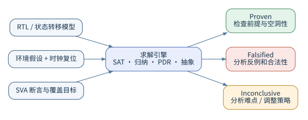

# 形式验证：从数学原理到芯片工程

## 1. 为什么需要形式验证

仿真回答“设计在**本次输入激励**下如何运行”；形式验证尝试回答“对于**满足约束的所有合法输入行为**，设计是否始终符合指定规则”。两者并不互相替代。仿真善于运行长时间系统场景、软件交互和模拟接口；形式验证善于证明局部控制逻辑、协议约束、寄存器访问以及难以用随机激励命中的组合条件。工具搜索到一个能够违反规则的输入与状态序列时，会给出反例；如果建立了有效的数学证明，则给出该属性在所建模型和假设条件下成立的结论。


**典型问题**包括：先进先出缓冲区是否发生上溢和下溢；多路仲裁器能否同时授权两个请求方；复位后控制状态是否正确；握手请求能否在指定期限得到响应；中断是否会在清除之后错误保持；重构后的控制逻辑是否与原设计一致；安全数据能否流向公开端口；未知值是否泄漏到关键控制输出。

**不适合单独依赖形式验证的问题**包括：没有可形式化规格说明的复杂系统行为、第三方模拟器件的模拟特性、未经正确建模的软件运行环境，以及大量没有抽象处理的存储阵列或复杂数据处理导致的计算难题。形式验证的结论取决于模型、约束、属性和工具求解状态。

## 2. 有限状态模型：形式验证究竟检查什么

把一个同步数字模块抽象为状态转移系统：

\[
\mathcal{M}=(S,I,T,S_0),\qquad s_{t+1}=T(s_t,i_t)
\]

其中，\(S\) 为所有寄存器状态的集合，\(I\) 为可用输入，\(T\) 为当前状态与输入决定下一状态的逻辑，\(S_0\) 为**允许的初始状态**。一个安全性属性可以写成：

\[
\forall t\ge0,\ \forall (s_0,i_0,\ldots,i_t)\in\text{LegalTraces},\quad P(s_t,i_t)=1.
\]

这里的 `LegalTraces` 极其重要，它由复位初始条件、输入协议假设、时钟关系和外部环境模型共同限定。属性被证明，不代表“在任何想象中的物理条件下都正确”，只代表**在被建模的所有合法执行轨迹中**成立。如果约束不合理地排除了错误场景，证明结果就可能失去工程价值。

### 2.1 安全性与活性

| 类别 | 要表达的规则 | 示例 | 常见求解关注点 |
| --- | --- | --- | --- |
| 安全性（Safety） | 坏事情永不发生 | 缓冲区满时不得额外写入 | 是否存在有限长度反例 |
| 有界响应 | 事件必须在有限窗口响应 | 请求发生后 1～3 周期出现应答 | 计数范围、复位与连续请求 |
| 活性（Liveness） | 好事情终将发生 | 请求最终被服务 | 公平性、无限执行、死锁和活锁 |
| 可达性（Reachability） | 某状态是否能够到达 | 仲裁状态是否被访问 | 覆盖证明或可达见证 |
| 等价性（Equivalence） | 两个系统的可观测行为一致 | 改写后的设计与参考设计一致 | 输入、状态与延迟关系 |

安全性通常可以由一段有限反例推翻，例如在某一拍出现非法写入；活性失败则可能表现为无限等待，需要考虑环境是否最终允许前进。有界响应把完成期限写入规格，更便于得到有限反例，但不能为降低求解难度而擅自把无期限要求改成任意的周期上限。

有界响应往往容易写成安全性检查；无限期“最终应答”涉及环境是否持续提供条件。例如，如果从设备永远可以拒绝服务，那么主设备无法保证最终完成。不要用无法由本模块控制的假设来证明本模块“有活性”。

### 2.2 关于初始状态与复位

未经初始化的寄存器在形式模型中可能代表任意初始取值。`create_reset` 用于声明复位信号及其极性，`sim_run`、`sim_save_reset` 等命令用于建立与保存可供证明使用的初始化状态，但必须确认复位真正驱动到目标寄存器，而不能假定声明命令自然令所有寄存器变为零。复位后的第一拍、同步/异步复位、部分复位寄存器需要区别处理。参见《VC Formal User Guide》§4.11～4.13（约第 132～154 页）。

## 3. 工具如何找到反例或完成证明

### 3.1 可满足性求解与有界模型检查

对于最大展开深度 \(k\)，可构造：

\[
S_0(s_0) \wedge \bigwedge_{t=0}^{k-1}T(s_t,i_t,s_{t+1})
\wedge \bigvee_{t=0}^{k}\neg P(s_t,i_t).
\]

若可满足，满足赋值对应一条反例；若不可满足，仅能表明在该展开深度内未找到违反，**不能由此推出无限深度已证明**。有界模型检查（Bounded Model Checking，BMC）常适合较短缺陷路径。

### 3.2 数学归纳与增强不变量

归纳证明要求初始时刻性质成立，并证明“假设性质对当前状态成立，则对下一状态也成立”。简单归纳可能因为包含不可达状态而失败，这时可引入更强的不变量（例如缓冲区占用计数与读写指针之间的关系）。归纳深度增加不必然解决证明困难；关键在于性质与状态约束是否充分。

### 3.3 属性引导可达性与其他证明引擎

工业工具可结合 SAT/SMT、归纳、插值、PDR/IC3、抽象及问题分解等多种方法；不同属性和设计结构的性能差异很大。VC Formal 的实际引擎组合与配置由软件版本、应用模式、许可证和资源控制决定，不应把某个求解方法当作该工具唯一的实现。

### 3.4 抽象、分解与可能的误报

只保留某个属性关心的逻辑集合可降低求解规模，这被称为影响锥（Cone of Influence，COI）约简。进一步将乘法器、存储器或内部网络抽象成不完全受原逻辑约束的变量，通常形成更宽泛的行为集合，因此可能产生原始设计并不可能发生的反例。遇到这种反例应检查被抽象的信号与约束，而不是直接修改 RTL。



## 4. 断言、假设与覆盖目标

| 角色 | 表达的责任 | 结果的含义 |
| --- | --- | --- |
| 断言 | 设计必须满足的规则 | 证明所有允许执行都符合规则，或提供反例 |
| 假设 | 环境保证的合法行为 | 限制引擎允许搜索的行为集合 |
| 覆盖 | 希望确认可发生的场景 | 找到至少一条见证路径，或分析其不可达性 |

三种角色可以使用相近的 SVA 语法，但逻辑责任完全不同。把断言改成假设并不修复设计，而是排除所有违反该规则的执行；把断言改成覆盖，则只要求某一条执行符合规则，不能继续声称对全部行为进行了证明。

```systemverilog
// 外部协议确实要求请求期间输入数据有效，才可作为环境前提。
as_request_data: assume property (
    @(posedge clk) disable iff (!rst_n) req |-> valid_input);
// 队列占用计数是设计自身责任，不能把这条关系改成 assume。
ap_occupancy: assert property (
    @(posedge clk) disable iff (!rst_n) count <= DEPTH);
// 确认当前环境允许请求真正出现。
cp_request: cover property (
    @(posedge clk) disable iff (!rst_n) req);
```

如果假设请求永不出现，所有以请求为前件的响应规则都可能空通过。触发覆盖能够揭示这种问题，但覆盖成功仍不足以证明输入假设全部合理：还需要审查请求重叠、背压、错误输入和运行中复位等其他合法情况。有效验证要同时保持真实环境允许的行为，并排除真实环境禁止的行为。

## 5. 结果的工程含义

| 状态 | 能得出的结论 | 不能得出的结论 | 后续动作 |
| --- | --- | --- | --- |
| Proven | 对当前模型、初始状态和假设已经证明 | 系统级规格自动正确 | 审查属性范围、前提和空洞性 |
| Falsified | 存在可触发该属性失败的候选反例 | 一定存在芯片功能缺陷 | 检查反例、假设、复位和抽象 |
| Inconclusive | 在当前资源、策略或时间内尚无明确结论 | 该属性正确或错误 | 缩小问题、调优、延长资源 |
| Covered | 找到了满足覆盖目标的路径 | 设计全部功能受到验证 | 检查路径是否真实且有意义 |
| Uncoverable | 在当前模型和约束下不可到达 | 目标在真实系统里也不可到达 | 检查约束与复位、用例定义 |
| Not run / Disabled | 属性未被验证 | 属性已通过验证 | 检查启用列表和任务配置 |

证明状态只对本次构造的数学模型有效。判断结果时，应把设计版本、初始状态、输入前提、抽象设置与属性正文一起看。特别是覆盖目标的不可达，可能是设计固有行为，也可能是环境约束限制了场景；未完成则表示现有时间和资源还不足以确定结果，不能归入已证明或已失败。

状态名称依应用、版本及报告格式略有变化。不能把“检查结束”、“没有失败条目”、“达到某个深度”直接写成“全部已证明”。工具输出还可能包括 `checking`、`unknown`、`waived` 等管理状态。参见 User Guide §7.1（第 247 页起）。

## 6. 与仿真、静态检查、ATPG、等价检查的区别

| 技术 | 主要目标 | 典型输入 | 典型输出 |
| --- | --- | --- | --- |
| RTL 仿真 | 在给定激励下观察行为 | Testbench、激励、RTL | 波形、断言失败、覆盖率 |
| 规则检查/静态检查 | 查找结构与编码问题 | RTL、规则集 | 报错或告警 |
| 属性形式验证 | 证明逻辑规则或找反例 | RTL、SVA、形式约束 | 证明、反例、未完成 |
| 等价检查 | 比较两个版本 | 参考与实现设计、对应关系 | 等价或差异证据 |
| ATPG | 为制造缺陷模型生成测试向量 | 网表、故障模型、扫描结构 | 测试图样、故障覆盖率 |
| MBIST | 在存储器上运行算法发现制造缺陷 | 存储宏、控制器、March 测试 | 测试结果、故障定位信息 |

这些方法相互补充而不是彼此取代。仿真便于检查复杂软件场景和真实激励，形式验证擅长系统地寻找属性反例，等价检查适合验证实现变换前后的一致性，制造测试向量则针对制造故障模型。选择方法时先说明要排除的错误类型，再决定所需输入和接受条件。

**特别说明：**形式验证与 ATPG 都使用逻辑求解技术，但其目标并不相同。RTL 断言证明不能替代制造测试；ATPG 高故障覆盖率也不能证明功能协议正确。

## 7. 一个完整的思考例子：仲裁器

设计：两个请求 `req[1:0]`，输出授权 `gnt[1:0]`。初步规格：

1. 同一时刻最多有一个授权；
2. 未收到请求的端口不得得到授权；
3. 在持续请求且另一端口有公平竞争条件时，请求不会无限期饥饿；
4. 复位之后授权清零。

最先写的属性通常是：

```systemverilog
ap_no_double_grant: assert property (
  @(posedge clk) disable iff (!rst_n) $onehot0(gnt));
ap_grant_requires_request: assert property (
  @(posedge clk) disable iff (!rst_n) ((gnt & ~req) == 2'b00));
cp_contention: cover property (
  @(posedge clk) disable iff (!rst_n) req == 2'b11);
```

以上第二条**只适用于同周期请求—授权协议**；如果授权允许滞后一拍，则应与 `$past(req)` 或挂起请求记录相匹配。第三条用于防止所有验证都发生在“根本没有竞争”的场景。公平性属性必须考虑仲裁策略、请求是否持续、时钟是否运行以及端口是否能响应，因此不应脱离协议就写出无条件的 `eventually`。

## 8. 从规格到验证的推荐过程

1. 阅读接口规格，列出模块能保证的行为、外部必须保证的条件，以及排除的非法使用方式。
2. 把规则分成复位、功能安全性、进展性、交叉接口、异常处理和参数化条件。
3. 每条规则编写可阅读的自然语言解释、SVA 表达式、触发示例与应失败的反例。
4. 建立时钟、复位、初始状态和必要的输入假设，不要提前把内部状态约束成预期结果。
5. 检查属性是否生效，并利用覆盖目标验证关键触发场景可达。
6. 证明安全性；记录未完成的原因；修正设计后回归全部属性。
7. 以版本化的 RTL、SVA、Tcl、日志、结果报告和豁免说明组成可复现的结果包。

详见 [验证工程与结果判读](验证工程与结果判读.md)。

## 9. 初学者常见误解

**“我有 100% 代码覆盖率，所以所有功能都正确。”** 代码覆盖率描述哪些代码结构被执行，不等同于正确性。**“模型只要能跑出 Proven 就代表覆盖完整。”** 属性可能遗漏关键规格或触发条件不可达。**“形式验证不需要 Testbench。”** 虽然不必使用传统仿真激励，仍需通过假设、状态初始化和环境模型定义合法行为。**“加入假设后证明更快一定是好事。”** 如果假设屏蔽关键场景，速度提高反而意味着可信度下降。**“每个未完成都表示工具有问题。”** 更多时候是属性范围、运算规模、状态空间或外部环境模型仍需优化。

## 10. 本手册学习索引与参考依据

- SVA 系统教材：[SVA语法合集.md](SVA语法合集.md)。
- 工具共性：[VC_Formal_平台与环境.md](VC_Formal_平台与环境.md)、[验证工程与结果判读.md](验证工程与结果判读.md)。
- 首次动手：[FPV.md](FPV.md)、[案例工程/README.md](案例工程/README.md)。
- 实战进阶：[调试与证明性能.md](调试与证明性能.md)、[覆盖与验证验收.md](覆盖与验证验收.md)。
- 官方版本参考：用户提供的 *VC Formal User Guide*, X-2025.06-SP1，§1、§3、§4、§6、§7、§17、§18；以及 *VC Formal Quick Reference Guide* 同版本。版权属于 Synopsys，本文为独立撰写的中文学习教程，不是官方文件的逐页翻译。
